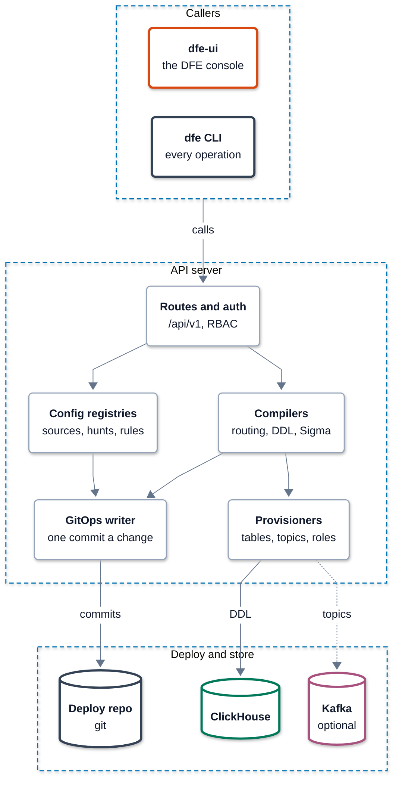
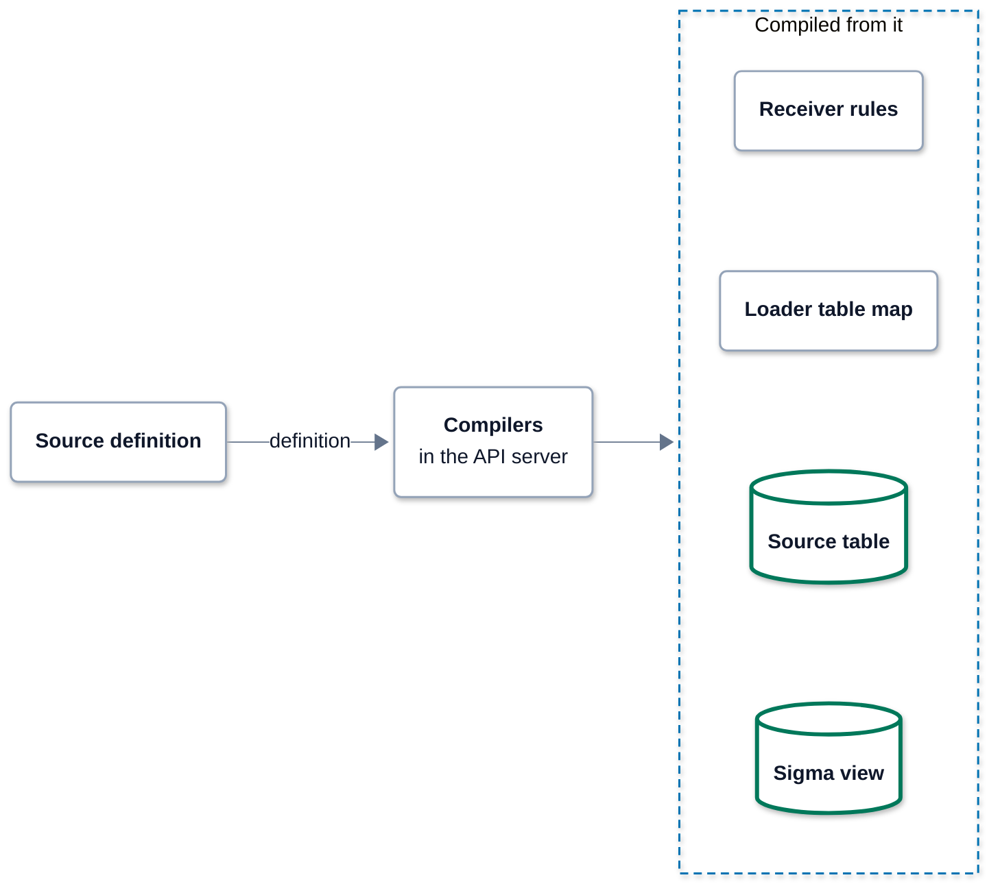
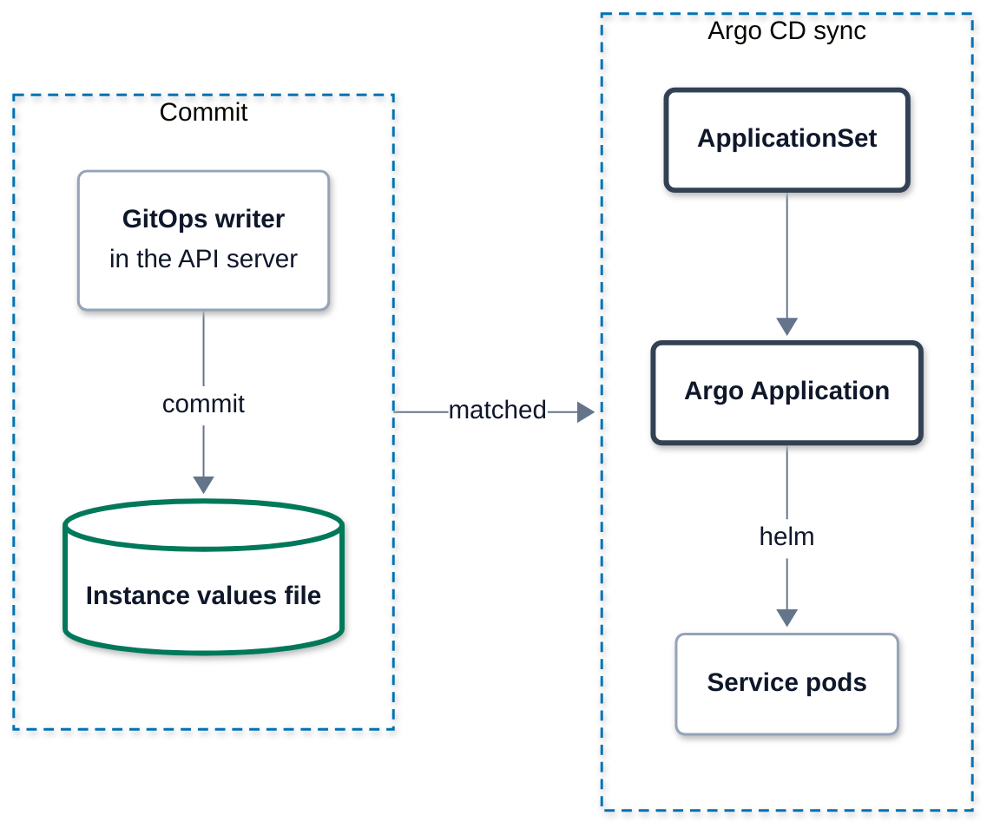

# API server

The API server is the part of [dfe-engine](architecture.md) that every operator change goes through: it keeps the deployment's config, compiles what the data apps read, and applies it.

| | |
|---|---|
| Repo | [hyperi-io/dfe-engine](https://github.com/hyperi-io/dfe-engine) |
| Image and chart | `ghcr.io/hyperi-io/dfe-engine`, entry point `dfe-engine`. Chart `oci://ghcr.io/hyperi-io/charts/dfe-engine` |
| Config reference | `DFE_ENGINE_` environment variables, `src/dfe_engine/settings.py` |
| Endpoints | `:8000` the API under `/api/v1` ([route map](reference/api-route-map.md)). `:9090` `/livez`, `/readyz` and `/metrics` |
| Metrics | Prometheus `/metrics` and OTLP, names prefixed `dfe_` ([observability standard](deployment/observability-standard.md)) |

Every change enters through the routes and leaves as a commit or as DDL.

*Figure 1. L3 Components -- API server. The dotted arrow runs only where the deployment has Kafka.* Up: [L2 Services -- dfe-engine](architecture.md). Down: none.

## How it works

1. Routes and auth authenticate the request by trusted OIDC headers, an API key or a bearer token, and check its RBAC scope.
2. The config registries read and write sources, hunts, rules, field maps, governance and app overlays. With GitOps on they live in the deploy repo, otherwise in directories under `DFE_CONFIG_DIR`.
3. The compilers turn a source into the receiver's routing rules, the loader's table map, the table's DDL and its Sigma view. Behind the `sigma.enabled` beta, off by default, they turn Sigma rules into SQL ([#887](https://github.com/hyperi-io/dfe-engine/issues/887)).
4. The GitOps writer makes one attributed commit per change.
5. The provisioners apply the dfe-schemas manifest and each source's table, create Kafka topics, and keep the dfe-hyperdx sources and the ClickHouse roles and row policies in step.

A source definition carries its routing rule, schema binding and field maps together, and every stage reads what is compiled from it.

*Figure 2. L4 Detail -- One source definition, compiled.* Up: [L3 Components -- API server](api-server.md).

The `<table>_sigma` view projects the source's columns under Sigma field names for detection. Routing that disagrees with the sources is reported as drift and re-synced.

## Interfaces

- Inbound: HTTP on port 8000. The dfe CLI and dfe-ui's types are both generated from the OpenAPI specs in `openapi/`.
- Deploy repo: app overlays in `values/`, backing-service overlays in `infra/`, governance in `governance/`, and with GitOps on the sources in `config/sources/` and the hunts and rules in `config/hunts/` and `config/rules/`. GitHub, GitLab or the in-cluster Forgejo.
- ClickHouse: DDL, roles and row policies. The engine is the only thing that creates ClickHouse objects.
- Kafka: topic creation, on tiers that run Kafka.
- dfe-hyperdx: the sources the Observe view queries.

Adding a service instance is a commit of one values file. dfe-infra's ApplicationSet turns each file into one Argo CD Application.

*Figure 3. L4 Detail -- Instance deploy path.* Up: [L3 Components -- API server](api-server.md).

The file is `values/<service>-<instance>-values.yaml`, and dfe-infra's git-files ApplicationSet (`argocd/appsets/layer2-apps.yaml`) matches it. Removing the file removes the app. An instance removed while its source still exists keeps its files in `values/<service>-<instance>-parked.yaml`, which the glob does not match, and its next deploy restores them.

## Scaling and failure

- Nothing on the data path or the hunt path calls it, so an API server that is down delays config changes and nothing else.
- A write that names the revision it read in `If-Match` gets `409 Conflict` with the current document when that revision is stale. A write with no `If-Match` is not checked.
- With no ClickHouse at start it waits up to 180 seconds for the schema bootstrap (`DFE_ENGINE_CLICKHOUSE_BOOTSTRAP_WAIT_SECONDS`), then serves with `/readyz` reporting `clickhouse: false`.
- The engine reports what it committed. Argo CD, and any approval gate, decides when it is live.

## Key metrics

`/readyz` reports `clickhouse: false` while ClickHouse is unreachable. `api_bearer_tokens_refused_total{reason}` counts refused bearer tokens. The [observability standard](deployment/observability-standard.md) lists the rest.

## Related

- [Control plane](control-plane/README.md): governed GitOps, RBAC and OIDC in depth.
- [Source definition](data-plane/source-definition.md) and [schema](data-plane/schema.md).
- [Deployment](deployment/README.md): the tiers and the deploy-repo providers.
