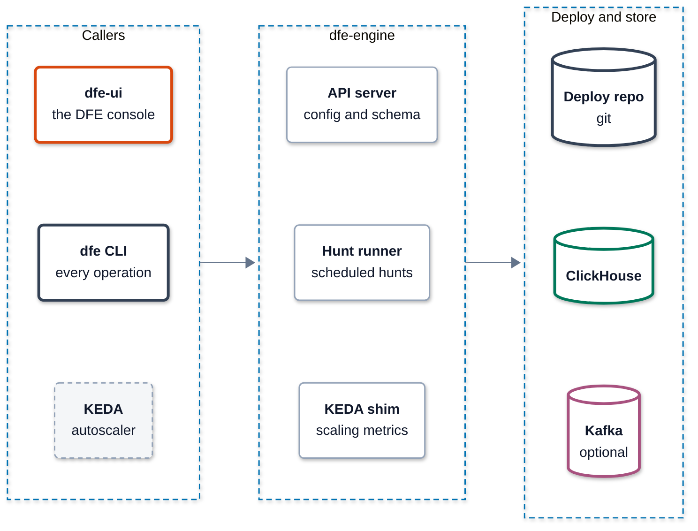

# dfe-engine architecture

dfe-engine is DFE's control plane: it turns an operator's change into a commit in the deployment's git repo, applies the ClickHouse schema and runs the scheduled hunts. Records never pass through it, because the engine only decides how the receiver, loader and the other data apps are configured.

*Figure 1. L2 Services -- dfe-engine. The dashed grey box is outside DFE.* Up: [L2 Services -- DFE](https://github.com/hyperi-io/dfe-infra/blob/main/docs/architecture.md). Down: [L3 Components -- API server](api-server.md), [L3 Components -- Hunt runner](hunt-runner.md).

## How data flows

1. dfe-ui and the dfe CLI call the API server on port 8000. The CLI is generated from the API's OpenAPI spec. Its `local` and `schema` groups work with no engine running, as the break-glass path.
2. The API server writes each change as one attributed commit to the deploy repo, and Argo CD syncs the repo into the cluster. A commit is not a deployment: an organisation's approval gate can sit between the commit and the sync.
3. The API server applies ClickHouse DDL itself, the dfe-schemas manifest at every start and a source's table when that source is deployed. On a tier with Kafka it creates the topics too.
4. The hunt runner reads hunts and rules from the deploy repo through a git-sync sidecar. It runs them inside ClickHouse, writes the matches to a detection table and sends an alert for each fire that matched.
5. KEDA polls the KEDA shim, which answers from ClickHouse. Scaling never waits on the API server.

## Components

| Part | Role | Page |
|---|---|---|
| API server | The registries, compilers, GitOps writer and provisioners behind `/api/v1` | [API server](api-server.md) |
| Hunt runner | Runs scheduled hunts in ClickHouse, coordinated through leases in ClickHouse | [Hunt runner](hunt-runner.md) |
| KEDA shim | Answers KEDA's `metrics-api` scaler from ClickHouse, and holds its last good value when a query fails | none |
| dfe CLI | Every API operation from a terminal, plus the offline `local` and `schema` groups | none |

All four ship in one image, `ghcr.io/hyperi-io/dfe-engine`, as the entry points `dfe-engine`, `dfe-hunt-runner`, `dfe-keda-shim` and `dfe` (`pyproject.toml`, `[project.scripts]`). The engine chart renders the API server. dfe-infra's `dfe-extras` chart renders the hunt runner and the shim as their own pods.

## External dependencies

| Dependency | Needed | Choices |
|---|---|---|
| ClickHouse | Always | In-cluster single node or cluster, or an external server |
| Git host for the deploy repo | On Kubernetes | GitHub, GitLab, or the in-cluster Forgejo |
| Argo CD | On Kubernetes | Installed by dfe-infra, or an existing one adopted |
| Secrets backend | Always | `file` (default), OpenBao or Vault, or AWS Secrets Manager (`DFE_ENGINE_SECRETS_PROVIDER`) |
| Kafka | single and scale tiers | In-cluster broker or cluster |
| Identity provider | When OIDC sign-in is on | Any OIDC provider. Local accounts and API keys need none |
| KEDA | When autoscaling is on | Installed by dfe-infra |
| Alert destinations | When a hunt names one | Any Apprise URL: Slack, email, PagerDuty, Teams and others |

## Deployment variants

| Variant | What changes for the engine |
|---|---|
| Docker (dfe-docker) | No Argo CD and no KEDA shim. The engine commits to a local deploy repo in its config volume |
| slim | No Kafka, so every source uses the direct gRPC transport. Saving a source that needs a fetcher or a transform is refused |
| single | Kafka with one broker. The engine creates each source's topics |
| scale | ClickHouse is a cluster, so the hunt coordination tables are replicated across its nodes |

Each tier sets defaults, and a deployer overrides any one dial in the deploy repo's overlay. The hunt runner is one steady pod on every Kubernetes tier. [Deployment](deployment/README.md) has the full composition per tier.

## Design considerations

- Security. A request is authenticated by trusted OIDC headers, an API key or an ES384 bearer token, then checked against scoped RBAC. ClickHouse roles and row policies, which the engine provisions, keep each organisation to its own rows. A secret the engine mints lives in the secrets backend, and the API masks it on every read.
- Reliability. With the API server down, the data path, the hunt runner and the shim keep running, because each needs only ClickHouse. A runner or shim pod that is starting waits for the engine, which applies the schema at its own start. A write that names the revision it read (`If-Match`) gets `409 Conflict` when the file has changed, so a human or CI edit is never overwritten.
- Operations. The git history is the audit log. `/livez`, `/readyz` and `/metrics` answer on port 9090, apart from API traffic. Compiled routing that disagrees with the sources is reported as drift and re-synced.
- Performance. Hunt load runs in ClickHouse, so one runner pod covers most deployments. Per-fire caps keep a flood of matches to a bounded write.

## Why it's built this way

- Config is YAML in git, with no config database. It is reviewable and versioned, the Rust services read the files directly, and an operator can manage the system by editing the repo when the engine and UI are down.
- The engine writes config and never installs infrastructure. dfe-infra deploys the backing services and owns the Argo CD ApplicationSets. The one thing the engine applies itself is ClickHouse DDL, because it controls every ClickHouse object.
- A source is defined once. The receiver's routing rules, the loader's table map, the source's table and its Sigma view are all compiled from that definition, so there is no separate ETL config to drift out of step.
- ClickHouse is the only operational store. Hunt results, watermarks and leases all live there, so the runner works the same on Docker, where ClickHouse is the only store guaranteed.
- The hunt runner and the shim are separate pods on the engine image. Neither puts the API server on a hot path, and neither stops when it does.
- A file's name is its identity, never a field inside it. YAML 1.1 reads `off`, `yes` and `no` as booleans, so an id inside the file is not safe.

## Diagram map

- Figure 1. L2 Services -- dfe-engine, on this page
  - [L3 Components -- API server](api-server.md)
    - [L4 Detail -- One source definition, compiled](api-server.md#how-it-works)
    - [L4 Detail -- Instance deploy path](api-server.md#interfaces)
  - [L3 Components -- Hunt runner](hunt-runner.md)

## What's next

- Configuration: every setting is a `DFE_ENGINE_` environment variable, listed in `src/dfe_engine/settings.py` and the [README](../README.md#configuration).
- [Running dfe-engine locally](local-dev.md).
- [Control plane](control-plane/README.md): the API, auth, RBAC and governed GitOps.
- [Data plane](data-plane/README.md): sources, schemas, the query API and hunts.
- [Deployment](deployment/README.md), including [KEDA scaling](deployment/keda-scaling.md), which covers the shim's queries.
- [CONTRIBUTING.md](../CONTRIBUTING.md#context): where the code lives and what tends to bite.
