# DFE architecture

DFE is a deployable product suite: event-data ingest, ClickHouse storage,
scheduled detection, and exploration, all governed through one git-backed
control plane. This page is the map - where each repo sits, the two principles
that define the system, the invariants, and links into the depth docs.

The depth docs:

| Area | Start at | Covers |
|------|----------|--------|
| Control-plane surface | [control-plane/README.md](control-plane/README.md) | governed ops, gitops commit standard, RBAC, OIDC, CLI, UI API, type-safety sync |
| Data plane | [data-plane/README.md](data-plane/README.md) | sources, schemas, field mapping, CEL, query API, hunts |
| Deployment | [deployment/README.md](deployment/README.md) | tiers + composition, backing services, KEDA, observability, supply-chain pinning, e2e acceptance |
| Integrations | [integrations/README.md](integrations/README.md) | dfe-ui guide, and where the dfe-hyperdx fork runbook lives |
| Archive | [archive/README.md](archive/README.md) | superseded research + snapshots, kept for the decision trail |

Edge auth: [auth-envoy-topology.md](auth-envoy-topology.md).

## Where the engine sits in the suite

dfe-engine is the control plane: a Python library and FastAPI server that turns
operator changes into git commits Argo CD syncs into the cluster, and applies the
ClickHouse DDL itself. Operators call the engine through dfe-ui and the CLI, and the engine commits to the deploy repo that Argo CD syncs.

```mermaid
---
config:
  theme: base
  look: neo
  fontFamily: Inter, -apple-system, Segoe UI, Roboto, Helvetica, Arial, sans-serif
  flowchart:
    curve: linear
    nodeSpacing: 40
    rankSpacing: 64
    padding: 18
    wrappingWidth: 280
    htmlLabels: true
  elk:
    preset: modelOrder
  themeVariables:
    fontSize: 15px
    lineColor: "#64748B"
    primaryTextColor: "#0F172A"
    clusterBorder: "#0072B2"
    edgeLabelBackground: "#FFFFFF"
  themeCSS: >-
    p{margin:0}
    .node[data-look] rect,.node[data-look] path,.node[data-look] polygon,.node[data-look] .outer-path{filter:drop-shadow(0 1px 2px rgba(15,23,42,.10)) drop-shadow(0 6px 14px rgba(15,23,42,.10))}
    .node rect{rx:10px;ry:10px}
    .cluster rect{rx:16px;ry:16px}
    .node .label div{min-width:150px}
    .node.decision .label div{min-width:0}
    .cluster[data-look] rect{filter:none}
    .nodeLabel{line-height:1.35}
    .nodeLabel b{font-weight:600;font-size:15px;letter-spacing:-0.01em}
    .nodeLabel span{font-size:12.5px;font-weight:400;color:#334155}
    .cluster-label span.nodeLabel{display:inline-block;background:#FFFFFF;color:#0B2A3F;border:1.5px solid #0072B2;border-radius:999px;padding:2px 12px;font-size:11.5px;font-weight:700;letter-spacing:.09em;text-transform:uppercase}
    .flowchart-link{stroke-width:1.75px}
    .labelBkg{background:transparent!important}
    span.edgeLabel{display:inline-block;background:#FFFFFF!important;color:#1E293B;border:1px solid #94A3B8;border-radius:999px;padding:2px 10px;font-size:12px;font-weight:500}
    span.edgeLabel p{background:transparent!important}
    .label-icon{width:20px;height:20px;vertical-align:-4px;margin-right:6px}
    .ingest .label-icon{color:#0E8A7D}
    .xform .label-icon{color:#7B4FB0}
    .load .label-icon{color:#0072B2}
    .bus .label-icon{color:#A8517F}
    .store .label-icon{color:#00785A}
    .ui .label-icon{color:#D9480F}
    .ext .label-icon{color:#64748B}
---
flowchart LR
  accTitle: L2 Services -- DFE
  accDescr: Operators call dfe-engine through dfe-ui and the dfe CLI. The engine commits config to the deploy repo and applies DDL to ClickHouse. Argo CD syncs the deploy repo into the runtime services.

  subgraph clients["Clients"]
    ui["<b>dfe-ui</b>"]
    cli["<b>dfe CLI</b>"]
  end

  engine[["<b>dfe-engine</b>"]]
  repo[("<b>Deploy repo</b>")]
  ch[("<b>ClickHouse</b>")]
  argo["<b>Argo CD</b>"]
  runtime["<b>Runtime services</b>"]

  clients -->|calls| engine
  engine -->|commits| repo
  engine -->|DDL| ch
  repo --> argo
  argo -->|helm| runtime
  classDef ext fill:#F4F6F8,stroke:#94A3B8,stroke-width:1.5px,stroke-dasharray:5 4,color:#0F172A
  classDef ingest fill:#FFFFFF,stroke:#0E8A7D,stroke-width:3px,color:#0F172A
  classDef xform fill:#FFFFFF,stroke:#7B4FB0,stroke-width:3px,color:#0F172A
  classDef load fill:#FFFFFF,stroke:#0072B2,stroke-width:3px,color:#0F172A
  classDef bus fill:#FFFFFF,stroke:#A8517F,stroke-width:3px,color:#0F172A
  classDef store fill:#FFFFFF,stroke:#00785A,stroke-width:3px,color:#0F172A
  classDef ui fill:#FFFFFF,stroke:#D9480F,stroke-width:3px,color:#0F172A
  classDef decision fill:#FFFFFF,stroke:#9A6700,stroke-width:3px,color:#0F172A
  classDef error fill:#FFFFFF,stroke:#C2410C,stroke-width:3px,color:#0F172A
  classDef control fill:#FFFFFF,stroke:#334155,stroke-width:3px,color:#0F172A
  classDef part fill:#FFFFFF,stroke:#94A3B8,stroke-width:1.5px,color:#0F172A
  class ch store
  class ui ui
  class cli,engine,repo,argo control
  class runtime part
  style clients fill:none,stroke:#0072B2,stroke-width:1.5px,stroke-dasharray:6 4
```

*Figure 1. L2 Services -- DFE.* Up: top of dfe-engine. Down: [L3 Components -- dfe-engine](#inside-the-engine).

Argo CD also reads dfe-infra's charts. The runtime services write to ClickHouse, and dfe-hyperdx, embedded in dfe-ui, reads it.

| Repo | Role | Relationship to the engine |
|------|------|---------------------------|
| dfe-engine | config control plane + API server | the engine itself |
| dfe-infra | charts, ApplicationSets, bootstrap | consumes engine-authored overlays via the deploy repo |
| dfe-ui | web UI | calls the engine API and nothing else |
| dfe-hyperdx | the Observe view: our extended fork of the upstream HyperDX project, explore UI + telemetry sink | embedded in dfe-ui, reads ClickHouse |
| dfe-schemas | every table, view, role and bootstrap topic, plus the apply manifest | where they are defined, and nowhere else. The engine applies the manifest at boot ([schema bootstrap](data-plane/schema-bootstrap.md)) |
| scalo-py / scalo-rs | shared libraries (neutral-identity OSS) | engine imports scalo-py, Rust services import scalo-rs |
| dfe-receiver/loader/archiver/fetcher/transform-* | Rust runtime services | read YAML config the engine writes |
| dfe-deploy | example deploy/overlay repo | the GitOps hand-off surface |

An event goes from the receiver through Kafka to the loader and the archiver.

```mermaid
---
config:
  theme: base
  look: neo
  fontFamily: Inter, -apple-system, Segoe UI, Roboto, Helvetica, Arial, sans-serif
  flowchart:
    curve: linear
    nodeSpacing: 40
    rankSpacing: 64
    padding: 18
    wrappingWidth: 280
    htmlLabels: true
  elk:
    preset: modelOrder
  themeVariables:
    fontSize: 15px
    lineColor: "#64748B"
    primaryTextColor: "#0F172A"
    clusterBorder: "#0072B2"
    edgeLabelBackground: "#FFFFFF"
  themeCSS: >-
    p{margin:0}
    .node[data-look] rect,.node[data-look] path,.node[data-look] polygon,.node[data-look] .outer-path{filter:drop-shadow(0 1px 2px rgba(15,23,42,.10)) drop-shadow(0 6px 14px rgba(15,23,42,.10))}
    .node rect{rx:10px;ry:10px}
    .cluster rect{rx:16px;ry:16px}
    .node .label div{min-width:150px}
    .node.decision .label div{min-width:0}
    .cluster[data-look] rect{filter:none}
    .nodeLabel{line-height:1.35}
    .nodeLabel b{font-weight:600;font-size:15px;letter-spacing:-0.01em}
    .nodeLabel span{font-size:12.5px;font-weight:400;color:#334155}
    .cluster-label span.nodeLabel{display:inline-block;background:#FFFFFF;color:#0B2A3F;border:1.5px solid #0072B2;border-radius:999px;padding:2px 12px;font-size:11.5px;font-weight:700;letter-spacing:.09em;text-transform:uppercase}
    .flowchart-link{stroke-width:1.75px}
    .labelBkg{background:transparent!important}
    span.edgeLabel{display:inline-block;background:#FFFFFF!important;color:#1E293B;border:1px solid #94A3B8;border-radius:999px;padding:2px 10px;font-size:12px;font-weight:500}
    span.edgeLabel p{background:transparent!important}
    .label-icon{width:20px;height:20px;vertical-align:-4px;margin-right:6px}
    .ingest .label-icon{color:#0E8A7D}
    .xform .label-icon{color:#7B4FB0}
    .load .label-icon{color:#0072B2}
    .bus .label-icon{color:#A8517F}
    .store .label-icon{color:#00785A}
    .ui .label-icon{color:#D9480F}
    .ext .label-icon{color:#64748B}
---
flowchart LR
  accTitle: L4 Detail -- Event path
  accDescr: Log shippers send events to dfe-receiver, which routes them to Kafka topics. dfe-loader writes them to ClickHouse and dfe-archiver writes them to object storage.

  shippers["<b>Log shippers</b>"]
  receiver["<b>dfe-receiver</b>"]
  topics[("<b>Kafka topics</b>")]

  subgraph readers["Topic readers"]
    loader["<b>dfe-loader</b>"]
    archiver["<b>dfe-archiver</b>"]
  end

  subgraph stores["Stores"]
    ch[("<b>ClickHouse</b>")]
    bucket[("<b>Object storage</b>")]
  end

  shippers -->|events| receiver
  receiver -->|routed| topics
  topics --> readers
  readers --> stores
  classDef ext fill:#F4F6F8,stroke:#94A3B8,stroke-width:1.5px,stroke-dasharray:5 4,color:#0F172A
  classDef ingest fill:#FFFFFF,stroke:#0E8A7D,stroke-width:3px,color:#0F172A
  classDef xform fill:#FFFFFF,stroke:#7B4FB0,stroke-width:3px,color:#0F172A
  classDef load fill:#FFFFFF,stroke:#0072B2,stroke-width:3px,color:#0F172A
  classDef bus fill:#FFFFFF,stroke:#A8517F,stroke-width:3px,color:#0F172A
  classDef store fill:#FFFFFF,stroke:#00785A,stroke-width:3px,color:#0F172A
  classDef ui fill:#FFFFFF,stroke:#D9480F,stroke-width:3px,color:#0F172A
  classDef decision fill:#FFFFFF,stroke:#9A6700,stroke-width:3px,color:#0F172A
  classDef error fill:#FFFFFF,stroke:#C2410C,stroke-width:3px,color:#0F172A
  classDef control fill:#FFFFFF,stroke:#334155,stroke-width:3px,color:#0F172A
  classDef part fill:#FFFFFF,stroke:#94A3B8,stroke-width:1.5px,color:#0F172A
  class shippers ext
  class receiver ingest
  class loader,archiver load
  class topics bus
  class ch,bucket store
  style readers fill:none,stroke:#0072B2,stroke-width:1.5px,stroke-dasharray:6 4
  style stores fill:none,stroke:#0072B2,stroke-width:1.5px,stroke-dasharray:6 4
```

*Figure 6. L4 Detail -- Event path. The dashed grey box is outside DFE.* Up: [L2 Services -- DFE](#where-the-engine-sits-in-the-suite).

The loader writes to ClickHouse and the archiver to object storage. With no broker, the receiver pushes to them over gRPC instead. The hunt runner, dfe-hyperdx and the query API read ClickHouse.

Matched rows are written at full fidelity up to `hunts.max_detections_per_run`
per rule, and past it the runner writes one summary row. When a hunt names an alert
destination, the runner sends one message per fire that matched. There is no
alert grouping or cooldown.

## The two principles that define DFE

The first is orchestration over infra: helm through Argo, never hands on the
cluster. The engine makes every operational change as a governed git commit of
compiled Helm overlay values, and Argo CD reconciles the cluster to match. The
one thing it applies itself is ClickHouse DDL. The engine never deploys backing
services, never authors Argo Applications, and never claims a commit is live
(an org-specific approval gate may sit between commit and sync). One committed values file becomes one Argo Application and its pods.

```mermaid
---
config:
  theme: base
  look: neo
  fontFamily: Inter, -apple-system, Segoe UI, Roboto, Helvetica, Arial, sans-serif
  flowchart:
    curve: linear
    nodeSpacing: 40
    rankSpacing: 64
    padding: 18
    wrappingWidth: 280
    htmlLabels: true
  elk:
    preset: modelOrder
  themeVariables:
    fontSize: 15px
    lineColor: "#64748B"
    primaryTextColor: "#0F172A"
    clusterBorder: "#0072B2"
    edgeLabelBackground: "#FFFFFF"
  themeCSS: >-
    p{margin:0}
    .node[data-look] rect,.node[data-look] path,.node[data-look] polygon,.node[data-look] .outer-path{filter:drop-shadow(0 1px 2px rgba(15,23,42,.10)) drop-shadow(0 6px 14px rgba(15,23,42,.10))}
    .node rect{rx:10px;ry:10px}
    .cluster rect{rx:16px;ry:16px}
    .node .label div{min-width:150px}
    .node.decision .label div{min-width:0}
    .cluster[data-look] rect{filter:none}
    .nodeLabel{line-height:1.35}
    .nodeLabel b{font-weight:600;font-size:15px;letter-spacing:-0.01em}
    .nodeLabel span{font-size:12.5px;font-weight:400;color:#334155}
    .cluster-label span.nodeLabel{display:inline-block;background:#FFFFFF;color:#0B2A3F;border:1.5px solid #0072B2;border-radius:999px;padding:2px 12px;font-size:11.5px;font-weight:700;letter-spacing:.09em;text-transform:uppercase}
    .flowchart-link{stroke-width:1.75px}
    .labelBkg{background:transparent!important}
    span.edgeLabel{display:inline-block;background:#FFFFFF!important;color:#1E293B;border:1px solid #94A3B8;border-radius:999px;padding:2px 10px;font-size:12px;font-weight:500}
    span.edgeLabel p{background:transparent!important}
    .label-icon{width:20px;height:20px;vertical-align:-4px;margin-right:6px}
    .ingest .label-icon{color:#0E8A7D}
    .xform .label-icon{color:#7B4FB0}
    .load .label-icon{color:#0072B2}
    .bus .label-icon{color:#A8517F}
    .store .label-icon{color:#00785A}
    .ui .label-icon{color:#D9480F}
    .ext .label-icon{color:#64748B}
---
flowchart LR
  accTitle: L4 Detail -- Instance deploy path
  accDescr: dfe-engine commits an instance values file to the deploy repo. dfe-infra's ApplicationSet makes one Argo Application per values file, which renders the app's chart into service pods.

  engine[["<b>dfe-engine</b>"]]
  values[("<b>Instance values file</b>")]
  appset["<b>ApplicationSet</b>"]
  app["<b>Argo Application</b>"]
  pods["<b>Service pods</b>"]

  engine -->|commit| values
  values -->|matched| appset
  appset --> app
  app -->|helm| pods
  classDef ext fill:#F4F6F8,stroke:#94A3B8,stroke-width:1.5px,stroke-dasharray:5 4,color:#0F172A
  classDef ingest fill:#FFFFFF,stroke:#0E8A7D,stroke-width:3px,color:#0F172A
  classDef xform fill:#FFFFFF,stroke:#7B4FB0,stroke-width:3px,color:#0F172A
  classDef load fill:#FFFFFF,stroke:#0072B2,stroke-width:3px,color:#0F172A
  classDef bus fill:#FFFFFF,stroke:#A8517F,stroke-width:3px,color:#0F172A
  classDef store fill:#FFFFFF,stroke:#00785A,stroke-width:3px,color:#0F172A
  classDef ui fill:#FFFFFF,stroke:#D9480F,stroke-width:3px,color:#0F172A
  classDef decision fill:#FFFFFF,stroke:#9A6700,stroke-width:3px,color:#0F172A
  classDef error fill:#FFFFFF,stroke:#C2410C,stroke-width:3px,color:#0F172A
  classDef control fill:#FFFFFF,stroke:#334155,stroke-width:3px,color:#0F172A
  classDef part fill:#FFFFFF,stroke:#94A3B8,stroke-width:1.5px,color:#0F172A
  class values store
  class engine,appset,app control
  class pods part
```

*Figure 2. L4 Detail -- Instance deploy path.* Up: [L2 Services -- DFE](#where-the-engine-sits-in-the-suite).

Adding a service instance is a git write of one
`values/<service>-<instance>-values.yaml` file. dfe-infra's git-files
ApplicationSet (`argocd/appsets/layer2-apps.yaml`) makes one Argo Application per
values file. Removing the file removes the app. The engine declares instances.
The appset deploys them.
An instance removed while its source still exists leaves the files authored into it in `values/<service>-<instance>-parked.yaml`, which the glob does not match, and its next deploy restores them.
Depth: [deployment/README.md](deployment/README.md) and
[control-plane/governed-ops-design.md](control-plane/governed-ops-design.md).

The second is close coupling of source, ingest, schema and transform, where
other stacks run separate ETL. Traditional pipelines split ingest, schema management, and transformation
across separate tools with separate config stores that drift apart. DFE keeps
them one artifact: a source definition carries the routing rule, the schema
binding, and the field-map bindings together, and every runtime stage reads
what the engine compiles from it. One definition compiles to the receiver's rules, the loader's table map, the table and its Sigma view.

```mermaid
---
config:
  theme: base
  look: neo
  fontFamily: Inter, -apple-system, Segoe UI, Roboto, Helvetica, Arial, sans-serif
  flowchart:
    curve: linear
    nodeSpacing: 40
    rankSpacing: 64
    padding: 18
    wrappingWidth: 280
    htmlLabels: true
  elk:
    preset: modelOrder
  themeVariables:
    fontSize: 15px
    lineColor: "#64748B"
    primaryTextColor: "#0F172A"
    clusterBorder: "#0072B2"
    edgeLabelBackground: "#FFFFFF"
  themeCSS: >-
    p{margin:0}
    .node[data-look] rect,.node[data-look] path,.node[data-look] polygon,.node[data-look] .outer-path{filter:drop-shadow(0 1px 2px rgba(15,23,42,.10)) drop-shadow(0 6px 14px rgba(15,23,42,.10))}
    .node rect{rx:10px;ry:10px}
    .cluster rect{rx:16px;ry:16px}
    .node .label div{min-width:150px}
    .node.decision .label div{min-width:0}
    .cluster[data-look] rect{filter:none}
    .nodeLabel{line-height:1.35}
    .nodeLabel b{font-weight:600;font-size:15px;letter-spacing:-0.01em}
    .nodeLabel span{font-size:12.5px;font-weight:400;color:#334155}
    .cluster-label span.nodeLabel{display:inline-block;background:#FFFFFF;color:#0B2A3F;border:1.5px solid #0072B2;border-radius:999px;padding:2px 12px;font-size:11.5px;font-weight:700;letter-spacing:.09em;text-transform:uppercase}
    .flowchart-link{stroke-width:1.75px}
    .labelBkg{background:transparent!important}
    span.edgeLabel{display:inline-block;background:#FFFFFF!important;color:#1E293B;border:1px solid #94A3B8;border-radius:999px;padding:2px 10px;font-size:12px;font-weight:500}
    span.edgeLabel p{background:transparent!important}
    .label-icon{width:20px;height:20px;vertical-align:-4px;margin-right:6px}
    .ingest .label-icon{color:#0E8A7D}
    .xform .label-icon{color:#7B4FB0}
    .load .label-icon{color:#0072B2}
    .bus .label-icon{color:#A8517F}
    .store .label-icon{color:#00785A}
    .ui .label-icon{color:#D9480F}
    .ext .label-icon{color:#64748B}
---
flowchart LR
  accTitle: L4 Detail -- One source definition, compiled
  accDescr: A source definition goes to dfe-engine, which compiles the receiver's rules, the loader's table map, the source's table and its Sigma view from it.

  src["<b>Source definition</b>"]
  engine[["<b>dfe-engine</b>"]]

  subgraph out["Compiled from it"]
    direction LR
    rules["<b>Receiver rules</b>"]
    tablemap["<b>Loader table map</b>"]
    table[("<b>Source table</b>")]
    view[("<b>Sigma view</b>")]
    rules ~~~ tablemap ~~~ table ~~~ view
  end

  src -->|definition| engine
  engine --> out
  classDef ext fill:#F4F6F8,stroke:#94A3B8,stroke-width:1.5px,stroke-dasharray:5 4,color:#0F172A
  classDef ingest fill:#FFFFFF,stroke:#0E8A7D,stroke-width:3px,color:#0F172A
  classDef xform fill:#FFFFFF,stroke:#7B4FB0,stroke-width:3px,color:#0F172A
  classDef load fill:#FFFFFF,stroke:#0072B2,stroke-width:3px,color:#0F172A
  classDef bus fill:#FFFFFF,stroke:#A8517F,stroke-width:3px,color:#0F172A
  classDef store fill:#FFFFFF,stroke:#00785A,stroke-width:3px,color:#0F172A
  classDef ui fill:#FFFFFF,stroke:#D9480F,stroke-width:3px,color:#0F172A
  classDef decision fill:#FFFFFF,stroke:#9A6700,stroke-width:3px,color:#0F172A
  classDef error fill:#FFFFFF,stroke:#C2410C,stroke-width:3px,color:#0F172A
  classDef control fill:#FFFFFF,stroke:#334155,stroke-width:3px,color:#0F172A
  classDef part fill:#FFFFFF,stroke:#94A3B8,stroke-width:1.5px,color:#0F172A
  class table,view store
  class engine control
  class src,rules,tablemap part
  style out fill:none,stroke:#0072B2,stroke-width:1.5px,stroke-dasharray:6 4
```

*Figure 3. L4 Detail -- One source definition, compiled.* Up: [L3 Components -- dfe-engine](#inside-the-engine).

One definition, read by every stage: the receiver routes an event by the
source's match rule, the loader writes it to that source's table, and the
`<table>_sigma` view projects the same columns under Sigma field names for
detection (`services/source_routing.py`, `schema/schema_ddl.py`). Routing that
disagrees with the sources is reported as drift and re-synced
(`appmgmt/routing.py`), so there is no separate ETL config to fall out of step.
Depth: [data-plane/README.md](data-plane/README.md).

## The control pyramid

The control path has four layers, each a narrower window onto the one below. The API is the single
control plane: dfe-ui and the generated CLI commands call it, and the CLI's `local`
and `schema` groups are break-glass paths that work with no engine. The API never
reaches past git to the cluster. Both clients reach the engine through its API, and the API reaches the cluster through git.

```mermaid
---
config:
  theme: base
  look: neo
  fontFamily: Inter, -apple-system, Segoe UI, Roboto, Helvetica, Arial, sans-serif
  flowchart:
    curve: linear
    nodeSpacing: 40
    rankSpacing: 64
    padding: 18
    wrappingWidth: 280
    htmlLabels: true
  elk:
    preset: modelOrder
  themeVariables:
    fontSize: 15px
    lineColor: "#64748B"
    primaryTextColor: "#0F172A"
    clusterBorder: "#0072B2"
    edgeLabelBackground: "#FFFFFF"
  themeCSS: >-
    p{margin:0}
    .node[data-look] rect,.node[data-look] path,.node[data-look] polygon,.node[data-look] .outer-path{filter:drop-shadow(0 1px 2px rgba(15,23,42,.10)) drop-shadow(0 6px 14px rgba(15,23,42,.10))}
    .node rect{rx:10px;ry:10px}
    .cluster rect{rx:16px;ry:16px}
    .node .label div{min-width:150px}
    .node.decision .label div{min-width:0}
    .cluster[data-look] rect{filter:none}
    .nodeLabel{line-height:1.35}
    .nodeLabel b{font-weight:600;font-size:15px;letter-spacing:-0.01em}
    .nodeLabel span{font-size:12.5px;font-weight:400;color:#334155}
    .cluster-label span.nodeLabel{display:inline-block;background:#FFFFFF;color:#0B2A3F;border:1.5px solid #0072B2;border-radius:999px;padding:2px 12px;font-size:11.5px;font-weight:700;letter-spacing:.09em;text-transform:uppercase}
    .flowchart-link{stroke-width:1.75px}
    .labelBkg{background:transparent!important}
    span.edgeLabel{display:inline-block;background:#FFFFFF!important;color:#1E293B;border:1px solid #94A3B8;border-radius:999px;padding:2px 10px;font-size:12px;font-weight:500}
    span.edgeLabel p{background:transparent!important}
    .label-icon{width:20px;height:20px;vertical-align:-4px;margin-right:6px}
    .ingest .label-icon{color:#0E8A7D}
    .xform .label-icon{color:#7B4FB0}
    .load .label-icon{color:#0072B2}
    .bus .label-icon{color:#A8517F}
    .store .label-icon{color:#00785A}
    .ui .label-icon{color:#D9480F}
    .ext .label-icon{color:#64748B}
---
flowchart LR
  accTitle: L4 Detail -- Control layers
  accDescr: dfe-ui covers the common tasks and the dfe CLI every listed operation, both through the engine API. The API covers every control function and works through the charts and YAML in git.

  subgraph clients["Clients"]
    ui["<b>dfe-ui</b><br/><span>common tasks</span>"]
    cli["<b>dfe CLI</b><br/><span>every operation</span>"]
  end

  api["<b>Engine API</b><br/><span>every control function</span>"]
  git[("<b>Charts and YAML in git</b>")]

  clients -->|API calls| api
  api -->|commits| git
  classDef ext fill:#F4F6F8,stroke:#94A3B8,stroke-width:1.5px,stroke-dasharray:5 4,color:#0F172A
  classDef ingest fill:#FFFFFF,stroke:#0E8A7D,stroke-width:3px,color:#0F172A
  classDef xform fill:#FFFFFF,stroke:#7B4FB0,stroke-width:3px,color:#0F172A
  classDef load fill:#FFFFFF,stroke:#0072B2,stroke-width:3px,color:#0F172A
  classDef bus fill:#FFFFFF,stroke:#A8517F,stroke-width:3px,color:#0F172A
  classDef store fill:#FFFFFF,stroke:#00785A,stroke-width:3px,color:#0F172A
  classDef ui fill:#FFFFFF,stroke:#D9480F,stroke-width:3px,color:#0F172A
  classDef decision fill:#FFFFFF,stroke:#9A6700,stroke-width:3px,color:#0F172A
  classDef error fill:#FFFFFF,stroke:#C2410C,stroke-width:3px,color:#0F172A
  classDef control fill:#FFFFFF,stroke:#334155,stroke-width:3px,color:#0F172A
  classDef part fill:#FFFFFF,stroke:#94A3B8,stroke-width:1.5px,color:#0F172A
  class ui ui
  class cli,api,git control
  style clients fill:none,stroke:#0072B2,stroke-width:1.5px,stroke-dasharray:6 4
```

*Figure 4. L4 Detail -- Control layers.* Up: [L2 Services -- DFE](#where-the-engine-sits-in-the-suite).

## Inside the engine

Inside the engine, the API server drives the registries and compilers, which commit through the gitops writer or apply DDL through the provisioners.

```mermaid
---
config:
  theme: base
  look: neo
  fontFamily: Inter, -apple-system, Segoe UI, Roboto, Helvetica, Arial, sans-serif
  flowchart:
    curve: linear
    nodeSpacing: 40
    rankSpacing: 64
    padding: 18
    wrappingWidth: 280
    htmlLabels: true
  elk:
    preset: modelOrder
  themeVariables:
    fontSize: 15px
    lineColor: "#64748B"
    primaryTextColor: "#0F172A"
    clusterBorder: "#0072B2"
    edgeLabelBackground: "#FFFFFF"
  themeCSS: >-
    p{margin:0}
    .node[data-look] rect,.node[data-look] path,.node[data-look] polygon,.node[data-look] .outer-path{filter:drop-shadow(0 1px 2px rgba(15,23,42,.10)) drop-shadow(0 6px 14px rgba(15,23,42,.10))}
    .node rect{rx:10px;ry:10px}
    .cluster rect{rx:16px;ry:16px}
    .node .label div{min-width:150px}
    .node.decision .label div{min-width:0}
    .cluster[data-look] rect{filter:none}
    .nodeLabel{line-height:1.35}
    .nodeLabel b{font-weight:600;font-size:15px;letter-spacing:-0.01em}
    .nodeLabel span{font-size:12.5px;font-weight:400;color:#334155}
    .cluster-label span.nodeLabel{display:inline-block;background:#FFFFFF;color:#0B2A3F;border:1.5px solid #0072B2;border-radius:999px;padding:2px 12px;font-size:11.5px;font-weight:700;letter-spacing:.09em;text-transform:uppercase}
    .flowchart-link{stroke-width:1.75px}
    .labelBkg{background:transparent!important}
    span.edgeLabel{display:inline-block;background:#FFFFFF!important;color:#1E293B;border:1px solid #94A3B8;border-radius:999px;padding:2px 10px;font-size:12px;font-weight:500}
    span.edgeLabel p{background:transparent!important}
    .label-icon{width:20px;height:20px;vertical-align:-4px;margin-right:6px}
    .ingest .label-icon{color:#0E8A7D}
    .xform .label-icon{color:#7B4FB0}
    .load .label-icon{color:#0072B2}
    .bus .label-icon{color:#A8517F}
    .store .label-icon{color:#00785A}
    .ui .label-icon{color:#D9480F}
    .ext .label-icon{color:#64748B}
---
flowchart LR
  accTitle: L3 Components -- dfe-engine
  accDescr: Clients call the API server. It reads and writes the config registries and runs the compilers. The gitops writer commits registry changes and compiled overlays to the deploy repo, and the provisioners apply compiled DDL to ClickHouse.

  clients["<b>Clients</b>"]

  subgraph engine["dfe-engine"]
    api["<b>API server</b>"]
    registries["<b>Config registries</b>"]
    compilers["<b>Compilers</b>"]
    writer["<b>GitOps writer</b>"]
    provisioners["<b>Provisioners</b>"]
  end

  repo[("<b>Deploy repo</b>")]
  ch[("<b>ClickHouse</b>")]

  clients -->|calls| api
  api --> registries
  api --> compilers
  registries --> writer
  compilers --> writer
  compilers --> provisioners
  writer -->|commits| repo
  provisioners -->|DDL| ch
  classDef ext fill:#F4F6F8,stroke:#94A3B8,stroke-width:1.5px,stroke-dasharray:5 4,color:#0F172A
  classDef ingest fill:#FFFFFF,stroke:#0E8A7D,stroke-width:3px,color:#0F172A
  classDef xform fill:#FFFFFF,stroke:#7B4FB0,stroke-width:3px,color:#0F172A
  classDef load fill:#FFFFFF,stroke:#0072B2,stroke-width:3px,color:#0F172A
  classDef bus fill:#FFFFFF,stroke:#A8517F,stroke-width:3px,color:#0F172A
  classDef store fill:#FFFFFF,stroke:#00785A,stroke-width:3px,color:#0F172A
  classDef ui fill:#FFFFFF,stroke:#D9480F,stroke-width:3px,color:#0F172A
  classDef decision fill:#FFFFFF,stroke:#9A6700,stroke-width:3px,color:#0F172A
  classDef error fill:#FFFFFF,stroke:#C2410C,stroke-width:3px,color:#0F172A
  classDef control fill:#FFFFFF,stroke:#334155,stroke-width:3px,color:#0F172A
  classDef part fill:#FFFFFF,stroke:#94A3B8,stroke-width:1.5px,color:#0F172A
  class ch store
  class clients ui
  class repo control
  class api,registries,compilers,writer,provisioners part
  style engine fill:none,stroke:#0072B2,stroke-width:1.5px,stroke-dasharray:6 4
```

*Figure 5. L3 Components -- dfe-engine.* Up: [L2 Services -- DFE](#where-the-engine-sits-in-the-suite).

| Part | Code | What it does |
|---|---|---|
| API server | `api/` | FastAPI routers, the four auth paths and RBAC |
| Config registries | `source/registry.py`, `hunts/`, `fieldmap/registry.py`, `gitcrud/registry.py` | Read and write sources, hunts, rules, field maps, governance and app overlays |
| Compilers | `services/source_routing.py`, `appmgmt/routing.py`, `schema/schema_ddl.py`, `sigma/` | Receiver rules and loader table maps, table DDL and Sigma views, Sigma rules to SQL |
| GitOps writer | `gitcrud/`, `gitops/` | One attributed commit per change, with an `If-Match` revision check |
| Provisioners | `schema/phase.py`, `kafka/topics.py`, `hyperdx/`, `governance/ch/` | The dfe-schemas manifest and source tables, Kafka topics, dfe-hyperdx sources, ClickHouse roles and row policies |

- The config directory (`DFE_CONFIG_DIR`) is the deployment's own config: a
  mounted volume, or a checkout of its config repo. The engine keeps its
  registries and its auth store (`auth/`) there.
- The deploy repo is the GitOps hand-off. The engine commits app overlays to
  `values/`, backing-service overlays to `infra/` and governance to
  `governance/` (`gitcrud/registry.py`), and Argo CD reads them. With gitops
  enabled it also holds the source definitions (`config/sources/`) and the hunt
  definitions and detection rules (`config/hunts/`, `config/rules/`), one
  attributed commit per change. A write that names the revision it read
  (`If-Match`) answers `409 Conflict` with the current document when that
  revision is stale, rather than overwrite a human or CI edit. A write with no
  `If-Match` is not checked, so a client that needs the guard sends it. Standalone deployments fall back to
  plain directories under the config directory. The hunt runner git-syncs the
  hunt and rule directories, so on Kubernetes they are how a hunt reaches the pod
  that runs it. Provider-agnostic: GitHub / GitLab external git, or the
  in-cluster Forgejo fallback (see [deployment/README.md](deployment/README.md)).
- dfe-infra holds the charts and pinned versions that deploy the stack. The engine never writes to it.

## First principles (invariants)

1. Generic product, not an internal tool. Ships into a customer cluster
   we never see. Nothing site-specific in code.
2. YAML + git is the single source of truth. No config database. Rust
   services read config files directly. The engine reads/writes them through
   GitCrud on the deploy repo, or a cached YAML directory (DirectoryConfigStore
   from scalo) for registries that live off it. Identity
   comes from the FILENAME, never a field inside the YAML (the store loads
   YAML 1.1, where `off`/`yes`/`no` become booleans).
3. Engine writes config, never installs infrastructure. The hard
   engine<->infra boundary: dfe-infra deploys backing services and owns
   ApplicationSets. The engine commits config and overlays to the deploy
   repo, applies DDL to ClickHouse itself, and turns dials through overlays.
   If the engine is about to install ClickHouse or author an Argo Application,
   the work belongs in dfe-infra.
4. Assume a bare cluster. Layer 0 detect-or-install brings
   everything else: a default StorageClass, cert-manager, External Secrets,
   and Argo CD, installed into `argocd` or, where one already runs, adopted.
5. ClickHouse is the only operational store. All non-gitops state -
   events, results, watermarks, leases - lives in CH via
   `effective_data_database`. The DocumentDB store is dfe-hyperdx's, never
   DFE state.
6. A commit is not a deployment. The engine reports what it committed.
   Argo (and any org approval gate) decides when it is live.
7. Fully operable from the repos alone. Engine and UI down = running
   system unaffected, manageable by editing the repos directly.

The deployment is layered. Layer 0 platform baseline (Argo CD + detect-or-install operators) ->
Layer 1 backing services (ClickHouse, optional Kafka, DocumentDB) ->
Layer 2 apps, dfe-hyperdx among them, and config (digest-pinned thin charts
built from each app's deployment contract + engine-authored overlays). Four
tiers select defaults: **dfe-docker** (Compose), **slim** (gRPC, no Kafka),
**single** (+ single-broker Kafka) and **scale** (everything clustered). A
fifth, **mesh** (scale's replicas and ClickHouse cluster over gRPC, no broker),
is in the charts, but dfe-infra's bootstrap refuses to select it. dfe-hyperdx
ships in EVERY tier - it is the explore UI over all DFE data and the
self-monitoring sink, not an add-on. Full detail including the per-tier
composition table, deploy-repo providers, backing-service modes, and the
network model: [deployment/README.md](deployment/README.md).

## Technology decisions

| Decision | Choice | Rationale |
|----------|--------|-----------|
| Config storage | YAML + git (no DB) | human-readable, versioned, Rust reads directly |
| API host | dfe-engine FastAPI | one artifact |
| Auth | local JWT by default, plus OIDC, API key and disabled | OIDC through the engine's own relying party (`/api/v1/auth/oidc/{provider}/login`) |
| Conflict handling | optional `If-Match` revision + 409 | git-native, standard HTTP semantics |
| Deployment | Argo CD + Helm, thin chart + dfe-extras + overlay, multi-source | engine turns dials, appsets author apps |
| Platform baseline | Layer 0 detect-or-install | assume a bare cluster |
| Deploy repo | provider-agnostic (GitHub/GitLab/Forgejo) | no hard git-server dependency |
| Backing services | DFE-owned, mode-driven (single/cluster/external) | never piggyback shared infra |
| Secrets | External Secrets Operator for deployment secrets, `DFE_ENGINE_SECRETS_PROVIDER` for secrets the engine mints | ESO: customer Vault, or in-cluster generators on bare. Engine: file by default, OpenBao/Vault or AWS Secrets Manager |
| Observability | OTel -> ClickHouse -> dfe-hyperdx | single storage backend |
| Ingress / OIDC | Envoy Gateway (k8s) / oauth2-proxy (docker) | native OIDC at the edge |
| Expression language | CEL (Python + Rust), DFE subset | one standard, tiered for performance |
| Field mapping | YAML, two-tier (default + source) | human-editable, git-tracked, UI-editable |
| Stage transport | one per source, `bus` or `direct`, default from the profile | a flow is never mixed. The bus provider (Kafka) is a deployment fact, so a second provider joins without a model change |
