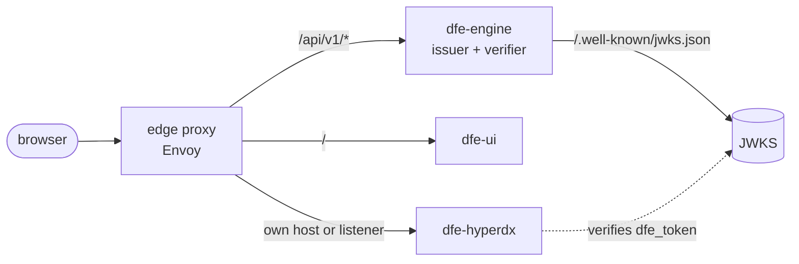

<!--
Project:   DFE (Data Forensics Engine) - product suite
File:      docs/auth-envoy-topology.md
Purpose:   How a request is authenticated at the edge proxy and by each app,
           on Kubernetes and on Docker.
Language:  Markdown
License:   see repository LICENSE
Copyright: HyperI / DFE contributors
-->

# DFE auth at the edge (k8s vs docker)

The engine is the only issuer of the token the apps trust: an ES384 JWT, published through the engine's JWKS and carried in the `dfe_token` cookie or an `Authorization: Bearer` header. The engine and dfe-hyperdx verify that token themselves. The edge proxy routes requests, and only on Kubernetes can it also check a token, an opt-in for an external IdP's.

## One issuer, verified by each app

- Local login: `POST /api/v1/auth/login`, and the engine signs the JWT (`src/dfe_engine/api/v1/auth.py`).
- External OIDC: the engine is the relying party. `/api/v1/auth/oidc/{provider}/login` redirects to the IdP, and the callback validates the IdP's token and mints an engine token (`src/dfe_engine/api/v1/oidc_login.py`). The IdP's token stays on the engine-to-IdP leg.
- dfe-hyperdx authenticates from the `dfe_token` cookie dfe-ui shares across the domain, so the fork is its own enforcement point.
- The engine believes proxy-set `X-Oidc-*` identity headers only with `DFE_ENGINE_AUTH_TRUST_PROXY_AUTH_HEADERS=true` (default off, `settings.py` `auth.trust_proxy_auth_headers`). Turn it on only where a proxy strips those headers from the client and the engine is reachable through that proxy alone.

The engine signs with ES384 (ECDSA P-384 with SHA-384), `api.jwt_algorithm`. Ed25519 is not used: at 128-bit security it is below the CNSA 2.0 target. The `kid` is the RFC 7638 JWK thumbprint and the algorithm is a setting, so a post-quantum signature such as ML-DSA can replace ES384 once JOSE and Envoy can verify it (`src/dfe_engine/auth/jwt_authority.py`).

The engine mints the key on first boot and stores it create-only, as a PKCS#8 PEM, in the scalo.secrets backend at `api.jwt_key_path`. The engine does not encrypt it, so at-rest protection is the backend's.

## What the token carries

Every token carries `sub`. A login token adds `email` and `groups`, and the local login also carries `roles`, `org_id` and `org_ids`. The engine re-resolves roles from the group files on every request, so what a token asserts about them never decides an engine answer.

One claim exists for a peer rather than for the engine:

| Claim | Value | Read by |
|---|---|---|
| `role` | `admin` for `admin` or `infra_admin` at system scope and for the engine's own `svc:dfe-engine` token, `member` for an account whose roles allow `query:write`, `viewer` for any other | dfe-hyperdx |

The fork reads the same value from `GET /api/v1/auth/me` (`hyperdx_role`), resolved from the account's groups at that request, and falls back to the token's claim only when that answer carries none. `admin` (or `owner`, which the engine never mints) may change what the whole team sees, `member` may save searches and dashboards, and `viewer` is refused every write (`src/dfe_engine/auth/hyperdx_role.py`).

## Kubernetes: Envoy Gateway

dfe-infra's `helm/edge/gateway` chart configures Envoy Gateway.

| Concern | What the chart does |
|---|---|
| Routing | dfe-ui and the engine share one hostname, the engine on its `/api/v1` path families. dfe-hyperdx has its own hostname. |
| Infra routes | Argo CD and the other infra-class routes carry an OIDC `SecurityPolicy` that requires one of the admin groups. Kafbat is the exception (`edgePolicy: false`, `ownLogin: true`): it runs its own OIDC login. |
| Product routes | With `oidc.enabled: false`, the default, dfe-ui, the engine and dfe-hyperdx carry no edge OIDC policy and the apps check the engine token. Turned on, the engine route takes a `SecurityPolicy`, because the default `oidc.targetRoutes` names `dfe-engine`. dfe-hyperdx is left out on purpose: it is framed inside dfe-ui, where an interactive redirect cannot complete. |
| Edge JWT (opt-in) | `jwtAuthn.enabled` (default `false`) adds Envoy's `jwt_authn` for an external OIDC issuer's Bearer token. It strips client `X-Oidc-*` headers first, then maps the token's claims into them. |
| TLS | One `ClientTrafficPolicy`: TLS 1.2 minimum by default (1.3 for a high-security overlay), AES-256-GCM, P-384 ECDHE, and the hybrid ML-KEM group offered. |
| Reachability | dfe-infra's `network-policies` chart (`templates/dfe-namespace.yaml`) admits ingress to the DFE namespaces only from the gateway namespace, the other DFE namespaces, KEDA on the shim port and the OTel collector. |

## Docker: one static Envoy config

dfe-docker's `config/proxy/envoy.yaml` runs the router filter only, with no token check:

- One listener sends `/api/v1/` to `dfe-engine:8000` and everything else to `dfe-ui:3000`.
- A second listener serves the dfe-hyperdx embed from `dfe-hyperdx:8090`.
- The auth profile adds three oauth2-proxy gates (`compose/oauth2-proxy.yml`).

The engine API is also published on the host's loopback, port `DFE_ENGINE_PORT` (default 8003), for local tools.

## See also

- The embedded HyperDX fork: the dfe-hyperdx repo, `docs/fork/`.
- RBAC and sign-in: [control-plane/rbac-sign-in.md](control-plane/rbac-sign-in.md).
