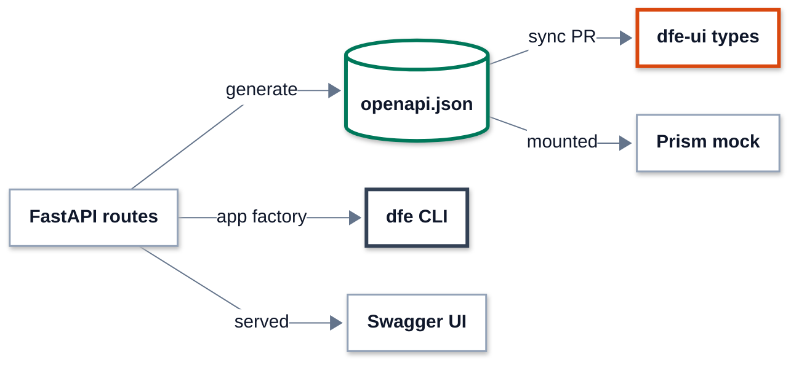

# The DFE control-plane layer

The control-plane layer is the small set of repos that own the DFE control plane: configuration, RBAC, schema, the operator UI and the deploy target. A doc that says "the control-plane layer" means these repos. The data-plane repos (receiver, loader, transforms, fetcher, archiver, hunt runner) are services the control plane configures, outside the layer.

The API is the dfe-engine API, never "the dfe-api". The daemon is `dfe-engine` (`dfe-engine run`), the human CLI is `dfe`, and the engine's API settings read as `DFE_ENGINE_API_*`.

dfe-ui calls the engine, which reads dfe-schemas and commits to the deploy repo that Argo CD syncs with dfe-infra's ApplicationSets.

```mermaid
---
config:
  theme: base
  look: neo
  fontFamily: Inter, -apple-system, Segoe UI, Roboto, Helvetica, Arial, sans-serif
  flowchart:
    curve: linear
    nodeSpacing: 40
    rankSpacing: 64
    padding: 18
    wrappingWidth: 280
    htmlLabels: true
  elk:
    preset: modelOrder
  themeVariables:
    fontSize: 15px
    lineColor: "#64748B"
    primaryTextColor: "#0F172A"
    clusterBorder: "#0072B2"
    edgeLabelBackground: "#FFFFFF"
  themeCSS: >-
    p{margin:0}
    .node[data-look] rect,.node[data-look] path,.node[data-look] polygon,.node[data-look] .outer-path{filter:drop-shadow(0 1px 2px rgba(15,23,42,.10)) drop-shadow(0 6px 14px rgba(15,23,42,.10))}
    .node rect{rx:10px;ry:10px}
    .cluster rect{rx:16px;ry:16px}
    .node .label div{min-width:150px}
    .node.decision .label div{min-width:0}
    .cluster[data-look] rect{filter:none}
    .nodeLabel{line-height:1.35}
    .nodeLabel b{font-weight:600;font-size:15px;letter-spacing:-0.01em}
    .nodeLabel span{font-size:12.5px;font-weight:400;color:#334155}
    .cluster-label span.nodeLabel{display:inline-block;background:#FFFFFF;color:#0B2A3F;border:1.5px solid #0072B2;border-radius:999px;padding:2px 12px;font-size:11.5px;font-weight:700;letter-spacing:.09em;text-transform:uppercase}
    .flowchart-link{stroke-width:1.75px}
    .labelBkg{background:transparent!important}
    span.edgeLabel{display:inline-block;background:#FFFFFF!important;color:#1E293B;border:1px solid #94A3B8;border-radius:999px;padding:2px 10px;font-size:12px;font-weight:500}
    span.edgeLabel p{background:transparent!important}
    .label-icon{width:20px;height:20px;vertical-align:-4px;margin-right:6px}
    .ingest .label-icon{color:#0E8A7D}
    .xform .label-icon{color:#7B4FB0}
    .load .label-icon{color:#0072B2}
    .bus .label-icon{color:#A8517F}
    .store .label-icon{color:#00785A}
    .ui .label-icon{color:#D9480F}
    .ext .label-icon{color:#64748B}
---
flowchart LR
  accTitle: L4 Detail -- Control-plane repos
  accDescr: dfe-ui calls the engine API and dfe-schemas ships the schema trees the engine reads. The engine commits config to the deploy repo, which Argo CD syncs from dfe-infra's ApplicationSets.

  ui["<b>dfe-ui</b>"]
  schemas["<b>dfe-schemas</b>"]

  engine["<b>dfe-engine</b>"]

  deploy[("<b>Deploy repo</b><br/><span>dfe-deploy</span>")]

  infra["<b>dfe-infra</b><br/><span>Argo CD</span>"]

  ui -->|API calls| engine
  schemas -->|schema trees| engine
  engine -->|commits| deploy
  deploy --> infra
  classDef ext fill:#F4F6F8,stroke:#94A3B8,stroke-width:1.5px,stroke-dasharray:5 4,color:#0F172A
  classDef ingest fill:#FFFFFF,stroke:#0E8A7D,stroke-width:3px,color:#0F172A
  classDef xform fill:#FFFFFF,stroke:#7B4FB0,stroke-width:3px,color:#0F172A
  classDef load fill:#FFFFFF,stroke:#0072B2,stroke-width:3px,color:#0F172A
  classDef bus fill:#FFFFFF,stroke:#A8517F,stroke-width:3px,color:#0F172A
  classDef store fill:#FFFFFF,stroke:#00785A,stroke-width:3px,color:#0F172A
  classDef ui fill:#FFFFFF,stroke:#D9480F,stroke-width:3px,color:#0F172A
  classDef decision fill:#FFFFFF,stroke:#9A6700,stroke-width:3px,color:#0F172A
  classDef error fill:#FFFFFF,stroke:#C2410C,stroke-width:3px,color:#0F172A
  classDef control fill:#FFFFFF,stroke:#334155,stroke-width:3px,color:#0F172A
  classDef part fill:#FFFFFF,stroke:#94A3B8,stroke-width:1.5px,color:#0F172A
  class schemas store
  class ui ui
  class engine,deploy,infra control
```

*Figure 1. L4 Detail -- Control-plane repos.* Up: [DFE architecture](../architecture.md).

| Repo | Role in the layer |
|---|---|
| dfe-engine | The config control plane and the sole authorisation decision point. Hosts the FastAPI API and the generated `dfe` CLI. Everything else in the layer keys off its API. |
| dfe-schemas | The schema source of truth: the common event header, the hunt-results DDL, the profiles. The engine reads the version-pinned `dfe-schemas` wheel and creates the ClickHouse objects from it. |
| dfe-ui | The operator console, a window over the engine API that decides nothing. It holds the engine-minted JWT and reads its expiry, and the engine verifies it. |
| dfe-infra | The charts, ApplicationSets and bootstrap that deploy the suite through Argo CD. Never a config authority. |
| dfe-deploy | The per-deployment read-write gitops repo the running engine commits to. dfe-deploy ships its starting content, and each deployment owns its copy. |

## Each source of truth has one writer

Each holds one kind of authoritative state, every other component reads it or an artefact generated from it, and each has exactly one write path, so a change is auditable and consumers cannot diverge.

| Source of truth | Lives in | Consumed by | Written by |
|---|---|---|---|
| API surface, `openapi.json` | dfe-engine `openapi/` | dfe-ui types, the Prism contract mock, the route map | `scripts/generate_openapi.py` from the FastAPI routes, never by hand |
| Schema: event header, hunt-results DDL, profiles | dfe-schemas, the `dfe-schemas` wheel pinned in `uv.lock` | the engine, which creates the ClickHouse objects at startup, and `dfe schema` | dfe-schemas commits |
| Deployment definition: Helm charts and values | each app's thin chart, built from its deployment contract, plus dfe-infra values and the deploy-repo overlays | Argo CD | each app's release for its chart, dfe-infra for its values, the engine for the overlays (one `values/<service>-<instance>-values.yaml` per app instance, each write a gitops commit). Where no chart runs (Compose), `src/dfe_engine/appmgmt/appconfig.py` merges an overlay's `config:` over the base config into the app's config file |
| Deployed state, the gitops YAML | dfe-deploy, one per deployment | Argo CD, and the engine for current state | the engine API, every mutation a git commit, and `dfe local` break-glass when the daemon is down |
| AuthZ: RBAC roles and scopes | roles in `rbac/roles.yaml` under `DFE_CONFIG_DIR`, seeded from `src/dfe_engine/auth/resources/roles.yaml`. Scopes in `src/dfe_engine/auth/rbac_scopes/scope_constants.py` | the API (`require_action`), the CLI | the engine's role API for roles, a code change for scopes |

The engine reads dfe-schemas and the RBAC roles, and Argo CD syncs the deploy repo with the charts and dfe-infra values.

```mermaid
---
config:
  theme: base
  look: neo
  fontFamily: Inter, -apple-system, Segoe UI, Roboto, Helvetica, Arial, sans-serif
  flowchart:
    curve: linear
    nodeSpacing: 40
    rankSpacing: 64
    padding: 18
    wrappingWidth: 280
    htmlLabels: true
  elk:
    preset: modelOrder
  themeVariables:
    fontSize: 15px
    lineColor: "#64748B"
    primaryTextColor: "#0F172A"
    clusterBorder: "#0072B2"
    edgeLabelBackground: "#FFFFFF"
  themeCSS: >-
    p{margin:0}
    .node[data-look] rect,.node[data-look] path,.node[data-look] polygon,.node[data-look] .outer-path{filter:drop-shadow(0 1px 2px rgba(15,23,42,.10)) drop-shadow(0 6px 14px rgba(15,23,42,.10))}
    .node rect{rx:10px;ry:10px}
    .cluster rect{rx:16px;ry:16px}
    .node .label div{min-width:150px}
    .node.decision .label div{min-width:0}
    .cluster[data-look] rect{filter:none}
    .nodeLabel{line-height:1.35}
    .nodeLabel b{font-weight:600;font-size:15px;letter-spacing:-0.01em}
    .nodeLabel span{font-size:12.5px;font-weight:400;color:#334155}
    .cluster-label span.nodeLabel{display:inline-block;background:#FFFFFF;color:#0B2A3F;border:1.5px solid #0072B2;border-radius:999px;padding:2px 12px;font-size:11.5px;font-weight:700;letter-spacing:.09em;text-transform:uppercase}
    .flowchart-link{stroke-width:1.75px}
    .labelBkg{background:transparent!important}
    span.edgeLabel{display:inline-block;background:#FFFFFF!important;color:#1E293B;border:1px solid #94A3B8;border-radius:999px;padding:2px 10px;font-size:12px;font-weight:500}
    span.edgeLabel p{background:transparent!important}
    .label-icon{width:20px;height:20px;vertical-align:-4px;margin-right:6px}
    .ingest .label-icon{color:#0E8A7D}
    .xform .label-icon{color:#7B4FB0}
    .load .label-icon{color:#0072B2}
    .bus .label-icon{color:#A8517F}
    .store .label-icon{color:#00785A}
    .ui .label-icon{color:#D9480F}
    .ext .label-icon{color:#64748B}
---
flowchart LR
  accTitle: L4 Detail -- Control-plane sources of truth
  accDescr: The engine reads the dfe-schemas trees and the RBAC roles, and commits overlays and config to the deploy repo. Argo CD syncs the deploy repo together with the charts and dfe-infra values.

  schemas[("<b>dfe-schemas</b>")]
  rbac[("<b>RBAC roles</b>")]

  engine["<b>dfe-engine</b>"]

  deploy[("<b>Deploy repo</b>")]
  charts[("<b>Charts and dfe-infra values</b>")]

  argo["<b>Argo CD</b>"]

  schemas -->|schema trees| engine
  rbac -->|grants| engine
  engine -->|commits| deploy
  engine ~~~ charts
  deploy --> argo
  charts --> argo
  classDef ext fill:#F4F6F8,stroke:#94A3B8,stroke-width:1.5px,stroke-dasharray:5 4,color:#0F172A
  classDef ingest fill:#FFFFFF,stroke:#0E8A7D,stroke-width:3px,color:#0F172A
  classDef xform fill:#FFFFFF,stroke:#7B4FB0,stroke-width:3px,color:#0F172A
  classDef load fill:#FFFFFF,stroke:#0072B2,stroke-width:3px,color:#0F172A
  classDef bus fill:#FFFFFF,stroke:#A8517F,stroke-width:3px,color:#0F172A
  classDef store fill:#FFFFFF,stroke:#00785A,stroke-width:3px,color:#0F172A
  classDef ui fill:#FFFFFF,stroke:#D9480F,stroke-width:3px,color:#0F172A
  classDef decision fill:#FFFFFF,stroke:#9A6700,stroke-width:3px,color:#0F172A
  classDef error fill:#FFFFFF,stroke:#C2410C,stroke-width:3px,color:#0F172A
  classDef control fill:#FFFFFF,stroke:#334155,stroke-width:3px,color:#0F172A
  classDef part fill:#FFFFFF,stroke:#94A3B8,stroke-width:1.5px,color:#0F172A
  class schemas,rbac store
  class engine,deploy,charts,argo control
```

*Figure 2. L4 Detail -- Control-plane sources of truth.* Up: [DFE architecture](../architecture.md).

To change one, go through its writer: edit the routes and regenerate the spec, commit to dfe-schemas, turn the engine's dials, or edit roles through the API. Never hand-edit a generated artefact such as `openapi.json` or a compiled overlay.

`openapi/openapi.json`, the API source of truth, is generated from the FastAPI app (`uv run python scripts/generate_openapi.py`) and committed. The routes feed it, and every consumer keys off the routes or the file, never off a hand-kept copy.

The dfe CLI and Swagger UI read the live routes, and dfe-ui and the Prism mock read the committed `openapi.json`.

*Figure 3. L4 Detail -- openapi.json and its consumers.* Up: [DFE architecture](../architecture.md).

- The `dfe` CLI builds its whole command tree at runtime from the installed engine's app factory, so an endpoint becomes a command with no CLI code. An endpoint opts out with `x-scalo.cli.hidden`.
- dfe-ui copies both specs into its `@repo/dfe-engine-types` package through a PR the [sync workflow](type-safety-sync.md) opens, and generates its types from them.
- `docker-compose.dev.yaml` mounts `./openapi` into Prism. Swagger UI is served at `/docs` when `DFE_ENGINE_API_DOCS_ENABLED` allows it.

When the API changes, change the routes, regenerate `openapi.json`, and every consumer follows.

The pages in this area:

| Doc | Covers |
|---|---|
| [governed-ops-design.md](governed-ops-design.md) | GitCrud, the governance layer and curated actions |
| [gitops-commit-standard.md](gitops-commit-standard.md) | machine-commit conventions for gitops repos |
| [oidc-rbac-architecture.md](oidc-rbac-architecture.md) | OIDC and RBAC: the auth model, the two RBAC planes, the provider registry and adapters, the management API, infra requirements |
| [rbac.md](rbac.md) | auth paths, the RBAC model, multi-tenant ClickHouse, stores |
| [rbac-sign-in.md](rbac-sign-in.md) | identity resolution, the sign-in allowlist, first login and password changes |
| [rbac-groups.md](rbac-groups.md) | IdP group sync, linking a group to an IdP group, the checks on a link |
| [rbac-engine-reads.md](rbac-engine-reads.md) | the engine's ClickHouse reads and how they bind to a caller's orgs |
| [idp-setup/](idp-setup/README.md): [google.md](idp-setup/google.md), [entra.md](idp-setup/entra.md), [okta.md](idp-setup/okta.md) | one-time setup for a customer's IdP admin: sign-in client, groups, the values to send the operator |
| [rbac-vocabulary.md](rbac-vocabulary.md) | role and group names and terms across engine, ui, infra, deploy, schemas and test envs |
| [synthetic-data.md](synthetic-data.md) | synthetic data: reference packs, lookalike scrub, standing demo streams |
| [ui-api-guide.md](ui-api-guide.md) | frontend integration guide and endpoint reference |
| [type-safety-sync.md](type-safety-sync.md) | OpenAPI and RBAC-scope type sync to dfe-ui |
| [dfe-cli-design.md](dfe-cli-design.md) | how the `dfe` client CLI is built and resolves profiles |

The system map is [../architecture.md](../architecture.md).
