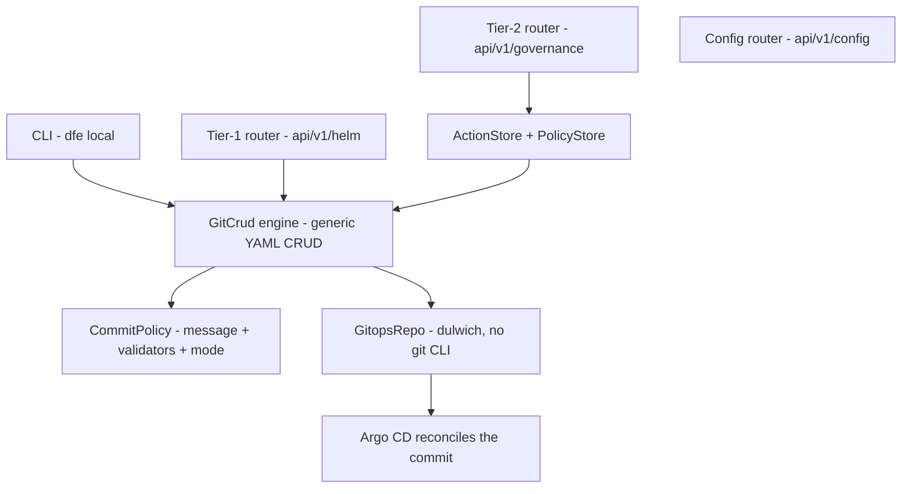
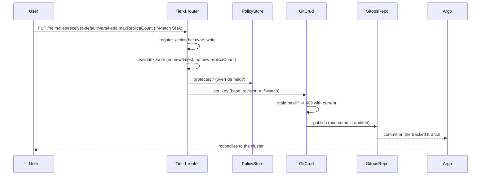
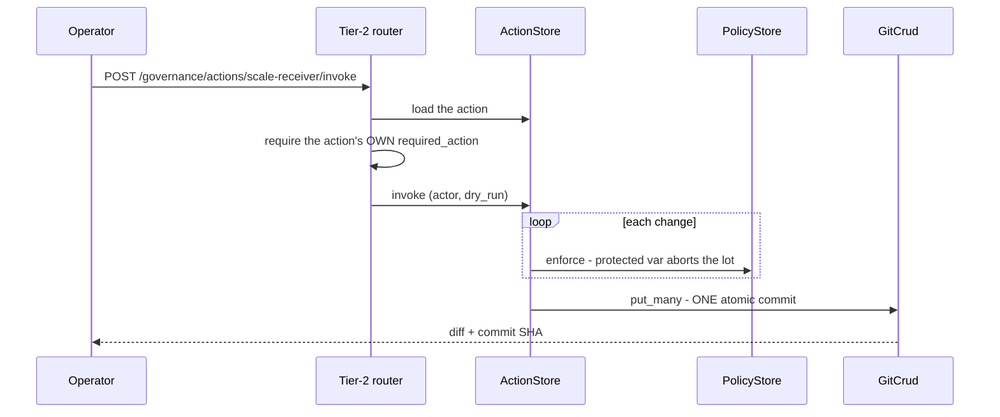
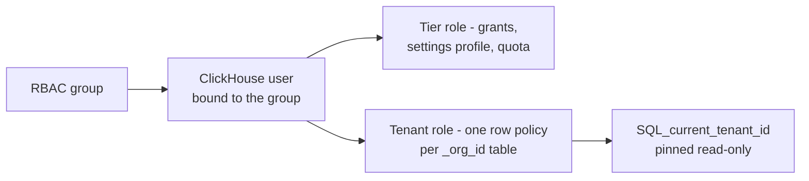
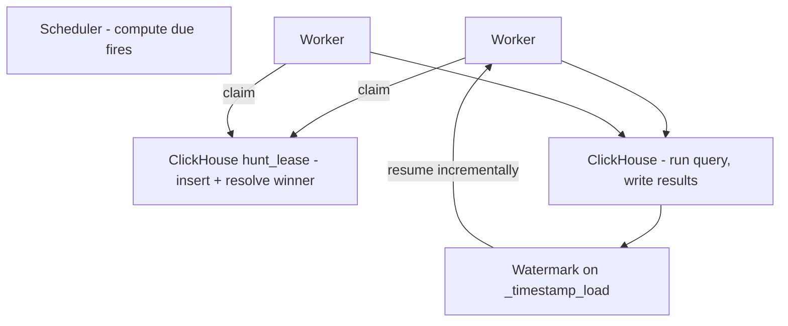
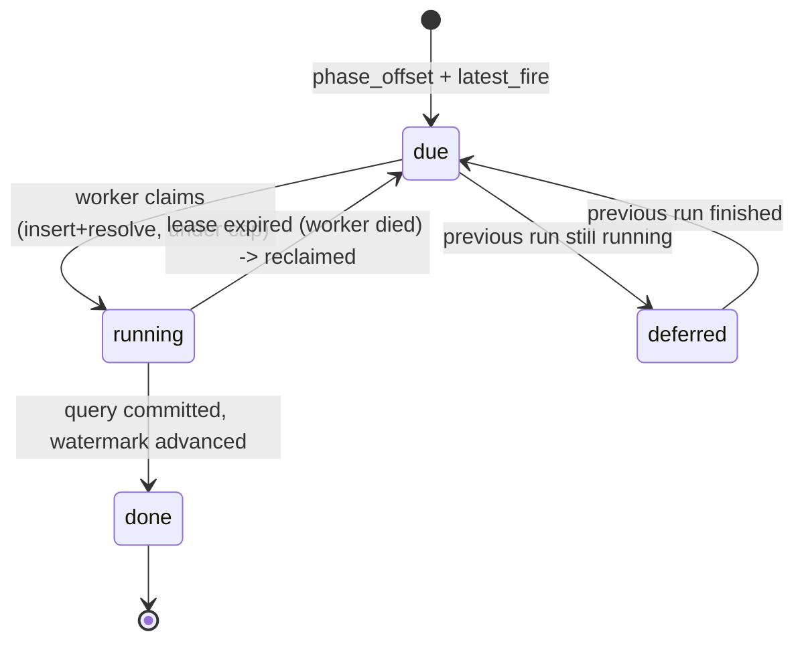
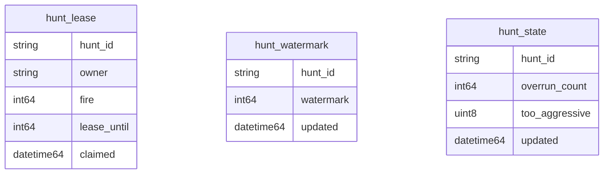
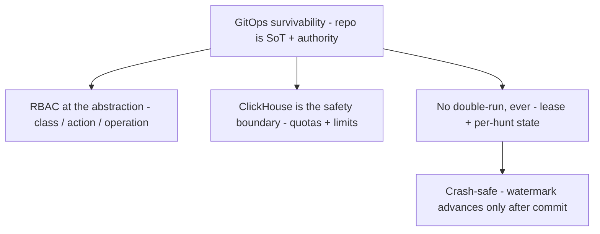

<!-- Project: dfe-engine -->
# Governed Ops and the Hunt Runner

How DFE is operated, and how detection runs. Two subsystems, one idea: the GitOps
repo is the source of truth and the authority, and dfe-engine is a governed window
onto it. Companion to [architecture.md](../architecture.md), the
[commit standard](gitops-commit-standard.md), and the
[observability standard](../deployment/observability-standard.md).

## The one idea

Everything you can change in DFE -- deployment dials, detection hunts, access
control -- is YAML in a git repo. The engine does not hold a config database and
does not touch the live cluster. It reads and writes those YAML files through one
generic, git-native CRUD engine called `GitCrud`, applies RBAC, and commits.
Argo reconciles the commit. Kill the engine and the UI and DFE keeps running --
you can still drive it by editing the repo by hand. That survivability is the
whole point, and it is the acceptance test for every piece below.

## Layering



Two tiers sit on the one engine:

- **Tier-1** is raw, generic var CRUD over the overlay files. Powerful, so it is
  admin-grade.
- **Tier-2** is curated *actions* -- named bundles of changes, each behind its own
  permission. This is the safe surface an operator gets. They can run
  "scale-receiver" without holding the keys to edit any var.

RBAC binds at the high level only -- a resource class, a named action, an operation
-- never per field. One permission check per request. That keeps the security
surface small and the policy readable.

## GitCrud -- the generic engine

`src/dfe_engine/gitcrud/`. One engine handles every resource class the same way,
because every resource is git-backed config. A `ResourceClass` says where a class
lives (a directory), how one resource is laid out, and which RBAC prefix governs
it. The default registry (`src/dfe_engine/gitcrud/registry.py`) covers the deploy repo:
`helmvars` (the app-instance overlays under `values/`), `infravars` (the cluster
and platform overlays under `infra/`), the datamodel classes `sources`,
`compat_profiles` and `derived_schemas` (under `config/sources/`,
`config/compat-profiles/` and `config/schemas/derived/`), `hunts` and `rules`
(`config/hunts/`, `config/rules/`), `library` (the versioned artefact library
under `config/library/`) and the governance classes (`accounts`, `groups`,
`roles`, `actions`, `policies`, `ch_tiers`, `ch_service_roles` and
`gov_settings` under `governance/`).

`infravars` shares the `helmvars` RBAC prefix but needs its own directory: Argo
hands the app generator's `values/*-values.yaml` glob to git as a pathspec, where
`*` matches `/`, so anything under `values/` becomes an Argo application. Its
surface is `api/v1/backing-services`, and its reads are DECLARED, never observed
-- the engine runs no Kubernetes client, by design.

### Layouts -- one document, or a directory

Most classes are `FILE`: one YAML document, one file. The fields ARE the resource,
so one doc keeps them consistent and gives one conflict domain per write.
`helmvars` cannot be anything else -- Argo and Helm read the overlay as one values
file.

A class storing authored CONTENT declares `BUNDLE`: a directory per resource,
holding a `manifest.yaml` plus payload files. `library` is the first consumer, and
its layout is the general one:

```text
config/library/<name>/manifest.yaml
config/library/<name>/versions/0001.vrl
config/library/<name>/current.vrl
```

Content in files rather than in the manifest means a reviewer diffs the language
itself, a validator runs against a real path, reading one version does not parse
the whole history, and no YAML emitter touches the bytes. `put_bundle` writes the
manifest and its files in ONE commit, so a manifest never names a version whose
content has not landed. Payload paths are refused if they escape the bundle or
collide with the manifest.

Nothing else moves to `BUNDLE` by default: the other versioned classes hold small
structured payloads that already diff well, so migrating them would cost a data
migration in every deployed gitops repo for no gain.

## One commit per mutation

The engine is small on purpose. Read, flatten to dot-paths, set or delete a path,
write a whole doc, delete a resource -- every mutation ends in one commit via
`GitopsRepo` (which uses dulwich, so there is no shell-out to `git`). Three extras
earn their keep:

- `put_many` writes several resources in ONE commit, so an action that touches N
  files is atomic.
- `put_bundle` does the same for one bundle's manifest plus its content files.
- The HEAD commit SHA is the optimistic-concurrency token. A read returns it, a
  write may require it, and a stale one raises `ConcurrencyConflictError` carrying
  the current doc -- so two editors never silently clobber each other.

`commit_policy.py` enforces the [commit standard](gitops-commit-standard.md) in
code: it builds every message and its audit trailers (callers cannot hand-write
them), rejects `latest`/unpinned image refs and controller-owned fields like
`replicaCount`, and resolves direct-commit vs PR from the environment and class.

## Writing a helm var



The router is thin. The work -- validation, the protected-var check, the commit --
lives in the engine and the policy store, so the CLI and the API take the identical
path.

## Defined actions and protected vars

`src/dfe_engine/governance/`. An `ActionDef` is a name, the permission needed to run
it (`required_action`), and a list of `VarChange`s. `ActionStore.invoke` applies them
all in one commit, honours the protected-var policy (a single violation aborts the
whole action -- it is atomic), and `dry_run` returns the diff without writing.



## Protected vars and refused writes

A `ProtectedPolicy` is the one thing that reaches below a class -- a list of locked `cls:name:path` globs that even Tier-1 must respect unless the caller holds the override grant. It is a policy object, not a per-var ACL. A set or revert at a parent, or a set below a locked scalar, is refused like a write to the var itself, because either one changes it. A whole-document write is gated only on the leaves it adds, changes or removes.

Three policies ship and seed into every deploy repo. `baseline` locks image references. `storage-layout` locks the data-layer modes, the storage model, the `objectStore` / `tieredBlock` / `tieredObject` dial blocks, and the disk size and class. `sizing-locks` locks the Kafka sizing inputs, the KRaft controller layout and the cloud. Seeding never rewrites an existing file, so a repo carrying the earlier `storage-model` policy keeps it and gains `storage-layout` beside it -- hence the pre-vocabulary key spellings in the shipped lock.

## Refused writes no grant lifts

Not everything unsafe is a protected var. A lower node or broker count is refused
by the backing-services router itself, and by an action that leaves one in the infra overlay, with a 400 that names the reason, and the
override grant does NOT get past it: the hazard is data loss rather than
governance, and there is no correct way to grant your way through it. The same
distinction applies to `replicaCount`, which the commit standard refuses unless
the document being written explicitly disables KEDA -- with a controller owning
the count, writing one renders nothing.

Ahead of the count guard and the policy locks, the router, and an action writing the infra overlay, refuse a write or revert of a `read_only` value on a backing service DFE does not run (`managed_by` `provider` or `external`, per `src/dfe_engine/backing/providers.yaml`) with 409 `managed_by_provider`. The override grant does not lift it: the chart deploys no store there, so the commit would change nothing.

## Constrained params -- a dial with detents, or a bounded knob

An action may declare `params`, and every param carries a CLOSED constraint:
an enum carries its full value list, a numeric carries both bounds. There is
deliberately no free-string param type -- an unconstrained param would reopen
the hole curation closed. A `VarChange.value` references a param as
`{"$param": "level"}` (whole-value substitution) or with a `map` that turns an
enum value into a per-var literal -- the admin still curates what each detent
means. Substitution never reaches `cls`/`name`/`path`, and there is no string
interpolation, so params add zero injection surface. Wiring errors (dangling
reference, map not covering the enum) are rejected at DEFINE time. Only the
caller's supplied values can fail an invoke (422 `invalid_params`).

A `value` of `{"$unset": true}`, alone or as a map entry, removes the path instead of setting it, which returns the var to the layer beneath the overlay (a chart default or a tier profile). Removing an absent path is a no-op that creates no file, an emptied parent map is removed with it, and the diff shows `new` as `{"$unset": true}`. A marker with any other content is rejected at define time.

`required_action` is optional: left empty it derives `action:invoke:<name>`,
the convention the shipped roles grant on (`dfe_operator` and `infra_admin`
carry `action:invoke:*`).

## The contract exposes the closed sets

Every stringly field on an action is a closed set, so the contract enumerates
it rather than trusting hand-typed values: `GET /gitops/classes` (the registry,
with `action_writable` exporting the no-governance-class guard),
`.../classes/{cls}/resources` and `.../resources/{name}/vars` (each gated by
that class's own `:read` grant), and `POST /governance/admin/actions/validate`
returns EVERY violation plus the would-be diff without committing. The schema
fields carry `x-dfe-enum-source` annotations naming these endpoints, so
generated clients render selects, not text boxes (the full convention:
[ui-api-guide.md](ui-api-guide.md)).

## The shipped action library

The deploy-repo template (dfe-deploy `governance/`) ships a standard library
of dials -- `receiver-surge`/`receiver-normal` (KEDA ceiling detents),
`hunts-pause`/`hunts-resume`, `hunts-throttle` (bounded concurrent-run cap) --
plus a `baseline` protected-var policy locking `image.*` (images move through
stack pins, not dials). Every shipped action's structure is CI-validated in
that repo (`tools/validate_governance.py`). The chart vars they point at are
owned by dfe-infra's chart validation. An action's `description` is its
runbook line -- what it does, and which action reverts it.

## ClickHouse data RBAC -- a tier and a tenant per identity

`src/dfe_engine/governance/ch/`. Access control in dfe-hyperdx's app layer cannot
contain a bad query. Quotas and resource limits can, and those live in ClickHouse.
So every ClickHouse identity composes two axes:



A group binding ties an RBAC group's ClickHouse user to one tier and at most one
org. A tier is grants, a settings profile and a quota (`dfe_<tier>_role`,
`_profile`, `_quota`). The tenant axis is one shared role plus a restrictive row
policy on each `_org_id` table, reading the caller's `SQL_current_tenant_id`, which
an org-tied user carries pinned read-only, so a `SETTINGS` override in a query is
refused. The catalogue of tiers and service roles is data in dfe-schemas
(`roles/clickhouse.yaml`), editable through the `ch_tiers` and `ch_service_roles`
classes, and `ChRbacReconciler` renders whatever exists into idempotent DDL and
runs it.

The hunt runner connects as the `dfe_hunt_runner` service role, which carries
grants and no quota (`roles/clickhouse.yaml`, `src/dfe_engine/hunts/connect.py`). The catalogue's
`hunt_tier_*` tiers carry per-query memory and time limits and an hourly quota for a
group bound to one.

## The hunt runner

`src/dfe_engine/hunts/`. A hunt is a rule query on a schedule that writes
matched rows to a table. The runner is a pool, and hunts are never *assigned* to
pods. Workers pull due runs from a
ClickHouse lease table. Add a pod and it just starts pulling. Kill one and its leases
expire and get reclaimed. There is no shard map to rebalance and nothing to go
split-brain over.

ClickHouse is the ONLY operational store -- no Postgres. Making hunts (the
mission-critical path) depend on a second database purely for coordination is not
worth the operational surface, so the same CH the hunts already query holds the
lease, watermark, and state. CH has no row locks, so the claim is optimistic:
insert-a-lease-then-resolve, not `SELECT ... FOR UPDATE`.



The smarts are deterministic, not random. `schedule.phase_offset` gives each hunt a
stable offset inside its interval from a hash of its id, so hunts on the same
schedule fan out evenly and never stampede ClickHouse at the boundary. `latest_fire`
names the most recent fire at or before now, and it stays owed until its watermark
is written. A global cap hard-limits how much hits CH at once.

## Claims, windows and coordination tables

A run never doubles up. To claim, a worker reads the hunt free, INSERTs a lease row
and a marker of its own, waits a settle, and keeps the claim only if its row landed
within that settle and is still the latest. Lease writes reach a majority of
replicas and lease reads go through `FINAL`, so every worker names the same winner
(`src/dfe_engine/hunts/ch_coordinator.py`). Exclusion has to hold, because a window run twice
writes its rows twice. Per-hunt state means an overrun defers
rather than starting a second copy -- and flags `too_aggressive` so the UI can tell
the user their schedule is too tight.



Each run is incremental and crash-safe. The query carries a `{window}` placeholder.
The worker substitutes the window predicate on the hunt's timestamp field, runs it,
and advances the watermark ONLY after the query commits. A pod killed mid-run re-runs
the same window from the last committed watermark -- no gap, no loss. The field
defaults to `_timestamp_load`, the common-header column that is always present, and a
hunt's `timestamp_field` overrides it (`src/dfe_engine/hunts/spec_loader.py`).

The three coordination tables, all ReplacingMergeTree in the effective data database.
`hunt_run` (one row per fire) and `hunt_runner_heartbeat` (one row per runner) sit
beside them:



`HuntRunner.tick(now)` is one cycle -- find due hunts that are not already active,
then claim up to the cap and execute each at its scheduled window. The daemon is
`while: tick(); sleep`.

## The smaller pieces

- `GET /api/v1/config/client` (authenticated, any role) hands the UI its API base,
  Observe URL, auth mode and feature flags at runtime, so one UI image runs in every
  environment.
- `src/dfe_engine/alerting/` is a scaffold: a rule model (threshold over a window,
  severity to a channel) and a dispatcher whose only sender logs. A hunt's own alert
  destinations are delivered by `src/dfe_engine/hunts/delivery.py`.
- `dfe local` (`ls`, `get`, `set`, `unset`, `rm`, `revert`, `restore`, `push`) wraps
  GitCrud on a clone of the deploy repo, for break-glass when the engine is down. It
  has no action invoke ([dfe-cli-design.md](dfe-cli-design.md)).

## What holds it together



If a change cannot be made by committing YAML to the repo, it does not belong in the
engine. That rule is what keeps DFE operable without us.
