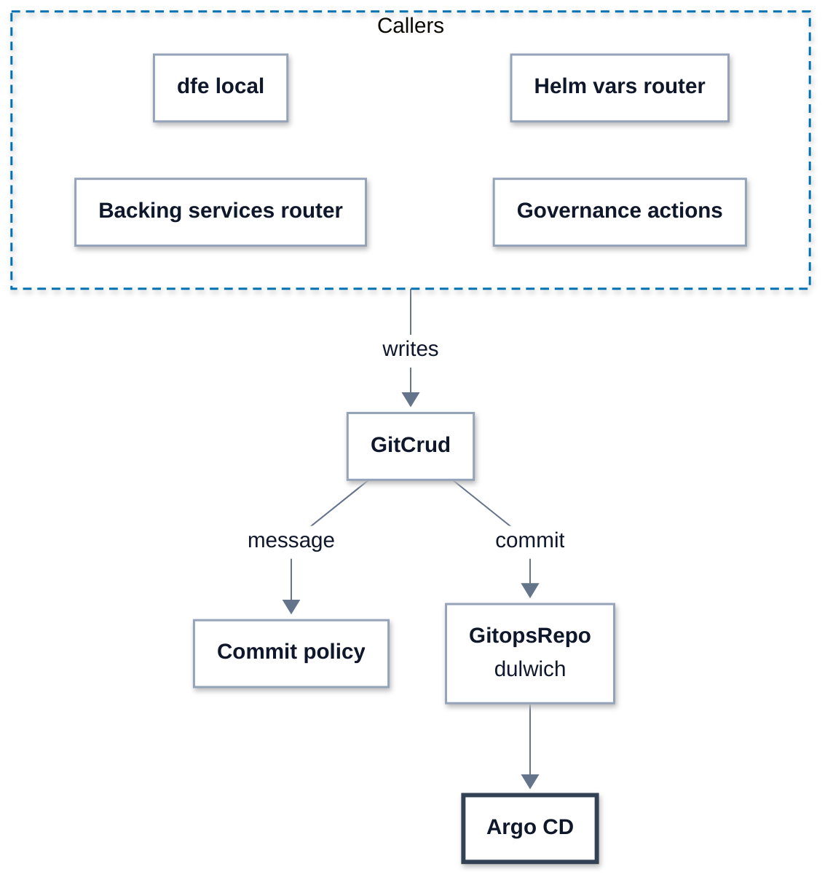
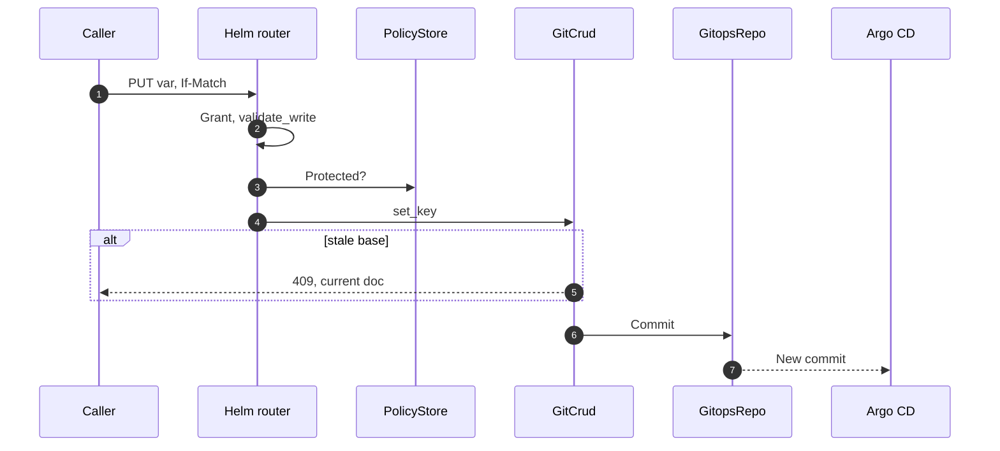
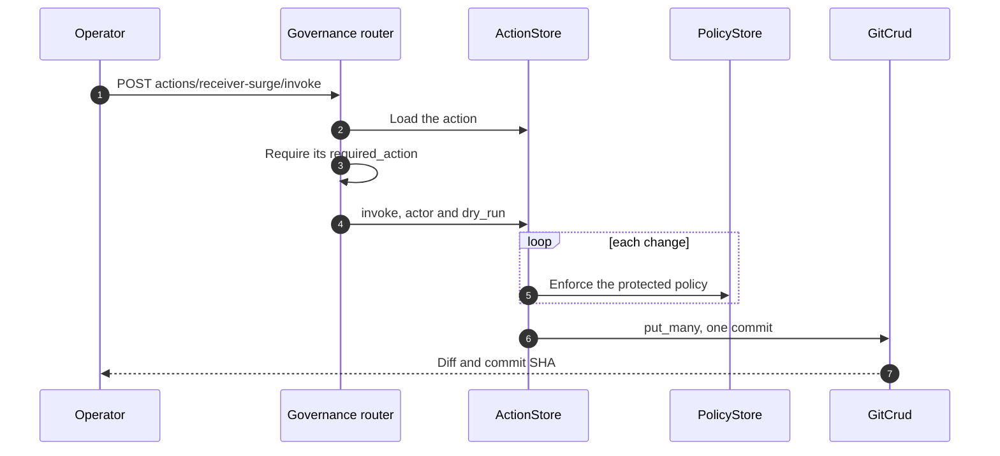
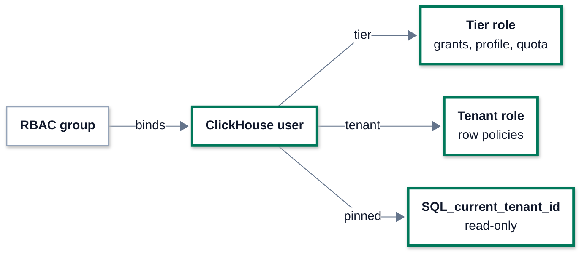
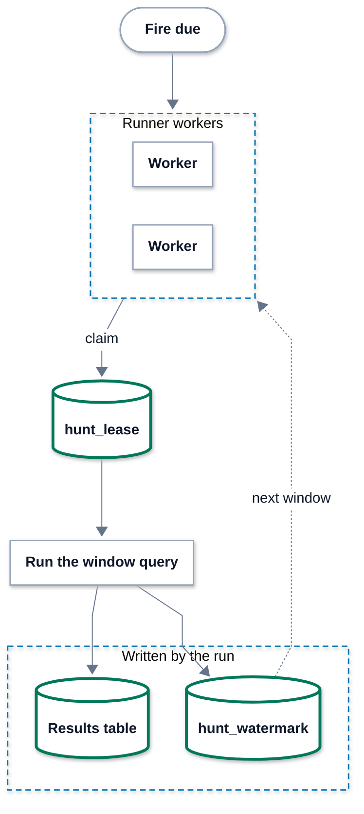
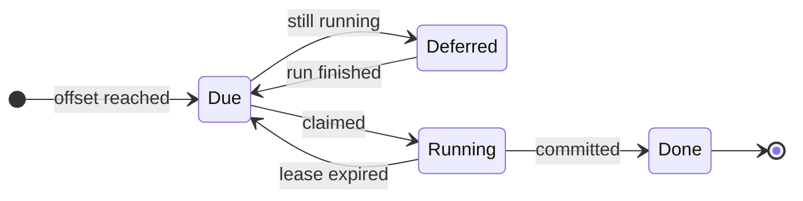
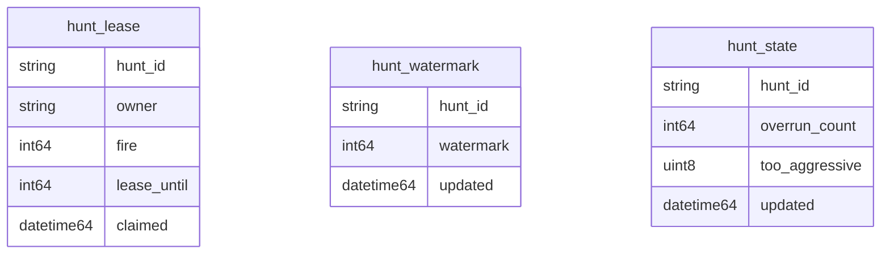

<!-- Project: dfe-engine -->
# Governed Ops and the Hunt Runner

How DFE is operated, and how detection runs. Everything you can change in DFE (deployment dials, detection hunts, access control) is YAML in a git repo, and dfe-engine is a governed window onto it. The engine holds no config database and never touches the live cluster: it reads and writes the YAML through one git-native CRUD engine, `GitCrud`, applies RBAC, and commits. Argo CD reconciles the commit. Kill the engine and the UI and DFE keeps running on hand edits to the repo.

## Every write is one GitCrud commit

Every caller writes through GitCrud, which commits under the commit policy for Argo CD to reconcile.



*Figure 1. L4 Detail -- Governed write path. Argo CD is outside the engine.* Up: [L3 Components -- API server](../api-server.md).

Tier 1 is raw var CRUD over the overlay files (`/api/v1/helm`), admin-grade because it can set anything. Tier 2 is curated actions (`/api/v1/governance`), each behind a permission of its name, so an operator can run `receiver-surge` without the keys to edit any var. RBAC binds to a resource class, an action or an operation, never to a field.

A `ResourceClass` names the directory a class lives in, how one resource is laid out, and its RBAC prefix. The default registry (`src/dfe_engine/gitcrud/registry.py`) covers the deploy repo: `helmvars` (app-instance overlays under `values/`), `infravars` (cluster and platform overlays under `infra/`), `sources`, `compat_profiles` and `derived_schemas` (under `config/sources/`, `config/compat-profiles/` and `config/schemas/derived/`), `hunts` and `rules` (`config/hunts/`, `config/rules/`), `library` (`config/library/`), and the governance classes `accounts`, `groups`, `roles`, `actions`, `policies`, `ch_tiers`, `ch_service_roles` and `gov_settings` under `governance/`.

`infravars` shares the `helmvars` RBAC prefix in a separate directory: Argo hands the app generator's `values/*-values.yaml` glob to git as a pathspec, where `*` matches `/`, so anything under `values/` becomes an Argo application. Its surface is `/api/v1/backing-services`, and its reads are declared, never observed, because the engine runs no Kubernetes client.

Most classes are `FILE`, one YAML document per resource and one conflict domain per write. A class storing authored content is `BUNDLE`, a directory per resource with a `manifest.yaml` and payload files, so a reviewer diffs the language itself:

```text
config/library/<name>/manifest.yaml
config/library/<name>/versions/0001.vrl
config/library/<name>/current.vrl
```

Every mutation ends in one commit through `GitopsRepo`, which uses dulwich rather than the `git` CLI. `put_many` writes several resources in one commit, so an action touching N files is atomic, and `put_bundle` does the same for a manifest and its content files. The HEAD commit SHA is the concurrency token, and a stale one raises `ConcurrencyConflictError` carrying the current doc. `src/dfe_engine/gitcrud/commit_policy.py` enforces the [commit standard](gitops-commit-standard.md): it builds every message and its audit trailers, rejects `latest` and unpinned image refs and a `replicaCount` KEDA owns, and resolves direct commit or PR from the environment and the class.

## Writing a helm var

A Tier 1 var write is checked for the grant and the protected-var policy, then committed, against its `If-Match` base when the caller sends one.



*Figure 2. L4 Detail -- Writing a helm var. Solid arrows are requests, dashed arrows are responses.* Up: [L3 Components -- API server](../api-server.md).

The full path is `PUT /api/v1/helm/files/{name}/vars/{path}`, for example `receiver-default-values` and `keda.maxReplicaCount`. A production `DFE_ENGINE_ENV` in team mode routes the write to a review branch instead of `main`. Validation, the protected-var check and the commit live in the engine, so the CLI and the API take the same path.

## Actions, protected vars and rejected writes

An `ActionDef` (`src/dfe_engine/governance/`) is a name, the permission needed to run it (`required_action`) and a list of `VarChange`s. `ActionStore.invoke` applies them all in one commit and honours the protected-var policy, so one violation aborts the whole action, and `dry_run` returns the diff without writing.

An action invoke checks the caller's grant and every change, then writes them all in one commit.



*Figure 3. L4 Detail -- Invoking an action. Solid arrows are requests, dashed arrows are responses.* Up: [L3 Components -- API server](../api-server.md).

A `ProtectedPolicy` is a list of locked `cls:name:path` globs that Tier 1 respects too, unless the caller holds the override grant. A set or revert at a parent, or a set below a locked scalar, is rejected like a write to the var itself, and a whole-document write is gated on the leaves it adds, changes or removes. Three policies ship: `baseline` locks image references, `storage-layout` locks the data-layer modes, the storage model, the `objectStore`, `tieredBlock` and `tieredObject` dial blocks and the disk size and class, and `sizing-locks` locks the Kafka sizing inputs, the KRaft controller layout and the cloud.

No grant lifts three rejections. A lower node or broker count is rejected with a 400 naming the reason, by the backing-services router and by any action leaving one in the infra overlay, because the hazard is data loss. A `replicaCount` is rejected while KEDA owns the count (`keda.enabled`, else the chart default), because it would render nothing. A write or revert of a `read_only` value on a backing service DFE does not run (`managed_by` `provider` or `external` in `src/dfe_engine/backing/providers.yaml`) answers 409 `managed_by_provider`, because the chart deploys no store there.

## Action params and the closed sets

An action may declare `params`, each closed: an enum lists its values, a numeric both bounds, and there is no free-string type. A `VarChange.value` references a param as `{"$param": "level"}`, whole-value only, or with a `map` turning an enum value into a per-var literal. Substitution never reaches `cls`, `name` or `path` and there is no string interpolation, so params add no injection surface. A dangling reference or a map that misses an enum value is rejected at define time, and only the caller's values can fail an invoke (422 `invalid_params`). A value of `{"$unset": true}` removes the path, handing the var back to the layer beneath, and an emptied parent map goes with it. `required_action` left empty derives `action:invoke:<name>`, which the shipped `dfe_operator` and `infra_admin` roles grant as `action:invoke:*`.

The contract enumerates every closed set: `GET /gitops/classes` (with `action_writable` exporting the no-governance-class guard), `.../classes/{cls}/resources` and `.../resources/{name}/vars`, each gated by that class's `:read` grant, and `POST /governance/admin/actions/validate` returns every violation and the would-be diff without committing. Schema fields hold `x-dfe-enum-source` annotations naming those endpoints ([ui-api-guide.md](ui-api-guide.md)).

The engine packages a standard library of dials in `src/dfe_engine/governance/resources/` and seeds it into every deploy repo, never rewriting an existing file: `receiver-surge` and `receiver-normal` (KEDA ceiling detents), `hunts-pause`, `hunts-resume` and `hunts-throttle`. dfe-deploy's template holds the same files, and its CI validates them (`tools/validate_governance.py` in dfe-deploy).

## ClickHouse data RBAC: a tier and a tenant per identity

`src/dfe_engine/governance/ch/`. dfe-hyperdx's app layer cannot contain a bad query, but ClickHouse quotas and limits can, so every ClickHouse identity composes two axes.

Each RBAC group binds to one ClickHouse user holding a tier role, the tenant role and, for an org, a pinned tenant setting.



*Figure 4. L4 Detail -- ClickHouse identity.* Up: [L3 Components -- API server](../api-server.md).

A group binding ties an RBAC group's ClickHouse user to one tier and at most one org. A tier is grants, a settings profile and a quota (`dfe_<tier>_role`, `_profile`, `_quota`). The tenant axis is one shared role plus a restrictive row policy on each `_org_id` table, reading the caller's `SQL_current_tenant_id`, which an org-tied user holds read-only, so a `SETTINGS` override in a query is rejected. The catalogue of tiers and service roles is data in dfe-schemas (`roles/clickhouse.yaml`), editable through the `ch_tiers` and `ch_service_roles` classes, and `ChRbacReconciler` renders it into idempotent DDL and runs it. The hunt runner connects as the `dfe_hunt_runner` service role, with grants and no quota (`src/dfe_engine/hunts/connect.py`), and the catalogue's `hunt_tier_*` tiers set per-query memory and time limits and an hourly quota for a group bound to one.

## The hunt runner

`src/dfe_engine/hunts/`. A hunt is a rule query on a schedule that writes matched rows to a table. Hunts are never assigned to pods: workers pull due runs from a ClickHouse lease table, and a dead pod's leases expire and are reclaimed. The ClickHouse the hunts query holds the lease, watermark and state, and with no row locks a claim is optimistic: insert a lease, then resolve the winner.

One worker wins each fire's claim, runs the window and advances the watermark.



*Figure 5. L4 Detail -- Hunt claim and run. The dotted arrow is the next run reading the watermark.* Up: [The DFE control-plane layer](README.md).

`phase_offset` in `src/dfe_engine/hunts/schedule.py` gives each hunt a stable offset inside its interval from a hash of its id, so hunts on one schedule spread out. `latest_fire` names the most recent fire at or before now, and it stays owed until its watermark is written. A global cap limits concurrent runs.

To claim, a worker reads the hunt free, inserts a lease row and a marker for itself, waits a settle, and keeps the claim only if its row landed within the settle and is still the latest. Lease writes reach a majority of replicas and lease reads go through `FINAL`, so every worker names the same winner (`src/dfe_engine/hunts/ch_coordinator.py`). An overrun defers rather than starting a second copy, and flags `too_aggressive` so the UI can say the schedule is too tight.

A fire goes from due to running to done, and an expired lease sends it back to due.



*Figure 6. L4 Detail -- Hunt fire lifecycle.* Up: [The DFE control-plane layer](README.md).

Each run is incremental and crash-safe. Every statement holds a `{window}` placeholder, which the worker fills with the window predicate on the hunt's timestamp field (`src/dfe_engine/hunts/worker.py`), and the watermark advances only after the query commits, so a pod killed mid-run re-runs the same window. The field is `_timestamp_load` unless a hunt's `timestamp_field` overrides it (`src/dfe_engine/hunts/spec_loader.py`). `HuntRunner.tick(now)` is one cycle: find due hunts that are not already active, then claim up to the cap and run each at its window.

Three ReplacingMergeTree tables in the effective data database, keyed by `hunt_id`, coordinate the runners. `hunt_run` (one row per fire) and `hunt_runner_heartbeat` (one row per runner) sit beside them.



*Figure 7. L4 Detail -- Hunt coordination tables.* Up: [The DFE control-plane layer](README.md).

## The smaller pieces

- `GET /api/v1/config/client` (any authenticated caller) hands the UI its API base, the Observe URL, the auth mode and feature flags at runtime, so one UI image runs in every environment.
- `src/dfe_engine/alerting/` is a scaffold: a rule model and a dispatcher with one sender, which logs. A hunt's alert destinations are delivered by `src/dfe_engine/hunts/delivery.py`.
- `dfe local` wraps GitCrud on a clone of the deploy repo for break-glass when the engine is down, with no action invoke ([dfe-cli-design.md](dfe-cli-design.md)).

The repo as source of truth underpins RBAC, the ClickHouse safety boundary and no double-run.

```mermaid
---
config:
  theme: base
  look: neo
  fontFamily: Inter, -apple-system, Segoe UI, Roboto, Helvetica, Arial, sans-serif
  flowchart:
    curve: linear
    nodeSpacing: 40
    rankSpacing: 64
    padding: 18
    wrappingWidth: 280
    htmlLabels: true
  elk:
    preset: modelOrder
  themeVariables:
    fontSize: 15px
    lineColor: "#64748B"
    primaryTextColor: "#0F172A"
    clusterBorder: "#0072B2"
    edgeLabelBackground: "#FFFFFF"
  themeCSS: >-
    p{margin:0}
    .node[data-look] rect,.node[data-look] path,.node[data-look] polygon,.node[data-look] .outer-path{filter:drop-shadow(0 1px 2px rgba(15,23,42,.10)) drop-shadow(0 6px 14px rgba(15,23,42,.10))}
    .node rect{rx:10px;ry:10px}
    .cluster rect{rx:16px;ry:16px}
    .node .label div{min-width:150px}
    .node.decision .label div{min-width:0}
    .cluster[data-look] rect{filter:none}
    .nodeLabel{line-height:1.35}
    .nodeLabel b{font-weight:600;font-size:15px;letter-spacing:-0.01em}
    .nodeLabel span{font-size:12.5px;font-weight:400;color:#334155}
    .cluster-label span.nodeLabel{display:inline-block;background:#FFFFFF;color:#0B2A3F;border:1.5px solid #0072B2;border-radius:999px;padding:2px 12px;font-size:11.5px;font-weight:700;letter-spacing:.09em;text-transform:uppercase}
    .flowchart-link{stroke-width:1.75px}
    .labelBkg{background:transparent!important}
    span.edgeLabel{display:inline-block;background:#FFFFFF!important;color:#1E293B;border:1px solid #94A3B8;border-radius:999px;padding:2px 10px;font-size:12px;font-weight:500}
    span.edgeLabel p{background:transparent!important}
    .label-icon{width:20px;height:20px;vertical-align:-4px;margin-right:6px}
    .ingest .label-icon{color:#0E8A7D}
    .xform .label-icon{color:#7B4FB0}
    .load .label-icon{color:#0072B2}
    .bus .label-icon{color:#A8517F}
    .store .label-icon{color:#00785A}
    .ui .label-icon{color:#D9480F}
    .ext .label-icon{color:#64748B}
---
flowchart LR
  accTitle: L4 Detail -- What governed ops rests on
  accDescr: The repo as source of truth and authority underpins RBAC at the class, action and operation level, ClickHouse as the safety boundary, and no double-run. A worker dying between its writes and the watermark repeats the window, and rule detections dedupe it.

  surv["<b>Repo is the source of truth</b>"]

  rbac["<b>RBAC per class, action, operation</b>"]
  chsafe["<b>ClickHouse quotas and limits</b>"]
  nodouble["<b>No double-run</b>"]

  crash["<b>Watermark after the writes</b>"]

  surv --> rbac
  surv --> chsafe
  surv --> nodouble
  nodouble --> crash
  class surv,rbac,chsafe,nodouble,crash part
  classDef ext fill:#F4F6F8,stroke:#94A3B8,stroke-width:1.5px,stroke-dasharray:5 4,color:#0F172A
  classDef ingest fill:#FFFFFF,stroke:#0E8A7D,stroke-width:3px,color:#0F172A
  classDef xform fill:#FFFFFF,stroke:#7B4FB0,stroke-width:3px,color:#0F172A
  classDef load fill:#FFFFFF,stroke:#0072B2,stroke-width:3px,color:#0F172A
  classDef bus fill:#FFFFFF,stroke:#A8517F,stroke-width:3px,color:#0F172A
  classDef store fill:#FFFFFF,stroke:#00785A,stroke-width:3px,color:#0F172A
  classDef ui fill:#FFFFFF,stroke:#D9480F,stroke-width:3px,color:#0F172A
  classDef decision fill:#FFFFFF,stroke:#9A6700,stroke-width:3px,color:#0F172A
  classDef error fill:#FFFFFF,stroke:#C2410C,stroke-width:3px,color:#0F172A
  classDef control fill:#FFFFFF,stroke:#334155,stroke-width:3px,color:#0F172A
  classDef part fill:#FFFFFF,stroke:#94A3B8,stroke-width:1.5px,color:#0F172A
```



*Figure 8. L4 Detail -- What governed ops rests on.* Up: [The DFE control-plane layer](README.md).

If a change cannot be made by committing YAML to the repo, it does not belong in the engine.
