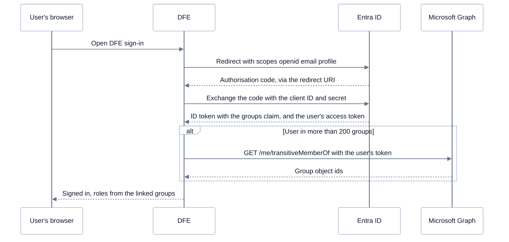

# Microsoft Entra ID sign-in for DFE

DFE asks for two things from your Microsoft Entra ID tenant: your users sign in to DFE with their work account, and DFE reads which security groups each user is in, so your groups decide their DFE roles. You set this up once as an app registration. Nothing is needed per user.

The DFE operator who sent you this page gives you the redirect URI. It looks like this, and you paste it exactly as given:

```text
https://<your DFE console host>/api/v1/auth/oidc/<provider-name>/callback
```

You need at least the Cloud Application Administrator role in the Microsoft Entra admin center, <https://entra.microsoft.com>.

## How DFE reads groups

Once you turn on the groups claim, Entra puts each user's group object ids in the ID token, and DFE reads them at sign-in. A user in more than 200 groups, nested groups included, gets a pointer instead of the list. DFE then reads that user's groups from Microsoft Graph `/me/transitiveMemberOf` with the user's sign-in token. The User.Read permission an app registration starts with covers that call.

DFE signs in with Entra ID by code exchange, and reads the groups of a user in more than 200 from Microsoft Graph.



*Figure 1. L4 Detail -- Entra sign-in. Solid arrows are requests, dashed arrows are responses.* Up: [Identity provider setup](README.md).

## Set it up

1. Go to **Entra ID > App registrations** and select **New registration**. Name it (for example `DFE`). Under **Supported account types** pick **Single tenant only - <your tenant>**. Select **Register**.
2. On the **Overview** page, copy the **Application (client) ID** and the **Directory (tenant) ID**.
3. Under **Manage**, select **Authentication**. Select **Add Redirect URI**, pick the **Web** tile, paste the redirect URI and select **Configure**. Leave the **ID tokens (used for implicit and hybrid flows)** box unticked: DFE uses the authorisation code flow.
4. Select **Certificates & secrets > Client secrets > New client secret**. Add a description, pick an expiry of 24 months or less and select **Add**. Copy the **Value** column at this step, not the **Secret ID**: Entra never shows the value again. DFE authenticates with a client secret, not a certificate. Diary the expiry: sign-in stops the day the secret lapses.
5. Under **Manage**, select **Token configuration**, then **Add groups claim**. Tick **Security groups** and select **Save**. Leave each token's value at the default, the group ID. Switching it to sAMAccountName, cloud display names or role claims breaks DFE's group links.
6. Do not add a `groups` permission or scope. Entra adds the claim from step 5, and asking for a `groups` scope fails the sign-in.

Three optional extras, for when the operator asks:

- Group names on the Graph path, which otherwise returns each group's id with a blank name: **API permissions > Add a permission > Microsoft Graph > Delegated permissions > GroupMember.Read.All**, then **Grant admin consent for <tenant>**. DFE links on the id, so sign-in works without it.
- An app-only fallback: the Microsoft Graph application permission **GroupMember.Read.All** with admin consent. DFE then reads a user's groups with the app's secret when Graph turns down the user's token, and the operator can run a group sync.
- Linking sign-ins to existing DFE accounts by email: **Token configuration > Add optional claim**, token type **ID**, tick **email** and **xms_edov**, then **Add**. Entra sends no `email_verified`, so DFE treats an Entra email as verified only when `xms_edov` is true.

## Send these to the operator

| Value | Where it comes from |
|---|---|
| Application (client) ID | Step 2 |
| Client secret | Step 4, the **Value**. Send it over a channel fit for a password, never plain email |
| Directory (tenant) ID | Step 2. The issuer is `https://login.microsoftonline.com/<tenant-id>/v2.0` |
| Group object ids | One per group that should hold a DFE role, with the role it should get. See below |

DFE links an Entra group on its object id, a GUID, so renaming the group does not break the link. Go to **Entra ID > Groups > All groups**, open the group and copy its **Object ID** from the **Overview** or **Properties** page. Once one of the user's groups is linked, the check below lists the ids of every group they are in as well.

## Check it worked

Once the operator confirms the provider is in place, open this URL in a private browser window and sign in as a user in a mapped group:

```text
https://<your DFE console host>/api/v1/auth/oidc/<provider-name>/login
```

The page answers with JSON. `email` is the user, and `groups` lists their group object ids. The JSON holds an `access_token` as well: it is a live DFE session, so do not paste it anywhere. A user in no linked group is turned away, and DFE keeps no account for them.

## Common failures

| What you see | Cause | Fix |
|---|---|---|
| Microsoft page: `AADSTS50011` | The redirect URI on the app differs from the one DFE sent | Add the operator's URI exactly under the **Web** platform |
| Microsoft page: `AADSTS700016` | DFE holds the wrong client ID, or the issuer names the wrong tenant | Resend the client ID and tenant ID from step 2 |
| DFE page: `OIDC login failed: invalid_client: AADSTS7000215 ...` | DFE holds the **Secret ID**, or a mistyped value | Send the secret's **Value** |
| DFE page: `OIDC login failed: invalid_client: AADSTS7000222 ...` | The client secret expired | Create another secret and send its value |
| Microsoft page: `AADSTS50105` | The enterprise application needs assignment and this user is not assigned | Assign the user, or a group they are in, to the application |
| DFE page: `OIDC login refused: no DFE group with a role is linked to your identity provider groups.` | None of the user's groups is linked yet, or no groups arrived: no groups claim, or the user is in no security group | Send the operator the group object ids (see "Send these to the operator"). If they are linked, redo step 5 and check the user's memberships |

## For the DFE operator

Create the provider with `POST /api/v1/auth/oidc-providers`. The `name` becomes `<provider-name>` in the redirect URI, so set it before the admin starts:

```json
{
  "name": "<provider-name>",
  "type": "entra_id",
  "display_name": "Microsoft",
  "issuer": "https://login.microsoftonline.com/<tenant-id>/v2.0",
  "client_id": "<application (client) id>",
  "client_secret": "<client secret value>",
  "groups": {"mode": "token_claim", "tenant_id": "<tenant-id>"}
}
```

`token_claim` reads the `groups` claim, and the overage lookup runs with no setting. The app-only fallback is the one thing that needs `groups.tenant_id`, and it uses the login client secret unless `groups.client_secret` is set. Leave `scopes` unset: the default is `openid email profile`. The client secret goes to the secret store and the provider keeps its path, never the value. Set `trusted_email_domains` to your users' email domains and have the admin add the `xms_edov` claim: DFE admits only a sign-in whose verified email is in one of them, and links it to an existing account holding that email: see [rbac-sign-in.md, Linked sign-ins](../rbac-sign-in.md#linked-sign-ins).

Link each DFE group by setting two fields in its group file: `source_provider` to `<provider-name>`, the name the provider was created with, and `source_id` to an object id the admin sent. A group file with a `source_id` and no `source_provider` loads unlinked, with a warning naming it in the engine log, and no sign-in reaches it through that id: see [rbac-groups.md, section 4.4](../rbac-groups.md#44-group-sync-process).

```yaml
# config/auth/groups/soc-analysts.yaml
roles: ["data_analyst"]
source_provider: "<provider-name>"
source_id: "<group object id>"
```

Behind a TLS-terminating proxy, set `api.forwarded_allow_ips` (`DFE_ENGINE_API_FORWARDED_ALLOW_IPS`), or the engine builds the redirect URI with `http://` and Entra turns it down.

## Microsoft references

- Register an app: <https://learn.microsoft.com/en-us/entra/identity-platform/quickstart-register-app>
- Add a redirect URI: <https://learn.microsoft.com/en-us/entra/identity-platform/how-to-add-redirect-uri>
- Add a client secret: <https://learn.microsoft.com/en-us/entra/identity-platform/how-to-add-credentials>
- Groups claim and the 200-group limit: <https://learn.microsoft.com/en-us/entra/identity-platform/optional-claims>
- The `xms_edov` claim: <https://learn.microsoft.com/en-us/entra/identity-platform/optional-claims-reference>
- Why an unverified email must not identify a user: <https://learn.microsoft.com/en-us/entra/identity-platform/migrate-off-email-claim-authorization>
- Issuer and discovery: <https://learn.microsoft.com/en-us/entra/identity-platform/v2-protocols-oidc>
- `transitiveMemberOf` permissions: <https://learn.microsoft.com/en-us/graph/api/user-list-transitivememberof>
- Error codes: <https://learn.microsoft.com/en-us/entra/identity-platform/reference-error-codes>
- Find a group's object id: <https://learn.microsoft.com/en-us/entra/fundamentals/how-to-manage-groups>
