# OIDC + RBAC architecture and design

How dfe-engine handles authentication, external OIDC, group to role mapping, the
two RBAC planes, the management API and the infrastructure they need. The RBAC and
multi-tenant ClickHouse detail is in [rbac.md](rbac.md), and this page links it
rather than repeating it.

Request and response bodies, tofu outputs and secret keys stay with their
sources: `openapi.json`, the code (`src/dfe_engine/auth/oidc/`) and the
dfe-infra tofu modules.

## 1. The auth model - local always, OIDC additive

The engine is the relying party and the **single token issuer**. An external IdP
does the interactive login. The engine validates the IdP's id_token (signature,
nonce, audience and expiry against the IdP's JWKS, through Authlib) and re-mints
an ES384 token of its making. dfe-ui and dfe-hyperdx see the engine token and
nothing else: the IdP's token stays on the engine-to-IdP leg. Code:
`src/dfe_engine/auth/oidc/rp.py`, `src/dfe_engine/api/v1/oidc_login.py`.

Several auth paths run at once and merge, so OIDC adds to local auth and never
replaces it:

- Local accounts (username and password to JWT), API keys and the disabled dev
  path are always available, which keeps an operator in when the IdP is down or
  misconfigured.
- External OIDC is added when provided, and is the path for a production
  deployment. When present it takes precedence, but the local and key paths stay live.
- Groups from both sources unify. An IdP group takes a DFE group's roles
  through that group file's `source_provider` + `source_id` link and no other
  way. A matching name grants nothing (rbac-sign-in.md section 2.1).

The four auth paths, their precedence and the header-trust precondition are in
rbac.md section 1.

## 2. The layered pipeline

Provider-specific code stops at one layer, the group adapter, and the engine
machinery above it is the same for every IdP. A sign-in goes from the IdP through
the engine's relying party and the group files to both RBAC planes.

```mermaid
---
config:
  theme: base
  look: neo
  fontFamily: Inter, -apple-system, Segoe UI, Roboto, Helvetica, Arial, sans-serif
  flowchart:
    curve: linear
    nodeSpacing: 40
    rankSpacing: 64
    padding: 18
    wrappingWidth: 280
    htmlLabels: true
  elk:
    preset: modelOrder
  themeVariables:
    fontSize: 15px
    lineColor: "#64748B"
    primaryTextColor: "#0F172A"
    clusterBorder: "#0072B2"
    edgeLabelBackground: "#FFFFFF"
  themeCSS: >-
    p{margin:0}
    .node[data-look] rect,.node[data-look] path,.node[data-look] polygon,.node[data-look] .outer-path{filter:drop-shadow(0 1px 2px rgba(15,23,42,.10)) drop-shadow(0 6px 14px rgba(15,23,42,.10))}
    .node rect{rx:10px;ry:10px}
    .cluster rect{rx:16px;ry:16px}
    .node .label div{min-width:150px}
    .node.decision .label div{min-width:0}
    .cluster[data-look] rect{filter:none}
    .nodeLabel{line-height:1.35}
    .nodeLabel b{font-weight:600;font-size:15px;letter-spacing:-0.01em}
    .nodeLabel span{font-size:12.5px;font-weight:400;color:#334155}
    .cluster-label span.nodeLabel{display:inline-block;background:#FFFFFF;color:#0B2A3F;border:1.5px solid #0072B2;border-radius:999px;padding:2px 12px;font-size:11.5px;font-weight:700;letter-spacing:.09em;text-transform:uppercase}
    .flowchart-link{stroke-width:1.75px}
    .labelBkg{background:transparent!important}
    span.edgeLabel{display:inline-block;background:#FFFFFF!important;color:#1E293B;border:1px solid #94A3B8;border-radius:999px;padding:2px 10px;font-size:12px;font-weight:500}
    span.edgeLabel p{background:transparent!important}
    .label-icon{width:20px;height:20px;vertical-align:-4px;margin-right:6px}
    .ingest .label-icon{color:#0E8A7D}
    .xform .label-icon{color:#7B4FB0}
    .load .label-icon{color:#0072B2}
    .bus .label-icon{color:#A8517F}
    .store .label-icon{color:#00785A}
    .ui .label-icon{color:#D9480F}
    .ext .label-icon{color:#64748B}
---
flowchart LR
  accTitle: L4 Detail -- OIDC sign-in layers
  accDescr: The external IdP authenticates the user and hands the engine an id_token. The engine's relying party validates it and re-mints an engine token. The provider adapter turns the raw group references into group ids, the group files map them to roles and org ids, and those feed the control plane and the data plane.

  idp["<b>External IdP</b>"]
  rp["<b>Relying party</b>"]
  adapt["<b>Provider adapter</b>"]
  files[("<b>Group files</b>")]
  ctrl["<b>Control plane</b><br/><span>roles to actions</span>"]
  data["<b>Data plane</b><br/><span>orgs to rows</span>"]

  idp -->|id_token| rp
  rp -->|groups| adapt
  adapt -->|ids| files
  files --> ctrl
  files --> data
  classDef ext fill:#F4F6F8,stroke:#94A3B8,stroke-width:1.5px,stroke-dasharray:5 4,color:#0F172A
  classDef ingest fill:#FFFFFF,stroke:#0E8A7D,stroke-width:3px,color:#0F172A
  classDef xform fill:#FFFFFF,stroke:#7B4FB0,stroke-width:3px,color:#0F172A
  classDef load fill:#FFFFFF,stroke:#0072B2,stroke-width:3px,color:#0F172A
  classDef bus fill:#FFFFFF,stroke:#A8517F,stroke-width:3px,color:#0F172A
  classDef store fill:#FFFFFF,stroke:#00785A,stroke-width:3px,color:#0F172A
  classDef ui fill:#FFFFFF,stroke:#D9480F,stroke-width:3px,color:#0F172A
  classDef decision fill:#FFFFFF,stroke:#9A6700,stroke-width:3px,color:#0F172A
  classDef error fill:#FFFFFF,stroke:#C2410C,stroke-width:3px,color:#0F172A
  classDef control fill:#FFFFFF,stroke:#334155,stroke-width:3px,color:#0F172A
  classDef part fill:#FFFFFF,stroke:#94A3B8,stroke-width:1.5px,color:#0F172A
  class idp ext
  class files store
  class ctrl control
  class rp,adapt,data part
```

*Figure 1. L4 Detail -- OIDC sign-in layers. The provider adapter is the one layer that knows the provider.* Up: [rbac.md](rbac.md).

| Layer | What it does |
|---|---|
| Relying party | Validates the IdP's id_token against its JWKS and re-mints an ES384 engine token. `NormalizedIdentity` holds the subject, email, name and raw group references |
| Provider adapter | Turns raw references (names, ids or nothing) into group ids. In `token_claim` mode the references are in the token. In `api` mode the adapter calls the provider's directory API |
| Group files | `config/auth/groups/*.yaml` map a linked group id to roles, `org_ids` and a scope |
| Control plane | Static roles (`admin`, `data_analyst`, `infra_admin`, ...) to permissions: what you can DO with sources, hunts, config and deploys |
| Data plane | `org_ids` to the org's dfe-hyperdx team and pinned ClickHouse user: a row-filtered view of data, read-only, with no control |

Two principles follow. Adding a provider is one adapter, and nothing else changes.
The control plane and data plane are orthogonal: the same group membership feeds
both, roles decide what you can DO and `org_ids` decide what data you can SEE, and
a pure customer gets the data plane alone.

## 3. The provider registry

Providers are YAML files (one per provider, filename stem = name) managed by
`OIDCProviderRegistry`. The model (`src/dfe_engine/auth/oidc/models.py`) holds
`type` (generic, google, entra_id or okta), `enabled`, `issuer`, `client_id`,
`client_id_env`, `client_secret_path`, `client_secret_env`, `scopes`, and a
`groups` block (mode, claim name and the per-provider directory fields).

A provider file that does not load, with unreadable YAML or fields that fail validation, is left out of the provider list, the relying party and the sync scheduler. The engine logs it once and counts it on `auth_oidc_providers_skipped_total{reason}` (`unreadable`, `invalid`), and every other provider keeps working.

A secret is never stored in config. The client id is not secret and is held in
the clear. Every other credential is a PATH into the `DfeSecrets` store or the
NAME of an env var. Resolution reads the store before the environment, so a
secret sent to the API works at once, and an ESO-mounted env var keeps serving a
provider configured that way.

Three group resolution modes:

- `token_claim`, the default: groups arrive as strings in the id_token and are looked up directly.
- `api`: the token lacks group names or holds ids alone, so an adapter calls the
  provider's directory API to resolve names and list membership on a
  schedule. Each provider syncs every `groups.sync_interval` seconds (60 at least) from a background loop in the engine. `DFE_ENGINE_AUTH_OIDC_GROUP_SYNC_ENABLED=false` leaves `POST /oidc-providers/{name}/sync` as the one way to sync.
- `manual`: membership is mapped by hand in the engine. The token's groups are ignored at login and nothing syncs.

The provider admin API enforces which fields each provider type accepts and needs in each mode, from `src/dfe_engine/auth/oidc/field_rules.py`. A `generic` provider has no `api` mode, and a `google` provider has `api` mode alone, with `enrich_on_login` on.

## 4. Group identifiers, adapters and sync

The api-mode adapters return `GroupInfo { id, name, email, description }`
(models.py), with `id` the identifier the provider's sign-ins assert. The
token_claim path (`extract_identity`, rp.py) emits a flat `list[str]` of
identifiers. Either way a group file is linked by `source_provider` and that
provider's `source_id`, and a login takes the groups with a `source_id` it asserts,
for the provider it signed in through (`membership.linked_groups`). A group's name
links nothing, so an Entra login with object GUIDs resolves against `source_id`
and lands the right roles. The sync, SCIM's `externalId` and an admin through the
groups API or dfe-ui's group form each set the link.

`src/dfe_engine/auth/oidc/adapters/` holds `generic` (token_claim or manual, no API), `google` (the Cloud
Identity Groups API with the user's login token, and the Admin SDK Directory API
for an optional service account), `entra` (Microsoft Graph) and `okta` (Groups API). Each implements
`list_all_groups`, `resolve_user_groups` and `test_connection`. `resolve_user_groups`, the one a login reaches, never raises: it reports an outage or a refusal. An outage
keeps the token's groups, else the account's, and anything else replaces them.
`list_all_groups` serves the sync and raises when a page fails, so the sync
never reads a short listing as the whole directory.

`src/dfe_engine/auth/oidc/sync.py` lists a provider's groups in api mode. It creates a group file for each unseen group, linked by `source_provider` and `source_id`, and updates the files linked to that IdP group, keeping their roles ([rbac-groups.md](rbac-groups.md#44-group-sync-process) has the skips). Detaching a provider does NOT delete its groups: they orphan with `source_provider` set, and the delete answer lists them. Sign-in needs the engine, the relying party and one token issuer, so with the engine down nobody can sign in and provider CRUD and group sync stop as well. Running pipelines keep running, because the data path does not call the engine.

The adapter is where the provider quirks live:

| Quirk | Cause | Adapter's job | Status |
|-------|-----------|---------------|--------|
| refs are names (dex, Okta) vs ids (Entra) vs absent (Google) | provider design | resolve ids by `source_id`, and call the directory API when the token lacks the name | built: id resolution by `source_id` match |
| id stable, name mutable | directories rename groups | map roles on `id`, display `name` | built: `source_id` is the stable key |
| overage (Entra over 200 groups gives a Graph pointer) | token size limits | detect the marker, fall back to the directory API | built: `rp.py` detects `_claim_names` and fetches `transitiveMemberOf` with the user's login token (`/me`: User.Read returns each group's id, which is all role resolution needs, and `GroupMember.Read.All` adds names), falling back to app credentials (tenant id + client secret) when Graph turns that token down |
| nested groups | AD, Entra and Google nesting | take the closure the provider emits, or walk it when it does not | built: Entra emits the full closure in the token, and it is honoured per provider, not by a global toggle |
| name collisions across tenants | bare names are not unique | namespace the key (source + domain) | partial: a name held by a group not linked to that IdP group is skipped (`name_taken`). Namespacing is not built |
| non-role groups (mailing lists) | not all groups grant access | filter by group type | not built |

## 5. The two RBAC planes

One group resolution (`deps.py _resolve_group_grants` and the `Group` model) feeds
both planes. A group file holds `roles`, `org_ids` and `scope`
(`system` or `org:<name>`). A user's roles and `org_ids` are the union across groups.

- Control plane: `roles.yaml` and the wildcard `permission_matches` gate
  the dfe-engine API (manage sources, hunts, config and deploys). Static roles.
- Data plane: `org_ids` drive data-only access. A caller fenced to one org (an `org_viewer`, or any role bound at that org's scope) browses Observe as the org's pinned ClickHouse user. That user's READONLY tenant setting and the shared RESTRICTIVE row policies filter every query to that org (rbac.md section 5). Read-only, with no control-plane power.

Both planes resolve from the group files. The re-minted token holds
`{sub, email, groups}` plus the `role` claim dfe-hyperdx reads (see
[auth-envoy-topology.md](../auth-envoy-topology.md)). Roles and `org_ids` derive
engine-side from the group files, not the token. Full detail: rbac.md sections 2, 5, 6 and 7.

## 6. The management API and CLI

Admin CRUD is at `/api/v1/auth/oidc-providers` (`src/dfe_engine/api/v1/oidc_providers.py`):
create, list, get, update, delete (which lists orphaned groups), `{name}/sync`,
`{name}/test` and `{name}/verify-login`, under the RBAC scopes
`oidc_read`, `oidc_write` and `oidc_delete`, with an audit event on every mutation and pagination on list. The `dfe`
CLI is generated from `openapi.json`, so UI and CLI share one CRUD surface.
Create and update take the credential VALUES (`client_secret`, the Okta API
token, the Entra client secret, the Google service account JSON), write them to
the secret store and record the path, then re-register the provider with the
relying party. A provider configured through the API alone completes a login with
no env edit and no restart. A `*_env` field takes an environment variable NAME,
and a credential pasted there is a 422 naming the field. Detach deletes the
provider's stored secrets.

Two checks help an onboard or offboard:

- `GET /{name}/verify-login` reports whether the client_id and client_secret
  resolve (the value is never returned) and whether the issuer's discovery
  document is reachable and well-formed. `{name}/test` checks the group-directory
  credentials, and does nothing for a generic provider.
- No single endpoint returns raw claims, groups, resolved roles and
  `org_ids` for a login. Assemble them from the callback JSON
  (`{subject,email,groups}`) and `GET /auth/me` (roles and `org_ids`).

## 7. Infrastructure requirements

A deployment provides these, dfe-infra owns them and the engine consumes them:

- OIDC client credentials per provider, as env vars from a K8s Secret
  (materialised by ESO from OpenBao or a cloud secrets manager), or sent to the API. The provider config gives the env var NAMES, and the chart mounts the values. The tofu modules define the per-provider secret keys (client-id, client-secret, and extras such as the Google service account JSON, the Entra tenant-id and the Okta api-token).
- Cloud IAM provisioning in tofu: `tf-oidc-google` (the OAuth client is
  console-only, so the module creates the group-resolver service account), `tf-oidc-entra` (app
  registration and admin-consented `GroupMember.Read.All`) and `tf-oidc-okta` (OIDC
  app, groups claim and API token), under dfe-infra `terraform/modules/`. The engine reads the resulting credentials.
- DNS and TLS for the callback host. The relying-party callback is
  `https://{dfe_host}/api/v1/auth/oidc/{provider}/callback` (plus localhost for dev).
- Network egress to the IdP directory APIs for api-mode group resolution:
  `cloudidentity.googleapis.com`, the Admin SDK at `www.googleapis.com` when a
  service account is set, `graph.microsoft.com` and `{org}.okta.com`.
- The edge header path, a fallback. dfe-infra's gateway can verify an
  IdP token and inject `X-Oidc-Subject` (`jwtAuthn`, off by default), and the
  engine trusts it with `auth.trust_proxy_auth_headers` on and not otherwise. Envoy Gateway cannot
  map an array claim to a header, so `X-Oidc-Groups` never arrives and such a login
  holds no roles (dfe-infra `helm/edge/gateway/values.yaml`). The
  relying party is the login path. When the header path is used, Envoy must be
  the one way to reach the engine (NetworkPolicy), or the headers can be forged.

## 8. Provider-agnostic onboarding recipe

Because the provider code stays in the adapter, onboarding an external OIDC IdP
takes four steps:

1. Register a provider config: type, issuer, client credentials and the groups mode.
2. The IdP emits whatever it emits, and the adapter turns it into group ids.
3. Link group files to those ids, with their roles and `org_ids`.
4. The group files, the control plane and the data plane do the rest unchanged.

The role and group names are in [rbac-vocabulary.md](rbac-vocabulary.md), which
every consumer (engine, ui, infra, deploy, schemas, test environments) aligns to.
