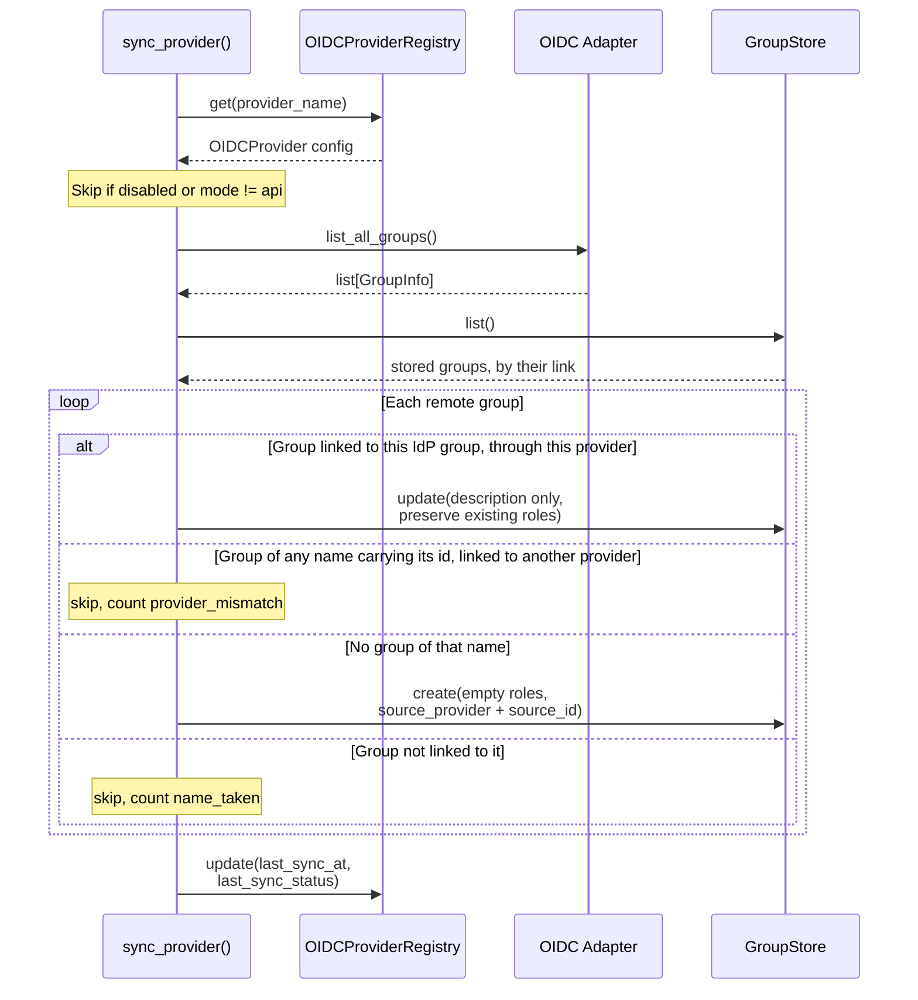

# RBAC - IdP group sync and links

Section 4.4 of [rbac.md](rbac.md), which keeps its number so section references resolve.

## 4.4 Group Sync Process

The sync updates a stored group only when it is already linked to that IdP group: its `source_id` is the IdP group's id and its `source_provider` is this provider, or one `auth.source_provider_bindings` joins to it. The directory assigns that id, so a user cannot choose it the way they choose a display name. Okta is the exception: its groups claim carries names, so an Okta group's id here is its name ([idp-setup/okta.md](idp-setup/okta.md)). A group the sync creates is linked in the same write. A linked group keeps its roles, and the sync refreshes only its description. Admins assign roles to synced groups by hand.

A name match links nothing. Directory display names are not unique, and in a tenant where users can create groups anyone can pick one, so an IdP group named `DFE Admins` would otherwise take the seeded `dfe-admins` and its `admin` role. A stored group of the same name with no `source_id`, or carrying another IdP group's id, is left untouched and counted as `name_taken`. So is a new group whose name is a stored group's `source_id` or whose id is a stored group's name.

A sync never moves a group between providers. Two providers can assign one id, and Okta's ids are group names, so an Okta group named `SOC Analysts` carries the same id as a Keycloak group of that name. A stored group carrying the IdP group's id but linked to another provider, whatever it is called, is left untouched and counted as `provider_mismatch`, so the sync never creates a second group carrying the id, and the engine log names the syncing provider, the provider the group is linked to and the reason. `auth.source_provider_bindings` declares two names one identity source, either way round, so with `{"scim": "entra"}` the `entra` sync refreshes a group SCIM stamped `scim` and leaves the stamp as it is.

---

## Linking an IdP group

Linking an IdP group to a stored group is an admin's act. Set both `source_provider`, the provider's name in the registry, and `source_id`, the IdP group's id, through the groups API (`POST` or `PUT /api/v1/auth/groups`), dfe-ui's group form, the group's file in the live store or the chart's `authConfig.groupsConfigMap`. `PUT /api/v1/scim/v2/Groups/{name}` sets `source_id` from `externalId`. On a group not yet linked it also sets `source_provider` to `scim`, so an OIDC sign-in reaches the group only through the provider `auth.source_provider_bindings` binds to `scim`. A group already linked keeps its provider.

The groups API refuses a link no login could use to reach the group alone:

- `409 conflict`: another group carries the `source_id`, under any provider (SCIM answers `uniqueness`).
- `409 identifier_taken`: a new group's name is another group's `source_id` or a new or changed `source_id` is another group's name (SCIM answers `uniqueness` for a `displayName` or `externalId`). An API key resolves each group identifier by name, then by `source_id`, so an identifier in both namespaces would let a key minted for one group take the other's roles once the first is deleted. A group whose name is its own `source_id` is one group and is accepted. A pair already stored is logged as a warning at startup, naming both groups.
- A caller that cannot see every group gets one answer to either collision, `409 conflict` with `Group name '<name>' is not available`. A group outside the caller's scope answers `404` on get, update, member changes and delete, exactly as a missing one does.
- `422 invalid_source_id`: the `source_id` is over 512 characters, starts or ends with whitespace or holds a control character.
- `422 invalid_source_provider`: the `source_provider` is over 512 characters or is not an OIDC provider, a binding, `scim` or (while `auth.trust_proxy_auth_headers` is on) `auth.proxy_provider`.
- `422 missing_source_provider`: a new or changed link has a `source_id` but no `source_provider`.

Only a changed value is checked, so an edit to other fields of a group whose stored link these rules now refuse still succeeds. Setting, changing or clearing a link needs `group:write` at system scope, checked before any other group is read, and the role rights adding a member does, since each changes who holds the group's roles. Deleting a linked group needs them too, through the groups API and SCIM alike.

---

## Account and group writes

An account write is checked against the groups the account holds before and after it. An IdP-owned account's own list is also its assertion, so a name in that list that is another group's `source_id` is checked as that group as well.

A group write, through the groups API or SCIM, changes only the group's member list. It updates a local account's own `groups` list to match but never an IdP-owned account's (one with `source_provider` set): that list is what the IdP asserts, so a group name written there would be read as an assertion. The member still holds the group through the member list, which SCIM `/Users` reports.

---

## Failed and partial syncs

One bad group never aborts the sync. A provider group that carries no id, whose email, name or id makes no valid group name, whose name is held by a stored group that does not load, whose name is held by a stored group not linked to it, or whose stored group is linked to another provider, is skipped and counted on `auth_oidc_sync_groups_skipped_total{reason}` (`no_id`, `invalid_name`, `stored_unloadable`, `name_taken`, `provider_mismatch`), and the provider's `last_sync_status` reads `partial` with each reason. A group with no id can never be linked, from any provider, so the engine log counts those in one line per run and names none of them.

A listing that fails on any page, the first or the last, stops the sync before it writes a group. So does a page without the listing's shape, and a listing still handing out pages after 1,000. `last_sync_status` reads `error`, and `sync_error` says what failed: the provider's HTTP status, a page it could not read, or the page limit. A 429 reads as throttling, not as a refusal. The engine log carries the provider's error code, and the next run lists again from the start.

A credential that is set but gives no access fails the same way. Entra issuing no token for the client secret, a Google service account JSON that does not build a client, or Google's token endpoint refusing the service account (`invalid_grant`), reads `error`, and `sync_error` says the directory API could not use the configured credential. The engine log has the reason. An Entra that cannot be reached, throttles the token request (429) or fails it (5xx) says that instead, and never blames the credential. `GET /oidc-providers/{name}/test` reports an Entra credential the same way, and keeps "not configured" for one that was never set.

---

## Sync outcomes

An api-mode Entra or Okta provider with no directory credential, or a Google provider whose configured service account resolves to nothing, has nothing to list with. Its `last_sync_status` reads `not_configured`, `sync_error` says no credential is configured, and `POST /oidc-providers/{name}/sync` answers with the same text in `skipped`. A Google provider with no service account reads `user_token` with an empty `sync_error`, because each sign-in reads that user's groups with their own token. A credential whose secret store does not answer reads `error`, and `sync_error` names the secret store. One whose secret store refuses the engine access (a 403 on the path, or a refused AppRole login) also reads `error`, and `sync_error` says the store refused access, so the fix is the engine's secrets policy rather than the store's reachability.

A `generic` provider has no directory API, so one set to api mode reads `error`, and `sync_error` says to set `groups.mode` to `token_claim`.

The sync answer's `status` field carries the outcome: `ok`, `partial`, `error`, `not_configured`, `user_token` or `skipped`. The scheduled sync counts each run on `auth_oidc_sync_scheduled_runs_total{outcome}`. A provider that is not configured is tried again after its `sync_interval`, so adding the credential is picked up without a restart.
