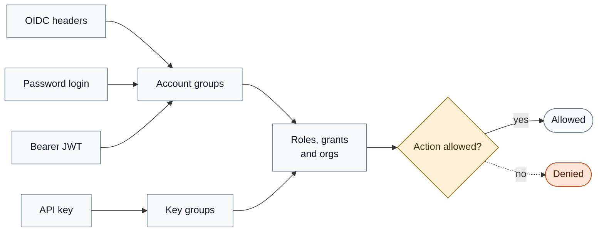

# RBAC - identity resolution and first login

This page is sections 2.1 and 3.5 of [rbac.md](rbac.md), kept under those numbers so section references resolve.

## 2.1 Identity Resolution Chain

Every request takes one credential to an account or a key, the account or key to its groups, and the groups to roles, before `authorize()` decides the action.



*Figure 1. L4 Detail -- Identity resolution chain. The dotted arrow is the refusal.* Up: [rbac.md](rbac.md).

| Credential | Identity | Groups |
|---|---|---|
| OIDC headers | `X-Oidc-Subject`, read when `auth.trust_proxy_auth_headers` is on | `X-Oidc-Groups`, recorded on the account the sign-in binds |
| Password login | `POST /auth/login`, `AccountStore.verify_password()` | The account's |
| Bearer JWT | The verified `sub` binds an account | The account's: the group files listing it as a member, plus the groups an IdP asserts when an IdP owns it |
| API key | `X-API-Key`, `APIKeyStore.verify()` | The key's `groups` field |

The roles step takes member groups by name and IdP identifiers by linked `source_id`, and unions their roles, scoped grants and `org_ids`. `authorize(auth, action)` then matches the action against the roles' permissions with `permission_matches()`, wildcards included ([rbac.md, section 2.5](rbac.md#25-authorization-engine)).

An identifier an IdP asserts, in a token's groups claim, `X-Oidc-Groups` or a SCIM record, takes a group when that group's `source_id` is the identifier and its `source_provider` is the provider the login came through (or one `auth.source_provider_bindings` joins to it). A group's name links nothing, so an IdP group that happens to be called `dfe-admins` gets no roles until an admin links it. Logins through `X-Oidc-Groups` count as the provider `auth.proxy_provider` gives (default `oidc`).

A link names its provider. A group with a `source_id` and no `source_provider` would answer every provider that asserts the id, so the group stores will not write one. A group file or document that has one loads unlinked: the id is dropped and links no provider, its members keep the group's roles, and the engine logs a warning naming the group and counts it on `auth_groups_unlinked_total{reason="no_provider"}`. The next write to that group saves it without the id, so link it again by setting both fields.

`auth.source_provider_bindings` joins each stamp straight to one OIDC provider, and settings turn down a chain such as `{"legacy": "scim", "scim": "entra"}`, where a target is itself a stamp. An IdP sign-in is admitted on the providers its account's stamp answers for, the set its roles resolve through, so a SCIM account stamped `scim` is admitted on `scim` and `entra` but not on another stamp bound to `entra`.

A sign-in through `X-Oidc-Groups` resolves its roles the way a token does, from the account the sign-in binds: the groups its asserted identifiers link to, plus every group with the account in its member list. A gateway that forwards no groups claim, Envoy among them, reaches roles through that membership and no other way, so on those deployments adding an account to a group by hand is how its roles arrive.

## The sign-in allowlist

The linked groups are the sign-in allowlist as well. An IdP sign-in, through the OIDC callback or `X-Oidc-Groups`, is admitted when the account it binds to would hold a role, from a group its identifiers link to or a group with the account in its member list. A linked group with no role, which is every group the sync creates until an admin gives it one, admits nobody.

Anyone else gets `401 no_role_granted` (a sign-in the console started, with `return_to`, goes back to the console with that code in the URL fragment instead) and an `auth.jit.login_refused` audit event. A first sign-in leaves no account. An existing account records the groups its IdP asserts at that sign-in and has every session ended, as a logout ends them, so an issued token answers `401 session_ended` on any route, refresh included. The local admin or the break-glass account (section 3.5) links the first group, and adding an account to a group by hand admits someone the IdP groups do not cover, which is the one way in through a `manual`-mode provider.

An admin sets `source_id` and `source_provider` together through the groups API or dfe-ui's group form ([section 4.4](rbac-groups.md#44-group-sync-process)). `source_provider` names the provider with the logins the link answers. Where a `token_claim` provider's claim holds names (Okta's default, dex, Keycloak), `source_id` is the name the IdP sends. For Entra it is the object ID.

A groups claim sent as one string is split on commas, never on whitespace (`src/dfe_engine/auth/oidc/rp.py`), and `X-Oidc-Groups` is split on commas. So a string claim of `SOC Analysts` is the one group `SOC Analysts`. A `source_id` containing a comma matches an array claim on the relying-party path and nothing else.

## Local accounts and role changes

For a local account the group files are the authority. The API routes keep the account's `groups` list in step, but that list grants nothing. A member removed from a group file in the live store loses that group's roles and orgs at its next engine request, whether the API removed it, someone edited the file in the engine's auth directory, or dfe-infra's `authConfig.groupsConfigMap` value seeded a changed file in at pod start. The engine's auth never reads the deploy repo's `governance/rbac/groups` or `governance/rbac/roles`, so an edit there changes nothing. An account an IdP owns (JIT or SCIM) holds the groups its record says the IdP asserts as well, so a group an operator adds it to by hand sits beside those.

dfe-hyperdx decides on the `role` claim of the token it holds, so there a role taken away lasts until that token expires or is refreshed (`api.jwt_expire_minutes`).

## 3.5 First Login: the two seeded accounts

The deploy mints the credentials, the engine turns down defaults, and the UI never holds a password.

`admin` takes its password from `DFE_ENGINE_AUTH_LOCAL_ADMIN_PASSWORD`, filled by the deployment's secret store and issued with a forced change at first login. Every boot reasserts it until the admin replaces it, and after that on a rotation alone.

`breakglass` is the recovery admin, verified against a bcrypt hash committed at `governance/settings/auth.yaml` in the deploy repo, so it survives losing the engine, the UI and the secret store:

```yaml
breakglass:
  password_hash: $2b$12$...   # minted once, never the plaintext
  enabled: true               # false locks the account out
```

`DFE_ENGINE_AUTH_BREAKGLASS_PASSWORD` mints that hash on the first boot with none committed and is ignored afterwards. Gitops off means no hash and no break-glass account. Every attempt is audit-logged (`auth.breakglass.login`). With `enabled: false` the login answers `403 breakglass_disabled`, giving the setting and the file that turn the account back on.

The engine will not start on an unset or default admin password unless `DFE_ENGINE_ENV` is a dev environment, the predicate gitops auto-merge gates on (`settings.is_dev_posture`), and the error gives the variable and the fix. A dev environment running the default reports `default_credentials: true` on setup-status, login and refresh, for the UI to banner and force a change. Each reads the admin account at the request, so the forced change clears it with no restart.

Other repos copy the predicate `auth.bootstrap.default_credentials_in_use`: strip surrounding whitespace, then treat empty and `changeme` as the default. An exact comparison reads the `"changeme\n"` a Secret or `.env` line delivers as a minted password.

setup-status reports `deploy_kind` (`docker`, `kubernetes` or `local`, from `DFE_ENGINE_DEPLOYMENT_TARGET`, else scalo's runtime detection) and `credential_fetch_command`, the way to read the minted password: `make creds` for docker, `kubectl -n <ns> get secret <name> -o jsonpath='{.data.<key>}' | base64 -d` for kubernetes, the environment file for local. Both survive setup completion, because that is when an operator has lost the password.

## Changing and rotating passwords

`POST /auth/accounts/{username}/reset-password` changes either password on every deployment, and is the console's one password action for each. The changed password works at the next sign-in, and the engine keeps it where that account's password lives so a restart does not undo it:

| Account | Kept in | Gitops off |
|---|---|---|
| `admin` | the live account store, and its whole account doc at `governance/rbac/accounts/<admin>.yaml` | the live account store alone |
| `breakglass` | its bcrypt hash at `governance/settings/auth.yaml`, which every boot seeds the account from | no `breakglass` account |

A deployment that commits straight to main (dev, solo, auto-merge) is done at once. Production with `DFE_ENGINE_GITOPS_MODE=team` opens a review instead, and the response's `git.pending` holds the PR URL, or the merge command when no forge is configured. A restart before the review merges brings the old password back. `GET /auth/accounts/{username}/git-status` reports when it has merged.

`POST /auth/accounts/{admin}/rotate-password` changes the value the deployment injects, not the live password. It writes the deployment's secret store when `DFE_ENGINE_AUTH_LOCAL_ADMIN_PASSWORD_SECRET_PATH` is set, else answers 501 with the command that changes it where the deployment keeps it (`store_command`). The next boot issues the rotated value with a forced change. The engine never writes the password into its YAML store. The rotated password faces the two rules that gate startup, 12 characters minimum and never the default, so a rotation cannot lock the deployment out of its next boot. Either is a 422 naming the field. Any other account answers 400 `not_store_backed` and is reset instead.

The console never retires `admin`: its first login replaces the minted password, and from then on it is reset like any other account. `POST /api/v1/auth/setup/retire-admin` remains for an operator with a policy to disable it once the deployment has another admin.
