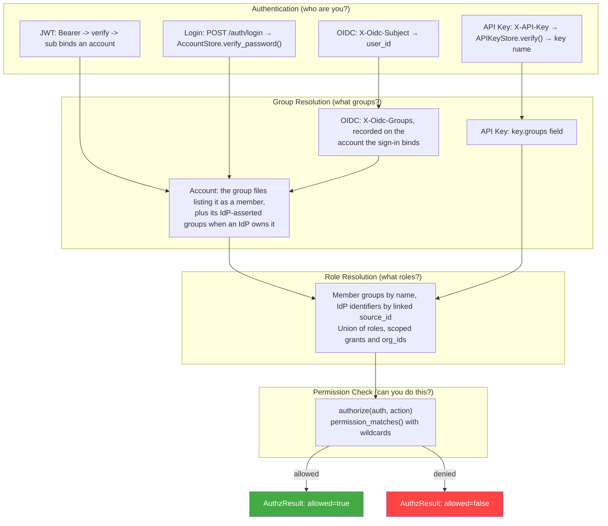

# RBAC - identity resolution and first login

Sections 2.1 and 3.5 of [rbac.md](rbac.md), which keep their numbers so section references resolve.

## 2.1 Identity Resolution Chain



An identifier an IdP asserts, in a token's groups claim, `X-Oidc-Groups` or a SCIM record, takes a group only when that group's `source_id` is the identifier and its `source_provider` is the provider the login came through (or one `auth.source_provider_bindings` joins to it). A group's name links nothing, so an IdP group that happens to be called `dfe-admins` gets no roles until an admin links it. Logins through `X-Oidc-Groups` count as the provider named in `auth.proxy_provider` (default `oidc`).

A link names its provider. A group with a `source_id` and no `source_provider` would answer every provider that asserts the id, so the group stores refuse to write one. A group file or document already carrying one loads unlinked: the id is dropped and links no provider, its members keep the group's roles, and the engine logs a warning naming the group and counts it on `auth_groups_unlinked_total{reason="no_provider"}`. The next write to that group saves it without the id, so link it again by setting both fields.

`auth.source_provider_bindings` joins each stamp straight to one OIDC provider, and settings refuse a chain such as `{"legacy": "scim", "scim": "entra"}`, where a target is itself a stamp. An IdP sign-in is admitted on the providers its account's own stamp answers for, the set its roles resolve through, so a SCIM account stamped `scim` is admitted on `scim` and `entra` but not on another stamp bound to `entra`.

A sign-in through `X-Oidc-Groups` resolves its roles the way a token does, from the account the sign-in binds: the groups its asserted identifiers link to, plus every group whose members list the account. A gateway that forwards no groups claim, Envoy among them, reaches roles only through that membership, so on those deployments adding an account to a group by hand is how its roles arrive.

---

## The sign-in allowlist

The linked groups are also the sign-in allowlist. An IdP sign-in, through the OIDC callback or `X-Oidc-Groups`, is admitted only when the account it binds to would hold a role, from a group its identifiers link to or a group whose members name the account, so a linked group with no role (every group the sync creates, until an admin gives it one) admits nobody. Anyone else gets `401 no_role_granted` (a sign-in the console started, with `return_to`, goes back to the console with that code in the URL fragment instead) and an `auth.jit.login_refused` audit event, a first sign-in leaves no account, and an existing account records the groups its IdP now asserts and has every session ended, as a logout ends them, so an issued token answers `401 session_ended` on any route, refresh included. The local admin or the break-glass account (section 3.5) links the first group, and adding an account to a group by hand admits someone the IdP groups do not cover, which is the only way in through a `manual`-mode provider.

An admin sets `source_id` and `source_provider` together through the groups API or dfe-ui's group form ([section 4.4](rbac-groups.md#44-group-sync-process)). `source_provider` names the provider whose logins the link answers. Where a `token_claim` provider's claim carries names (Okta's default, dex, Keycloak), `source_id` is the name the IdP sends. For Entra it is the object ID.

A groups claim sent as one string is split on commas (on whitespace when it has none, `auth/oidc/rp.py`) and `X-Oidc-Groups` is split on commas. So a group name containing a space needs an array claim. A `source_id` containing a comma matches only an array claim on the relying-party path.

---

## Local accounts and role changes

For a local account the group files are the authority. The account's own `groups` list is kept in step by the API routes, but it grants nothing. A member removed from a group file in the live store loses that group's roles and orgs at its next engine request, whether the API removed it, someone edited the file in the engine's auth directory, or the Helm chart's `authConfig.groupsConfigMap` copied a new file in at pod start. The deploy repo's `governance/rbac` classes are neither read nor written at runtime, so an edit there changes nothing. An account an IdP owns (JIT or SCIM) also holds the groups its record says the IdP asserts, so a group an operator adds it to by hand sits beside those.

dfe-hyperdx decides on the `role` claim of the token it holds, so there a role taken away lasts until that token expires or is refreshed (`api.jwt_expire_minutes`).

---

## 3.5 First Login: the two seeded accounts

The deploy mints the credentials, the engine refuses defaults, the UI never holds
a password.

**`admin`** takes its password from `DFE_AUTH_LOCAL_ADMIN_PASSWORD`, filled by the deployment's own secret store, issued with a forced change at first login. Every boot reasserts it until the admin replaces it, and after that only on a rotation.

**`breakglass`** is the recovery admin, verified against a bcrypt hash committed
at `governance/settings/auth.yaml` in the deploy repo, so it survives losing the
engine, the UI and the secret store:

```yaml
breakglass:
  password_hash: $2b$12$...   # minted once, never the plaintext
  enabled: true               # false locks the account out
```

`DFE_AUTH_BREAKGLASS_PASSWORD` mints that hash on the first boot with none
committed and is ignored afterwards. Gitops off means no hash and no break-glass
account. Every attempt is audit-logged (`auth.breakglass.login`). With
`enabled: false` the login returns 403 naming the setting.

**No `changeme` outside dev.** The engine refuses to start on an unset or default
admin password unless `DFE_ENV` is a dev posture -- the predicate gitops
auto-merge gates on (`settings.is_dev_posture`), and the error names the variable
and the fix. A dev posture running the default reports `default_credentials: true` on setup-status, login and refresh, for the UI to banner and force a change. Each reads the admin account at the request, so the forced change clears it with no restart.

**The predicate other repos copy** is `auth.bootstrap.default_credentials_in_use`:
strip surrounding whitespace, then treat empty and `changeme` as the default. An
exact comparison reads the `"changeme\n"` a Secret or `.env` line delivers as a
minted password.

**Reading the minted password.** setup-status carries `deploy_kind` (`docker` |
`kubernetes` | `local`, from `DFE_DEPLOYMENT_TARGET` else scalo's runtime
detection) and `credential_fetch_command`: `make creds` for docker, `kubectl -n
<ns> get secret <name> -o jsonpath='{.data.<key>}' | base64 -d` for kubernetes,
the environment file for local. Both survive setup completion (#301) -- that is
when an operator has lost the password.

---

## Changing and rotating passwords

**Changing either password.** `POST /auth/accounts/{username}/reset-password` works for both accounts on every deployment, and is the console's one password action for each. The new password works at the next sign-in, and the engine keeps it where that account's password lives so a restart does not undo it:

| Account | Kept in | Gitops off |
|---|---|---|
| `admin` | the live account store, and its whole account doc at `governance/rbac/accounts/<admin>.yaml` | the live account store only |
| `breakglass` | its bcrypt hash at `governance/settings/auth.yaml`, which every boot seeds the account from | no `breakglass` account |

A deployment that commits straight to main (dev, solo, auto-merge) is done at once. Production with `DFE_GITOPS_MODE=team` opens a review instead, and the response's `git.pending` carries the PR URL, or the merge command when no forge is configured. A restart before the review merges brings the old password back. `GET /auth/accounts/{username}/git-status` reports when it has merged.

**Rotation.** `POST /auth/accounts/{admin}/rotate-password` changes the value the deployment injects, not the live password: it writes the deployment's secret store when `DFE_AUTH_LOCAL_ADMIN_PASSWORD_SECRET_PATH` is set, else returns 501 with the command that changes it where the deployment keeps it (`context.store_command`). The next boot issues the rotated value with a forced change. The engine never writes the password into its own YAML store. The new password faces the two rules that gate startup -- 12 characters minimum, never the default -- so a rotation cannot lock the deployment out of its own next boot. Either is a 422 naming the field. Any other account answers 400 `not_store_backed` and is reset instead.

**The admin is kept.** The console never retires `admin`: its first login replaces the minted password, and from then on it is reset like any other account. `POST /api/v1/auth/setup/retire-admin` remains for an operator whose policy is to disable it once the deployment has an admin of its own.
