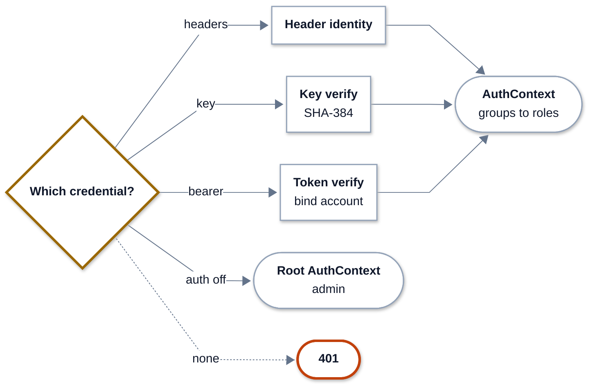
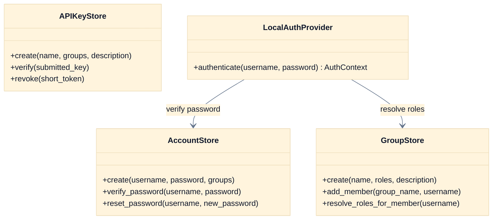
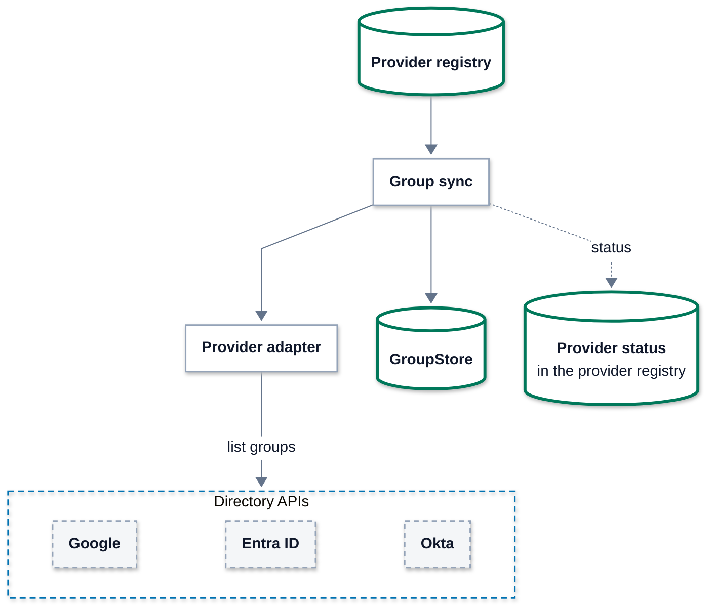
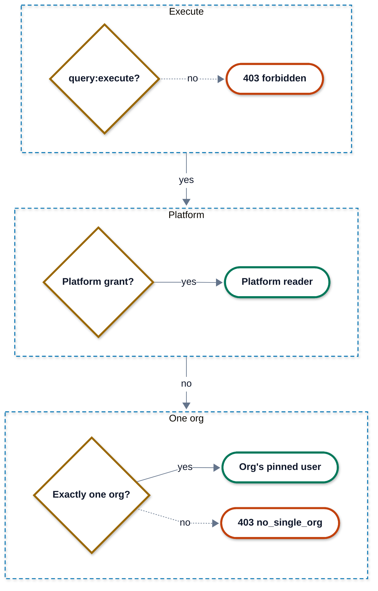
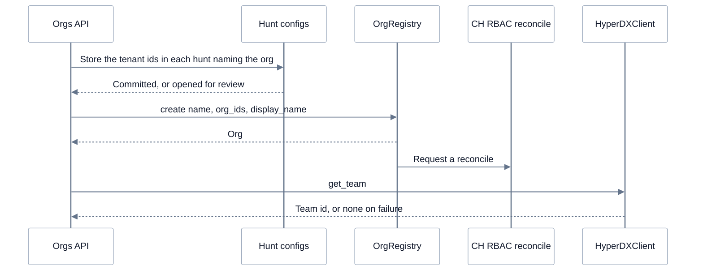

# RBAC, Multi-Tenant ClickHouse, and Auth Architecture

**Scope:** Auth, granular RBAC, multi-tenant CH with row-level security, OIDC group sync, dfe-hyperdx integration, Argo CD RBAC export

---

## 1. Auth Flow

### 1.1 Four Authentication Paths

`get_current_user()` (`src/dfe_engine/api/deps.py`) tries the credentials in a fixed order and stops at the first one present.



*Figure 1. L4 Detail -- Four authentication paths. The arrow labelled none is the refusal, and `auth off` needs a dev `DFE_ENGINE_ENV`.* Up: [Control plane](README.md).

A bearer token is verified for its signature (ES384 by default), issuer and expiry, and its `sub` binds an account. A disabled or blocked account answers 401, and the token's claims are ignored. A key or a header identity resolves its groups through the `GroupStore` the same way.

| Path | Use case | Credential storage | Token lifetime |
|------|----------|-------------------|----------------|
| OIDC headers | Fallback, off by default: an engine an OIDC proxy fronts, with no other way in | IdP (Entra, Google, etc.) | Session cookie (proxy managed) |
| API key | CI/CD, Terraform, scripts | `config/auth/api-keys/*.yaml` (SHA-384 hash) | `expires_at` if set, else `auth.api_key_default_ttl_days` from creation (default 90, `0` for no expiry). Revoke by deleting the file |
| JWT Bearer | Console sessions, standalone, dev | Issued by `POST /api/v1/auth/login`, the OIDC login callback and `POST /api/v1/auth/refresh` | `api.jwt_expire_minutes` (`DFE_ENGINE_API_JWT_EXPIRE_MINUTES`, default 60) |
| Disabled | Dev/test | N/A | N/A |

A JWT holds identity, not authority. Its `org_id`, `roles`, `groups` and `org_ids` claims grant nothing: every request re-resolves them from the account the `sub` binds to, so a role or org taken away is gone from the next request.

A session's `org_id` is its account's `org`, set by `POST` or `PUT /api/v1/auth/accounts`, or its API key's `org`, set by `POST /api/v1/auth/api-keys` (`422 unknown_org` for an unregistered org), and empty for one bound to none. A view taking `org_id` runs when the session's groups grant that org or it reads every org, else `403 no_org` or `403 org_not_granted`. A `sub` that binds no account holds nothing -- an API-key subject, a deleted account -- and with auth enabled `POST /api/v1/auth/refresh` answers 401 for it, since each refresh issues a later expiry.

OIDC headers a proxy injects, read when `auth.trust_proxy_auth_headers` (`DFE_ENGINE_AUTH_TRUST_PROXY_AUTH_HEADERS`) is true. dfe-infra's gateway sets them with its opt-in `jwtAuthn`, and Envoy Gateway cannot map the array `groups` claim, so `X-Oidc-Groups` does not arrive from it:

| Header | Content |
|--------|---------|
| `X-Oidc-Subject` | User email or unique ID |
| `X-Oidc-Email` | User email, optional |
| `X-Oidc-Groups` | Comma-separated OIDC group identifiers |

### 1.2 Deployment Modes

Local auth is **always available**. OIDC headers are additive -- checked
first when present and `auth.trust_proxy_auth_headers` is true, but JWT and
API key paths remain active. With the flag off (the default) the engine ignores
the headers and falls through to API key and JWT.

| Mode | Setting | What's active | Use case |
|------|---------|--------------|----------|
| **Dev/test** | `auth.enabled=false` with a dev `DFE_ENGINE_ENV` | Requests with no credential get root admin context. Any other `DFE_ENGINE_ENV` will not start | Local development |
| **Standalone** | `auth.enabled=true` (the default) | JWT Bearer + API keys + local accounts | Docker, no external IdP |
| **Production** | `auth.enabled=true` + an OIDC provider | The engine is the OIDC relying party (`/api/v1/auth/oidc/{provider}/login`) and mints the session JWT, plus API keys and local accounts | Kubernetes |
| **Proxy headers (fallback)** | `auth.enabled=true` + `auth.trust_proxy_auth_headers=true` | OIDC headers (precedence) + JWT + API keys | An engine an OIDC proxy fronts, with no other way in |

### 1.3 OIDC Header Trust Model

**Security precondition:** When `auth.trust_proxy_auth_headers` is on,
the proxy that sets the headers MUST be the one way to reach dfe-engine. Direct pod access MUST be
blocked by K8s NetworkPolicy. Without this, any client with pod access can
forge OIDC headers and impersonate any user.

## 1.4 Credential Storage Architecture

The auth files hold accounts, groups, keys and roles, and the secrets backend holds the signing key and ClickHouse passwords.

```mermaid
---
config:
  theme: base
  look: neo
  fontFamily: Inter, -apple-system, Segoe UI, Roboto, Helvetica, Arial, sans-serif
  flowchart:
    curve: linear
    nodeSpacing: 40
    rankSpacing: 64
    padding: 18
    wrappingWidth: 280
    htmlLabels: true
  elk:
    preset: modelOrder
  themeVariables:
    fontSize: 15px
    lineColor: "#64748B"
    primaryTextColor: "#0F172A"
    nodeBorder: "#334155"
    clusterBorder: "#0072B2"
    edgeLabelBackground: "#FFFFFF"
  themeCSS: >-
    p{margin:0}
    .node[data-look] rect,.node[data-look] path,.node[data-look] polygon,.node[data-look] .outer-path{filter:drop-shadow(0 1px 2px rgba(15,23,42,.10)) drop-shadow(0 6px 14px rgba(15,23,42,.10))}
    .node rect{rx:10px;ry:10px}
    .cluster rect{rx:16px;ry:16px}
    .node .label div{min-width:150px}
    .node.decision .label div{min-width:0}
    .cluster[data-look] rect{filter:none}
    .nodeLabel{line-height:1.35}
    .nodeLabel b{font-weight:600;font-size:15px;letter-spacing:-0.01em}
    .nodeLabel span{font-size:12.5px;font-weight:400;color:#334155}
    .cluster-label span.nodeLabel{display:inline-block;background:#FFFFFF;color:#0B2A3F;border:1.5px solid #0072B2;border-radius:999px;padding:2px 12px;font-size:11.5px;font-weight:700;letter-spacing:.09em;text-transform:uppercase}
    .flowchart-link{stroke-width:1.75px}
    .labelBkg{background:transparent!important}
    span.edgeLabel{display:inline-block;background:#FFFFFF!important;color:#1E293B;border:1px solid #94A3B8;border-radius:999px;padding:2px 10px;font-size:12px;font-weight:500}
    span.edgeLabel p{background:transparent!important}
    .label-icon{width:20px;height:20px;vertical-align:-4px;margin-right:6px}
    .icon-shape path[stroke-width="0"][fill="none"]{fill:#FFFFFF;stroke:#FFFFFF;stroke-width:12px;stroke-linejoin:round}
    .icon-shape p{background:transparent!important;color:#0F172A}
    .ingest .label-icon{color:#0E8A7D}
    .xform .label-icon{color:#7B4FB0}
    .load .label-icon{color:#0072B2}
    .bus .label-icon{color:#A8517F}
    .store .label-icon{color:#00785A}
    .ui .label-icon{color:#D9480F}
    .ext .label-icon{color:#64748B}
---
flowchart LR
  accTitle: L4 Detail -- Credential storage
  accDescr: The auth files hold accounts, groups, API keys and the role definitions, and the engine reads them to verify passwords and keys and to resolve roles. The secrets backend holds the JWT signing key and the ClickHouse passwords.

  subgraph files["Auth files"]
    direction TB
    acc[("<b>accounts/</b>")]
    grp[("<b>groups/</b>")]
    keys[("<b>api-keys/</b>")]
    roles[("<b>rbac/roles.yaml</b>")]
  end

  sec[("<b>Secrets backend</b>")]

  api["<b>dfe-engine API</b>"]

  files -->|hashes, roles| api
  sec -->|keys, passwords| api
  class acc,grp,keys,roles,sec store
  class api control
  classDef ext fill:#F4F6F8,stroke:#94A3B8,stroke-width:1.5px,stroke-dasharray:5 4,color:#0F172A
  classDef ingest fill:#FFFFFF,stroke:#0E8A7D,stroke-width:3px,color:#0F172A
  classDef xform fill:#FFFFFF,stroke:#7B4FB0,stroke-width:3px,color:#0F172A
  classDef load fill:#FFFFFF,stroke:#0072B2,stroke-width:3px,color:#0F172A
  classDef bus fill:#FFFFFF,stroke:#A8517F,stroke-width:3px,color:#0F172A
  classDef store fill:#FFFFFF,stroke:#00785A,stroke-width:3px,color:#0F172A
  classDef ui fill:#FFFFFF,stroke:#D9480F,stroke-width:3px,color:#0F172A
  classDef decision fill:#FFFFFF,stroke:#9A6700,stroke-width:3px,color:#0F172A
  classDef error fill:#FFFFFF,stroke:#C2410C,stroke-width:3px,color:#0F172A
  classDef control fill:#FFFFFF,stroke:#334155,stroke-width:3px,color:#0F172A
  classDef part fill:#FFFFFF,stroke:#94A3B8,stroke-width:1.5px,color:#0F172A
  style files fill:none,stroke:#0072B2,stroke-width:1.5px,stroke-dasharray:6 4
```



*Figure 2. L4 Detail -- Credential storage.* Up: [Control plane](README.md).

The auth files are YAML and hold one-way hashes, so they are safe to commit. The secrets backend (a `.env`, a Kubernetes Secret, OpenBao or a cloud secrets manager) is never committed.

What goes where:

| Data | Where stored | Format | Safe to commit? |
|------|-------------|--------|-----------------|
| Account names | `accounts/{name}.yaml` | Filename stem | Yes |
| Password hashes | `accounts/{name}.yaml` | `$2b$12$...` (bcrypt) | Yes (one-way) |
| API key short token | `api-keys/{name}.yaml` | Plaintext (8 hex chars) | Yes (lookup index) |
| API key long hash | `api-keys/{name}.yaml` | `sha384:{hex}` (legacy `sha256:` keys still verify) | Yes (one-way) |
| Full API key | Shown once at creation | `dfe_ak_{short}_{long}` | **NO** (never stored) |
| JWT signing key | Secrets backend at `api.jwt_key_path` (default `jwt/signing-key`), minted on first boot when absent | ECDSA private key, PEM (P-384 for the default ES384) | **NO** |
| OIDC login session cookie key | `DFE_ENGINE_API_SESSION_SECRET`, else `DFE_ENGINE_API_JWT_SECRET` | Random, `DFE_ENGINE_API_JWT_SECRET` at least 32 bytes | **NO** |
| CH connection passwords | Env var / K8s Secret | Plaintext | **NO** |
| Role definitions | `rbac/roles.yaml` beside the auth directory, seeded from `src/dfe_engine/auth/resources/roles.yaml` on first boot | Permission patterns | Yes |
| Group->role mapping | `groups/{name}.yaml` | Role list | Yes |

Config directory layout:

```text
config/auth/
    accounts/           # One YAML per local user account
        admin.yaml
        analyst1.yaml
    groups/              # One YAML per group (group -> roles)
        dfe-admins.yaml
        soc-analysts.yaml
    api-keys/            # One YAML per API key
        ci-deploy.yaml
    oidc-providers/      # One YAML per OIDC provider (see 4.2)
```

Account filename = username. Group filename = group name. API key filename =
key name. The filename IS the identity -- never stored inside the YAML body
(avoids DirectoryConfigStore YAML 1.1 boolean coercion on values like `off`,
`yes`, `no`).

## 1.5 Password Verification

`AccountStore.verify_account_password()` (`src/dfe_engine/auth/accounts.py`) runs one bcrypt check on every path. A missing account, an empty password and an account with no usable hash are checked against a dummy hash and turned down, so the time an answer takes does not reveal whether a username exists.

## 1.6 API Key Format

A key reads `dfe_ak_<short>_<long>`, for example `dfe_ak_8a3f2c91_7f3b2c4d8e9a1b5f6c7d8e9f0a1b2c3d`.

| Part | Form | Stored as |
|---|---|---|
| Prefix `dfe_ak_` | Fixed, so GitHub and GitGuardian secret scanning can match it | Not stored |
| Short token | 8 hex characters | Plaintext in the key file, the lookup index the UI shows |
| Long token | 32 hex characters | A SHA-384 hash. Not bcrypt: the token is high-entropy random, so bcrypt's slowness adds no security |

- The full key is shown **once** at creation and can never be read back.
- Expiry (`expires_at`, optional ISO-8601 stored as UTC) is enforced on every
  verify, so a lapsed key stops authenticating with no sweeper running. The
  file stays until revoked, and `list` reports `expired: true`. A key created
  through the API without one expires after `auth.api_key_default_ttl_days`
  (default 90, `0` for no expiry).
- Revocation: delete the key's YAML file or call the revoke API.

## 1.7 API Key Verification

`APIKeyStore.verify_detailed()` (`src/dfe_engine/auth/api_keys.py`) parses the key, finds the key file by its short token, hashes the long token with the key's stored algorithm (`sha384`, or `sha256` for a key made before SHA-384) and compares the two with `hmac.compare_digest`. The disabled and expired checks run after that comparison, so the reason a key is turned down cannot confirm a key the caller does not hold. The reasons are `malformed_key`, `unknown_key`, `invalid_key`, `disabled_key` and `expired_key`.

---

## 2. RBAC Data Model

### 2.1 Identity Resolution Chain

Moved to [rbac-sign-in.md](rbac-sign-in.md#21-identity-resolution-chain).

### 2.2 Role Definitions

The built-in roles ship in `src/dfe_engine/auth/resources/roles.yaml`. On first
boot the engine copies that file to `rbac/roles.yaml` beside the auth directory
and loads roles from the copy. Custom roles are added to it through
`/api/v1/auth/roles`.

The API turns down edits to a built-in role, and every boot rewrites each built-in role in the copy to the package's definition. A built-in grant changed in a later engine release therefore reaches an existing deployment with its next restart. Custom roles are left as they are, and a hand edit to a built-in role does not survive a boot.

The 8 built-in roles form a flat set with no inheritance, split across the two planes of [rbac-vocabulary.md](rbac-vocabulary.md).

```mermaid
---
config:
  theme: base
  look: neo
  fontFamily: Inter, -apple-system, Segoe UI, Roboto, Helvetica, Arial, sans-serif
  flowchart:
    curve: linear
    nodeSpacing: 40
    rankSpacing: 64
    padding: 18
    wrappingWidth: 280
    htmlLabels: true
  elk:
    preset: modelOrder
  themeVariables:
    fontSize: 15px
    lineColor: "#64748B"
    primaryTextColor: "#0F172A"
    nodeBorder: "#334155"
    clusterBorder: "#0072B2"
    edgeLabelBackground: "#FFFFFF"
  themeCSS: >-
    p{margin:0}
    .node[data-look] rect,.node[data-look] path,.node[data-look] polygon,.node[data-look] .outer-path{filter:drop-shadow(0 1px 2px rgba(15,23,42,.10)) drop-shadow(0 6px 14px rgba(15,23,42,.10))}
    .node rect{rx:10px;ry:10px}
    .cluster rect{rx:16px;ry:16px}
    .node .label div{min-width:150px}
    .node.decision .label div{min-width:0}
    .cluster[data-look] rect{filter:none}
    .nodeLabel{line-height:1.35}
    .nodeLabel b{font-weight:600;font-size:15px;letter-spacing:-0.01em}
    .nodeLabel span{font-size:12.5px;font-weight:400;color:#334155}
    .cluster-label span.nodeLabel{display:inline-block;background:#FFFFFF;color:#0B2A3F;border:1.5px solid #0072B2;border-radius:999px;padding:2px 12px;font-size:11.5px;font-weight:700;letter-spacing:.09em;text-transform:uppercase}
    .flowchart-link{stroke-width:1.75px}
    .labelBkg{background:transparent!important}
    span.edgeLabel{display:inline-block;background:#FFFFFF!important;color:#1E293B;border:1px solid #94A3B8;border-radius:999px;padding:2px 10px;font-size:12px;font-weight:500}
    span.edgeLabel p{background:transparent!important}
    .label-icon{width:20px;height:20px;vertical-align:-4px;margin-right:6px}
    .icon-shape path[stroke-width="0"][fill="none"]{fill:#FFFFFF;stroke:#FFFFFF;stroke-width:12px;stroke-linejoin:round}
    .icon-shape p{background:transparent!important;color:#0F172A}
    .ingest .label-icon{color:#0E8A7D}
    .xform .label-icon{color:#7B4FB0}
    .load .label-icon{color:#0072B2}
    .bus .label-icon{color:#A8517F}
    .store .label-icon{color:#00785A}
    .ui .label-icon{color:#D9480F}
    .ext .label-icon{color:#64748B}
---
flowchart LR
  accTitle: L4 Detail -- Built-in roles
  accDescr: Seven built-in roles grant control-plane actions: admin, infra_admin, infra_viewer, data_analyst, data_analyst_viewer, dfe_operator and ingest_admin. Two grant data-plane reads: data_viewer and the scoped org_viewer.

  subgraph ctrl["Control plane"]
    direction TB
    admin["<b>admin</b>"]
    infra_admin["<b>infra_admin</b>"]
    infra_viewer["<b>infra_viewer</b>"]
    data_analyst["<b>data_analyst</b>"]
    data_analyst_viewer["<b>data_analyst_viewer</b>"]
    dfe_operator["<b>dfe_operator</b>"]
    ingest_admin["<b>ingest_admin</b>"]
  end

  subgraph dataplane["Data plane"]
    direction TB
    data_viewer["<b>data_viewer</b>"]
    org_viewer["<b>org_viewer</b>"]
  end

  ctrl ~~~ dataplane
  class admin,infra_admin,infra_viewer,data_analyst,data_analyst_viewer,dfe_operator,ingest_admin,data_viewer,org_viewer part
  classDef ext fill:#F4F6F8,stroke:#94A3B8,stroke-width:1.5px,stroke-dasharray:5 4,color:#0F172A
  classDef ingest fill:#FFFFFF,stroke:#0E8A7D,stroke-width:3px,color:#0F172A
  classDef xform fill:#FFFFFF,stroke:#7B4FB0,stroke-width:3px,color:#0F172A
  classDef load fill:#FFFFFF,stroke:#0072B2,stroke-width:3px,color:#0F172A
  classDef bus fill:#FFFFFF,stroke:#A8517F,stroke-width:3px,color:#0F172A
  classDef store fill:#FFFFFF,stroke:#00785A,stroke-width:3px,color:#0F172A
  classDef ui fill:#FFFFFF,stroke:#D9480F,stroke-width:3px,color:#0F172A
  classDef decision fill:#FFFFFF,stroke:#9A6700,stroke-width:3px,color:#0F172A
  classDef error fill:#FFFFFF,stroke:#C2410C,stroke-width:3px,color:#0F172A
  classDef control fill:#FFFFFF,stroke:#334155,stroke-width:3px,color:#0F172A
  classDef part fill:#FFFFFF,stroke:#94A3B8,stroke-width:1.5px,color:#0F172A
  style ctrl fill:none,stroke:#0072B2,stroke-width:1.5px,stroke-dasharray:6 4
  style dataplane fill:none,stroke:#0072B2,stroke-width:1.5px,stroke-dasharray:6 4
```



*Figure 3. L4 Detail -- Built-in roles. `org_viewer` is the one scoped role.* Up: [Control plane](README.md).

[rbac-vocabulary.md](rbac-vocabulary.md) says what each role is for, and `src/dfe_engine/auth/resources/roles.yaml` lists the permissions each grants.

A role write grants what its caller holds and nothing more. Creating a role, or changing what one grants, needs every permission it lists through the caller's system-scope grants, where a pattern covers another when it matches everything that one does (`config:*` covers `config:read`). An unscoped role reads every org once bound at system scope, so it needs those permissions through roles that themselves read every org. Handing a role to a group, an account or an API key follows the same rule at the group's scope, `role:write` adds nothing to it, and a role `roles.yaml` does not declare needs `*`.

`source:write` reaches every credential the fetcher can. A fetcher source names its credential as a reference (`env:`, `file:`, `vault:`), and the fetcher resolves it with its own privileges and sends it to the host the source names. So grant `source:write` (`data_analyst`, `ingest_admin`) only to people trusted with the fetcher's credentials. dfe-infra's [threat model](https://github.com/hyperi-io/dfe-infra/blob/main/docs/threat-model.md) records this as an accepted risk.

A `scoped` role grants `...:read` patterns and `query:execute` and nothing else, as at system scope it passes every org-scope check. Anything else fails the roles file's load, and the roles API answers 422.

## 2.3 Permission Taxonomy

| Domain | Actions | Scoped by service? |
|--------|---------|---------------------|
| `hunt` | `read`, `write`, `delete`, `execute`, `*` | No |
| `query` | `read`, `execute`, `write` (save searches and dashboards in Observe, section 7.2), `*` | No |
| `source` | `read`, `write`, `delete`, `deploy`, `*` | No |
| `fieldmap` | `read`, `write`, `delete`, `*` | No |
| `alert` | `read`, `write`, `delete`, `*` | No |
| `schema` | `read`, `write`, `delete`, `*` | No |
| `dashboard` | `read`, `*` | No |
| `config` | `read`, `write`, `*` | No |
| `transform` | `compile`, `test`, `*` | No |
| `service` | `read`, `write`, `delete`, `validate`, and per service `config:read`, `config:write`, `metrics:read`, `*` | The `config` and `metrics` actions (`service:{name}:{action}`) |
| `helm` | `compile`, `execute_ddl`, `create_topics`, `*` | No |
| `deployment` | `read`, `write`, `*` | No |
| `org` | `read`, `write`, `*` | No |
| `usage` | `read` | No |
| `argo` | `{resource}:{action}` (open-ended) | No |

The routes enforce more domains than this table lists (accounts, groups, API keys, roles, OIDC providers, governance, and others). The full catalogue is `src/dfe_engine/auth/rbac_scopes/scope_constants.py`.

The usage scope:

`usage:read` opens `GET /api/v1/usage` and `GET /api/v1/usage/overview` ([ui-api-guide.md](ui-api-guide.md#usage-apiv1usage)). Four built-in roles hold it: `infra_admin`, `infra_viewer`, `dfe_operator` and `org_viewer`. `admin` holds it through `*`. A changed built-in grant reaches an existing deployment at its next restart, see [2.2](#22-role-definitions).

A grant at system scope or at an org's scope opens both routes. A holder with a grant that reads every org sees the whole deployment and may name any org. Any other holder is held to the orgs it holds that grant `usage:read`. `org_viewer` is scoped, so it is always held. The reads are described in [rbac-engine-reads.md](rbac-engine-reads.md#usage-reads).

## 2.4 Wildcard Permission Matching

```python
def permission_matches(permission: str, action: str) -> bool:
```

| Pattern | Matches | Does NOT match |
|---------|---------|----------------|
| `*` | Everything | -- |
| `config:*` | `config:read`, `config:write`, `config:read:sub` | `hunt:read` |
| `service:*:config:*` | `service:loader:config:read` | `service:loader:metrics:read` |
| `service:*:config:read` | `service:loader:config:read` | `service:loader:config:write` |

- `*` alone matches ANY action regardless of segment count
- Trailing `*` matches any remaining segments
- Mid-position `*` matches exactly one segment

## 2.5 Authorization Engine

```python
# engine.py
def authorize(
    auth: AuthContext | None,
    action: str,
    resource: str = "",
    *,
    scope: Scope | None = None,
    enabled: bool = True,
    role_config: RoleConfig | None = None,
) -> AuthzResult:
```

Decision order:

1. `enabled=False` -> allow (dev/test)
2. `auth=None` -> root mode, allow
3. For each of the caller's scoped grants (`auth.grants`, else `auth.roles` as system grants): allow when the grant's scope covers the requested scope and its role's permissions match the action. `scope=None` is a system-scope check
4. Return `AuthzResult(allowed, reason)`

## 2.6 RBAC Enforcement in API

```python
# api/deps.py
@router.post("/sources")
async def create_source(
    user: CurrentUser,
    _auth: None = Depends(require_action("source:write")),
): ...
```

`require_action(action)` calls `authorize()` and raises `AuthorizationError` on denial,
which the error handler converts to HTTP 403.

---

## 3. Account, Group, and API Key Stores

### 3.1 Store Architecture

Three YAML-backed stores hold accounts, groups and API keys, and the local login provider reads the first two.



*Figure 4. L4 Detail -- Auth stores. Arrows are calls.* Up: [Control plane](README.md).

An account's `groups` field names groups in `GroupStore`. `AccountStore` and `GroupStore` have `get`, `list`, `update` and `delete` as well, `GroupStore` has `remove_member`, and `APIKeyStore` has `get` and `list`. All stores are YAML-backed (one file per entity, filename = identity).

### 3.2 File Formats

```yaml
# config/auth/accounts/analyst1.yaml
enabled: true
password_hash: "$2b$12$LJ3m..."
groups: ["soc-analysts"]        # kept in step with the group files; grants nothing for a local account
created_at: "2026-03-31T02:00:00Z"
updated_at: "2026-03-31T02:00:00Z"
```

```yaml
# config/auth/groups/soc-analysts.yaml
description: "SOC analyst team"
roles: ["data_analyst"]
members: ["analyst1", "analyst2"]
source_provider: ""              # identity provider the group is linked to (see 4.4)
source_id: ""                    # that provider's group ID; needs source_provider
```

```yaml
# config/auth/api-keys/ci-deploy.yaml
enabled: true
short_token: "8a3f2c91"
key_hash: "sha384:38b060a7..."
groups: ["infra-ops"]
org: "acme"                      # org its sessions are bound to, empty for none
description: "CI/CD pipeline deployer"
created_at: "2026-03-31T02:00:00Z"
```

### 3.3 REST API

```text
POST   /api/v1/auth/login                           # JWT login
POST   /api/v1/auth/refresh                          # Refresh JWT
POST   /api/v1/auth/logout                           # End the session
GET    /api/v1/auth/me                               # Current user info + permissions
GET    /api/v1/auth/permissions                      # Current user's resolved permissions
GET    /api/v1/auth/setup-status                     # First-login state (see 3.5)
POST   /api/v1/auth/setup/retire-admin               # Retire the bootstrap admin
GET    /api/v1/auth/oidc/{provider}/login            # OIDC sign-in (see 4)
GET    /api/v1/auth/oidc/{provider}/callback         # OIDC callback, mints the engine JWT
```

Account, group, API key, role and OIDC provider CRUD sit under
`/api/v1/auth/accounts`, `/api/v1/auth/groups`, `/api/v1/auth/api-keys`,
`/api/v1/auth/roles` and `/api/v1/auth/oidc-providers`. `openapi/openapi.json`
lists every route.

An account holds its roles only through its groups, so `POST /api/v1/auth/accounts` needs at least one group and a `PUT` cannot empty them (422).

### 3.4 Bootstrap Defaults

`bootstrap_auth()` seeds these groups when the group store is empty:

- `dfe-admins` -> roles: `[admin]`
- `dfe-analysts` -> roles: `[data_analyst]`
- `dfe-viewers` -> roles: `[data_viewer]`
- `dfe-infra` -> roles: `[infra_admin]`
- `dfe-ingest` -> roles: `[ingest_admin]`

The two seeded accounts, `admin` and `breakglass`, are both in `dfe-admins` (section 3.5).

---

### 3.5 First Login: the two seeded accounts

Moved to [rbac-sign-in.md](rbac-sign-in.md#35-first-login-the-two-seeded-accounts).

---

## 4. OIDC Provider Integration

### 4.1 Architecture

A group sync reads the provider from the registry, lists its groups through the adapter and writes them to the group store.



*Figure 5. L4 Detail -- OIDC provider sync. Google, Entra ID and Okta are external, and the status arrow writes the sync's status back.* Up: [Control plane](README.md).

`get_adapter()` picks the adapter by provider type. A `generic` provider has no directory API, so it never syncs. Each provider resolves groups in one of three modes:

| Mode | Groups come from |
|---|---|
| `manual` | Membership managed in dfe-engine alone |
| `token_claim` | The OIDC token's groups claim at login |
| `api` | The provider's API: a scheduled sync, and at login with `enrich_on_login` |

### 4.2 Provider Configuration

```yaml
# config/auth/oidc-providers/{name}.yaml
type: "google"           # generic | google | entra_id | okta
enabled: true
display_name: "Google Workspace"
issuer: "https://accounts.google.com"
client_id: "1234.apps.googleusercontent.com"   # not secret
client_secret_path: "oidc/google-workspace/client_secret"
groups:
  mode: "api"            # manual | token_claim | api (google: api only)
  sync_interval: 3600
  enrich_on_login: true  # required for google: its tokens carry no groups
  # Google, optional: a service account holding a groups admin role, for sync
  service_account_json_path: "oidc/google-workspace/groups_service_account_json"
  domain: "example.com"
```

A Google login reads the user's groups from Cloud Identity with that login's token (scope `cloud-identity.groups.readonly`, Cloud Identity API enabled in the OAuth client's project). A group file links on `source_id`, the id after `groups/` in the group's resource name.

The customer's IdP admin sets up their side from [idp-setup/google.md](idp-setup/google.md), [idp-setup/entra.md](idp-setup/entra.md) or [idp-setup/okta.md](idp-setup/okta.md), and sends back the client credentials, the issuer and the group identifiers each provider links on.

Config holds a secret PATH into the `DfeSecrets` store, or the NAME of an env var
(`client_id_env`, `client_secret_env`, `service_account_json_env`) -- never a
secret value. Resolution reads the store first, so a credential sent to
`POST /api/v1/auth/oidc-providers` takes effect without a restart, then the
environment, so an ESO-mounted variable keeps working.

Surrounding whitespace, such as the newline a mounted secret file ends with, is stripped from a resolved credential. An Okta API token still holding a space, a control character or a non-ASCII one is never sent: the sync reads `error` and the connection test names the setting, never the value. Each secret's `*_env` field (`client_secret_env` plus `groups.api_token_env`, `groups.client_secret_env` and `groups.service_account_json_env`) moves that secret between the store and an env var on `PUT /api/v1/auth/oidc-providers/{name}`:

| Request sends | Result |
|---|---|
| no `*_env` field | the env var name and any stored copy are kept |
| `*_env` set to `""` | the name is cleared, the stored copy is kept |
| a name, with no value for the secret, that differs from the one held or sits beside a stored copy | the env var must resolve non-empty in the engine: the name is saved and the stored copy is deleted once the update is saved |
| the same, but the engine does not set that env var | `422`, the field error `env_var_not_set` on that `*_env` field. Nothing is saved or deleted |
| the name the provider holds, with nothing stored | no change |
| a value for the secret | the value is stored and the name saved as sent |

A create naming an env var the engine does not set, with no value for that secret, is turned down the same way. A stored copy that fails to delete after the update is saved is logged by its store path. The update still answers 200.

### 4.3 Adapter Implementations

| Adapter | Status | Admin API | Group sync |
|---------|--------|-----------|------------|
| Generic | Done | None | No (use `token_claim` mode) |
| Google | Done | Cloud Identity as the user at login. Admin SDK `groups().list()` as an optional service account | With a service account, else no |
| Entra ID | Done | Graph `/me/transitiveMemberOf` with the user's token on a >200 group overage, falling back to app-only `/users/{oid}/transitiveMemberOf` when Graph turns that token down. Graph `/groups` for sync | Yes, api mode with app credentials -- `$top=999` pagination |
| Okta | Done | Groups API `/api/v1/groups` with an API token, in api mode. `token_claim` calls nothing | Yes, api mode -- `Link` header pagination |

A directory outage, a lookup past its deadline included, keeps the groups the ID token carries, or the account's stored groups when it carries none, so an outage never locks a user out. A refusal (a 401 or 403, a missing scope or credential) is judged as no directory groups, and the login then needs a membership that grants a role (`auth/oidc/rp.py`, `_enrich_groups_from_directory`). The group sync's listing does the opposite and raises, so a failed listing never reads as a directory with no groups (section 4.4).

### 4.4 Group Sync Process

Moved to [rbac-groups.md](rbac-groups.md#44-group-sync-process).

---

## 5. ClickHouse Tenant Isolation

### 5.1 Pinned Org Users, One Shared Policy Set

Every registered org gets a ClickHouse user for that org alone, and that user is what fences it in. The reconciler in `src/dfe_engine/governance/ch/` renders the whole model from the org registry and the tier catalogue. The role, setting and user names come from the dfe-schemas catalogue, not from engine code.

- One shared tenant role. Every org-pinned user holds it and nothing else does.
- One RESTRICTIVE row policy per table with an `_org_id` column, on that role. Its predicate is `has(splitByChar(',', getSetting('<tenant setting>')), _org_id)`.
- The tenant setting, pinned READONLY on each org user, listing that org's `_org_id` values. A `SETTINGS` clause in query text cannot override it: ClickHouse answers 452 (SETTING_CONSTRAINT_VIOLATION).

A platform identity does not hold the tenant role, so no policy targets it and it reads every row. RESTRICTIVE-only is deliberate. A PERMISSIVE policy would flip the table to default-deny for everyone. A holder of the tenant role with no pinned setting makes `getSetting` throw, so a bad grant fails closed.

A tenant-reachable table with no `_org_id` column gets a `USING 0` policy, so a tenant reads nothing from it. The tables are found in `system.columns`.

Adding an org adds one pinned user. The policy set does not change.

Each reconcile replaces a pinned or group user's whole role set, so a group that loses `admin` loses `otel_reader` with it, and one that turns platform-wide loses the tenant role.

It replaces each tier, service and tenant role's privileges with the ones configured as well, so a grant dropped from a tier is revoked. Where ClickHouse turns the list down, the role is cleared and given each entry it accepts.

## 5.2 Who Reads As Whom

`GET /api/v1/hyperdx/connection` (`src/dfe_engine/api/v1/hyperdx.py`) picks the ClickHouse user a caller reads as.



*Figure 6. L4 Detail -- Who reads as whom. Platform reader and Org's pinned user are ClickHouse users, and the two 403 ends are refusals.* Up: [Control plane](README.md).

The platform reader holds no tenant role and reads every org. A pinned user holds the tenant role and its org's pinned setting. Both refusals fail closed.

`platform_grants` (`src/dfe_engine/auth/models.py`) is the one filter for "every org". The ClickHouse group bindings, the sampler, the dfe-hyperdx connection read, the fork's role claim and JIT team assignment all go through it. A role bound at an org's scope covers that org alone, a role marked `scoped` in `roles.yaml` is held to its holder's orgs wherever it is bound, a role `roles.yaml` does not declare unfences nothing, and `org_viewer` never unfences anyone.

`authorize()` holds the same roles to those orgs. A system grant of a scoped role or `org_viewer` answers yes at an org's scope, or at a group that org owns, only when its group names the org by name or tenant id. It answers no at any other org, at a system-wide group and at another user's scope. Its system-scope check still passes, because the handler holds what it reads there to those orgs. These routes take a platform role instead, since no handler holds their rows to an org: API keys, SCIM, the account list, get, git-status and attribute reads, the group attribute reads, the alert destination reads, and the hunt list and get. A built-in `org_viewer` keeps the reads its role grants.

Group bindings (`src/dfe_engine/governance/ch/bindings.py`) follow the same rule. An org-scoped group binds to its org's pinned user whatever roles it holds. A system group holding a platform role reads unrestricted, and an `admin` or `infra_admin` group reads the otel database as well. A group's claimed org markers resolve to a registered org by name or, failing that, by the one org that declares the marker as a tenant id (`orgs/tenant_scope.py::resolve_orgs`). A marker no org declares, or a tenant id two orgs both declare, resolves to none, so the group gets no ClickHouse user at all -- the alternative is an unrestricted one.

### 5.3 Row reads for a caller

Moved to [rbac-engine-reads.md](rbac-engine-reads.md#53-row-reads-for-a-caller).

---

## 6. Org Lifecycle

### 6.1 Org Registry

YAML-backed CRUD via `OrgRegistry`, one file per org in `orgs/` under `DFE_CONFIG_DIR` (`src/dfe_engine/api/app.py`).

### 6.2 Org Creation Flow

`POST /api/v1/orgs` stores the org's tenant ids in its hunts, creates the org, then reconciles ClickHouse RBAC and asks dfe-hyperdx for a team (`src/dfe_engine/api/v1/orgs.py`, `src/dfe_engine/orgs/lifecycle.py`).



*Figure 7. L4 Detail -- Org creation. Each reply is drawn back to the system that asked.* Up: [Control plane](README.md).

The team's ClickHouse connection is the fork's to create, from `GET /api/v1/hyperdx/connection`, and a dfe-hyperdx failure is logged and does not fail the request.

Creating an org does not create its ClickHouse user. The CH RBAC reconcile does, and it runs at engine startup, in the background after every org or group change, and on `POST /api/v1/governance/ch-rbac/reconcile` (the console's "Reconcile Clickhouse RBAC" drawer). Until one of those runs, the org's users get `503 org_unprovisioned` from `GET /api/v1/hyperdx/connection`. The row policies need no change for an added org.

A reconcile that raises, ClickHouse unreachable being the usual cause, is logged with the cause and run again in the background on a jittered back-off from 5 seconds up to 5 minutes, until one gets through. That includes the startup run, so a ClickHouse that comes up after the engine still gets every service user the dfe-schemas role catalogue mints without a restart. With tenant isolation off the service roles reconcile and nothing else, and they retry the same way. A successful `POST` stands a waiting retry down. Each retry adds 1 to `ch_rbac_reconcile_retries_total` (`reconcile`: `rbac` or `service_roles`), and every run counts on `ch_rbac_reconciles_total` (`outcome`). None of it gates readiness.

`create` and `update` both turn down a name or tenant id that collides with another org's name or tenant ids -- `409 conflict` naming the other org -- because a shared marker would let their pinned ClickHouse users read each other's rows. An org keeping its name among its tenant ids is not a collision.

## 6.3 Hunts Follow Their Orgs

A hunt stores the tenant ids each of its customer orgs resolved to, because the hunt runner reads the deploy repo and the org registry is not in it. `POST /api/v1/orgs`, and `PUT` and `DELETE` on `/api/v1/orgs/{name}`, store the org's tenant ids afresh in every hunt naming it, as one deploy-repo commit, before the org itself is written. A hunt write that fails leaves the org as it was, so the same request can be sent again, and a `PUT` with nothing changed repairs a hunt holding stale ids.

- Delete: the hunt keeps the org's name and loses its ids, so it fails as `unknown_customers` and holds its watermark until someone edits it.
- Rename: an org's name is its identity, so `PUT` cannot change it.
- Review: production with `DFE_ENGINE_GITOPS_MODE=team` puts the hunt change on one review branch, the org answer has the `X-DFE-Review-Required` header, and the runner keeps the old ids until it is merged.

Each hunt rewritten emits `resource.hunt.updated` naming the org.

---

## 7. dfe-hyperdx Integration

### 7.1 Strategy

- Connections: the fork asks `GET /api/v1/hyperdx/connection` with the user's token and seeds that one per-org credential on their team. The engine writes none of them
- Runtime: `HyperDXClient` calls the dfe-hyperdx internal API for the team and for per-DFE-source CRUD
- Failures: non-fatal and logged as warnings. An unreachable fork (no answer, or a 5xx) opens the client's circuit breaker, and a 4xx fails that one call and nothing else

### 7.2 Teams and Connections

- Team name: JIT picks it from the caller's grants (`src/dfe_engine/auth/jit.py`, `resolve_hyperdx_team`): `dfe-admin` for `admin` or `infra_admin` at system scope, `dfe-analysts` for `data_analyst` at system scope, else `customer-<org>` for the caller's first org, else none.
- Connection: a team's ClickHouse connection is whatever `GET /api/v1/hyperdx/connection` returned to the user with the token that seeded it (section 5.2): the platform reader, or that user's org's pinned user.
- Role: `GET /api/v1/auth/me` hands the fork `hyperdx_role` (`src/dfe_engine/auth/hyperdx_role.py`). `admin` goes to `admin` or `infra_admin` at system scope and may change what a whole team sees. `member` goes to anyone with roles that allow `query:write`, the dfe-hyperdx authoring permission, and may save searches and dashboards in the observe embed. Everyone else is `viewer`, and the fork turns it down on every write. So `admin` and `data_analyst` author, and the other shipped roles read.

---

## 8. Argo CD Permissions

Roles hold `argo:{resource}:{action}` permissions in `roles.yaml`, and the scope catalogue publishes the `argo:` prefix (`src/dfe_engine/auth/rbac_scopes`). The engine does not export them: it writes no `argocd-rbac-cm` policy and no AppProject roles.

---

## 9. Audit Logging

Logins, denied authorisation decisions and admin changes are logged for compliance (SOC 2, GDPR) via structured OTel log events (`scalo.logger`). An allowed decision is not logged.

| Event | Log key | Level |
|-------|---------|-------|
| Login success | `auth.login.success` | info |
| Login denied | `auth.login.denied` | warning |
| Break-glass login | `auth.breakglass.login` | warning |
| Permission denied | `auth.permission.denied` | warning |
| Account change | `auth.account.{change}` -- `created`, `updated`, `deleted`, `password_reset`, `password_changed` (by the account's owner), `attributes_updated`, `sensitive_attributes_updated`, a password rotation, ending sessions, retiring the bootstrap admin | info |
| Group change | `auth.group.{change}` -- `created`, `updated`, `deleted`, `member_added`, `member_removed`, `attributes_updated`, `sensitive_attributes_updated` | info |
| API key change | `auth.api_key.{change}` -- `created`, `revoked` | info |
| Role change | `auth.role.{change}` -- `created`, `updated`, `deleted` | info |
| JIT provisioning | `auth.jit.{event}` -- account created, groups updated, login refused, team assigned, dfe-hyperdx invite, failure | info / warning |
| Org change | `org.{change}` | info |
| Resource change | `resource.{type}.{change}` -- OIDC providers, sources, fieldmaps and other config resources | info |

A bearer token the engine turns down emits `auth.login.denied` with `login_method: jwt`, the verifier's error class as `reason`, and the `reference` its 401 answer names. The verifier's text goes to a `bearer token refused` line at most once a minute, the next one naming how many it held back, and `api_bearer_tokens_refused_total{reason}` counts every refusal.

Every account, group, API key and role write through `/api/v1/auth` emits one event naming the actor (`admin_id`), the change and the target. Its `details` hold the roles, groups, members or permissions the write set, and the names of contact fields changed, never their values. No event holds a password, a hash, an attribute value or an API key's secret half.

Events flow through the OTel pipeline -> JSON -> ClickHouse -> Observe.
No custom ClickHouse audit table -- standard OTel log ingestion is used.

---

## 10. AuthContext Model

```python
class AuthContext(BaseModel):
    org_id: str = ""  # The account's or API key's org, empty when bound to none
    user_id: str  # Required unique identifier
    email: str | None = None  # From the OIDC/JWT claim, for git author attribution
    roles: list[str]  # Resolved DFE roles
    grants: list[ScopedGrant] = []  # Roles with the scope each was bound at
    groups: list[str] = []  # OIDC or local groups
    org_ids: list[str] = []  # For customer-scoped roles
    connection_id: str = ""  # Resolved CH connection name
    request_id: str | None = None
    client_ip: str | None = None
    user_agent: str | None = None
    session_marker: str | None = (
        None  # The account record a local login checked, carried by the token it mints
    )
```

Permissions are resolved at authorisation time from roles -- never stored on
the context.

---

## 11. Settings

```python
class AuthSettings(BaseModel):
    enabled: bool = True  # Off needs a dev DFE_ENGINE_ENV, else the engine refuses to start
    auth_dir: str = ""  # Path to config/auth/, OIDC providers in its oidc-providers/
    trust_proxy_auth_headers: bool = False  # Read the X-Oidc-* headers (Path 1)
    oidc_group_sync_enabled: bool = True  # Background sync of api-mode providers
    oidc_group_sync_tick_seconds: int = 60  # How often the sync checks which providers are due
    oidc_login_directory_deadline_seconds: float = (
        10.0  # Longest a login waits on the directory group lookup
    )
    proxy_provider: str = "oidc"  # Provider name the header path stamps on accounts it provisions
    source_provider_bindings: dict[str, str] = {}  # e.g. {"scim": "entra"}
    api_key_default_ttl_days: int = 90  # 0 = keys created without expires_at never expire
    local: LocalAuthSettings  # The seeded admin and break-glass accounts
    login_throttle: LoginThrottleSettings  # Failed sign-in throttling
```

Environment variables: `DFE_ENGINE_AUTH_ENABLED`, `DFE_ENGINE_AUTH_DIR`,
`DFE_ENGINE_AUTH_TRUST_PROXY_AUTH_HEADERS`, `DFE_ENGINE_AUTH_PROXY_PROVIDER`,
`DFE_ENGINE_AUTH_SOURCE_PROVIDER_BINDINGS` (a JSON object),
`DFE_ENGINE_AUTH_API_KEY_DEFAULT_TTL_DAYS`, `DFE_ENGINE_AUTH_OIDC_GROUP_SYNC_ENABLED`,
`DFE_ENGINE_AUTH_OIDC_GROUP_SYNC_TICK_SECONDS`,
`DFE_ENGINE_AUTH_OIDC_LOGIN_DIRECTORY_DEADLINE_SECONDS`, with `DFE_ENGINE_AUTH_LOCAL_*` and `DFE_ENGINE_AUTH_LOGIN_THROTTLE_*` for the two nested blocks (`src/dfe_engine/settings.py`). OIDC provider files always live in the
auth directory's `oidc-providers/`.

A login with a directory lookup still running at the deadline is handled as a directory that did not answer: it keeps the groups the token holds, else the account's stored groups, and logs the timeout once with the elapsed time.

---

## 12. Module Map

The auth package holds authorisation, roles and the stores, and its oidc package the provider registry, sync and adapters.

```mermaid
---
config:
  theme: base
  look: neo
  fontFamily: Inter, -apple-system, Segoe UI, Roboto, Helvetica, Arial, sans-serif
  flowchart:
    curve: linear
    nodeSpacing: 40
    rankSpacing: 64
    padding: 18
    wrappingWidth: 280
    htmlLabels: true
  elk:
    preset: modelOrder
  themeVariables:
    fontSize: 15px
    lineColor: "#64748B"
    primaryTextColor: "#0F172A"
    nodeBorder: "#334155"
    clusterBorder: "#0072B2"
    edgeLabelBackground: "#FFFFFF"
  themeCSS: >-
    p{margin:0}
    .node[data-look] rect,.node[data-look] path,.node[data-look] polygon,.node[data-look] .outer-path{filter:drop-shadow(0 1px 2px rgba(15,23,42,.10)) drop-shadow(0 6px 14px rgba(15,23,42,.10))}
    .node rect{rx:10px;ry:10px}
    .cluster rect{rx:16px;ry:16px}
    .node .label div{min-width:150px}
    .node.decision .label div{min-width:0}
    .cluster[data-look] rect{filter:none}
    .nodeLabel{line-height:1.35}
    .nodeLabel b{font-weight:600;font-size:15px;letter-spacing:-0.01em}
    .nodeLabel span{font-size:12.5px;font-weight:400;color:#334155}
    .cluster-label span.nodeLabel{display:inline-block;background:#FFFFFF;color:#0B2A3F;border:1.5px solid #0072B2;border-radius:999px;padding:2px 12px;font-size:11.5px;font-weight:700;letter-spacing:.09em;text-transform:uppercase}
    .flowchart-link{stroke-width:1.75px}
    .labelBkg{background:transparent!important}
    span.edgeLabel{display:inline-block;background:#FFFFFF!important;color:#1E293B;border:1px solid #94A3B8;border-radius:999px;padding:2px 10px;font-size:12px;font-weight:500}
    span.edgeLabel p{background:transparent!important}
    .label-icon{width:20px;height:20px;vertical-align:-4px;margin-right:6px}
    .icon-shape path[stroke-width="0"][fill="none"]{fill:#FFFFFF;stroke:#FFFFFF;stroke-width:12px;stroke-linejoin:round}
    .icon-shape p{background:transparent!important;color:#0F172A}
    .ingest .label-icon{color:#0E8A7D}
    .xform .label-icon{color:#7B4FB0}
    .load .label-icon{color:#0072B2}
    .bus .label-icon{color:#A8517F}
    .store .label-icon{color:#00785A}
    .ui .label-icon{color:#D9480F}
    .ext .label-icon{color:#64748B}
---
flowchart LR
  accTitle: L4 Detail -- Auth modules
  accDescr: The auth package holds the authorisation engine, roles, and the account and group stores. Its oidc package holds the provider registry, the group sync and the adapters. The API dependencies, the ClickHouse RBAC reconciler and the org registry sit outside it.

  subgraph auth["auth/"]
    engine["<b>engine.py</b>"]
    roles_mod["<b>roles.py</b>"]
    accounts["<b>accounts.py</b>"]
    groups["<b>groups.py</b>"]
  end

  subgraph oidc["auth/oidc/"]
    oidc_reg["<b>registry.py</b>"]
    oidc_sync["<b>sync.py</b>"]
    adapters["<b>adapters/</b>"]
  end

  subgraph outside["Outside auth/"]
    deps["<b>api/deps.py</b>"]
    chrbac["<b>governance/ch/</b>"]
    orgreg["<b>orgs/registry.py</b>"]
  end

  auth ~~~ oidc ~~~ outside
  class engine,roles_mod,accounts,groups,oidc_reg,oidc_sync,adapters,deps,chrbac,orgreg part
  classDef ext fill:#F4F6F8,stroke:#94A3B8,stroke-width:1.5px,stroke-dasharray:5 4,color:#0F172A
  classDef ingest fill:#FFFFFF,stroke:#0E8A7D,stroke-width:3px,color:#0F172A
  classDef xform fill:#FFFFFF,stroke:#7B4FB0,stroke-width:3px,color:#0F172A
  classDef load fill:#FFFFFF,stroke:#0072B2,stroke-width:3px,color:#0F172A
  classDef bus fill:#FFFFFF,stroke:#A8517F,stroke-width:3px,color:#0F172A
  classDef store fill:#FFFFFF,stroke:#00785A,stroke-width:3px,color:#0F172A
  classDef ui fill:#FFFFFF,stroke:#D9480F,stroke-width:3px,color:#0F172A
  classDef decision fill:#FFFFFF,stroke:#9A6700,stroke-width:3px,color:#0F172A
  classDef error fill:#FFFFFF,stroke:#C2410C,stroke-width:3px,color:#0F172A
  classDef control fill:#FFFFFF,stroke:#334155,stroke-width:3px,color:#0F172A
  classDef part fill:#FFFFFF,stroke:#94A3B8,stroke-width:1.5px,color:#0F172A
  style auth fill:none,stroke:#0072B2,stroke-width:1.5px,stroke-dasharray:6 4
  style oidc fill:none,stroke:#0072B2,stroke-width:1.5px,stroke-dasharray:6 4
  style outside fill:none,stroke:#0072B2,stroke-width:1.5px,stroke-dasharray:6 4
```



*Figure 8. L4 Detail -- Auth modules.* Up: [Control plane](README.md).

| Module | Holds |
|---|---|
| `src/dfe_engine/auth/engine.py` | `authorize()` |
| `src/dfe_engine/auth/models.py` | `AuthContext`, `AuthzResult`, `ScopedGrant`, `platform_grants()` |
| `src/dfe_engine/auth/roles.py` | `RoleConfig`, `permission_matches()` |
| `src/dfe_engine/auth/accounts.py`, `groups.py`, `api_keys.py` | `AccountStore`, `GroupStore`, `APIKeyStore` |
| `src/dfe_engine/auth/local_provider.py` | `LocalAuthProvider` |
| `src/dfe_engine/auth/bootstrap.py` | `bootstrap_auth()`, the default groups and the seeded accounts |
| `src/dfe_engine/auth/audit.py` | The `audit_*()` event functions |
| `src/dfe_engine/auth/resources/roles.yaml` | The 8 built-in roles |
| `src/dfe_engine/auth/oidc/` | `OIDCProviderRegistry`, `sync_provider()`, `OIDCProvider`, `GroupInfo` and the `generic`, `google`, `entra` and `okta` adapters |
| `src/dfe_engine/api/deps.py` | `get_current_user()`, `require_action()` |
| `src/dfe_engine/api/v1/auth.py`, `src/dfe_engine/api/app.py` | Login, refresh and `me`, and the lifespan bootstrap |
| `src/dfe_engine/governance/ch/reconciler.py` | The tenant role, row policies and pinned org users |
| `src/dfe_engine/orgs/registry.py` | `OrgRegistry` |
| `src/dfe_engine/hyperdx/client.py` | `HyperDXClient` |

---

## 13. Edge Cases

| Scenario | Behaviour |
|----------|-----------|
| Multi-role user | A platform grant with `query:execute` reads as the platform user. Otherwise the caller must resolve to exactly one org, or gets `403 no_single_org` (section 5.2) |
| dfe-hyperdx unavailable | Non-fatal. Org CRUD succeeds. Sync retried in background |
| ClickHouse unavailable | `/readyz` reports NotReady as long as its ping fails. Liveness is untouched, so the pod is not restarted. The CH RBAC reconcile retries in the background (section 6.2) |
| Unknown OIDC group | No linked group with a role, so the sign-in is turned down with `401 no_role_granted` and no account is created (section 2.1) |
| OIDC adapter failure | Failsafe: returns empty results, auth continues with available info |
| Default password in use | Dev `DFE_ENGINE_ENV`: warning at startup and `default_credentials: true` on setup-status. Any other `DFE_ENGINE_ENV`: the engine will not start (section 3.5) |

---

## 14. Non-Goals

- Per-metric RBAC granularity (access is per-service, not per-metric)
- Per-setting RBAC granularity (access is per-service config, not per-key)
- dfe-hyperdx per-user RBAC (solved at dfe-engine layer via teams)
- Dynamic K8s service discovery (future enhancement)
- Envoy Gateway SecurityPolicy CRD generation (managed by dfe-infra)
- ClickHouse cluster provisioning (managed by dfe-infra)
- Role hierarchy / inheritance (flat roles sufficient for 8-role set)

---

## 15. References

- [ClickHouse Custom Settings + Row Policy (Highlight)](https://www.highlight.io/blog/row-level-security)
- [API Key Prefix Pattern (seamapi/prefixed-api-key)](https://github.com/seamapi/prefixed-api-key)
- [Multi-Tenant RBAC Design (WorkOS)](https://workos.com/blog/how-to-design-multi-tenant-rbac-saas)
- [Envoy Gateway OIDC SecurityPolicy](https://gateway.envoyproxy.io/docs/tasks/security/oidc/)
