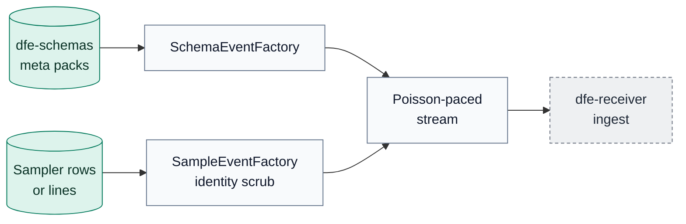

# Synthetic Data

Realistic synthetic events on demand, for two jobs: a continuous live-looking inbound stream for sales demos, and repeatable data for testing. It is never a load generator: every knob is a ceiling, and the shipped defaults generate nothing until an operator or caller asks.

Every synthetic event has a marker (overridable per request), which the common header lands in `_tags`, so synthetic data is always identifiable downstream. Where the pack's `tags` is an object, the event has `tags.synthetic: true`, found as `_tags.synthetic`. Where it is an ECS keyword list (`meta/elastic/ecs` and the beats packs that map ECS `tags`), the event has the keyword `synthetic` in that list, found with ``has(_tags.list.:`Array(Nullable(String))`, 'synthetic')``, and extra `tags` in the request are rejected because a list cannot hold keys (`src/dfe_engine/synthetic_data/tags.py`).

Schema packs and sampled rows feed two event factories, and a paced stream posts their events to dfe-receiver.

*Figure 1. L4 Detail -- Synthetic data paths. The dashed box is outside the engine.* Up: [The DFE control-plane layer](README.md).

From the receiver, a synthetic event takes the same path as any other: the loader writes it to ClickHouse.

| Mode | Input | Realism source |
|------|-------|----------------|
| Reference packs (default) | A dfe-schemas meta schema (`meta/syslog`, `meta/otel/logs`, `meta/beats/filebeat`, the cyber sets) | `@source:` expressions give the event fields, name and type heuristics pick typed generators, and schema-authored `synthetic:` hints and scenarios hold vocabularies and message templates |
| Lookalike | A sample's parsed `rows` or raw `lines` (the sampler's output) | The sample's distributions: enums replay weighted, numerics fit the observed range, free text keeps its structure with identity tokens substituted in place |

Both draw from a seeded entity pool: a generated host keeps its FQDN, IP, MAC and users across the whole stream, and an identical seed reproduces an identical stream. Lookalike mode never replays sample identities. IPs, MACs, UUIDs, emails and name-identified user and host keys are synthesised, so it doubles as a scrub.

Correlated columns must not draw independently (an sshd message under `appname: cron` reads as fake). A pack's version entry may declare `synthetic.scenarios`: one weighted scenario is drawn per event and pins the correlated columns together. The format is in dfe-schemas' [meta-schema.md](https://github.com/hyperi-io/dfe-schemas/blob/main/docs/meta-schema.md).

## API and limits

`GET /synthetic-data/packs`, `POST /synthetic-data/generate`, `POST /synthetic-data/lookalike`, and the stream task endpoints (`POST /synthetic-data/stream`, `GET /synthetic-data/streams`, `GET /synthetic-data/streams/{operation}`, `POST /synthetic-data/streams/{operation}/cancel`). Reads need `synthetic-data:read`. Generating or streaming needs `synthetic-data:run`, write-grade because it injects data into the pipeline. The full contract is `openapi/openapi.json`.

`SyntheticDataSettings` (`DFE_ENGINE_SYNTHETIC_DATA_*`) caps inline counts, stream rate and stream duration. The autostart settings run a standing sales demo: name the pack refs and a receiver URL (`DFE_ENGINE_SYNTHETIC_DATA_AUTOSTART_*`, set through the overlay's `extraEnv`) and the engine keeps those streams running for the pod's lifetime, in bounded segments, retrying when the receiver is away, cancelled at shutdown. Empty, the default, is off.
