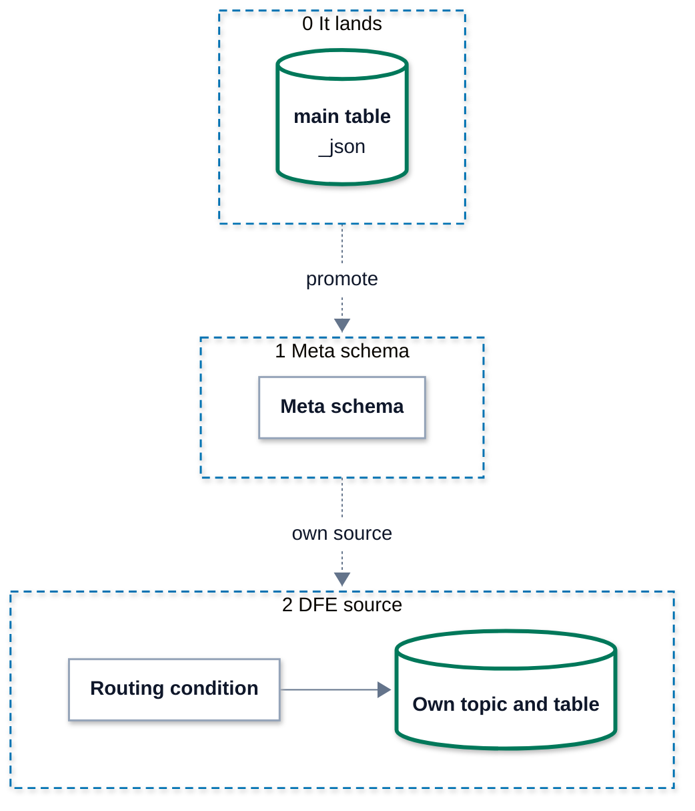

# Data evolution

DFE is a data evolution platform by design. Data lands by default and it just
works. You improve and evolve from there.

There are two ways the industry handles incoming data, and both make you pay up
front.

At one end, the search and index engines. Decide the schema before the data arrives, index
it all, query it fast. Change the schema later and you are reindexing. Send a
field you did not plan for and it is either dropped, mapped wrong, or it breaks
the mapping for everyone.

At the other end, data lakes. Land everything cheaply, decide later. Queries are
slow, the schema work is deferred forever, and 'later' rarely comes.

DFE takes the landing behaviour of a lake and the query behaviour of a search
platform, and lets you move between them one field at a time. No migration, no
reindex, no reingest. That is the best of both without the limitation of either.

## The path

A source moves from the main table to a meta schema to its own topic and table, one choice at a time.

*Figure 1. L4 Detail -- Data evolution stages. Dotted arrows are optional steps, and dfe-receiver or dfe-fetcher fills the main table.* Up: [L2 Services -- dfe-engine](architecture.md). Down: [L4 Detail -- How a table gets built](#how-a-table-gets-built), [L4 Detail -- What a transform does](#what-a-transform-is-actually-for).

Nothing forces you down the stages. A source can sit in stage 0 forever, and stage 3 below drops `_json` from a source you know fully.

## Stage 0 -- ground zero

Send data to dfe-receiver, or let dfe-fetcher pull it.

It is ingested as JSON and lands in the `main` table as `_json`.

`_json` is sub-field queryable at reasonable performance, so `fred.nerk.frog`
answers today. No schema, no mapping, no decision, no ceremony.

That is the whole of stage 0. Many sources never leave it. Fine.

## Stage 1 -- give a source a meta schema

A meta schema names the fields you want out of `_json` and into real columns.

You write one, or you import one. dfe-schemas ships meta schemas for common
sources under `meta/`: Elastic, Beats, OTel, syslog, the clouds, M365 and more.

What sets it apart from ETL and from a lake's schema work:

- Cover what you USE, not everything you receive. You are never forced to
  model the full breadth, because `_json` is still there as the slower fallback
  for anything off the hot path. Partial is a valid answer.
- Written in the primitive types the engine stores.
- Written at the use-case level. A column declares the question it answers
  -- `dimension`, `range`, `word_search` -- and DFE picks the ClickHouse index.
  The label never names the engine primitive.
- Readable by the SME who owns the data, with no data engineer, ClickHouse
  expert or Kafka expert needed.
- Narrowable to ClickHouse specifics where you do want that control.

A large meta schema is normally NOT deployed as it stands. It is the base a
derived schema selects from.

A meta schema may hold its own opinionated indexes beyond the common header,
but that is unusual and worth a second look when you see it.

### How a table gets built

A deployed table is the common header plus the fields a derived schema selects from a meta schema.

```mermaid
---
config:
  theme: base
  look: neo
  fontFamily: Inter, -apple-system, Segoe UI, Roboto, Helvetica, Arial, sans-serif
  flowchart:
    curve: linear
    nodeSpacing: 40
    rankSpacing: 64
    padding: 18
    wrappingWidth: 280
    htmlLabels: true
  elk:
    preset: modelOrder
  themeVariables:
    fontSize: 15px
    lineColor: "#64748B"
    primaryTextColor: "#0F172A"
    clusterBorder: "#0072B2"
    edgeLabelBackground: "#FFFFFF"
  themeCSS: >-
    p{margin:0}
    .node[data-look] rect,.node[data-look] path,.node[data-look] polygon,.node[data-look] .outer-path{filter:drop-shadow(0 1px 2px rgba(15,23,42,.10)) drop-shadow(0 6px 14px rgba(15,23,42,.10))}
    .node rect{rx:10px;ry:10px}
    .cluster rect{rx:16px;ry:16px}
    .node .label div{min-width:150px}
    .node.decision .label div{min-width:0}
    .cluster[data-look] rect{filter:none}
    .nodeLabel{line-height:1.35}
    .nodeLabel b{font-weight:600;font-size:15px;letter-spacing:-0.01em}
    .nodeLabel span{font-size:12.5px;font-weight:400;color:#334155}
    .cluster-label span.nodeLabel{display:inline-block;background:#FFFFFF;color:#0B2A3F;border:1.5px solid #0072B2;border-radius:999px;padding:2px 12px;font-size:11.5px;font-weight:700;letter-spacing:.09em;text-transform:uppercase}
    .flowchart-link{stroke-width:1.75px}
    .labelBkg{background:transparent!important}
    span.edgeLabel{display:inline-block;background:#FFFFFF!important;color:#1E293B;border:1px solid #94A3B8;border-radius:999px;padding:2px 10px;font-size:12px;font-weight:500}
    span.edgeLabel p{background:transparent!important}
    .label-icon{width:20px;height:20px;vertical-align:-4px;margin-right:6px}
    .ingest .label-icon{color:#0E8A7D}
    .xform .label-icon{color:#7B4FB0}
    .load .label-icon{color:#0072B2}
    .bus .label-icon{color:#A8517F}
    .store .label-icon{color:#00785A}
    .ui .label-icon{color:#D9480F}
    .ext .label-icon{color:#64748B}
---
flowchart LR
  accTitle: L4 Detail -- How a table gets built
  accDescr: A derived schema selects the deployed fields from a meta schema. The deployed table is the common header plus the derived schema.

  meta["<b>Meta schema</b><br/><span>full breadth</span>"]
  derived["<b>Derived schema</b><br/><span>fields and indexes</span>"]
  header["<b>Common header</b><br/><span>_json, _timestamp</span>"]
  table[("<b>Deployed table</b>")]

  meta -->|select fields| derived
  derived --> table
  header --> table
  class table store
  class meta,derived,header part
  classDef ext fill:#F4F6F8,stroke:#94A3B8,stroke-width:1.5px,stroke-dasharray:5 4,color:#0F172A
  classDef ingest fill:#FFFFFF,stroke:#0E8A7D,stroke-width:3px,color:#0F172A
  classDef xform fill:#FFFFFF,stroke:#7B4FB0,stroke-width:3px,color:#0F172A
  classDef load fill:#FFFFFF,stroke:#0072B2,stroke-width:3px,color:#0F172A
  classDef bus fill:#FFFFFF,stroke:#A8517F,stroke-width:3px,color:#0F172A
  classDef store fill:#FFFFFF,stroke:#00785A,stroke-width:3px,color:#0F172A
  classDef ui fill:#FFFFFF,stroke:#D9480F,stroke-width:3px,color:#0F172A
  classDef decision fill:#FFFFFF,stroke:#9A6700,stroke-width:3px,color:#0F172A
  classDef error fill:#FFFFFF,stroke:#C2410C,stroke-width:3px,color:#0F172A
  classDef control fill:#FFFFFF,stroke:#334155,stroke-width:3px,color:#0F172A
  classDef part fill:#FFFFFF,stroke:#94A3B8,stroke-width:1.5px,color:#0F172A
```

*Figure 2. L4 Detail -- How a table gets built.* Up: [L4 Detail -- Data evolution stages](#the-path).

A small meta schema deploys as it stands, with no derived schema. Every schema is built for one of two kinds of data:

- **Time-series** -- logs, a large fact table, observability data.
- **Time-stamped** -- a database or REST dump from dfe-fetcher, which is a
  point-in-time context or dimension table.

Every table is built on a **common header**, which holds the mandatory fields,
indexes, partitioning and TTL the rest of DFE depends on:

- `_json` is the fallback that makes stage 0 work and keeps partial meta schemas
  honest.
- `_timestamp_load` drives partitioning and retention, and `_timestamp`, the
  event time read from the record's `timestamp`, every time-bounded query.
- `_tags` holds contextual divisions and data routing.

Remove a header field and something concrete breaks: no `_timestamp_load` and the
table cannot partition or expire, no `_json` and a partial meta schema silently
loses every field it did not model. So the header is enforced.

## Stage 2 -- make it a DFE source

A source gets its own Kafka topic, where the deployment has Kafka, and its own
table.

Routing: a source declares the condition that selects its records, as a
`match` (`key exists`, `key=value` and the other operators, grouped `all` or
`any`) or as `when`, a CEL Fast condition the receiver evaluates. That condition
runs against EVERY inbound record, so the CEL Fast profile refuses regex,
iteration and time functions there.

What is mandatory: the source name, which names the table and the topics
(`<name>_land`, plus `<name>_load` after a transform), and the routing condition when the origin is the receiver. A source
landing anywhere other than `main` also needs a meta schema or a derived schema,
because that is what defines its table.

Derived schemas: this is where a large meta schema usually gets one. A
derived schema is a sub-selection of fields from its parent meta schema, plus
which of those fields take which index type -- one index type per field, added
and removed as a CRUD operation on both the definition and the deployed table.
A field promoted later joins the table beside the selection.

Transforms, optional: a source has at most one transform. DFE ships
transform-elastic, transform-vrl and transform-vector.

### What a transform is actually for

Most transforms do two jobs, and about 95% of the time the result maps onto the
meta schema:

1. **Parse.** Take a line of text encoded in `message`, `msg`, `description` or
   similar, and pull it out into dedicated performant columns.
2. **Enrich.** Add what the line itself does not hold -- geoip, IP reputation,
   asset and identity lookups, a timezone resolved from an abbreviation, and so
   on.

That is the bridge between stage 0 and stage 2. A Cisco syslog line arriving as
one opaque blob is queryable only by scanning it. The same line after a
transform has `source_ip`, `action` and `rule_name` as real indexed columns,
plus the fields the enrichment added.

A transform turns one blob in `_json` into typed, indexed columns.

```mermaid
---
config:
  theme: base
  look: neo
  fontFamily: Inter, -apple-system, Segoe UI, Roboto, Helvetica, Arial, sans-serif
  flowchart:
    curve: linear
    nodeSpacing: 40
    rankSpacing: 64
    padding: 18
    wrappingWidth: 280
    htmlLabels: true
  elk:
    preset: modelOrder
  themeVariables:
    fontSize: 15px
    lineColor: "#64748B"
    primaryTextColor: "#0F172A"
    clusterBorder: "#0072B2"
    edgeLabelBackground: "#FFFFFF"
  themeCSS: >-
    p{margin:0}
    .node[data-look] rect,.node[data-look] path,.node[data-look] polygon,.node[data-look] .outer-path{filter:drop-shadow(0 1px 2px rgba(15,23,42,.10)) drop-shadow(0 6px 14px rgba(15,23,42,.10))}
    .node rect{rx:10px;ry:10px}
    .cluster rect{rx:16px;ry:16px}
    .node .label div{min-width:150px}
    .node.decision .label div{min-width:0}
    .cluster[data-look] rect{filter:none}
    .nodeLabel{line-height:1.35}
    .nodeLabel b{font-weight:600;font-size:15px;letter-spacing:-0.01em}
    .nodeLabel span{font-size:12.5px;font-weight:400;color:#334155}
    .cluster-label span.nodeLabel{display:inline-block;background:#FFFFFF;color:#0B2A3F;border:1.5px solid #0072B2;border-radius:999px;padding:2px 12px;font-size:11.5px;font-weight:700;letter-spacing:.09em;text-transform:uppercase}
    .flowchart-link{stroke-width:1.75px}
    .labelBkg{background:transparent!important}
    span.edgeLabel{display:inline-block;background:#FFFFFF!important;color:#1E293B;border:1px solid #94A3B8;border-radius:999px;padding:2px 10px;font-size:12px;font-weight:500}
    span.edgeLabel p{background:transparent!important}
    .label-icon{width:20px;height:20px;vertical-align:-4px;margin-right:6px}
    .ingest .label-icon{color:#0E8A7D}
    .xform .label-icon{color:#7B4FB0}
    .load .label-icon{color:#0072B2}
    .bus .label-icon{color:#A8517F}
    .store .label-icon{color:#00785A}
    .ui .label-icon{color:#D9480F}
    .ext .label-icon{color:#64748B}
---
flowchart LR
  accTitle: L4 Detail -- What a transform does
  accDescr: A message held as one blob in _json goes through a transform that parses and enriches it into typed, indexed columns that match the schema.

  raw[("<b>_json.message</b><br/><span>one blob</span>")]
  xform["<b>Transform</b><br/><span>parse and enrich</span>"]
  cols[("<b>Typed columns</b><br/><span>source_ip, action</span>")]

  raw -->|record| xform
  xform -->|columns| cols
  class xform xform
  class raw,cols store
  classDef ext fill:#F4F6F8,stroke:#94A3B8,stroke-width:1.5px,stroke-dasharray:5 4,color:#0F172A
  classDef ingest fill:#FFFFFF,stroke:#0E8A7D,stroke-width:3px,color:#0F172A
  classDef xform fill:#FFFFFF,stroke:#7B4FB0,stroke-width:3px,color:#0F172A
  classDef load fill:#FFFFFF,stroke:#0072B2,stroke-width:3px,color:#0F172A
  classDef bus fill:#FFFFFF,stroke:#A8517F,stroke-width:3px,color:#0F172A
  classDef store fill:#FFFFFF,stroke:#00785A,stroke-width:3px,color:#0F172A
  classDef ui fill:#FFFFFF,stroke:#D9480F,stroke-width:3px,color:#0F172A
  classDef decision fill:#FFFFFF,stroke:#9A6700,stroke-width:3px,color:#0F172A
  classDef error fill:#FFFFFF,stroke:#C2410C,stroke-width:3px,color:#0F172A
  classDef control fill:#FFFFFF,stroke:#334155,stroke-width:3px,color:#0F172A
  classDef part fill:#FFFFFF,stroke:#94A3B8,stroke-width:1.5px,color:#0F172A
```

*Figure 3. L4 Detail -- What a transform does.* Up: [L4 Detail -- Data evolution stages](#the-path).

The blob in figure 3 is a line such as `%ASA-6-302013: Built outbound TCP...`, and the typed columns are `source_ip`, `dest_ip`, `action`, `rule_name` and `source_country`.

The schema says which columns exist. The transform is what fills them.

## Stage 3 -- drop the safety net

At some point you know the source. Every field you need is in the derived
schema, indexed the way you want it, and `_json` has become dead weight you are
still paying to store.

Stage 3 is a derived schema that tells dfe-loader **not to populate** `_json`
and `_raw`.

The columns stay. The common header is retained exactly as it is, because the
header is what the rest of DFE depends on. What changes is one instruction to
the loader, so the blob is never written.

That matters: the schema is unchanged, so the decision is reversible. Turn
population back on and new records get `_json` again. What you do not get back
is the period it was off -- a field you did not model, for rows loaded while the
net was down, is gone rather than slow.

It is a maturity statement. Never a default. Nothing pushes you here and most
tables should never arrive.

dfe-loader's `metadata.capture_mode`
(`full`, `json_only`, `raw_only`, `extracted_only`) decides what it writes, with
`metadata.table_capture_modes` for per-table control, and the column directive
framework reaches the same end with `@skip` on `_json`. The control plane says it
through a derived schema's `capture_json` and `capture_raw`, which the engine
compiles into the loader's per-table `table_capture_modes`.

A column's `expr` is a loader instruction. dfe-loader reads directives out of ClickHouse column
COMMENTs, and every one has an exact config-cascade equivalent. Config wins over
the DDL comment.

| Annotation | Meaning |
|---|---|
| `@skip` | Omit the column from the insert entirely |
| `@default:value` | Substitute when the column is null or absent |
| `@source:path` | Source field path, with an optional `\| fallback` |
| `@computed:expr` | A CEL expression producing this column's value |
| `@coerce:category` | Override the type category for coercion |

`@source` is the vocabulary dfe-schemas emits -- so a meta schema's
`expr: "@source: host.name"` becomes a column comment, which is what tells the
loader where to read that field from. So a derived schema keeps its
base's `expr` unchanged and only overrides the index.

CEL also appears at `@computed` on a column. Routing CEL is held to the Fast
profile because it runs against every record.

## Promote: see it, then give it a column

Select real data in the UI, find a field inside `_json`, and promote it to a
dedicated column. The field you just looked at becomes part of the schema.

Traditional schema work asks you to be exhaustive about data you have not seen,
which is slow and usually wrong. Promotion works on what is arriving, one field
at a time.

Why promote at all? `_json` takes whatever arrives. Each value keeps the type it came with, row by
row, so `port` can be `8080` in one record and `"http"` in the next. Inserts
never fail on it. Queries do.

While every `port` is a number, `WHERE _json.port = 8080` works. The first
string to land at that path breaks it, with no change to the query:

| Query on a path holding numbers and strings | Result on ClickHouse 26.3 |
|---------------------------------------------|---------------------------|
| `_json.port = 8080`, `>`, `<` | `NO_COMMON_TYPE`: no supertype for String and UInt16 |
| `_json.port IN (8080, 443)` | `ILLEGAL_TYPE_OF_ARGUMENT`: Dynamic is not allowed in `IN` |
| `startsWith(_json.port, 'ht')`, `LIKE`, `position` | `ILLEGAL_TYPE_OF_ARGUMENT` on every number row |
| `_json.port.:Int64 = 8080` | Works: reads only the rows stored as Int64 |

So a rule, a hunt or a saved search can pass the day it is written and fail the
day a source sends one odd value. And no path inside `_json` has an index, so
even the query that works reads every row.

That is the main reason to promote a field. A
promoted column has ONE type, so the query is the plain comparison you meant. Then give it a `use_case` so
it gets the index that answers how you query it (`exact_match` for an id or an
IP, `range` for a number, `word_search` for text).

Until a field is promoted, query it through a typed sub-column:
`_json.port.:Int64` for numbers, `_json.port.:String` for strings.

**It does not backfill.** A promoted column is filled by the records that arrive
after it, and is empty for every row already in the table. The value is still
there for those rows -- it is in `_json`, where it always was, at `_json` speed.
Promote a field you want a year of history on and you get the column plus a year
of nulls, so the query that spans the change has to read both.

Every claim on this page has a step that proves it:
[data-evolution-acceptance.md](data-evolution-acceptance.md).

A claim with no step is marketing.

None of it is a one-way door. Stage 3 costs you only the rows that landed while
the net was off.
