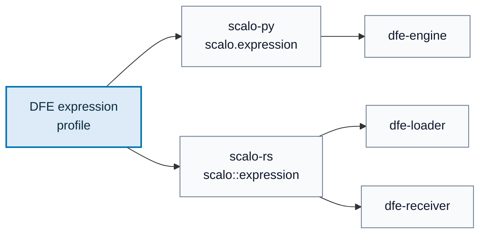

# DFE Expression Language -- CEL

DFE uses **CEL (Common Expression Language)** for conditions across the Python engine, the Rust services and the CLI. CEL is not Turing-complete: no loops, no recursion, no side effects, so every expression terminates. An expression is compiled once and evaluated against every row.

| Language | Package | Notes |
|----------|---------|-------|
| Rust | `cel` | Native implementation, through `scalo::expression` |
| Python | `common-expression-language` | PyO3 bindings, through `scalo.expression` |

scalo-rs's `Cargo.toml` and scalo-py's `pyproject.toml` carry the versions.

References:

- [CEL Specification](https://github.com/google/cel-spec)
- [CEL Overview](https://cel.dev/overview/cel-overview)
- [cel crate](https://crates.io/crates/cel)
- [Python CEL package](https://pypi.org/project/common-expression-language/)

---

CEL does not replace these:

| System | Reason |
|--------|--------|
| `@directive: body` DSL (`@source`, `@generated`, etc.) | Schema metadata -- column mapping instructions, not boolean conditions |
| ClickHouse SQL in `@generated` expressions | Runs in ClickHouse, not our evaluator |
| Hunt SQL queries / rule_rewriter | ClickHouse-native SQL |
| Duration strings (`"1h"`, `"30m"`) | Simple config values, not expressions |

---

## The DFE expression profile

DFE uses a **subset** of CEL. Expressions outside this profile are rejected at validation time.

Allowed operations:

| Category | Operations | Examples |
|----------|-----------|---------|
| Comparison | `==`, `!=`, `<`, `<=`, `>`, `>=` | `severity == "critical"` |
| Logical | `&&`, `\|\|`, `!` | `amount > 1000 && !is_test` |
| Membership | `in` | `status in ["active", "pending"]` |
| Arithmetic | `+`, `-`, `*`, `/`, `%` | `price * quantity` |
| Ternary | `? :` | `is_admin ? 95 : 50` |

Allowed functions:

| Function | Purpose | Example |
|----------|---------|---------|
| `contains()` | Substring check | `message.contains("error")` |
| `startsWith()` | Prefix check | `path.startsWith("/api/")` |
| `endsWith()` | Suffix check | `file.endsWith(".log")` |
| `matches()` | Regex match. A hunt rule's filter takes it. An alert condition takes it only when the config cascade sets `expression.allow_regex: true` | `hostname.matches("^web-[0-9]+$")` |
| `size()` | Length of string or list | `size(tags) > 0` |
| `has()` | Field existence | `has(event.user_id)` |
| `int()` | Cast to integer | `int(port_str) == 443` |
| `double()` | Cast to float | `double(score_str) > 0.5` |
| `string()` | Cast to string | `string(code) == "200"` |
| `bool()` | Cast to boolean | `bool(enabled)` |

Rejected at validation:

| Feature | Reason |
|---------|--------|
| `map()`, `filter()`, `exists()`, `all()` | Per-element iteration -- unpredictable performance on large lists |
| `timestamp()`, `duration()` | ClickHouse handles time natively -- no need to duplicate |
| Macros | Complexity with no benefit for DFE use cases |

Supported types:

| CEL Type | Python | Rust | ClickHouse |
|----------|--------|------|------------|
| `int` | `int` | `i64` | `Int64` |
| `double` | `float` | `f64` | `Float64` |
| `string` | `str` | `String` | `String` |
| `bool` | `bool` | `bool` | `Bool` |
| `list` | `list` | `Vec<Value>` | `Array` |
| `map` | `dict` | `HashMap<String, Value>` | -- |
| `null` | `None` | `Option::None` | `Nullable` |

---

## Where DFE uses it

An alert trigger:

```yaml
alerts:
  triggers:
    - when: "result_count >= 10"
```

A trigger sees `result_count`, the rows the fire wrote, and nothing else. A trigger on a row field never fires.

A source selects its records with `when`, a CEL condition, in place of `match`. The receiver evaluates it against every inbound record under its CEL Fast profile, so regex, iteration and time functions are refused at save. See [source-definition.md](source-definition.md).

```yaml
when: "data_stream.dataset == 'cisco_ios.log' && agent.type == 'filebeat'"
```

A computed column in the loader:

```yaml
columns:
  risk_label:
    expr: '@computed: risk_score > 80 ? "high" : risk_score > 40 ? "medium" : "low"'
```

CEL expressions can be mechanically converted to ClickHouse WHERE clauses for query pushdown:

| CEL | ClickHouse SQL |
|-----|---------------|
| `severity == "critical"` | `severity = 'critical'` |
| `amount > 10000 && !is_test` | `amount > 10000 AND NOT is_test` |
| `status in ["active", "pending"]` | `status IN ('active', 'pending')` |
| `message.contains("error")` | `position(message, 'error') > 0` |
| `path.startsWith("/api/")` | `startsWith(path, '/api/')` |
| `hostname.matches("^web-[0-9]+$")` | `match(hostname, '^web-[0-9]+$')` |
| `has(user_id)` | `user_id IS NOT NULL` |
| `size(tags) > 0` | `length(tags) > 0` |

This enables expressions written once in YAML to work both as in-memory evaluation (Rust/Python) and as ClickHouse query filters.

---

## Where it is implemented

Two scalo wrappers enforce the DFE profile: scalo-py's for the engine and scalo-rs's for the loader and receiver.



*Figure 1. L4 Detail -- CEL implementations.* Up: [Data plane](README.md).

scalo-py wraps `common-expression-language` and scalo-rs the `cel` crate. Both enforce the same allowed operators, functions and types. In the engine the callers are `hunts/alert.py`, the rule filters and source routing. In dfe-loader it is `src/transform/computed.rs`, and in dfe-receiver the filter validation in `src/config/mod.rs`.

scalo-py's names (`scalo.expression`):

```text
compile_expression(expr) -> Program    # Parse + validate + compile
evaluate(expr, data) -> Any            # One-shot convenience (compile + execute)
validate(expr) -> list[str]            # Syntax + profile check, returns errors for UI
transpile_to_clickhouse(expr) -> str   # The SQL pushdown above
```
