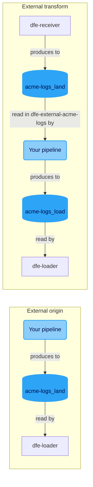

# External pipelines

You already run Vector, Fluentd, Fluent Bit or Logstash, and you don't want to rebuild it. You don't have to. Your pipeline plugs into a DFE source on Kafka, and DFE does the rest from the topic onwards.

There are two places it can plug in, and both are on the bus. A source on the direct (gRPC) transport refuses either one at save with a 422, because there is no topic for your pipeline to meet.

## Two places to plug in



Rounded light-blue nodes are your pipeline. Cylinders are the topics DFE creates.

**External origin.** Your pipeline is where the records come from. It produces straight to `<source>_land`, past the receiver, so the source has no match rule and no fetcher. If the source names a DFE transform, that reads `_land` as usual. Otherwise the loader does.

```yaml
source: acme-logs
external:
  credential_ref: vault:kv/acme/kafka/vector
```

**External transform.** DFE takes the records in through the receiver or a fetcher as normal, and your pipeline does the transform. It reads `<source>_land` in the consumer group `dfe-external-<source>` and produces to `<source>_load`, and the loader reads `_load`. DFE deploys no transform app for it.

```yaml
source: acme-logs
match: { field: data_stream.dataset, operator: equals, value: acme.log }
transform:
  engine: external
  credential_ref: vault:kv/acme/kafka/logstash
```

An external transform takes none of `variant`, `mode`, `detect`, `config_file`, `env` or `files`. Those configure an app DFE deploys, and it deploys none here. A source can't use your pipeline for both at once: the pipeline writing `_land` can transform before it writes.

## Connecting your pipeline

| | External origin | External transform |
|---|---|---|
| Your pipeline reads | nothing of DFE's | `<source>_land` |
| Your pipeline writes | `<source>_land` | `<source>_load` |
| Consumer group | none | `dfe-external-<source>` |

DFE creates both topics when the source deploys and removes them when it's deleted, the same as for any source ([topic-contract.md](topic-contract.md)). The group name is fixed rather than yours to choose. The engine reads that group's lag, and before it deletes a `_load` topic you've stopped writing, it checks the group has no live member and nothing left to read.

`GET /api/v1/sources/{name}/lag` reports how far your transform is behind on `_land`: the group's state, its live members, and the records it hasn't committed past. A group that has never committed counts every record on the topic. A broker the engine can't reach answers with `lag: null` and the reason, never a zero.

`GET /api/v1/sources/{name}` carries a `connection` block for a source with either one. The DFE console shows it on the source.

| Field | What it is |
|---|---|
| `role` | `origin` or `transform` |
| `reads`, `writes` | The topics above |
| `consumer_group` | `dfe-external-<source>` for a transform, null for an origin |
| `bootstrap` | `kafka.external_bootstrap_servers`, the address a pipeline outside the deployment reaches the brokers on. Unset, it's `kafka.bootstrap_servers` |
| `security_protocol`, `sasl_mechanism` | What the broker contract derives for this deployment's provider. On every DFE-owned broker that's SASL with SCRAM-SHA-512 |
| `credential_ref` | Where you keep the credential, as you set it |
| `org`, `allowed_org_ids`, `allowed_sources` | The tenant rule below |
| `header_fields`, `sample_record` | The table under "Where to comply", and a record carrying every field |

You bring the Kafka principal and its credential. DFE never mints one, never reads one and never stores one. `credential_ref` is a pointer for whoever runs the pipeline: `vault:`, `bao:`, `openbao:`, `env:` or `file:`, such as `vault:kv/acme/kafka/vector`. Anything else is refused, so a pasted password never reaches the source definition, which is committed to git and returned on every read.

Give the principal write on the one topic your pipeline writes, plus read on `_land` and the `dfe-external-<source>` group for a transform. Nothing wider.

## The tenant rule

Your pipeline sets `_org_id` and `_source` itself, and the loader holds them on your topic. That's what stops a pipeline writing into another tenant's data, or into another source's table.

- **`_org_id`** is kept when it's the source's org (`org`, a registered org name, the default org when unset) or one listed in `allowed_org_ids`. Any other value is replaced with the source's org.
- **`_source`** is kept when it's this source or one listed in `allowed_sources`. Any other value is replaced with this source, so the record lands in this source's table.

Nothing is refused. A replaced record still lands, and the loader counts it in `loader_external_org_id_replaced_total` or `loader_external_source_replaced_total`. A climbing counter is a pipeline stamping labels it shouldn't, and you'll want to go and look.

The allow-lists are for a provider whose pipeline fans in its own customers' records. List each customer's tenant id in `allowed_org_ids` and the pipeline can land each record in its customer's org:

```yaml
source: msp-firewall
external:
  org: msp
  allowed_org_ids: [customer-a-prod, customer-b-prod]
  credential_ref: vault:kv/msp/kafka/vector
```

Both lists start empty. A tenant id takes no comma, control character or surrounding space, a source name follows the usual source naming rule, and a repeated entry is refused.

## Where to comply for the best results

Nothing makes your records carry the DFE common header. The loader fills in a missing field exactly as it does for any producer, so a bare record still lands. Each field you set yourself gets you something the default can't.

| Field | Missing, the loader | Set, you get |
|---|---|---|
| `_timestamp` | reads `timestamp`, then `@timestamp`, and takes the load time when neither is there | the event's own time, so time-range queries and retention follow when it happened |
| `_org_id` | lands the record in the source's org | the source's org or one `allowed_org_ids` lists, which is how a provider lands each customer in their own org |
| `_source` | takes it from the topic name, which is this source | this source or one `allowed_sources` lists, which picks the table |
| `_tags` | reads `tags`, then `meta`, then `metadata.tags`, and leaves it empty when none is there | tags a query or an alert can filter on without parsing the payload |
| `_timestamp_received` | takes the load time | when your pipeline first saw the event, so you can measure the delay before DFE |

`_timestamp_load`, `_uuid`, `_json` and `_raw` are always written by the loader and ClickHouse, and a value you send isn't read. The columns come from the source's header profile in dfe-schemas (`common-header/`), and the default profile is `timeseries`.

A compliant record looks like this:

```json
{
  "_timestamp": "2026-11-03T04:05:06.789Z",
  "_org_id": "acme-prod",
  "_source": "acme-logs",
  "_tags": {"env": "prod"},
  "_timestamp_received": "2026-11-03T04:05:06.123Z",
  "message": "the event as your pipeline produced it"
}
```

Send it as one JSON object per Kafka message. DFE is JSON-only on the bus.

When it goes wrong, it's usually one of these.

| You see | It's because |
|---|---|
| A 422 naming the bus at save | The source is on the direct transport. Set `transport: bus` |
| A 422 on `credential_ref` | It holds a secret or an unknown scheme rather than a reference |
| A 422 `unknown_org` | `org` names an org the registry doesn't hold |
| Lag climbing with no members | Your transform isn't running, or it joined a group other than `dfe-external-<source>` |
| Records in the source's org you meant for another | That tenant id isn't in `allowed_org_ids`. Check the replaced counter |
