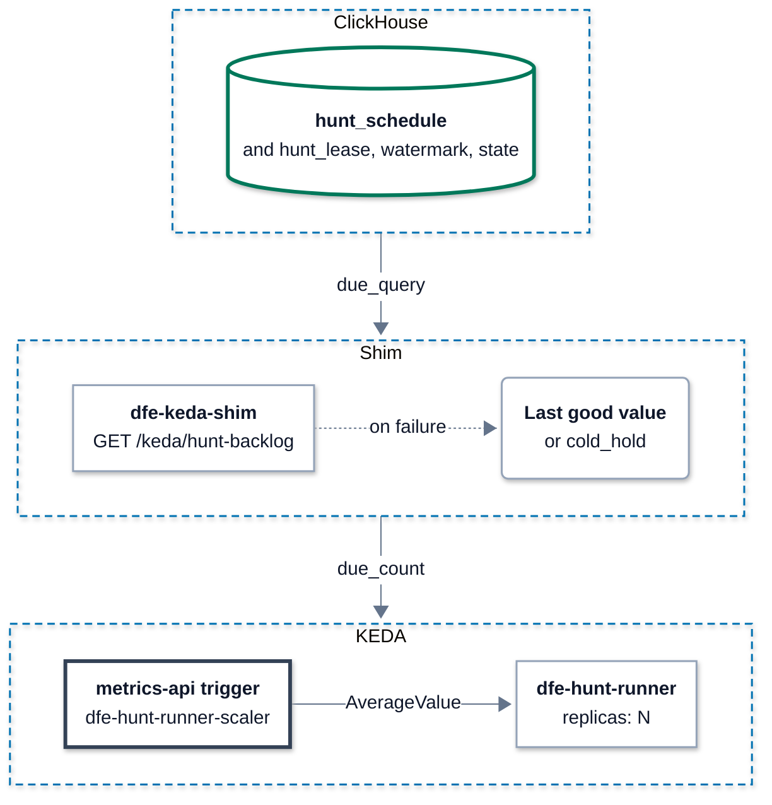

<!--
  Project:   dfe-engine
  File:      docs/data-plane/hunt-runner-scaling.md
  Purpose:   How the pull-based hunt runner scales out and to zero (KEDA)
  License:   BUSL-1.1
  Copyright: (c) 2026 HYPERI PTY LIMITED
-->

# Hunt-runner scaling

The hunt runner is pull-based and multi-pod. The default deployment is ONE steady pod with no ScaledObject, because the runner is a thin orchestrator and all hunt load runs in ClickHouse. One pod covers the large majority of deployments.

Autoscaling is a beta, off by default (`huntRunner.autoscaling.enabled`). Leave it off. It reads the due backlog from the `hunt_schedule` table, which every running hunt runner keeps current: it publishes the schedule when it starts and after each spec reload. With the default floor of 1 pod a runner is always there to do it. At `minReplicaCount: 0` no runner runs while the backlog is 0, so nothing publishes a hunt added in that time and nothing wakes a pod for it, and a fresh install may scale to zero before any runner has published. Run `dfe-hunt-runner materialise` once after each hunt-config change made while no pod is running, or keep the floor at 1.

When on, KEDA scales the pod count on the deterministic-due backlog described below, read through the fail-safe `dfe-keda-shim`. KEDA never asks the engine.

## Due-detection with zero workers

KEDA can only wake the first worker if "is any hunt due right now?" is answerable with no worker running, as a query the shim runs against ClickHouse. The per-hunt schedule (interval and stable phase offset) otherwise lives only in a running worker's memory, loaded from the gitops hunt configs.

So the schedule is materialised into a small ClickHouse table, `hunt_schedule`, by the runner:

```text
hunt_schedule(hunt_id, interval_seconds, phase_offset, enabled, updated)
  ReplacingMergeTree(updated) ORDER BY hunt_id
```

`enabled` is a soft tombstone: a deleted hunt is written `enabled=0` so it stops counting as due, without a DELETE. A hunt whose YAML says `enabled: false` is tombstoned the same way, since the loader keeps it out of the specs the materialiser publishes. The other coordination tables (`src/dfe_engine/hunts/ch_coordinator.py`) are `hunt_lease`, `hunt_watermark`, `hunt_state`, `hunt_run` and `hunt_runner_heartbeat`. `hunt_schedule` is the only one written outside the worker loop.

The shim's `/keda/hunt-backlog` endpoint runs `schedule.due_query(db)`, which counts hunts that are due and unclaimed. It uses the same arithmetic the worker uses (`schedule.latest_fire`):

```text
boundary = intDiv(now(), interval) * interval      -- start of this interval
current  = boundary + phase_offset                  -- this interval's scheduled fire
fire     = if(now() >= current, current,            -- the latest fire at or before now
              current - interval)
due      = watermark < fire                          -- that fire not already completed
           AND lease_until <= now()                  -- not currently running
```

A count above 0 scales up and 0 scales down, to zero only where `minReplicaCount: 0` is set (the default floor is 1 pod). The `enabled=1` filter sits in an inner subquery so a tombstone (interval 0) never reaches the `intDiv`.

The watermark comparison is exact because the worker writes `watermark = scheduled_start`, the fire time, after a run commits (`worker.py`, `set_watermark(end)`). The watermark is in the same scale as the boundary arithmetic, so `watermark < fire` means "this fire has not been completed".

## Why KEDA and a worker agree

Both compute "due" from the same inputs:

1. The backlog SQL and `runner.tick`'s gate share `schedule.latest_fire`, the watermark and the lease check. A parity test runs a matrix of (hunt_id, interval, now, watermark, lease), and the SQL runs against real ClickHouse.
2. The materialiser writes `phase_offset` with the same `schedule.phase_offset` the worker uses. Change the offset algorithm once and both move.
3. KEDA polls a real signal. Worst-case wake latency is `pollingInterval` plus pod start, which is immaterial for minute-plus intervals.
4. A worker that claims a hunt then dies before writing the watermark loses its lease after `lease_seconds` (default 300). The fire is still owed, so the backlog stays above 0 and another worker reclaims it.
5. Nothing double-runs. A claim stands only if it is acknowledged within a settle of its free read and is still the latest row after it. A later claim is never released, because it may sit over the winner, but it holds nothing, so the next poll claims again.
6. Hunts do not all fire at once. The phase offset falls in the first `hunts.phase_spread_fraction` of the interval (default 0.8, `DFE_ENGINE_HUNTS_PHASE_SPREAD_FRACTION`), so `due_count` rises gradually and KEDA scales out smoothly. The runner, the API's `next_due` and the materialised schedule all read it, and a runner rewrites the table with the new offsets when it next starts.

A fire stays owed until its watermark is written. A worker that ticks inside `[boundary, boundary+offset)` runs the previous interval's fire if nothing ran it, and the backlog counts it the same way. Without that, a hunt whose offset sits between two poll ticks (a 46s offset polled at :00/:15/:30/:45) never fires. Maximum lateness for any fire is under one interval, whether KEDA or a resident worker makes the decision.

## No operational dependency on dfe-engine

Once deployed, the running system needs only ClickHouse:

- Workers read hunt definitions from the gitops config, coordinate through the coordination tables and run queries against ClickHouse.
- The shim reads `hunt_schedule` and the coordination tables from ClickHouse. It is a separate, distinctly labelled pod on the engine container image with its own entrypoint (`dfe-keda-shim`), not the live engine API.
- `hunt_schedule` is written only through `publish_schedule`: by each running hunt runner at start and after every spec reload, by the phase smoother when smoothing is on, and by `dfe-hunt-runner materialise`. `materialise` is a one-shot, idempotent command that brings the table to the hunt config, for a deployment that scales the runner to zero. The charts do not run it.

If the engine pod is down, running hunt-runner pods keep firing hunts. What you lose is the ability to change configs, which needs the engine anyway. A pod that is starting is the exception: the runner and the shim each have a `wait-for-engine` init container (dfe-infra `helm/library/dfe-common/templates/_waitfor.tpl`) that holds the pod until the engine reports ready, because the engine applies the ClickHouse schema at its own start. A scale-out or a restart while the engine is down waits for it. ClickHouse is DFE's single operational store and the runner holds to that, which is also why the same runner works on a non-k8s single deploy (dfe-docker), where only ClickHouse is guaranteed present.

Every worker and the shim must see the same coordination tables. On the scale tier's multi-node cluster behind a round-robin load balancer, a plain `ReplacingMergeTree` lands on one node, and workers connected to other nodes see an empty or absent table (`UNKNOWN_DATABASE`, missing leases). The schema phase therefore creates the coordination tables as `ReplicatedReplacingMergeTree` inside a Replicated database on every deployment, so lease, watermark and schedule state is shared across nodes (<https://github.com/hyperi-io/dfe-schemas/blob/main/docs/clickhouse-platform.md>).

`schedule.publish_schedule(ch, db, specs)` is the only function that writes `hunt_schedule`. Its callers are the runner (`runner_cli.py`), `dfe-hunt-runner materialise` and the phase smoother (`smoothing.py`). It is idempotent and diff-aware: it writes only the rows that differ from the table, so a hunt whose row is already right keeps its `updated` time and the smoother's cool-down, and it tombstones hunts that vanished from config. With smoothing on, an offset the smoother learned for a hunt whose interval is unchanged is kept. A ClickHouse the runner cannot reach leaves the publish owed, logged once and retried on each tick, and the runner keeps firing its hunts.

## The ScaledObject

KEDA has no native ClickHouse scaler, and a KEDA database scaler can only fall back to a fixed replica count, not hold the current one. So the hunt runner scales through the `dfe-keda-shim`, a small pod on the engine image that KEDA's `metrics-api` scaler polls over HTTP. The shim runs `schedule.due_query(db)`, the same function the worker gate uses, and returns one integer.

The published engine chart (`oci://ghcr.io/hyperi-io/charts/dfe-engine`) renders only the engine pod. The shim and the hunt runner come from dfe-infra's `helm/charts/dfe-extras` chart (`templates/engine-keda-shim.yaml`, `templates/engine-hunt-runner.yaml`), on the same values.



*Figure 1. L4 Detail -- Hunt runner autoscaling. The dotted arrow is the failure path.* Up: [L3 Components -- Hunt runner](../hunt-runner.md).

With `huntRunner.autoscaling.enabled`, the Deployment's `replicas` field is omitted, because the ScaledObject owns the count, and a `dfe-hunt-runner-scaler` ScaledObject is rendered beside it:

```yaml
apiVersion: keda.sh/v1alpha1
kind: ScaledObject
metadata:
  name: dfe-hunt-runner-scaler
spec:
  scaleTargetRef:
    name: dfe-hunt-runner
  minReplicaCount: 1     # default 1, NOT 0 - set 0 via values to opt into scale-to-zero
  maxReplicaCount: 5     # default; huntRunner.autoscaling.maxReplicaCount
  cooldownPeriod: 300
  pollingInterval: 30
  triggers:
    - type: metrics-api
      metricType: AverageValue     # ceil(due / targetBacklog) workers
      metadata:
        targetValue: "10"          # huntRunner.autoscaling.targetBacklog
        # huntRunner.autoscaling.shimAddress, else the shim in the release's own namespace
        url: "http://dfe-keda-shim.<release-namespace>.svc.cluster.local:8080/keda/hunt-backlog"
        valueLocation: "value"
```

## When the metric is missing

The shim caches its last-good integer per query and parameters (`src/dfe_engine/keda_shim/shim.py`, `QueryShim.run`). On any failure (ClickHouse unreachable, a timeout, a bad query) it returns the cached value. KEDA sees no change, the pod count freezes at current, and a broken metric cannot run replicas up. A cold start with no cache yet, plus a failure, falls back to `cold_hold`, which is 0 for the backlog query. That holds the pod count at `minReplicaCount`.

The queries (clamp, `cold_hold` and timeout included) are config in `src/dfe_engine/keda_shim/queries.yaml`, with an optional mounted override at `DFE_ENGINE_KEDA_SHIM_QUERY_CONFIG`. A schema change or a tuning change is a config edit, not a shim rebuild.

`bootstrap/keda-scale-test.sh` in dfe-infra tests the shim to KEDA scale-out and scale-in path on demand with a disposable target. It drives the shim's pressure query, not the backlog query, but the metrics-api mechanism is the same one the backlog trigger uses. See [keda-scaling](../deployment/keda-scaling.md).

## Values

The defaults are in dfe-infra `helm/charts/dfe-extras/values.yaml`.

- `huntRunner.enabled` (default `true`) deploys `dfe-hunt-runner` as ONE steady pod (`replicas: 1`, no ScaledObject).
- `huntRunner.autoscaling.enabled` (default `false`, beta) renders the ScaledObject above. The pod count floats between `minReplicaCount` (default 1, set `0` to opt into scale-to-zero) and `maxReplicaCount` (default 5). Work divides safely across N pods through the `hunt_lease` mutual exclusion: KEDA picks the pod count and the leases decide who does what.
- `huntRunner.enabled: false` in the deploy overlay renders no pod and no ScaledObject, so hunts do not fire. Re-enable it and the runner resumes from the last committed window, because the schedule and watermarks are still in ClickHouse.

Each is a values dial, turned through the gitops overlay, never a live cluster mutation.
