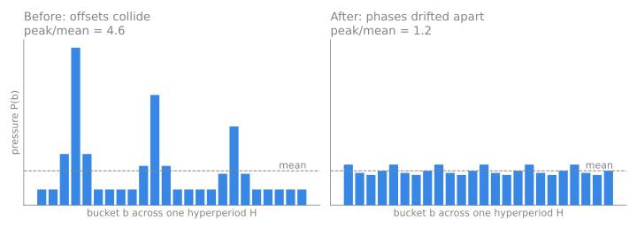
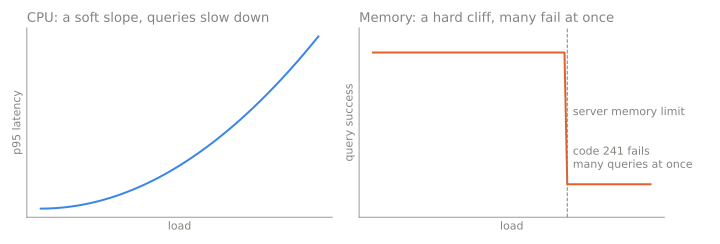

<!--
  Project:   dfe-engine
  File:      docs/data-plane/hunt-schedule-smoothing.md
  Purpose:   Adaptive load-smoothing for rate (loop-query) hunts on ClickHouse
  License:   BUSL-1.1
  Copyright: (c) 2026 HYPERI PTY LIMITED
-->

# Hunt schedule smoothing

Smoothing is held back from 2.2.2 until it has scaled testing, so no setting turns it on in this release. It comes in 2.2.3 as an opt-in beta behind `hunts.smoothing.enabled`, off by default. Tracked in https://github.com/hyperi-io/dfe-engine/issues/864.

What 2.2.2 ships is the fixed offset: each rate hunt fires at an offset hashed from its id, within the first `hunts.phase_spread_fraction` of its interval (default 0.8, see [hunt-runner-scaling.md](hunt-runner-scaling.md#why-keda-and-a-worker-agree)). Every hunt query is also tagged with a JSON `log_comment`, so ClickHouse attributes its cost to the hunt.

Rate hunts (`schedule.mode: rate`, the default) fire on fixed intervals. Left alone, the heavy ones stack into ClickHouse CPU and memory peaks. Smoothing learns what each hunt costs and drifts WHEN it fires, never how often, so the sum flattens over time. Anchored hunts and one-off monsters are meant to spike, so the loop leaves them alone.

Still design only, not in the 2.2.3 beta: the ClickHouse `WORKLOAD 'hunts'` backstop, promoting a settled schedule into git, and auto-disable.

## The picture

Hunts whose hash offsets land close together stack their cost pulses. The loop drifts them apart: same coverage, same freshness, no pile-up.



The one number to watch is `dfe_hunt_smoothing_flatness`, peak over mean, falling toward 1.0.

## Why memory gets special treatment

CPU and memory fail differently. A CPU peak slows queries. A memory peak crosses the server limit and ClickHouse throws `MEMORY_LIMIT_EXCEEDED` (code 241) at whatever is allocating right then, so one spike fails many co-running queries, innocent ones included. A slope and a cliff.



So the loop weights both, and memory is also a hard constraint: no move may push any bucket's summed memory over the cap.

## How it works

1. The operator's interval is untouched. Only the offset into it moves.
2. Every hunt query carries a JSON `log_comment` naming the hunt and its fire. ClickHouse records that in `system.query_log`, and the `query_log_archive` view keeps it with the real cost columns.
3. One runner replica leads. Each cycle it reads every hunt's trailing p95 cost from the archive, sums the pulses into a load curve over the hyperperiod, finds the tallest bucket, and moves ONE hunt that fires into it by a bounded step toward the deepest trough. A move is kept only if it lowers the objective by more than a hysteresis margin, and a hunt just moved sits out a cool-down.
4. The new offset is written to `hunt_schedule`, and in the beta the runner, the API's next-due and the KEDA due count all read that one table, so every reader agrees on the next fire. In 2.2.2 only the KEDA due count reads it, and the runner and the API compute the hash offset themselves.

Moving an offset changes one window's length and nothing else. A hunt moved later runs one longer window. A hunt moved earlier runs one shorter window. Coverage stays contiguous because every window starts at the last watermark.

With the flag off, nothing reads the archive, nothing leads, and every offset is the hash. Turning the flag off after a run rewrites `hunt_schedule` back to the hash offsets on the runner's next start.

Rescheduling fixes contention and nothing else. A query that busts the memory limit on its own busts it at 3am too, and moving it changes nothing. The ladder for that is still design only: smooth, then back off the interval of a hunt that runs into itself, then auto-disable a hunt that trips code 241 K times in a window, written as a governed-ops `enabled: false` with the reason, alerted, and never re-enabled without a human.

## What a hunt costs

Per hunt, per fire, over a trailing window (`hunts.smoothing.window_days`):

$$
m_i = \operatorname{p95}_{\text{fires}}\bigl(\max \texttt{memory\_usage}\bigr), \qquad
d_i = \operatorname{p95}_{\text{fires}}\Bigl(\sum \texttt{query\_duration\_ms}\Bigr), \qquad
c_i = d_i
$$

```text
for each hunt i, over its fires in the trailing window:
    m_i = p95 of each fire's max(memory_usage)        the fire's peak memory
    d_i = p95 of each fire's sum(query_duration_ms)   the fire's duration, in buckets
    c_i = d_i                                         CPU, proxied by duration
```

`query_log_archive` has no CPU column, so duration stands in for CPU. A hunt with no rows in the window stays on its current offset. A missing archive leaves every hunt where it is and logs once.

On ClickHouse Cloud `system.query_log` is per node, and a server upgrade can rename it under the view (ClickHouse issue 124177, fixed in 124217). A view that has stopped filling shows as every hunt's cost going stale, and the loop stops moving anything rather than move on old numbers.

## Settings

The 2.2.3 beta's settings. None of them exists in 2.2.2.

| Setting | Default | Meaning |
|---|---|---|
| `hunts.smoothing.enabled` | false | the master switch |
| `hunts.smoothing.cycle_seconds` | 300 | how often the leader runs a cycle |
| `hunts.smoothing.bucket_seconds` | 30 | Delta, the load curve's resolution |
| `hunts.smoothing.window_days` | 7 | the trailing window the p95 costs come from |
| `hunts.smoothing.max_step_fraction` | 0.1 | the most an offset moves per cycle, as a share of its interval |
| `hunts.smoothing.hysteresis` | 0.01 | the least relative drop in the objective that keeps a move |
| `hunts.smoothing.cooldown_cycles` | 2 | cycles a moved hunt sits out |
| `hunts.smoothing.weight_memory` | 0.5 | w_m, with w_c = 1 - w_m |
| `hunts.smoothing.memory_cap_bytes` | 0 | M_cap for the hard constraint, 0 reads `max_server_memory_usage` |
| `smoothing.settling_period`, `autodisable.*` | - | design only, see the top of this page |

Environment form: `DFE_ENGINE_HUNTS_SMOOTHING_<SETTING>`.

## Metrics

The beta's leading runner emits these each cycle, through scalo's OTel exporter ([observability-standard.md](../deployment/observability-standard.md)):

- `dfe_hunt_smoothing_enabled` (every runner, 1 when the flag is on), `dfe_hunt_smoothing_flatness` (peak/mean of P), `dfe_hunt_smoothing_objective` (J).
- `dfe_hunt_cost_mem_bytes{hunt}`, `dfe_hunt_cost_duration_ms{hunt}`.
- `dfe_hunt_phase_offset{hunt}`, `dfe_hunt_phase_shift_total{hunt}`.

J trending down is the loop working. J low and flat is settled. The runner's own `dfe_hunt_backlog`, `dfe_hunt_runs_total` and `dfe_hunt_overruns_total` ship in 2.2.2.

---

## Derek's maths geek section

> With apologies for Derek's maths-geek section here. This is Derek's hand-written maths, scanned from his notebook and set in type.

### Setup

Index the rate hunts $i = 1, \dots, N$. Each has period $T_i$ (seconds) and a phase offset
$\varphi_i \in [0, T_i)$ - the free variable we control. The **hyperperiod** is
$H = \operatorname{lcm}(T_1, \dots, T_N)$; for the usual harmonic periods (300, 900, 3600 s) that is
just 3600 s. Discretise $H$ into $B$ buckets of width $\Delta = H / B$ (e.g. $\Delta = 30$ s). Within
$H$, hunt $i$ fires $H / T_i$ times, at bucket positions $\bigl\lfloor (\varphi_i + k T_i) / \Delta \bigr\rfloor \bmod B$ for
$k = 0, 1, \dots$.

From `system.query_log` (per hunt, p95) we learn a **cost pulse**: a duration $d_i$
buckets wide carrying a CPU magnitude $c_i$ and a peak-memory magnitude $m_i$. A fire at
offset $\varphi$ deposits that pulse across the $d_i$ buckets it covers (wrapping around $H$).

### Aggregate curves

For each bucket $b = 0, \dots, B-1$, summing every fire of every hunt that covers $b$:

$$
C(b) = \sum_i \sum_k c_i \cdot \mathbb{1}\bigl[\text{fire } (i,k) \text{ covers } b\bigr] \quad \text{(CPU)}
\qquad
M(b) = \sum_i \sum_k m_i \cdot \mathbb{1}\bigl[\text{fire } (i,k) \text{ covers } b\bigr] \quad \text{(memory)}
$$

```text
C = [0] * B
M = [0] * B
for each hunt i:
    for k in 0 .. H/T_i - 1:                      # every fire of hunt i in the hyperperiod
        first = floor((phi_i + k * T_i) / Delta)
        for j in 0 .. d_i - 1:                    # the d_i buckets the fire covers
            b = (first + j) mod B                 # wrap around H
            C[b] += c_i
            M[b] += m_i
```

Normalise each by cluster capacity: $\tilde{c}(b) = C(b) / C_{\text{cap}}$, $\tilde{m}(b) = M(b) / M_{\text{cap}}$.
The **composite pressure** in bucket $b$, with weights $w_c + w_m = 1$:

$$
P(b) = w_c \, \tilde{c}(b) + w_m \, \tilde{m}(b)
$$

```text
for b in 0 .. B-1:
    P[b] = w_c * C[b] / C_cap + w_m * M[b] / M_cap
```

### Objective

Minimise the sum of squares of the composite pressure over the hyperperiod:

$$
\begin{aligned}
\text{minimise} \quad & J(\varphi) = \sum_{b=0}^{B-1} P(b)^2 \\
\text{subject to} \quad & \varphi_i \in [0, T_i) \quad \text{for all } i && \text{(full-period slack)} \\
& M(b) \le M_{\text{cap}} \quad \text{for all } b && \text{(keep concurrent memory under the server limit)}
\end{aligned}
$$

```text
J(phi) = sum(P[b] ** 2 for b in 0 .. B-1)
a schedule phi is allowed only if
    0 <= phi_i < T_i   for every hunt i
    M[b] <= M_cap      for every bucket b
pick the allowed phi with the smallest J
```

**Why sum-of-squares is the flattening objective.** The total pressure
$T = \sum_b P(b)$ is *invariant* under phase changes - moving $\varphi_i$ only shifts where a
hunt's pulses land, not their total ($H$ is periodic, so pulses wrap, nothing falls
off the edge). Since

$$
\sum_b P(b)^2 = \frac{T^2}{B} + \sum_b \bigl(P(b) - \bar{P}\bigr)^2 = \text{const} + B \cdot \operatorname{Var}(P),
$$

```text
T     = sum(P)                  # the same for every phi
P_bar = T / B                   # the mean bucket
J     = T**2 / B + sum((P[b] - P_bar) ** 2 for b in 0 .. B-1)
      = const    + B * Var(P)   # the only part phi can change is the variance
```

minimising J is *exactly* minimising the variance of the load curve - i.e.
flattening it. And by Cauchy-Schwarz, $J \ge T^2/B$ with equality iff $P(b)$ is constant
(perfectly flat). This is the same objective the two source fields use (resource
smoothing's $\sum_t R_t^2$; valley-filling's $\ell_2$-norm minimisation).

### The optimiser - damped, one-at-a-time water-filling

We do NOT globally re-solve (that thrashes and risks the herding "avalanche" the
demand-response literature warns of, where every load jumps to the same valley and
makes a new peak). Instead, each control cycle:

```text
1. Observe C, M from CH; refresh (c_i, m_i, d_i) from query_log p95.
2. Compute P(b) for the current φ.
3. b*  ← argmax_b P(b)                              (the current peak)
4. i*  ← the hunt firing into b* with the largest marginal term in J
5. φ*  ← the offset for i* that most reduces J (toward the deepest feasible
         trough), CLAMPED to a bounded step |φ* − φ_{i*}| ≤ Δφ_max, and
         rejecting any move with M(b) > M_cap in any bucket
6. If ΔJ < −θ (improves by more than the hysteresis margin): commit φ* for i*
7. Wait one cycle (let observation catch up); repeat.
```

Moving one hunt at a time, by a bounded step, with a hysteresis margin $\theta$ and a
per-hunt cool-down, is what makes it the gentle "drift" - and what prevents
oscillation and avalanche.

**Convergence.** Every accepted move strictly decreases $J$, and $J \ge 0$ is bounded
below, so $J$ converges monotonically. This is coordinate descent on $J$; it reaches a
local minimum, which - as the resource-leveling heuristics find in practice - is
where nearly all the benefit lives (the first few moves kill the worst peaks).

### Settling and promotion

Let the effective (learned) schedule for hunt $i$ live in a gitcrud overlay separate
from the operator's committed def. Hunt $i$ is **settled** when no move has been
accepted for it in a window $\ge X$ (the settling period). On settling, if promotion is
enabled (default), commit the settled ($\varphi_i$, and any backed-off $T_i$ from the
runs-into-itself loop) *over* the operator's original values in git - with an audit
message - and clear $i$'s overlay entry. Future drift then starts from the settled
baseline. This keeps the committed config truthful (it reflects what actually runs
well, not the initial hash guess) and bounds overlay growth.

---

## Useful Links and References

- Resource smoothing (operations research / project scheduling): shift tasks
  within slack to flatten a resource histogram; classic objective Σ_t R_t², via
  right/left-shift heuristics and MINSLK -
  [PMI](https://www.pmi.org/learning/library/time-constrained-approach-resource-leveling-1737).
- Valley-filling / demand response (smart grid): flatten aggregate demand by
  minimising the ℓ2-norm; decentralised water-filling one load at a time against a
  shared signal, with the avalanche caveat - this one is pretty cool, sometimes
  a side study pays off in places you least expect -
  [decentralised EV charging](https://arxiv.org/pdf/1710.05533),
  [survey](https://arxiv.org/pdf/1911.06500).
- Adaptive periodic spreading (systems): APIO spreads periodic I/O and extends
  the period under contention (our interval-backoff) -
  [APIO](https://www.mdpi.com/2079-9292/11/9/1318).
- ClickHouse-native workload / CPU-slot scheduling + concurrency/memory caps -
  the reactive backstop, not the arrival-time shaper -
  [CH docs](https://clickhouse.com/docs/operations/workload-scheduling).
