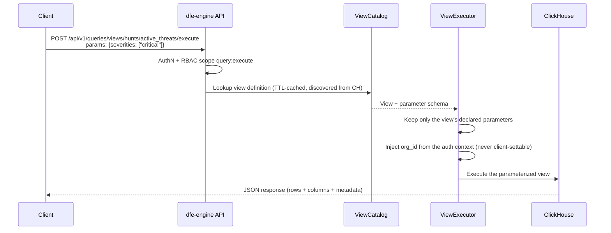
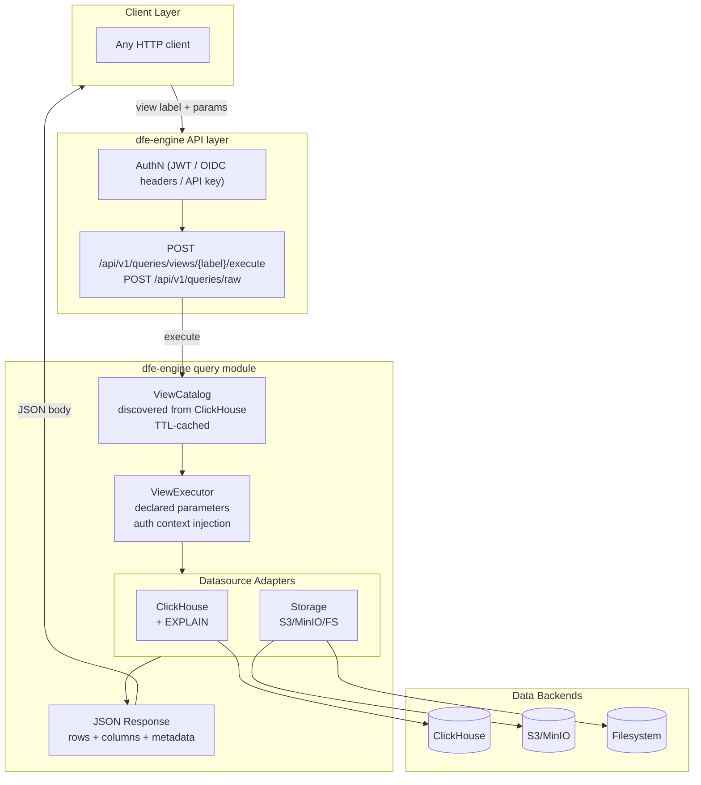
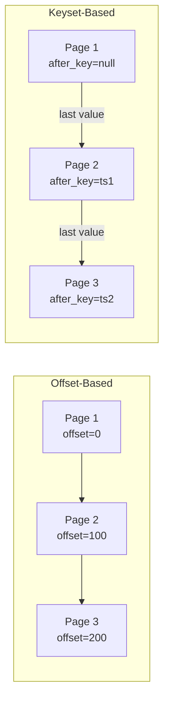
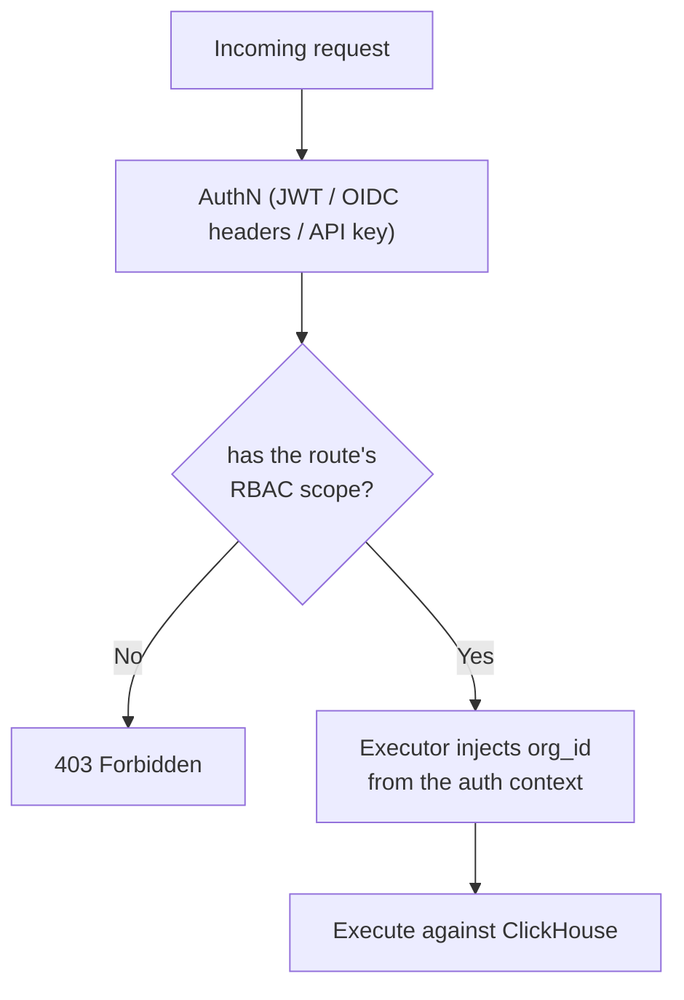

# DFE Query API

A label-based query interface over ClickHouse parameterised views, with multi-tenant isolation, scope-based RBAC and native JSON responses.

---

## Overview

- **No raw SQL from clients** - a view is referenced by label, and its SQL is a ClickHouse parameterised view deployed server-side
- **Mandatory tenant isolation** - `org_id` injected from the org the session's account or API key is bound to, cannot be overridden
- **Scope-based access control** - `query:read` browses the views and `query:execute` runs them
- **Declared parameters only** - the executor passes on only the parameters the view declares, unvalidated, and ClickHouse checks their types
- **Native JSON responses** - dict rows via clickhouse-connect, no intermediate wire format

### Supported Datasources

| Datasource | Description | Wire Format |
|------------|-------------|-------------|
| `clickhouse` | ClickHouse: parameterised views, and raw read-only queries | JSON |
| `s3` | S3 bucket directory listing, raw route only | JSON |
| `minio` | MinIO (S3-compatible) listing, raw route only | JSON |
| `file` | Local filesystem directory listing, raw route only | JSON |

---

## Security Model

### Example Security Flow



**Client Request** (the view label lives in the URL path):

```json
{
  "params": {"severities": ["critical", "high"]},
  "options": {"limit": 500}
}
```

**Server-side definition:** a ClickHouse parameterized VIEW, deployed
through the governed DDL path (gitops) and discovered by the engine's
`ViewCatalog` at runtime - there is no separate YAML query registry in the
engine. The executor passes on only the parameters the view's placeholders
declare, and `org_id` is injected from the auth context. It does not check
that a required parameter is present or that a value fits its type, so
ClickHouse refuses those and the request fails 500 `query_error`.

### Access control on the raw path

`POST /api/v1/queries/raw` executes against a registered datasource adapter (`clickhouse:...`, `s3:...`, `minio:...` or `file:...`). The SQL runs as the engine's own ClickHouse user, not a tenant's, so the route needs `raw_query:execute`. That action sits outside `query:*`, and no built-in role but `admin` holds it.

ClickHouse runs the query with `readonly=1`. That refuses every write and DDL statement, every `INSERT INTO FUNCTION` (`url()`, `file()`, `s3()`), a read through `url()`, and any `SETTINGS` clause in the query. The request's timeout still applies. The `s3`, `minio` and `file` adapters only list objects and never write, so `readonly` does not apply to them.

### The identity a view runs as

A view runs as `dfe_query_reader` (`query_views.restricted_user`), which holds `SELECT` on the data database and ClickHouse's introspection tables and no `SOURCES` grant, so `url()`, `s3()` and `remote()` are refused. Its password is `DFE_ENGINE_QUERY_VIEWS_RESTRICTED_PASSWORD` when set, else the minted user's own: `DFE_ENGINE_CLICKHOUSE_QUERY_READER_PASSWORD` when the deployment provides one, else `ch/service/query_reader` in the engine's secrets store. Its profile pins `readonly=2`, so the executor sends no `readonly` setting. Until the reader has a password, the view routes answer 503 `reader_unprovisioned`.

---

## Architecture



---

## API Reference

All routes live under `/api/v1/queries`:

| Route | Scope | Purpose |
|---|---|---|
| `GET /api/v1/queries/views` | `query:read` | list parameterized views (optional `?namespace=`) |
| `GET /api/v1/queries/views/namespaces` | `query:read` | list view namespaces |
| `GET /api/v1/queries/views/{label}` | `query:read` | one view definition with parameters |
| `POST /api/v1/queries/views/{label}/execute` | `query:execute` | execute a parameterized view |
| `POST /api/v1/queries/raw` | `raw_query:execute` | ad-hoc read-only query against a datasource adapter, as the engine's own ClickHouse user |

### Execute a view

```text
POST /api/v1/queries/views/analytics/user_activity/execute
Content-Type: application/json
Authorization: Bearer <jwt>

Request:
{
  "params": {
    "event_types": ["login", "logout"],
    "severities": ["critical", "high"]
  },
  "options": {
    "limit": 100,
    "offset": 0,
    "time_from": "2024-01-01T00:00:00Z",
    "time_to": "2024-01-31T23:59:59Z",
    "timeout_seconds": 30,
    "cache": true
  }
}

Response: JSON body (metadata embedded alongside rows, no custom headers)
{
  "rows": [ { "...": "..." } ],
  "columns": ["event_type", "timestamp"],
  "row_count": 100,
  "query_duration_ms": 42,
  "has_more": true,
  "next_offset": 100,
  "request_id": "req_abc123"
}
```

### Request models

```typescript
interface ViewExecuteRequest {
  // View parameters (only those the view declares are passed on)
  params?: Record<string, unknown>;

  // Execution options
  options?: QueryOptions;
}

interface RawQueryRequest {
  datasource: string;  // e.g. "clickhouse:default"
  query: string;
  params?: Record<string, unknown>;
  options?: QueryOptions;
}

interface QueryOptions {
  // Pagination - offset-based
  limit?: number;      // 1-100000
  offset?: number;     // >= 0, default 0; not combinable with after_key

  // Pagination - keyset-based
  order_by?: string;            // Column to order and page by
  order_dir?: "asc" | "desc";   // Sort direction
  after_key?: string | number;  // order_by value of the previous page's last row
  tiebreak_by?: string;         // Second column ordering rows that tie on order_by
  after_tiebreak?: string | number;  // tiebreak_by value of that last row

  // Time bounds (for time-series queries)
  time_from?: string;  // ISO8601 datetime
  time_to?: string;    // ISO8601 datetime, defaults to now

  // Execution
  timeout_seconds?: number;  // 1-300, default 30

  // Caching
  cache?: boolean;     // Allow cached results, default true

  // Accepted and ignored: views always run in the data database
  store?: string;
}
```

### Query Response Metadata

```typescript
interface QueryMetadata {
  row_count: number;
  query_duration_ms: number;
  query_label: string;
  datasource: string;
  store?: string;
  truncated: boolean;
  cached: boolean;
  cache_key?: string;
  explain_duration_ms?: number;
  request_id?: string;

  // Pagination info
  has_more: boolean;
  next_cursor?: string;
  next_offset?: number;
  total_count?: number;
}
```

---

## Pagination

The API supports two pagination modes:



### 1. Offset-Based Pagination

Simple pagination using `limit` and `offset`. Best for small datasets.

```json
{
  "options": {
    "limit": 100,
    "offset": 0
  }
}
```

**Response includes:**

- `has_more: true` if more rows available
- `next_offset: 100` for next page

### 2. Keyset Pagination

Stable pagination on a sort key. Send `order_by` from the first page, then `after_key` set to the previous page's last `order_by` value.

```json
{
  "options": {
    "limit": 100,
    "order_by": "timestamp",
    "order_dir": "desc",
    "after_key": "2024-01-15T12:00:00"
  }
}
```

The rules a keyset page follows:

- `after_key` is a string or a number, compared as the `order_by` column's type. Send a timestamp as `2024-01-15T12:00:00`, with a fraction if the column has one. A cursor that does not parse as the column's type is refused with 400 `invalid_options`.
- The key must be non-NULL: a row whose key is NULL is never returned.
- Without a tiebreak the key must be unique: a row tying with the cursor is skipped. For a key that is not unique, add `tiebreak_by` (a unique, non-NULL second column) and send `after_tiebreak` with `after_key`.
- `after_key` and `offset` cannot be combined.
- A view that declares its own `limit` parameter caps its rows before any outer paging, so `order_by`, `after_key` and `offset` on it are refused with 400. Page it with `limit` only.

---

## Query Labels

A view is referenced by a label in `namespace/name` form, the label goes in the URL path, and the body carries only `params` and `options`. `GET /api/v1/queries/views` lists the labels a deployment has, and `GET /api/v1/queries/views/namespaces` its namespaces.

```text
POST /api/v1/queries/views/analytics/user_activity/execute
```

---

## Storage Listing

Directory listings run on the raw route against a storage datasource, so they need `raw_query:execute`. The datasource names the bucket or root (`s3:<bucket>`, `minio:<bucket>`, `file:<root>`), and `params` narrow it:

| Datasource | Params |
|---|---|
| `s3`, `minio` | `bucket`, `prefix` (default ""), `delimiter` (default "/") |
| `file` | `path` (default ""), `recursive` (default false), `pattern` (default "*") |

```json
{
  "datasource": "s3:my-bucket",
  "query": "",
  "params": {"prefix": "data/2024/"},
  "options": {"limit": 100}
}
```

### Listing Result Schema

All storage adapters return a consistent JSON schema:

| Column | Type | Description |
|--------|------|-------------|
| `name` | string | File/directory name |
| `path` | string | Full path |
| `type` | string | "file" or "directory" |
| `size` | integer | Size in bytes (0 for directories) |
| `modified` | string \| null | Last modified time (ISO8601), null for directories |
| `etag` | string \| null | ETag (S3 only) |
| `storage_class` | string \| null | Storage class (S3 only) |
| `content_type` | string \| null | MIME type |

---

## EXPLAIN Plans

The API does not return EXPLAIN plans. In Python, the ClickHouse datasource adapter's `explain()` returns this structure, running every EXPLAIN with `readonly=1`.

### EXPLAIN Response

```json
{
  "steps": [
    {
      "step_type": "read",
      "description": "ReadFromMergeTree (events)",
      "estimated_rows": 10000,
      "estimated_cost": 0.5
    },
    {
      "step_type": "filter",
      "description": "Filter (org_id = 'acme')"
    },
    {
      "step_type": "limit",
      "description": "Limit 100"
    }
  ],
  "total_estimated_cost": 1.5,
  "total_estimated_rows": 100,
  "warnings": ["Consider adding index on timestamp"],
  "raw_plan": "Expression\n  ReadFromMergeTree..."
}
```

### Step Types

| Type | Description |
|------|-------------|
| `read` | Table/index scan |
| `filter` | WHERE/PREWHERE clause |
| `aggregate` | GROUP BY operation |
| `sort` | ORDER BY operation |
| `join` | Join operation |
| `projection` | Column selection |
| `limit` | LIMIT clause |
| `union` | Union operation |

---

## Error Handling

A failure is an RFC 9457 problem response with a stable `code`:

| HTTP Status | `code` | Cause |
|-------------|--------|-------|
| 404 | `not_found` | No view with that label |
| 400 | `invalid_options` | A paging option the executor refuses, for example a keyset cursor that does not parse or `after_key` with `offset` |
| 422 | - | The request body fails the request model, for example `limit` above 100000 |
| 403 | - | The caller lacks the route's scope, or the view's org is not granted |
| 500 | `query_error` | ClickHouse failed the view, including a missing or mistyped view parameter. The engine log has its reason |
| 503 | `reader_unprovisioned` | The restricted reader has no password yet |
| 503 | `not_configured` | No ClickHouse connection |

---

## Caching

Two distinct things, one implemented, one wire-format-only:

- **View catalog cache (implemented).** The `ViewCatalog` discovers view
  definitions from ClickHouse and caches them with a TTL (default 60s,
  `cache_ttl` on the catalog). A newly deployed view appears within one TTL;
  there is no invalidation endpoint - expiry is the mechanism.
- **Result caching (wire format only).** `QueryOptions.cache` and the
  `cached`/`cache_key` metadata fields exist in the request/response models,
  but no server-side result cache is implemented - the flag currently has no
  effect. Treat result caching as a client-side concern until the engine
  grows one.

---

## RBAC Integration

Authorisation is scope-based, enforced by `require_action` on every route -
there is no per-query role list:

| Scope | Grants |
|---|---|
| `query:read` | browse the view catalog (list/get views, namespaces) |
| `query:execute` | execute views |
| `raw_query:execute` | run raw datasource queries; only `admin` holds it |



Tenant isolation is structural, not per-query config: the executor injects
`org_id` from the authenticated context (never client-settable), and the
ClickHouse user's GRANTs + row policies bound what any deployment exposes.

---

## Wire Format

### Native JSON

All responses are a single native JSON body:

```text
Content-Type: application/json
```

**Benefits:**

- No client-side deserialization library required
- Human-readable, easy to debug (curl, browser devtools)
- Universal cross-language support
- Rows arrive as plain dicts/objects, ready to consume

### Metadata Embedding

Query metadata is returned as top-level fields alongside `rows` and `columns` in
the JSON response body - not in headers or a separate schema:

| Field | Description |
|-------|-------------|
| `row_count` | Number of rows |
| `query_duration_ms` | Query execution time |
| `has_more` | Whether more rows are available |
| `next_offset` | Offset for the next page (if `has_more`) |
| `request_id` | Request correlation ID |

---

## Clients

No SDK is published. Any HTTP client calls the routes above with a bearer token or an API key. Inside the engine image, `dfe_engine.query.QueryClient` wraps the same routes: [query-api-python.md](query-api-python.md).

---

## Security Properties

| Property | How Achieved |
|----------|--------------|
| No SQL injection | Clients send parameters to a server-side parameterised view, never SQL |
| Tenant isolation | Mandatory `org_id` injection from the session's bound org |
| AuthZ | `query:read` / `query:execute` scopes, `raw_query:execute` for the raw route |
| Least privilege | Views run as `dfe_query_reader`, `SELECT` only and no `SOURCES` grant |
| Resource limits | Per-request timeout (1-300 s) and limit (1-100000) |
| No arbitrary queries | Only the views ClickHouse holds can be executed |
| Type safety | ClickHouse types each parameter from the view's placeholder |

---

## References

- [ClickHouse parameterised views](https://clickhouse.com/docs/sql-reference/statements/create/view#parameterized-view)
- [ClickHouse](https://clickhouse.com/) - Analytics database
