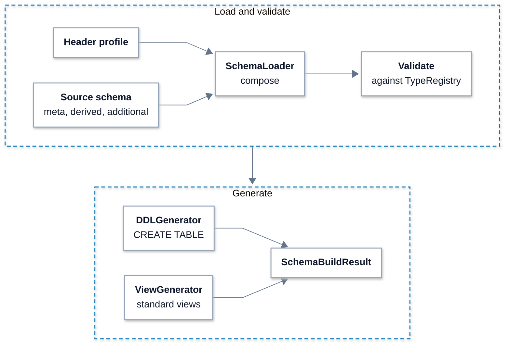

# Schema system - engine class reference

The engine classes that turn schema YAML (from the dfe-schemas repo) into
ClickHouse DDL. The YAML FORMAT itself (version tree, column fields, types,
attributes, use cases, @directives) is documented in the dfe-schemas repo
(<https://github.com/hyperi-io/dfe-schemas/blob/main/docs/meta-schema.md>). This page is the code-side lookup. Concept
overview: [schema.md](schema.md).

## File map

| File | What it contains |
|------|-----------------|
| `src/dfe_engine/source/models.py` | `SchemaColumn`, `SourceSchema`, `SourceHeader`, `Source` Pydantic models |
| `src/dfe_engine/source/type_registry.py` | `TypeRegistry` class, `ResolvedType` dataclass |
| dfe-schemas `registries/types.yaml` | the primitives, use_case constraints, attribute constraints, ch_override catalogue |
| `src/dfe_engine/source/engine_registry.py` | `EngineRegistry` - permitted table engines and their argument rules, from dfe-schemas `registries/engines.yaml` |
| `src/dfe_engine/schema/schema_loader.py` | `SchemaLoader` - YAML loading, composition, validation |
| `src/dfe_engine/schema/schema_ddl.py` | `DDLGenerator`, `DDLConfig` - column/index/view DDL generation |
| `src/dfe_engine/schema/schema_builder_v2.py` | `SchemaBuilderV2`, `SchemaBuildResult` - Source -> DDL orchestration |
| `src/dfe_engine/schema/schema_manager.py` | `SchemaManager` - version write operations (add, clone, create) |
| `src/dfe_engine/schema/applier.py` | `SchemaApplier`, `ManifestApplier`, `plan_source_table`, `read_table` - brings a live table to its CREATE TABLE, for a source deploy and the manifest alike |
| dfe-schemas `dfe_schemas/clickhouse.py` | `PlatformProbe` (Cloud or self-hosted, probed once per connection), `engine_clause` (the one `Replicated*` form), `create_database`, the settings realign |
| `src/dfe_engine/fieldmap/view_generator.py` | `ViewGenerator` - standard field map -> view DDL |

## Build pipeline

`SchemaBuilderV2.build` composes and validates the columns, then writes the CREATE TABLE and the standard views for one source version.



*Figure 1. L4 Detail -- Schema build. Validation errors go into the result and do not stop the build.* Up: [Data plane](README.md).

## Key classes

### SchemaColumn (`src/dfe_engine/source/models.py`)

```python
from dfe_engine.source.models import SchemaColumn

col = SchemaColumn(
    name="user_name",
    type="string",
    cardinality="low",
    use_case="dimension",
    expr="@source: first(user_id/uid/id)",
    comment="User identifier",
)
errors = col.validate_against_registry(TypeRegistry.default())
```

### TypeRegistry (`src/dfe_engine/source/type_registry.py`)

```python
from dfe_engine.source.type_registry import TypeRegistry

registry = TypeRegistry.default()  # loads dfe-schemas registries/types.yaml
resolved = registry.resolve("string", cardinality="low")
# ResolvedType(ch_type='LowCardinality(Nullable(String))', codec='ZSTD(1)')
registry.validate_use_case("integer", "dimension")  # OK
registry.validate_use_case("integer", "word_search")  # raises ValueError
registry.validate_cardinality("medium")  # raises InvalidCardinalityError
```

### SchemaLoader (`src/dfe_engine/schema/schema_loader.py`)

```python
from dfe_engine.schema.schema_loader import SchemaLoader

columns = SchemaLoader.load_columns("meta/syslog.yaml", version="1.0.0")
profile = SchemaLoader.load_profile("timeseries", version="1.0.0")
columns = SchemaLoader.apply_derived_schema(columns, "derived/beats/filebeat_auth.yaml")
columns = SchemaLoader.apply_additional_fields(columns, "additional.yaml")
full = SchemaLoader.compose(profile, columns)
errors = SchemaLoader.validate_columns(full, TypeRegistry.default())
order_cols = SchemaLoader.get_order_by_columns(full)
meta = SchemaLoader.load_version_metadata("meta/syslog.yaml")
```

### SchemaBuilderV2 (`src/dfe_engine/schema/schema_builder_v2.py`)

```python
from dfe_engine.schema.schema_builder_v2 import SchemaBuilderV2
from dfe_engine.source.models import Source

builder = SchemaBuilderV2(
    registry=TypeRegistry.default(),
    schemas_base_dir=Path("schemas/"),
)
result = builder.build(source)
result.create_table_ddl  # CREATE TABLE statement
result.columns  # list[SchemaColumn]
result.validation_errors  # list[str]
result.view_ddls  # {"sigma": "CREATE VIEW ...", ...}
```

### DDLGenerator (`src/dfe_engine/schema/schema_ddl.py`)

```python
from dfe_engine.schema.schema_ddl import DDLGenerator, DDLConfig

gen = DDLGenerator(TypeRegistry.default())
ddl = gen.generate_create_table("my_table", columns, DDLConfig(ttl_days=90))
add_ddl = gen.generate_alter_add_column("my_table", column)
view_ddl = gen.generate_view("my_table", {"SourceIP": "source_ip"}, "sigma")
```

### SchemaManager (`src/dfe_engine/schema/schema_manager.py`)

Version WRITE operations - published versions are immutable, so all changes
create new version entries:

```python
from dfe_engine.schema.schema_manager import SchemaManager

SchemaManager.create_meta_schema(
    "meta/new_source.yaml",
    columns=[{"name": "event_type", "type": "string"}],
    initial_version="1.0.0",
    summary="Initial schema",
)
SchemaManager.add_version(
    "meta/syslog.yaml",
    "1.1.0",
    columns=[...],  # complete column snapshot
    type="addition",
    summary="Added geo_country column",
)
SchemaManager.clone_version(
    "meta/syslog.yaml",
    "2.0.0",
    source_version="1.1.0",
    type="model",
    summary="Changed message type",
    column_modifications=[
        {"action": "update", "name": "message", "column": {"type": "string"}},
        {"action": "add", "column": {"name": "new_field", "type": "integer"}},
        {"action": "remove", "name": "old_field"},
    ],
)
```

### The applier (`src/dfe_engine/schema/applier.py`)

One applier brings every live table to its CREATE TABLE. It reads the statement
with sqlglot's ClickHouse tokens, and an added column or index is cut from the
CREATE's own text.

```python
from dfe_engine.schema.applier import plan_source_table

plan = plan_source_table(
    client, result.create_table_ddl, database="dfe", table=source.table_name, ttl_days=90
)
plan.statements  # CREATE, or ADD COLUMN / index / TTL / settings moves
```

## Validation rules

1. Primitive must exist in TypeRegistry (`registries/types.yaml` `primitives`).
2. Use case must be valid for the primitive (e.g. `word_search` is not valid
   for `integer`).
3. Attributes must be valid for the primitive (e.g. `lowcardinality` is not
   valid for `json`).
4. `ch_override` must match the supported ClickHouse types catalogue.
5. `cardinality` must be `low`, `high` or `unknown`, and cannot contradict the
   retired `lowcardinality` attribute.
6. Duplicate column names are rejected (normalised: dots and hyphens become
   underscores).
7. Published versions are immutable - SchemaManager refuses to modify them.

## Gotchas

- `expr` vs `comment`: both end up in the ClickHouse COMMENT clause,
  separated by ` - ` (dfe-schemas `render.py`). That separator is part of the
  wire format the loader parses. `expr` carries the `@directive`. `comment` is
  the human description. Never put directives in `comment`.
- `default` does triple duty: `DEFAULT expr` normally,
  `MATERIALIZED expr` with the `materialized` attribute, `ALIAS expr` with
  `alias`.
- Profile columns win: `SchemaLoader.compose()` drops source columns
  that duplicate profile names.
- `timestamp` vs `datetime`: both map to `DateTime64(3,'UTC')`, but
  `timestamp` is NOT nullable and uses `Delta, LZ4`. Use `timestamp` for
  ORDER BY time columns.
- Nullable ORDER BY: ORDER BY columns should carry `not_null`. The
  engine warns but does not reject.
- Shipped schemas are read-only: `is_shipped_schema()` detects paths
  inside the resolved schemas root (the `dfe-schemas` package, or the image
  seed) - custom schemas live outside those directories (`DFE_ENGINE_SCHEMAS_DIR`).
- Profile name matches the FILENAME: use `timeseries` / `minimal` /
  `passthrough` in `header.type`, matching the YAML filenames.
- Schema YAML is YAML 1.2: `registries/types.yaml` and the meta schemas
  load through ruamel (`yaml_utils.yaml_load`, dfe-schemas `loader.py`), so
  `off`/`yes`/`no` stay strings there.
