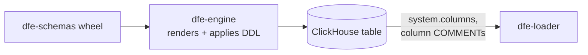

# The engine and loader schema contract

The engine renders and applies the DDL. dfe-loader reads the deployed table back out of ClickHouse and creates none. So the deployed table is the whole contract between them, and dfe-schemas is where the table's definition comes from.

## dfe-schemas owns the definitions

The dfe-schemas package holds the common-header profiles (`common-header/`), the source meta schemas (`meta/`), the hunt output schemas (`hunts/`) and the registries (`registries/`): table engines, the type system (primitive to ClickHouse type) and the default field maps.

The engine reads the version-pinned `dfe-schemas` wheel through `importlib.resources` and ships no schema files of its own. It looks in `DFE_ENGINE_SCHEMAS_DIR`, then the installed package, then the image's seed directory (copied out of that wheel at build), and when none carries what it needs, loading fails with `No dfe-schemas tree carries ...: set DFE_ENGINE_SCHEMAS_DIR or install dfe-schemas` (`src/dfe_engine/schema/schema_loader.py`).

## The deployed table is the runtime contract

dfe-loader reads three things from the table, never a profile YAML or a source definition:

1. Column types, from `system.columns`.
2. Column COMMENTs, which carry the loader directives.
3. The table COMMENT, which carries `@profile` and `@profile_version` for a header-composed table (dfe-schemas `render.py`).

The loader caches that schema for `schema.cache_ttl_secs` (300 by default, dfe-loader `docs/config-schema.yaml`), so an applied change reaches it on the next refresh, and until then it carries on with the schema it holds.

## What has to agree

- Directive vocabulary. The loader parses `@skip`, `@default`, `@source`, `@renamed`, `@computed` and `@coerce` (dfe-loader `src/column_meta/mod.rs`). `tests/unit/test_services/test_loader_directive_contract.py` restates that list as a literal and fails when the engine writes a directive the loader does not carry.
- Types. The engine maps primitives through dfe-schemas `registries/types.yaml`. The loader parses whatever ClickHouse type `system.columns` reports.
- Header columns. Both sides take them from the profile in `common-header/`.

No cross-repo CI job runs the loader's type parser over engine-generated DDL, and the loader has no profile migration of its own: the engine's schema apply adds the columns a new profile version brings.
