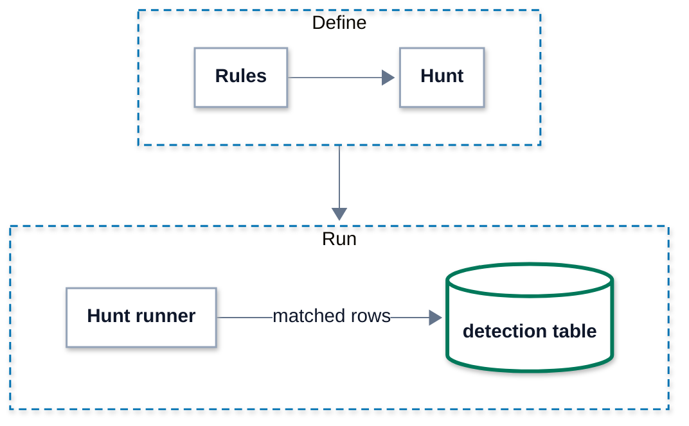

<!--
  Project:   dfe-engine
  File:      docs/data-plane/source-detections.md
  Purpose:   Rules, hunts and Sigma views -- the detection half of a source
  License:   BUSL-1.1
  Copyright: (c) 2026 HYPERI PTY LIMITED
-->

# Detections on a source

A source owns its detections the same way it owns its schema: the SQL runs
against that source's table, so it sees exactly the columns the source
declared. The source itself is [source.md](source.md).

## Rules

A rule is one detection condition on a source's table. `POST /api/v1/rules` takes it as a full `SELECT ... FROM <db>.<table> WHERE ...` in `user_sql` (the FROM names the source table), or as a structured `condition` on a `source`, and never both. A CEL filter may be ANDed in beside either. The engine stores the WHERE it extracts, the source table and the original SQL, which is the file the hunt runner reads.

```yaml
# rules/brute_force_login.yaml -- the filename stem is the rule's id
display_name: Brute Force Login Attempt
severity: high
source_db: dfe
source_table: winaudit
where_clause: "event_id = 4625"
original_sql: SELECT * FROM dfe.winaudit WHERE event_id = 4625
```

A `condition` is one test on a field, or `all` or `any` of several, nested to `x-dfe-max-nesting` groups. `negate` inverts a test or a group. The engine compiles it to `original_sql` and `where_clause` and stores it beside them, so `GET /api/v1/rules/{name}` returns the `condition` and the console reopens its builder on it. A rule saved as SQL has no condition, and a `PUT` with SQL drops one.

```json
{"all": [{"field": "user.name", "value": "bob"},
         {"field": "attempts", "operator": "gte", "value": 5}]}
```

| Operator | Value |
|---|---|
| `equals` (the default), `not_equals` | text or a number |
| `includes`, `starts_with`, `ends_with` | text, not empty |
| `lt`, `lte`, `gt`, `gte` | a number, or an ISO 8601 date or date-time (UTC unless it names a zone) |
| `in` | a list of texts or of numbers, at most 500 |
| `exists` | none |

The `RuleCondition` schema in `openapi.json` publishes the operators, the kind of value each takes (`x-dfe-operand-kinds`) and the nesting limit.

A field is a column of the source table when the table has one by that name, otherwise a path inside `_json` (`_json.` in front is accepted). A path is read as the type of its operand. A row without the field fails every test but `exists`, and `negate` does not change that, so `exists` negated finds the rows that lack it. Every value is quoted and every field name is split into identifier parts, so no operand reaches the SQL as text. The hunt window bounds time for every rule, so a condition cannot compare `_timestamp` or the other time columns with `lt`, `lte`, `gt` or `gte`, and a save or preview says so. A text operand cannot hold `{window}` or `{unseen}`, which the runner fills in wherever they sit. A condition is always `source_type` `raw`.

`POST /api/v1/rules/preview` takes `{source, condition, cel_filter?, cost_window_minutes?}` and runs what a save runs under the same org fence, then stops. Send `name` when editing a rule so the count follows the hunts that run it. A condition the save would refuse still answers 200, with the reasons in `sql_errors` or `matches_everything`.

```json
{"user_sql": "SELECT * FROM `dfe`.`winaudit` WHERE ...", "source_db": "dfe",
 "source_table": "winaudit", "where_clause": "...", "sql_errors": [],
 "matches_everything": null, "cost_estimate": {"estimated_rows": 2, "band": "ok"}}
```

`GET /api/v1/hunts?rule=<name>` lists the hunts with exactly that name in `rules`.

A hunt can only name a stored rule: `POST /api/v1/hunts` answers 422 `unknown_rule` for one that is not, and so does a `PUT` that adds one. A hunt whose rule file is deleted afterwards stays editable, and its list row and detail carry `missing_rules` and an `error` saying the runner cannot fire it.

## Hunts

A hunt groups rules, names the customers the rules read for, and holds the
schedule. The runner runs `rate` schedules: `anchored` hunts are recognised and
skipped.

```yaml
# hunts/windows_logins.yaml -- the filename stem is the hunt's id
name: Windows logins
schedule:
  mode: rate
  interval: 5m
customers: [acme]
rules: [brute_force_login]
```

The hunt runner runs each rule over the hunt's window and writes every matched row to the detection table.



*Figure 1. L4 Detail -- Rule to detection table.* Up: [Data plane](README.md).

Matches land in `<data database>.detection` unless the hunt
(`global_target_table_name`) or a rule entry (`target_table_name`) names another
table. How the runner scales is
[hunt-runner-scaling.md](hunt-runner-scaling.md), and how a person finds a
match is [hunt-match-delivery.md](hunt-match-delivery.md).

## Hunt customers

A hunt's `customers` are org names. The engine resolves each to the org's tenant ids when it saves the hunt and stores them as `customer_tenant_ids`, and the runner reads the rows with one of them in `_org_id` and no others. Every org create, update and delete stores that org's tenant ids afresh in each hunt naming it, as one deploy-repo change, before the org itself is written. A deleted org keeps its name in `customers` and loses its stored ids, so the hunt fails every fire as `unknown_customers` and holds its watermark until someone edits it. A hunt carrying a direct `query` instead of `rules` is trusted SQL from the operator-controlled deploy repo, and no customer holds it.

In production+team the hunt change waits on review while the org is written at once. So an org create or update is refused with 409 `tenant_id_held` when it takes a tenant id a hunt reads for another org, on main or on an unmerged review branch. Merge or delete that branch, or edit the hunt, to release the id. A squash merge leaves the branch behind, so turn on the forge's auto-delete of merged head branches. The startup seed skips such an org, and one the forge cannot check, until the next boot.

Accepted residual: the runner keeps the hunts it loaded until its next reload (`--reload-every` ticks of `hunts.runner_poll_seconds`, 20 x 15 s = 300 s at the defaults, plus `huntRunner.gitSync.period` on Kubernetes), so a tenant id deleted and given to a new org inside that window can fire once on the old org's hunt.

## Lookup databases

A rule condition reads its row and one more kind of table: a table of a database `hunts.lookup_databases` lists (`DFE_ENGINE_HUNTS_LOOKUP_DATABASES`, comma-separated, empty by default). The forms are `x IN (SELECT <columns> FROM <db>.<table> [WHERE <condition>])`, `x IN <db>.<table>` and `x IN (<db>.<table>)`, with `NOT` and `GLOBAL` as usual. Any other subquery, join, union or table after `IN` is refused when the rule is saved, in a governance action and when the runner compiles it.

The runner's ClickHouse user reads every org, so a listed database must hold shared reference data, such as threat-intel indicators, and no org's rows. Each of its tables must hold its rows itself, on a `MergeTree`-family, `Log`, `TinyLog`, `StripeLog`, `Memory` or `EmbeddedRocksDB` engine, with no `_org_id` column. So a view, `Merge`, `Distributed`, `Set` or `Join` table is refused. The runner refuses to start while one is there, and stops at the reload that first finds one. The engine refuses to start too when ClickHouse answers at its start. When it does not, the engine starts with the check unrun and logs a warning, and the runner's check still applies. `system`, `information_schema` and the data database cannot be listed. The runner's `hunt_runner` service role needs `SELECT` on each listed database, added to its grants as a governed-ops edit.

## Sigma views

Sigma rules reference fields by standardised names (`SourceIP`, `CommandLine`,
`EventID`). Rather than carrying those names in the base schema, a source
declares a Sigma view and the engine generates it:

```sql
-- Auto-generated from the source schema + the sigma field mapping
CREATE VIEW {db}.{source}_sigma AS
SELECT
    source_ip AS SourceIP,
    dest_ip AS DestinationIP,
    user_name AS User,
    command_line AS CommandLine,
    event_id AS EventID,
    *
FROM {db}.{source}
```

The rules query the view, the base schema stays ClickHouse-native, and the
mapping is per-source because different sources map differently. A view costs
no storage.

```yaml
# In the source definition (a views entry with standard: sigma)
views:
  - standard: sigma
    taxonomy: windows                   # Sigma logsource product binding
    custom_mappings:                    # Per-source overrides (win over field_map)
      CommandLine: command_line
      ParentCommandLine: parent_cmd
```

The view deploys whether Sigma is on or off. Converting a Sigma rule is a beta behind `sigma.enabled`, default `false`, tracked in <https://github.com/hyperi-io/dfe-engine/issues/887>. A converted Sigma rule becomes a DFE rule tied to the source, querying the
`{source}_sigma` view. The provider pipeline that keeps the rule catalogue
current is [sigma.md](sigma.md). The mapping layer itself is
[field-mapping.md](field-mapping.md).
