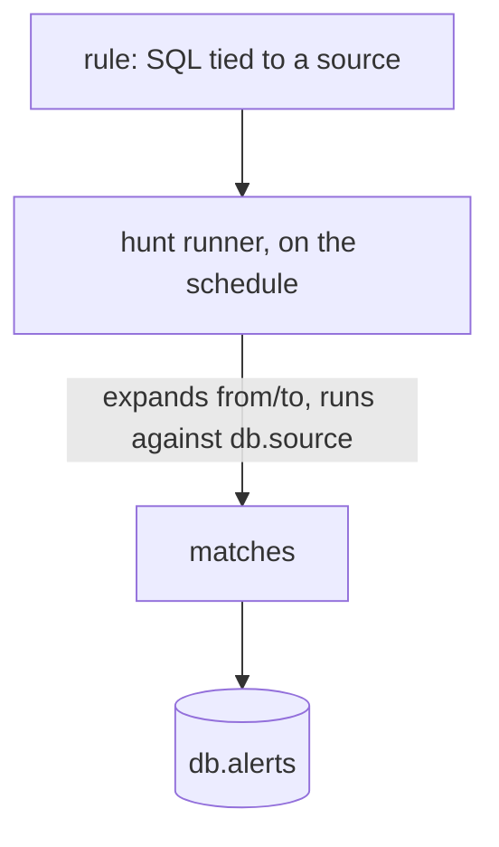

<!--
  Project:   dfe-engine
  File:      docs/data-plane/source-detections.md
  Purpose:   Rules, hunts and Sigma views -- the detection half of a source
  License:   BUSL-1.1
  Copyright: (c) 2026 HYPERI PTY LIMITED
-->

# Detections on a source

A source owns its detections the same way it owns its schema: the SQL runs
against that source's table, so it sees exactly the columns the source
declared. The source itself is [source.md](source.md).

## Rules

A rule is one SQL detection query tied to a source.

```yaml
# rules/brute_force_login.yaml
rule: brute_force_login
source: winaudit                        # Tied to this source's table
display_name: Brute Force Login Attempt
severity: high

query: |
  SELECT
    _timestamp,
    _org_id,
    user_name,
    source_ip,
    count() AS attempt_count
  FROM {db}.{source}
  WHERE event_id = 4625
    AND _timestamp >= {from}
    AND _timestamp < {to}
  GROUP BY _timestamp, _org_id, user_name, source_ip
  HAVING attempt_count >= {threshold}

parameters:
  threshold: 5

schedule: "*/5 * * * *"                 # Cron schedule for hunt execution
```

`{db}`, `{source}`, `{from}` and `{to}` are templated at execution time.

## Hunts

A hunt is a scheduled batch execution of rules, and its matches are written to
the alerts table.



The alerts table is itself a source (`_source = "alerts"`, `header.type:
timeseries`), so it gets the same schema management, retention and query
surface as any other -- including rules written against alerts, which is how
correlation is expressed. How the runner scales is
[hunt-runner-scaling.md](hunt-runner-scaling.md).

## Hunt customers

A hunt's `customers` are org names. The engine resolves each to the org's tenant ids when it saves the hunt and stores them as `customer_tenant_ids`, and the runner reads only rows whose `_org_id` is one of them. Every org create, update and delete stores that org's tenant ids afresh in each hunt naming it, as one deploy-repo change, before the org itself is written. A deleted org keeps its name in `customers` and loses its stored ids, so the hunt fails every fire as `unknown_customers` and holds its watermark until someone edits it. A hunt carrying a direct `query` instead of `rules` is trusted SQL from the operator-controlled deploy repo, and no customer holds it.

In production+team the hunt change waits on review while the org is written at once. So an org create or update is refused with 409 `tenant_id_held` when it takes a tenant id a hunt reads for another org, on main or on an unmerged review branch. Merge or delete that branch, or edit the hunt, to release the id. The startup seed skips such an org, reading main only.

## Lookup databases

A rule condition reads its own row and one more kind of table: a table of a database `hunts.lookup_databases` lists (`DFE_HUNTS_LOOKUP_DATABASES`, comma-separated, empty by default). The forms are `x IN (SELECT <columns> FROM <db>.<table> [WHERE <condition>])`, `x IN <db>.<table>` and `x IN (<db>.<table>)`, with `NOT` and `GLOBAL` as usual. Any other subquery, join, union or table after `IN` is refused when the rule is saved, in a governance action and when the runner compiles it.

The runner's ClickHouse user reads every org, so a listed database must hold shared reference data, such as threat-intel indicators, and no org's rows. Each of its tables must be a plain store of its own rows, on a `MergeTree`-family, `Log`, `TinyLog`, `StripeLog`, `Memory` or `EmbeddedRocksDB` engine, with no `_org_id` column. So a view, `Merge`, `Distributed`, `Set` or `Join` table is refused. The runner refuses to start while one is there, and stops at the reload that first finds one. The engine refuses to start too when ClickHouse answers at its start. When it does not, the engine starts with the check unrun and logs a warning, and the runner's check still applies. `system`, `information_schema` and the data database cannot be listed. The runner's `hunt_runner` service role needs `SELECT` on each listed database, added to its grants as a governed-ops edit.

## Sigma views

Sigma rules reference fields by standardised names (`SourceIP`, `CommandLine`,
`EventID`). Rather than carrying those names in the base schema, a source
declares a Sigma view and the engine generates it:

```sql
-- Auto-generated from the source schema + the sigma field mapping
CREATE VIEW {db}.{source}_sigma AS
SELECT
    source_ip AS SourceIP,
    dest_ip AS DestinationIP,
    user_name AS User,
    command_line AS CommandLine,
    event_id AS EventID,
    *
FROM {db}.{source}
```

The rules query the view, the base schema stays ClickHouse-native, and the
mapping is per-source because different sources map differently. A view costs
no storage.

```yaml
# In the source definition (a views entry with standard: sigma)
views:
  - standard: sigma
    taxonomy: windows                   # Sigma logsource product binding
    custom_mappings:                    # Per-source overrides (win over field_map)
      CommandLine: command_line
      ParentCommandLine: parent_cmd
```

A converted Sigma rule becomes a DFE rule tied to the source, querying the
`{source}_sigma` view. The provider pipeline that keeps the rule catalogue
current is [sigma.md](sigma.md); the mapping layer itself is
[field-mapping.md](field-mapping.md).
