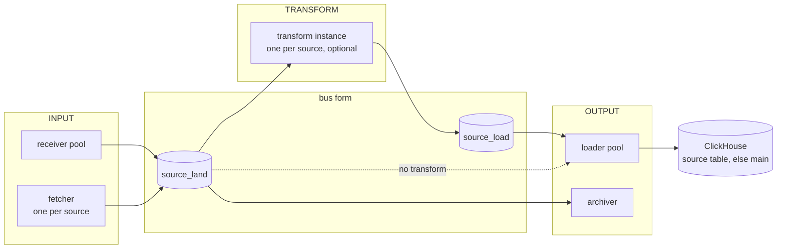
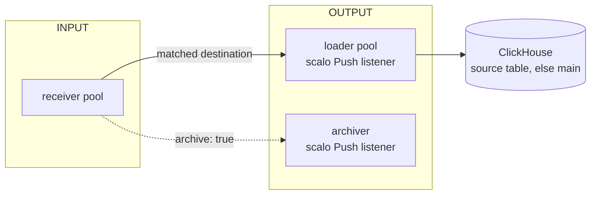
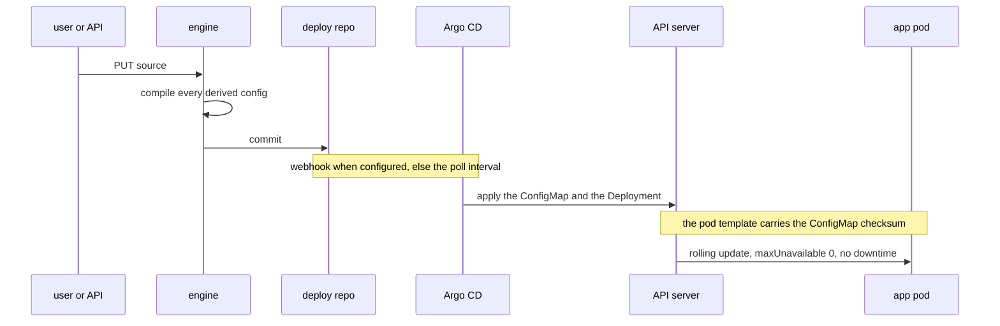

<!--
  Project:   dfe-engine
  File:      docs/data-plane/source-flow.md
  Purpose:   The source flow - INPUT, optional TRANSFORM, OUTPUT - on the bus or direct
  License:   BUSL-1.1
  Copyright: (c) 2026 HYPERI PTY LIMITED
-->

# The source flow - one definition, two transports

A source names where its records come in, whether they are transformed, and where they land. Everything else - topics, routing rules, endpoints, the instances that run the stages - is compiled from that definition by the engine and deployed through gitops. A record's path is predictable from the source alone, and a hand edit to a compiled artefact is drift the engine reports and re-syncs.

## The flow in one diagram

Two transports carry the same three stages. The bus (Kafka on the `single` and `scale` profiles) holds records between stages, so a stage can be down and nothing is lost. Direct gRPC (`slim`, `mesh`) stores nothing between stages, so the receiver's own buffer is the only slack.

Direct runs the receiver to loader path alone (the second diagram). A fetcher or a transform is an app of its own per source, and addressing a pool of those over gRPC needs the mesh, which is not GA. A source that needs one is refused at save on a direct deployment, and the compile leaves it out. `GET /api/v1/system/deployment` reports `transports.per_source_apps: false` there, and each `GET /api/v1/sources/catalogue` entry carries `runnable`, `runnable_reason` and `runnable_intakes`, judged by the same resolver as the save.

The archiver keeps the RAW record as it arrived, before any transform. On the bus it reads the landing topic; on direct the receiver fans the record out to it beside the loader. A profile that apps.yaml does not offer dfe-archiver in, or that does not run it unasked (`default_in`) while no archiver instance is deployed, refuses `archive: true` at save, naming the profile, while a source stored with it before still reads and compiles.

**We parse mechanical transport at max efficiency at the edge.** dfe-receiver and dfe-fetcher parse the transport layer (a syslog header, a beats envelope) into JSON with the payload in `message`. Content-dependent parsing, such as a vendor body through grok, happens in a transform reading `message`. Raw capture (`_raw`) is off by default because it doubles every record. A first-hop parse bug is fixed in the receiver or fetcher, never by turning raw capture on.

## Two transports, one per deployment

A source declares `transport: bus` or `transport: direct`. Left unset, it takes the deployment's own, which follows the profile's `kafka.mode`: `disabled` means direct, anything else means bus. Every stage is bound to that one at deploy, so it is the only transport the deployment carries and a source naming the other is refused at save with the reason - `GET /api/v1/system/deployment` reports the same one transport, so a console never offers the other. Separately, a flow is never mixed: every stage of one source runs on the same transport.

| Profile | Transport | Between stages | Balancing between pools |
|---|---|---|---|
| dfe-docker slim | direct | gRPC | one replica of each |
| dfe-docker single | bus | Kafka topics on one broker | one replica of each |
| slim | direct | gRPC | one replica; the KEDA ceiling of two would pin senders to pods |
| single | bus | Kafka topics on one broker | consumer groups |
| scale | bus | Kafka topics on a broker cluster | consumer groups |
| mesh | direct | gRPC | a listener per stage pool, see [../deployment/transports.md](../deployment/transports.md) |

The source records bus-versus-direct only. Which bus (Kafka today) and which direct protocol (gRPC) are deployment facts, so a second bus provider joins behind the same `transport: bus` value without a change to the source model.

## Naming is generated, never typed

| Thing | Name | Source |
|---|---|---|
| landing topic | `<label>_land` on the landing label, so `main_land` for a main-pushing fetcher | apps.yaml `source_binding` |
| transformed topic | `<source>_load` | apps.yaml `source_binding` |
| app instance (per-source apps only) | `dfe-<component>-<source>`, for example `dfe-transform-vrl-auth` | the instance overlay's `fullnameOverride` (and `component` for the dfe-common charts); stack-wide apps such as the receiver carry no suffix |
| Service and port per app | manifest `endpoints` | apps.yaml |
| unmatched records | source `main`, table `main` | the main flow |

The engine sets `<source>_load` only when the source has a transform, and the loader's topic discovery suppresses `_land` whenever a `_load` topic for the same source exists. So a `_load` topic left on the broker after a transform is removed starves the source until the topic is deleted. The deploy of the version without the transform goes ahead and reports the topic in `topics_pending_removal`. A later apps reconcile, or the engine's next start, deletes it once all three hold: the deploy repo carried no transform instance writing it before that pass, the transform's consumer group has no live member, and no consumer group has records left to read on it. Deployers never type a topic or an endpoint into an app's values file.

Those topics are the engine's for the source's whole life, and nothing depends on the broker's `auto.create.topics.enable`: [topic-contract.md](topic-contract.md) covers ensure, converge, status and remove.

## What the engine compiles

| Source field | Compiles into |
|---|---|
| `match` or `when` | the receiver `rules` rows that label the record, and on direct a `destinations.sources` entry sending that label to the loader. The entry keys on the label, so any match reaches it |
| `compat_profiles`, `aliases` | the bound profiles' `rules` rows, and each profile's alias lookup ([source-routing.md](source-routing.md)) |
| `fetcher` (source_type, config, topic, routes, org) | one fetcher instance overlay: the `org_id` it stamps, and one `output.destinations` entry plus the `output.routes` rule naming it per data-match route |
| `transform` (engine, variant, config) | one transform instance overlay: `_land` in and `_load` out, bus only |
| landing label | loader routing, source to table |
| `archive: true` | the archiver's topic list on the bus. On direct a second destination on the source's own rule |

A fetcher's composed config carries ONE connector type, because its source does: the composition refuses a second type, naming the source and the types, unless `DFE_SOURCE_ALLOW_MIXED_FETCHER_TYPES` says otherwise (see [source-definition.md](source-definition.md)).

Every compiled block lands in the deploy repo under `values/`, Argo CD applies it on Kubernetes, and a hand edit to any of them is reported as drift and re-synced on the next source write. A block carries only the keys the sources derive, so the deployment's own settings survive it. Compose has no Argo, so there the engine renders each app's own config file from those blocks into a directory the containers mount. A Compose deployment that has the engine render nothing runs its apps on the static config files the stack mounts, so a source written there compiles but never reaches the receiver, and `GET /api/v1/system/deployment` reports `applies_routing: false`. The receiver's destinations are a named set: the loader and the archiver are destinations, and a rule sends a matched record to one by name. The fetcher carries the same shape as `output.routes` over its default destination.

## How a change reaches a pod

Without a webhook Argo polls every 300 s with up to 60 s jitter, so a routing change takes 5 to 9 minutes to reach a pod; with the Forgejo-to-Argo webhook it takes seconds plus the kubelet's ConfigMap sync of about a minute.

Every app rolls on every config change, so nothing here depends on which app can reload which key: the apps that also apply a change in place (the receiver's routing, Vector's transform files) gain nothing extra from it. apps.yaml's `hot_reload` and `restart_paths` count only where no chart renders the config, on Compose, where they decide whether a write hands the operator a restart command.

## Asking what the deployment is, and what a source is doing

Two reads carry the facts a console would otherwise have to guess at. `GET /api/v1/system/deployment` answers what this deployment IS: the profile the deployer injected as `DFE_PROFILE`, the one transport it carries a source on - which is both the only one a source may name and the one a source that names none takes - whether the stage pools sit behind mesh listeners and where, whether compiled routing reaches its running apps (`applies_routing`), and the stack, engine, dfe-ui and per-app pinned versions (`apps`, name to version tag, from the deploy repo's pins). `GET /api/v1/system/version` serves the version half from the same function, so the footer and the deployment card cannot disagree, and `GET /api/v1/apps` judges each app's `offered` against the deployment's own profile when the caller names none.

`GET /api/v1/sources/{name}/signals` answers what one source is doing: `records_per_min` and `last_seen` over a bounded five-minute window, read from the loader's `loader_messages_by_table_total` counter in the otel database, plus `landed_in_default`. The counter is per TABLE, so `landed_in_default` says the number covers the whole shared landing table rather than this source alone - which is the case for a fetcher pushing to the main topic. Either reading is null where no series answers, and the route still returns 200: a source only just defined has nothing to report, and a zero would claim a measurement nobody took.

## The main flow

With no sources defined, every record the receiver accepts is stamped `_source: main`, lands in the `main` table, and can be searched. The `main` source is a normal source whose match rule is `operator: always`: it has the deployment's transport, may carry a transform, and may be archived on the bus form. It is read and written at `/api/v1/sources/main` like any other source and the console gives it a card of its own; nothing about it is special code.

## Adding a transform

A transform is an apps.yaml entry with a `source_binding` and its `transports`, and a chart that exposes the transport dial and the Push Service. No engine release is involved. dfe-transform-vrl, dfe-transform-vector and dfe-transform-elastic run a Push listener beside their bus consumer, but a transform is one deployment per source, so none runs on a direct deployment until the mesh is GA. dfe-transform-elastic's `source.name` selects one of the compiled-in transforms its contract lists.

## Content another repo ships

The engine serves two sorts of file it does not own. The reference pipelines the library and the console's copy-paste view show are pinned in dfe-infra `versions.yaml` under `content:`, and the engine chart materialises them into `/etc/dfe-engine/content` with one init container running the pinned app image. Neither a ConfigMap nor a Helm value carries them, because either form re-serialises them into etcd on every Argo sync.

The engine reads that directory through `DFE_LIBRARY_SEED_DIR`, which points at `<mount>/library`, laid out by artefact kind. Every file under it becomes a library artefact at startup: created when absent, published as a new version only when the pinned content differs from every version already in the series, and tagged `stack`. Seeded artefacts carry the group `stack` and the label `origin=stack`, so shipped content lists apart from authored content, and a version somebody published themselves stays where it is. The seed is idempotent across restarts, so a deployment that restarts for unrelated reasons writes nothing.

The source catalogue is the `catalogue/` tree of the dfe-schemas package the engine installs. Each file is the `POST /sources` write body for one source. A create with no intake takes the first of fetcher, beats and receiver the entry lists, because an Elastic-shipped event carries `data_stream.dataset` and no `_source` label. The engine reads the installed package, never the seeded schemas volume, because the seed never deletes and a dropped entry would survive there. The format is the Catalogue section of the dfe-schemas README, and a file that breaks it is left out with one warning naming it.

`GET /api/v1/sources/catalogue` lists it, leaving out an entry already stored as a source. `tags` keeps entries whose holding directory is one of the names given, and `untagged` is the files that sit in the catalogue root. Omitting `tags` lists the whole catalogue. `GET /api/v1/sources/catalogue-tags` lists the directories directly under that tree. Each row carries the directory key as `id`, and the display name and description from `registries/catalogue-tags.yaml`. Files that sit in the catalogue root, rather than in a directory, are the tag `untagged`. `name` keeps a tag whose key or display name starts with it, ignoring case. A `dfe-schemas` checkout beside this repository is the tree that route reads when the checkout has a `catalogue/`, so holding directories show up before a release ships them. `POST /api/v1/sources/from-catalogue` creates up to 50 entries as ordinary sources. One entry's refusal is recorded and the rest are still stored. Another intake swaps in the match rule it derives: beats matches `data_stream.dataset`, and receiver matches `_source` on the source name. Each entry's availability is read off the deployed transform's mounted `capability-catalog.json`: `available` when it lists the variant, `missing_variant` when it does not, and `unknown` when no contract reads. An entry whose variant is `missing_variant` is refused, and the other two are allowed.
