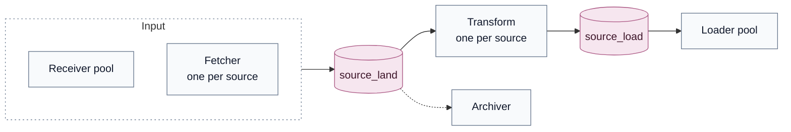
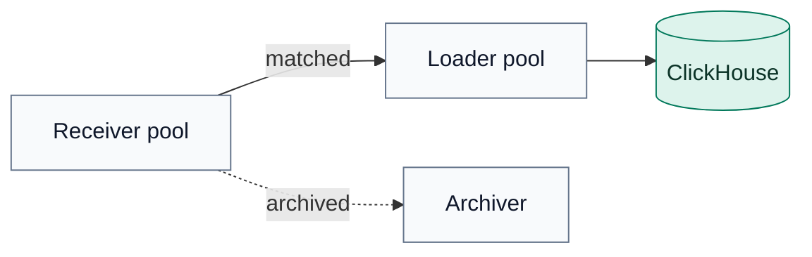
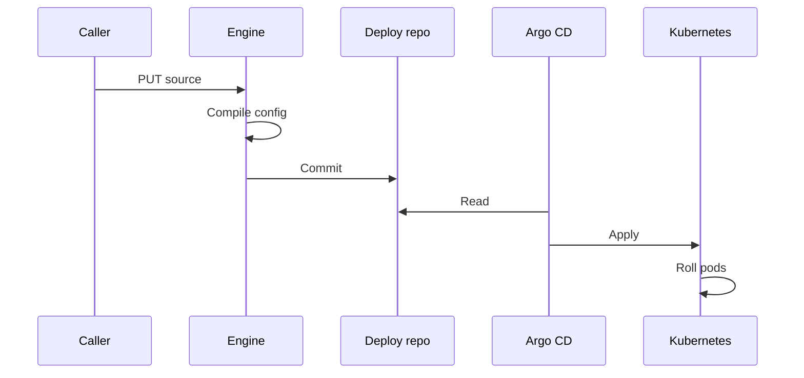

<!--
  Project:   dfe-engine
  File:      docs/data-plane/source-flow.md
  Purpose:   The source flow - INPUT, optional TRANSFORM, OUTPUT - on the bus or direct
  License:   BUSL-1.1
  Copyright: (c) 2026 HYPERI PTY LIMITED
-->

# The source flow - one definition, two transports

A source names where its records come in, whether they are transformed, and where they land. Everything else - topics, routing rules, endpoints, the instances that run the stages - is compiled from that definition by the engine and deployed through gitops. A record's path is predictable from the source alone, and a hand edit to a compiled artefact is drift the engine reports and re-syncs.

## The flow on each transport

Two transports carry the same three stages. The bus (Kafka on the `single` and `scale` profiles) holds records between stages, so a stage can be down and nothing is lost. Direct gRPC (`slim`, `mesh`) stores nothing between stages, so the receiver's own buffer is the only slack.

On the bus, a source's records go through its landing topic, its transform and its transformed topic to the loader.

*Figure 1. L4 Detail -- Source flow on the bus. With no transform the loader reads `source_land` itself.* Up: [Data plane](README.md).

The loader writes the source's own table, else `main`. The dotted arrow is the optional archive path.

On direct gRPC the receiver pushes each matched record to the loader, and to the archiver when the source is archived.

*Figure 2. L4 Detail -- Source flow on direct gRPC. The loader and the archiver each take the push on a scalo Push listener.* Up: [Data plane](README.md).

Direct runs the receiver to loader path alone (figure 2). A fetcher or a transform is one app per source, and addressing a pool of those over gRPC needs the mesh, which is not GA. On a direct deployment a source that needs one is rejected at save and left out of the compile. `GET /api/v1/system/deployment` reports `transports.per_source_apps: false` there, and each `GET /api/v1/sources/catalogue` entry has `runnable`, `runnable_reason` and `runnable_intakes` from the same resolver as the save.

The archiver keeps the record as it arrived, before any transform. On the bus it reads the landing topic. On direct the receiver sends the record to it beside the loader. `archive: true` is rejected at save, naming the profile, where apps.yaml does not offer dfe-archiver in the profile, or does not run it by default (`default_in`) and no archiver instance is deployed. A source stored with it before still reads and compiles.

The first hop parses the transport and stops. dfe-receiver and dfe-fetcher turn the transport layer (a syslog header, a beats envelope) into JSON with the payload in `message`. Parsing the content, such as a product's message body through grok, happens in a transform reading `message`. Raw capture (`_raw`) is off by default because it doubles every record. A first-hop parse bug is fixed in the receiver or fetcher, never by turning raw capture on.

## Two transports, one per deployment

A source declares `transport: bus` or `transport: direct`. Left unset, it takes the deployment's transport, which follows the profile's `kafka.mode`: `disabled` means direct, anything else means bus. Every stage is bound to that transport at deploy, so a source naming the other is rejected at save with the reason. `GET /api/v1/system/deployment` reports the same transport, so a console never offers the other. A flow is never mixed: every stage of one source runs on one transport.

| Profile | Transport | Between stages | Balancing between pools |
|---|---|---|---|
| dfe-docker slim | direct | gRPC | one replica of each |
| dfe-docker single | bus | Kafka topics on one broker | one replica of each |
| slim | direct | gRPC | one replica. The KEDA ceiling of two would pin senders to pods |
| single | bus | Kafka topics on one broker | consumer groups |
| scale | bus | Kafka topics on a broker cluster | consumer groups |
| mesh (in the charts, refused by dfe-infra's bootstrap) | direct | gRPC | a listener per stage pool, see [../deployment/transports.md](../deployment/transports.md) |

The source records bus or direct and nothing more. Which bus (Kafka) and which direct protocol (gRPC) are deployment facts, so a second bus provider joins behind the same `transport: bus` value with no change to the source model.

## Naming is generated, never typed

| Thing | Name | Source |
|---|---|---|
| landing topic | `<label>_land` on the landing label, so `main_land` for a main-pushing fetcher | apps.yaml `source_binding` |
| transformed topic | `<source>_load` | apps.yaml `source_binding` |
| app instance (per-source apps) | `dfe-<component>-<source>`, for example `dfe-transform-vrl-auth` | the instance overlay's `fullnameOverride` (and `component` for the dfe-common charts). Stack-wide apps such as the receiver have no suffix |
| Service and port per app | manifest `endpoints` | apps.yaml |
| unmatched records | source `main`, table `main` | the main flow |

The engine sets `<source>_load` when the source has a transform, and the loader's topic discovery drops `_land` whenever a `_load` topic for the same source exists. So a `_load` topic left on the broker after a transform is removed starves the source until the topic is deleted. The deploy of the version without the transform goes ahead and reports the topic in `topics_pending_removal`. A later apps reconcile, or the engine's next start, deletes it once three things hold: the deploy repo had no transform instance writing it before that pass, the transform's consumer group has no live member, and no consumer group has records left to read on it. Deployers never type a topic or an endpoint into an app's values file.

Those topics are the engine's for the source's whole life, and nothing depends on the broker's `auto.create.topics.enable`: [topic-contract.md](topic-contract.md) covers ensure, converge, status and remove.

With no sources defined, every record the receiver accepts is stamped `_source: main`, lands in the `main` table, and can be searched. The `main` source has the match rule `operator: always` and the deployment's transport. It is a core source the engine seeds: `/api/v1/sources/main` reads it, and an update or delete is refused (`SourceCoreResourceError`).

## What the engine compiles

| Source field | Compiles into |
|---|---|
| `match` or `when` | the receiver `rules` rows that label the record, and on direct a `destinations.sources` entry sending that label to the loader. The entry keys on the label, so any match reaches it |
| `compat_profiles`, `aliases` | the bound profiles' `rules` rows, and each profile's alias lookup ([source-routing.md](source-routing.md)) |
| `fetcher` (source_type, config, topic, routes, org) | one fetcher instance overlay: the `org_id` it stamps, and one `output.destinations` entry plus the `output.routes` rule naming it per data-match route |
| `transform` (engine, variant, config) | one transform instance overlay: `_land` in and `_load` out, bus only |
| landing label | loader routing, source to table |
| `archive: true` | the archiver's topic list on the bus. On direct a second destination on the source's own rule |

A fetcher's composed config holds ONE connector type, because its source does. The composition rejects a second type, naming the source and the types, unless `DFE_ENGINE_SOURCE_ALLOW_MIXED_FETCHER_TYPES` says otherwise ([source-definition.md](source-definition.md)).

Every compiled block lands in the deploy repo under `values/`, Argo CD applies it on Kubernetes, and a hand edit to one is reported as drift and re-synced on the next source write. A block holds just the keys the sources derive, so the deployment's other settings survive it. Compose has no Argo, so there the engine renders each app's config file from those blocks into a directory the containers mount, and one fetcher polls every fetched source from one merged file (apps.yaml `shared_instance`). A transform needs a container per source, so a published install rejects a transformed source outside `DFE_ENGINE_DEPLOYMENT_HOSTED_INSTANCES`. A Compose deployment with no engine-rendered config runs its apps on the static files the stack mounts, so a source compiles but never reaches the receiver, and `GET /api/v1/system/deployment` reports `applies_routing: false`.

The receiver's destinations are a named set: the loader and the archiver are destinations, and a rule sends a matched record to one by name. The fetcher has the same named set as `output.routes` over its default destination.

A transform is an apps.yaml entry with a `source_binding` and its `transports`, and a chart that exposes the transport dial and the Push Service. No engine release is involved. dfe-transform-vrl, dfe-transform-vector and dfe-transform-elastic run a Push listener beside their bus consumer, but a transform is one deployment per source, so none runs on a direct deployment until the mesh is GA. dfe-transform-elastic's `source.name` selects one of the compiled-in transforms its contract lists.

A transform can be a pipeline you run yourself. `engine: external` deploys nothing, and your pipeline reads `_land` in `dfe-external-<source>` and writes `_load` ([external-pipelines.md](external-pipelines.md)).

## How a change reaches a pod

A source change is compiled, committed and applied by Argo CD, and Kubernetes rolls the pods.

*Figure 3. L4 Detail -- A source change reaching a pod. Solid arrows are requests.* Up: [Data plane](README.md).

The pod template has the ConfigMap checksum, so a config change rolls the pods (scalo-rs `charts/scalo-service/templates/_rollout.tpl`). A set `strategy` wins, a singleton or claim-holding pod gets `Recreate`, and the rest roll surge-first (`maxUnavailable: 0`, `maxSurge: 1`).

Without a webhook Argo polls every 300 s with up to 60 s jitter, so a routing change takes 5 to 9 minutes to reach a pod. With the Forgejo-to-Argo webhook it takes seconds plus the kubelet's ConfigMap sync of about a minute.

Every app rolls on every config change, so nothing depends on which app can reload which key. apps.yaml's `hot_reload` and `restart_paths` count where no chart renders the config, on Compose, and there they decide whether a write hands the operator a restart command.

## What the deployment is, and what a source is doing

`GET /api/v1/system/deployment` answers what this deployment is: the profile the deployer set as `DFE_ENGINE_PROFILE`, the one transport it carries a source on, whether the stage pools sit behind mesh listeners, whether compiled routing reaches the running apps (`applies_routing`), and the pinned versions of the stack, the engine, dfe-ui and each app. The stack comes from the deploy repo's pins, else the published stack whose image digests match `DFE_ENGINE_STACK_IMAGES`, else the `DFE_ENGINE_STACK_VERSION` label, and `source` says which (`deploy-repo`, `registry`, `deployment`, `engine`). `DFE_ENGINE_STACK_RESOLVE=false` skips the registry read on an air-gapped site, and `DFE_ENGINE_STACK_MANIFEST_REPOSITORY` points it at a mirror. `GET /api/v1/system/version` reads the same function, so the footer and the deployment card agree.

`GET /api/v1/sources/{name}/signals` answers what one source is doing: `records_per_min` and `last_seen` over five minutes, read from the loader's `loader_messages_by_table_total` counter in the otel database, plus `landed_in_default`. The counter is per table, so `landed_in_default` says the number covers the whole shared landing table, as it does for a fetcher pushing to the main topic. A reading with no series behind it is null and the route still answers 200, because a zero would claim a measurement nobody took.

## Content from dfe-infra and dfe-schemas

The reference pipelines the library and the console's copy-paste view show are pinned in dfe-infra `versions.yaml` under `content:`. The engine chart copies them into `/etc/dfe-engine/content` with one init container running the pinned app image, because a ConfigMap or a Helm value would re-serialise them into etcd on every Argo sync. `DFE_ENGINE_LIBRARY_SEED_DIR` points at `<mount>/library`. At startup each file under it becomes a library artefact in the group `stack`, labelled `origin=stack`: created when absent, and published as a new version only when its content differs from every version in the series. A restart with nothing changed writes nothing.

The source catalogue is the `catalogue/` tree of the installed dfe-schemas package, never the seeded schemas volume, because the seed never deletes and a dropped entry would survive there. Each file is the `POST /sources` write body for one source, and a file that breaks the format in the dfe-schemas README is left out with a warning naming it. A create with no intake takes the first of fetcher, beats and receiver the entry lists. Beats matches `data_stream.dataset`, which an Elastic-shipped event carries, and receiver matches `_source` on the source name.

The catalogue routes are listed in [source-registry.md](source-registry.md). `tags` filters by holding directory, and `untagged` is the files in the catalogue root. The tag names and descriptions come from `registries/catalogue-tags.yaml`. Each entry's availability comes from the deployed transform's mounted `capability-catalog.json`: `available` when it lists the variant, `missing_variant` when it does not, `unknown` when no contract reads. A `missing_variant` entry is refused. To try unreleased catalogue changes, run `uv pip install -e ../dfe-schemas` in the engine venv.
