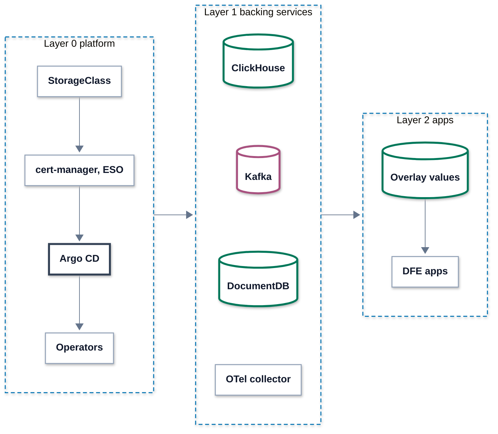

# Deployment

How DFE gets onto a cluster and how the engine's dials reach it. The engine
never deploys backing services and never authors Argo Applications. It
writes config and overlay values into the deploy repo and applies DDL to
ClickHouse itself, and the charts and ApplicationSets in dfe-infra do the deploying. This page covers the layered
model, the tiers, the deploy-repo providers, the backing-service modes and
the network model. The system map is [../architecture.md](../architecture.md).

The pages in this area:

| Doc | Covers |
|---|---|
| [backing-services.md](backing-services.md) | per-backend swap matrix |
| [transports.md](transports.md) | profile x transport, the Kafka provider swap and receiver buffers |
| [keda-scaling.md](keda-scaling.md) | CPU plus ScalingPressure via dfe-keda-shim, on by default for the ingest apps |
| [observability-standard.md](observability-standard.md) | one OTel destination, modes, log schema |
| [supply-chain-pinning.md](supply-chain-pinning.md) | pick-latest-per-rules then SHA-pin |
| [e2e-acceptance.md](e2e-acceptance.md) | the two sign-off scenarios (k8s + docker) |

## Layered deployment model

A DFE deployment comes up in three layers: the platform, the backing services, then the apps.

*Figure 1. L4 Detail -- Deployment layers. Read each layer top to bottom, then the next layer to the right.* Up: [L2 Services -- dfe-engine](../architecture.md).

Layer 0 is the platform baseline. The deployment assumes a bare cluster and nothing more. `bootstrap/bootstrap.sh` (in
dfe-infra) lays down the baseline with a **detect-or-install** probe for every
dependency: if a healthy controller and its CRDs are present, ADOPT it and create
DFE's CRs alone. If absent, INSTALL a DFE-owned copy. Covered: a default
StorageClass (local-path fallback), cert-manager, External Secrets, and Argo
CD itself. Argo CD then installs KEDA, metrics-server and the data operators
(dfe-infra `argocd/appsets/layer1-addons.yaml`, `layer-scale.yaml`).

Argo CD is installed or adopted. On a cluster with no running Argo CD,
bootstrap installs one into the `argocd` namespace. On a cluster that
runs Argo CD before DFE arrives, DFE adopts it and never reconfigures it: DFE's AppProjects and
ApplicationSets register into that instance.

## Backing services and apps

Layer 1 is the backing services: ClickHouse, optionally Kafka and Kafbat, the DocumentDB store and the OTel
collector, deployed by Argo CD through the layer2-data ApplicationSet and never
shared with anything else. Observe (dfe-hyperdx) is an app, so it comes up in
layer 2. The backing services are decoupled from the deploy repo: layer2-data is a single source (base chart plus profile and cloud
values, nothing else), so they come up before any external git or in-cluster git host
exists.

Layer 2 is the apps and their config: the dfe-* apps, each a thin chart built from its deployment contract plus an
engine-authored overlay from the deploy repo, merged so the engine's values
win. The layer2-apps ApplicationSet is a matrix of (clusters x git-files over
`values/*-values.yaml`) - one Application per service instance.

Every Application has four sources, one mechanism for every app:

1. The app's thin chart, assembled from its deployment contract, pulled over OCI and pinned by digest.
2. dfe-infra's `helm/charts/dfe-extras`, the objects DFE adds beside it.
3. dfe-infra as ref `infra`, for the value files.
4. The deploy repo as ref `values`, with the instance file layered last.

The engine turns dials through that instance file and never authors
Applications, so every dial has to be a Helm value.

App types: one deployment for the stack (receiver/loader/archiver/engine/ui -
one values file each) against one per config (fetcher and transforms, N files,
one config each). KEDA scaling is folded into each app chart - see
[keda-scaling.md](keda-scaling.md).

## Deployment tiers

Four selectable tiers, smallest to largest. The first is
Docker, and the rest are Kubernetes profiles selected by the cluster secret's
`dfe.hyperi.io/profile`. Transport
per tier: [transports.md](transports.md).

| Tier | Platform | Transport | Kafka | Sizing | Fits |
|------|----------|-----------|-------|--------|-------|
| **dfe-docker** | Docker Compose (NOT k8s) | four profiles: `slim-grpc`, `slim-kafka`, `single-grpc`, `single-kafka` (the default) | per profile | minimal | SME / single-host, anything smaller than `slim` |
| **slim** | k8s | gRPC (receiver->loader direct) | **no** | minimum-viable + safety | bare-minimum k8s. Smallest |
| **single** | k8s | Kafka | **yes** (single broker) | reliability | one node of everything, with Kafka |
| **scale** | k8s | Kafka | **yes** (multi-broker cluster) | reliability | everything clustered (ReplicatedMergeTree + dedicated Keeper) |

A tier sets defaults, and a deployer overrides any single dial.

## Default composition per k8s tier

- `on` is deployed by default.
- `src` is one deployment per source that needs it, written by the engine when the source is saved, and none until then.
- `opt` is deployable through the overlay but not seeded.
- `-` is refused on this tier.

| Component | dfe-docker | slim | single | scale |
|-----------|:---:|:---:|:---:|:---:|
| dfe-engine (control plane) | on | on | on | on |
| dfe-ui | on | on | on | on |
| Observe (explore UI and self-telemetry view) | on | on | on | on |
| dfe-receiver (ingest) | on | on | on | on |
| dfe-loader (ingest) | on | on | on | on |
| dfe-hunt-runner (detection hunts) | on | on [1] | on [1] | on [1] |
| dfe-archiver | single-kafka | on [2] | on [2] | on [2] |
| dfe-fetcher | single-kafka [3] | - [4] | src | src |
| dfe-transform-elastic / vrl | single-kafka [3] | - [4] | src | src |
| dfe-transform-vector | single-kafka [3] | - [4] | opt | opt |
| ClickHouse | single | single | single | cluster |
| DocumentDB store (Observe) | documentdb-local | on | on | on |
| Kafka | Kafka profiles | off | single | cluster |
| Kafbat | Kafka profiles | off | on | on |
| Layer 0 (Argo CD + operators + StorageClass/LB) | n/a [5] | on | on | on |

- [1] One steady pod on every k8s tier, slim included. Its autoscaling is
  beta and off by default. Keep it off: see
  [../data-plane/hunt-runner-scaling.md](../data-plane/hunt-runner-scaling.md).
- [2] Deployed and idle until an operator names a destination and topics.
- [3] `single-kafka` runs them, one idle instance each, and no other profile does. `single-grpc`
  runs the same services as `slim-grpc`, the core data path alone
  (dfe-docker `README.md`).
- [4] The direct transport runs the receiver to loader path alone, so saving
  a source that needs a fetcher or a transform is refused.
- [5] dfe-docker is Compose, not k8s - no Argo/operators layer. The
  containers wire to each other directly.

Slim is the bare-minimum k8s tier: the ingest path (receiver -> loader ->
ClickHouse) plus the engine, UI, hunt runner and Observe. Its direct
transport runs no per-source apps, so fetchers and transforms need single
or scale.

**Observe is ALWAYS present, in EVERY tier - never optional.** Two purposes,
which is why DFE ships an extended fork: (1) the view onto the self-monitoring
telemetry the OTel collector writes to ClickHouse, independent of the data
pipeline ([observability-standard.md](observability-standard.md)). (2) the
data-discovery UI over ALL DFE data in ClickHouse, embedded in dfe-ui - the
fork exists to point Observe at the DFE tables as well as its telemetry
schema.

Implementation: tier behaviour lives in `argocd/values/profile-<tier>.yaml`
(dfe-infra). Kafka+Kafbat are gated by those values (`kafka.mode` + kafbat
`enabled`). The full app set is the deploy repo's `values/*-values.yaml` set.
dfe-infra's `apps.yaml` `default_in` decides which apps each tier seeds, so
the default composition is a manifest edit, not a chart change.

Kafka on tier `single` takes the non-operator path: `kafka.mode: single`
renders a single-broker KRaft StatefulSet (dfe-infra `kafka-single.yaml`,
SCRAM-512 at format time), so the Strimzi operator runs on scale and nowhere else. A cluster
still annotated with the retired `standard` profile must move to `slim` (gRPC)
or `single` (Kafka).

## Deploy-repo providers (provider-agnostic)

The deploy repo is the cluster secret's `dfe.hyperi.io/config_repo_url`
annotation, a revision and a credential. There is
NO hard git-server dependency (the backing services do not depend on it).

- External git PRIMARY (GitHub / GitLab) - the deployer sets
  `DFE_CONFIG_REPO_URL` and its credential (`DFE_CONFIG_REPO_USER` and
  `DFE_CONFIG_REPO_TOKEN` for HTTPS, or `DFE_CONFIG_REPO_SSH_KEY`). bootstrap creates the Argo `repo-deploy`
  repository secret. No in-cluster git is deployed. The engine pushes over
  HTTPS with `DFE_CONFIG_REPO_TOKEN`, so with an SSH key alone Argo can read
  the repo but the engine cannot write to it.
- Forgejo FALLBACK (in-cluster) - deployed when no external URL is
  given, gated on the cluster label
  `dfe.hyperi.io/bundled-deploy-repo: "true"`. Forgejo, a Gitea-API-compatible
  git host, holds the deploy repo for tyre-kicking / air-gapped use, pulled from Forgejo's
  `code.forgejo.org` registry.

All providers use the same downstream mechanism (an Argo repository
credential + a git-files generator). From Argo's perspective GitLab and
GitHub are identical external remotes.

## Data backing-service modes

DFE deploys the data layer itself, mode-driven (`argocd/values/*.yaml` +
cluster-secret annotations). Full swap matrix:
[backing-services.md](backing-services.md).

- ClickHouse - `single` (one node running Keeper embedded, small/test),
  `cluster` (DFE-owned Keeper), or `external` (BYO or ClickHouse Cloud, connect
  and deploy nothing). Every self-hosted mode needs Keeper and the
  `{cluster}`, `{shard}` and `{replica}` macros, because every DFE table is a
  `ReplicatedMergeTree` in a Replicated database, and the engine rejects a server
  without them. Admin password generated in-cluster
  by an ESO Password generator - no external secret backend required.
- Kafka - Strimzi by default, Redpanda opt-in (BSL licence gate), or
  external: MSK provisioned with SCRAM-SHA-512, Confluent Cloud or Redpanda
  Cloud. MSK Serverless needs IAM, which the apps refuse
  ([backing-services.md](backing-services.md)). With gRPC transport, Kafka is omitted entirely.
- DocumentDB - Observe's document store, with the Mongo wire protocol.
  On k8s it is the DocumentDB operator running on CloudNativePG PostgreSQL (the
  image and version are in dfe-infra `helm/charts/documentdb/values.yaml`).
  dfe-docker runs the single-container `documentdb-local`. Nothing else in the
  stack uses PostgreSQL.

## Network model

- Pod and service CIDRs are a config value with a default chosen to avoid
  common ranges: pods `198.18.0.0/16`, services `198.19.0.0/16` (RFC 2544
  benchmarking space - non-RFC1918, non-CGNAT, low corporate overlap). Any
  other range is accepted at initial deploy. CIDRs are immutable once the
  cluster is started (dfe-infra `argocd/values/common.yaml` `networkModel`).
- CGNAT `100.64.0.0/10` is reserved SOLELY for edge-VPN clients, never
  for DFE pod/service ranges. The opt-in edge-fleet VPN (culvert) carves its
  tunnel subnets out of it.
- Receiver exposure is `exposure.groups.ingest`, defaulted in dfe-infra's
  `argocd/values/common.yaml` and overridden in the deploy repo's
  `infra/common.yaml`. Its `door` is one of three. `loadbalancer` (the
  default) is a LoadBalancer Service for the receiver, rendered when
  `allow` lists CIDRs and not otherwise. `gateway` is `receiver.{domain}` on the gateway.
  `tunnel` is no public door, for a fleet that dials in over the edge VPN.
  The receiver then talks to internal Kafka (ClusterIP, private), and
  isolation is by NetworkPolicy.
- Engine ports: the API listens on 8000. Health (`/livez`, `/readyz`) and
  `/metrics` are on 9090, apart from the API traffic.

## Engine settings the deployer supplies

The deployer lists the admin UIs it stood up in `DFE_ENGINE_ADMIN_LINKS`, a JSON array of `{name, purpose, url, probe_url}`, and `GET /api/v1/deployment/admin-links` serves it to `admin` and `infra_admin`. The engine never discovers one. Any answer below 500 from the optional `probe_url` is `up`. A 5xx, timeout or refusal is `down`. No `probe_url` is `unknown`. A bad entry is dropped and counted on `admin_links_dropped_total`, and a URL carrying credentials is refused.

`POST /api/v1/pipeline/build` points every KEDA Prometheus trigger it renders at `PROMETHEUS_SERVER_ADDRESS`, the URL of the deployment's Prometheus. It has no default: set it in the pipeline package or the engine's environment, or the build stops.
