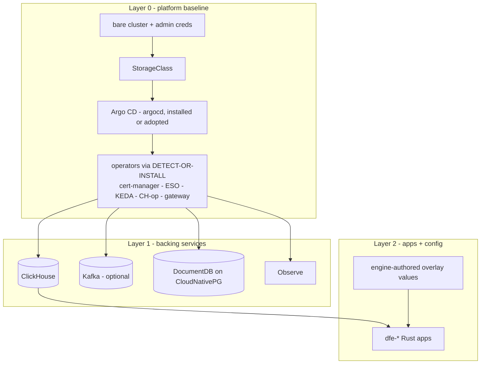

# Deployment

How DFE gets onto a cluster and how the engine's dials reach it. The engine
never deploys backing services and never authors Argo Applications - it
writes config, DDL, and overlay values into the deploy repo; dfe-infra's
charts and ApplicationSets do the deploying. This page carries the layered
model, the tiers, the deploy-repo providers, the backing-service modes, and
the network model. The system map is [../architecture.md](../architecture.md).

## Documents in this area

| Doc | Covers |
|---|---|
| [backing-services.md](backing-services.md) | per-backend swap matrix |
| [transports.md](transports.md) | profile x transport, the Kafka provider swap, the mesh tier's Envoy balancer and receiver buffers |
| [keda-scaling.md](keda-scaling.md) | CPU plus ScalingPressure via dfe-keda-shim, on by default for the ingest apps |
| [observability-standard.md](observability-standard.md) | one OTel destination, modes, log schema |
| [supply-chain-pinning.md](supply-chain-pinning.md) | pick-latest-per-rules then SHA-pin |
| [e2e-acceptance.md](e2e-acceptance.md) | the two sign-off scenarios (k8s + docker) |

## Layered deployment model

### Layer 0 - platform baseline

The deployment assumes ONLY a bare cluster. `bootstrap/bootstrap.sh` (in
dfe-infra) lays down the baseline with a **detect-or-install** probe for every
dependency: if a healthy controller + CRDs are present, ADOPT it (create only
DFE's own CRs); if absent, INSTALL a DFE-owned copy. Covered: a default
StorageClass (local-path fallback), cert-manager, External Secrets, and Argo
CD itself.

**Argo CD is installed or adopted.** On a cluster with no running Argo CD,
bootstrap installs one into the `argocd` namespace. On a cluster that already
runs Argo CD, DFE adopts it and never reconfigures it: DFE's AppProjects and
ApplicationSets register into that instance. Cluster-singleton operators (one
CRD, one controller) are exactly what detect-or-install handles.

### Layer 1 - backing services

ClickHouse, optionally Kafka, the DocumentDB store, and Observe (dfe-hyperdx), deployed by
Argo CD via ApplicationSets. DFE deploys its OWN backing services and
never piggybacks a shared one. The backing services are decoupled from the
deploy repo: layer2-data is a single source (base chart + profile/cloud
values only), so they come up before any external git or in-cluster git host
exists. (Validated live: the full set reaches Healthy on a bare cluster with
no deploy repo present.)

### Layer 2 - apps + config

The dfe-* apps, each a thin chart built from its deployment contract plus an
engine-authored overlay from the deploy repo, merged so the engine's values
win. The layer2-apps ApplicationSet is a matrix of (clusters x git-files over
`values/*-values.yaml`) - one Application per service instance.

**Four sources per Application (ONE mechanism).**

1. The app's thin chart, assembled from its deployment contract, pulled over OCI and pinned by digest.
2. dfe-infra's `helm/charts/dfe-extras`, the DFE-only objects beside it.
3. dfe-infra as ref `infra`, for the value files.
4. The deploy repo as ref `values`, whose instance file is layered last.

The engine turns dials through that instance file and never authors
Applications, so every dial has to be a Helm value.

App types: one deployment for the stack (receiver/loader/archiver/engine/ui -
one values file each) vs one per config (fetcher and transforms - N files,
each its own config). KEDA scaling is folded into each app chart - see
[keda-scaling.md](keda-scaling.md).

## Deployment tiers

Five tiers, smallest to largest. The first is Docker; the rest are Kubernetes
profiles selected by the cluster secret's `dfe.hyperi.io/profile`. Transport
and the balancer per tier: [transports.md](transports.md).

| Tier | Platform | Transport | Kafka | Sizing | Fits |
|------|----------|-----------|-------|--------|-------|
| **dfe-docker** | Docker Compose (NOT k8s) | four profiles: `slim-grpc`, `slim-kafka`, `single-grpc`, `single-kafka` (the default) | per profile | minimal | SME / single-host, anything smaller than `slim` |
| **slim** | k8s | gRPC (receiver->loader direct) | **no** | minimum-viable + safety | bare-minimum k8s; smallest |
| **single** | k8s | Kafka | **yes** (single broker) | reliability | one node of everything, with Kafka |
| **scale** | k8s | Kafka | **yes** (multi-broker cluster) | reliability | everything clustered (ReplicatedMergeTree + dedicated Keeper) |
| **mesh** | k8s | gRPC, Envoy listener per stage pool | **no** | reliability | scale's replicas and ClickHouse cluster with no broker, see [transports.md](transports.md#buffering-without-a-bus) |

A tier sets defaults, and a deployer overrides any single dial. `mesh`
composes as `scale` below with Kafka and Kafbat off and, like slim, no
fetchers or transforms.

## Default composition per k8s tier

- `on` is deployed by default.
- `src` is one deployment per source that needs it, written by the engine when the source is saved, and none until then.
- `opt` is deployable through the overlay but not seeded.
- `-` is refused on this tier.

| Component | dfe-docker | slim | single | scale |
|-----------|:---:|:---:|:---:|:---:|
| dfe-engine (control plane) | on | on | on | on |
| dfe-ui | on | on | on | on |
| Observe (explore UI + self-telemetry sink) | on | on | on | on |
| dfe-receiver (ingest) | on | on | on | on |
| dfe-loader (ingest) | on | on | on | on |
| dfe-hunt-runner (detection hunts) | on | on [1] | on [1] | on [1] |
| dfe-archiver | single-kafka | on [2] | on [2] | on [2] |
| dfe-fetcher | single profiles [3] | - [4] | src | src |
| dfe-transform-elastic / vrl | single profiles [3] | - [4] | src | src |
| dfe-transform-vector | single profiles [3] | - [4] | opt | opt |
| ClickHouse | single | single | single | cluster |
| DocumentDB store (Observe) | documentdb-local | on | on | on |
| Kafka | Kafka profiles | off | single | cluster |
| Kafbat | Kafka profiles | off | on | on |
| Layer 0 (Argo CD + operators + StorageClass/LB) | n/a [5] | on | on | on |

- [1] One steady pod on every k8s tier, slim included. Its autoscaling is
  beta and off by default. Keep it off: see
  [../data-plane/hunt-runner-scaling.md](../data-plane/hunt-runner-scaling.md).
- [2] Deployed and idle until an operator names a destination and topics.
- [3] The `single-grpc` and `single-kafka` profiles start one idle instance.
  The `slim-*` profiles run the core data path alone.
- [4] The direct transport runs the receiver to loader path alone, so saving
  a source that needs a fetcher or a transform is refused.
- [5] dfe-docker is Compose, not k8s - no Argo/operators layer. The
  container brings its own minimal wiring.

### Admin UI links

The deployer lists the admin UIs it stood up in `DFE_ENGINE_ADMIN_LINKS`, a JSON array of `{name, purpose, url, probe_url}`, and `GET /api/v1/deployment/admin-links` serves it to `admin` and `infra_admin`. The engine never discovers one. Any answer below 500 from the optional `probe_url` is `up`; a 5xx, timeout or refusal is `down`; no `probe_url` is `unknown`. A bad entry is dropped and counted on `admin_links_dropped_total`, and a URL carrying credentials is refused.

## Why the tiers compose that way

Slim is the bare-minimum k8s tier: the ingest path (receiver -> loader ->
ClickHouse) plus the engine, UI, hunt runner and Observe. Its direct
transport carries no per-source apps, so fetchers and transforms need single
or scale.

**Observe is ALWAYS present, in EVERY tier - never optional.** Two purposes,
which is why DFE ships an extended fork: (1) a separate self-monitoring
telemetry sink, deliberately independent of the data pipeline; (2) the
data-discovery UI over ALL DFE data in ClickHouse, embedded in dfe-ui - the
fork exists precisely to point Observe at the DFE tables, not only its own
telemetry schema.

Implementation: tier behaviour lives in `argocd/values/profile-<tier>.yaml`
(dfe-infra). Kafka+Kafbat are gated by those values (`kafka.mode` + kafbat
`enabled`). The full app set is the deploy repo's `values/*-values.yaml` set.
dfe-infra's `apps.yaml` `default_in` decides which apps each tier seeds, so
the default composition is a manifest edit, not a chart change.

Kafka on tier `single` takes the non-operator path: `kafka.mode: single`
renders a single-broker KRaft StatefulSet (dfe-infra `kafka-single.yaml`,
SCRAM-512 at format time), so the Strimzi operator stays scale-only. A cluster
still annotated with the retired `standard` profile must move to `slim` (gRPC)
or `single` (Kafka).

## Deploy-repo providers (provider-agnostic)

The deploy repo is just `config_repo_url` + revision + credentials. There is
NO hard git-server dependency (the backing services do not depend on it).

- **External git PRIMARY** (GitHub / GitLab) - the deployer sets
  `DFE_CONFIG_REPO_URL` + creds (`DFE_CONFIG_REPO_TOKEN`+`_USER` for HTTPS,
  or `DFE_CONFIG_REPO_SSH_KEY`). bootstrap creates the Argo `repo-deploy`
  repository secret. No in-cluster git is deployed. The engine pushes over
  HTTPS with `DFE_CONFIG_REPO_TOKEN`, so with an SSH key alone Argo can read
  the repo but the engine cannot write to it.
- **Forgejo FALLBACK** (in-cluster) - deployed ONLY when no external URL is
  given, gated on the cluster label
  `dfe.hyperi.io/bundled-deploy-repo: "true"`. Forgejo, a Gitea-API-compatible
  git host, holds the deploy repo for tyre-kicking / air-gapped use, pulled from the canonical
  `code.forgejo.org` registry. Never a hard dependency.

All providers use the same downstream mechanism (an Argo repository
credential + a git-files generator); from Argo's perspective GitLab and
GitHub are identical external remotes.

## Data backing-service modes

DFE deploys its own data layer, mode-driven (`argocd/values/*.yaml` +
cluster-secret annotations). Full swap matrix:
[backing-services.md](backing-services.md).

- **ClickHouse** - `single` (one node running Keeper embedded, small/test),
  `cluster` (DFE-owned Keeper), or `external` (BYO or ClickHouse Cloud, connect
  only and deploy nothing). Every self-hosted mode needs Keeper and the
  `{cluster}`, `{shard}` and `{replica}` macros, because every DFE table is a
  `ReplicatedMergeTree` in a Replicated database, and the engine refuses a server
  without them. Admin password generated in-cluster
  by an ESO Password generator - no external secret backend required.
- **Kafka** - Strimzi by default, Redpanda opt-in (BSL licence gate), or
  external (incl. MSK IAM). With gRPC transport, Kafka is omitted entirely.
- **DocumentDB** - Observe's document store, with the Mongo wire protocol.
  On k8s it is the DocumentDB operator running on CloudNativePG PostgreSQL 18.
  dfe-docker runs the single-container `documentdb-local`. Nothing else in the
  stack uses PostgreSQL.

## Network model

- **Pod / service CIDRs** are a config value with a sensible non-conflicting
  default: pods `198.18.0.0/16`, services `198.19.0.0/16` (RFC 2544
  benchmarking space - non-RFC1918, non-CGNAT, low corporate overlap). Any
  other range is accepted at initial deploy; CIDRs are immutable once the
  cluster is started. Canal IP-masquerades pod egress to the node IP, so the
  customer needs no NAT or route change.
- **CGNAT `100.64.0.0/10` is reserved SOLELY for edge-VPN clients**, never
  for DFE pod/service ranges. The opt-in edge-fleet VPN (culvert) carves its
  tunnel subnets out of it.
- **Receiver exposure is `exposure.groups.ingest`**, set in the deploy repo's
  `infra/common.yaml`. Its `door` is one of three. `loadbalancer` (the
  default) is the receiver's own LoadBalancer Service, rendered only while
  `allow` lists CIDRs. `gateway` is `receiver.{domain}` on the gateway.
  `tunnel` is no public door, for a fleet that dials in over the edge VPN.
  The receiver then talks to internal Kafka (ClusterIP, private), and
  isolation is by NetworkPolicy.
- **Engine ports.** The API listens on 8000. Health (`/livez`, `/readyz`) and
  `/metrics` are on 9090, apart from the API traffic.

## Pipeline builds

`POST /api/v1/pipeline/build` points every KEDA Prometheus trigger it renders at `PROMETHEUS_SERVER_ADDRESS`, the URL of the deployment's own Prometheus. It has no default: set it in the pipeline package or the engine's environment, or the build stops.
