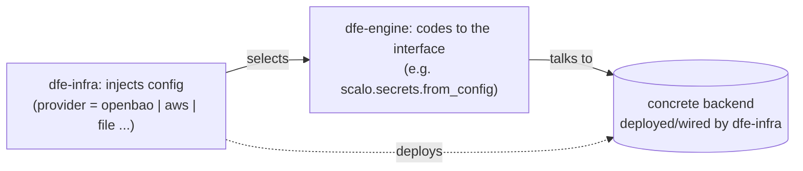
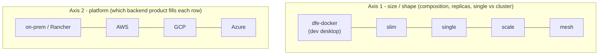
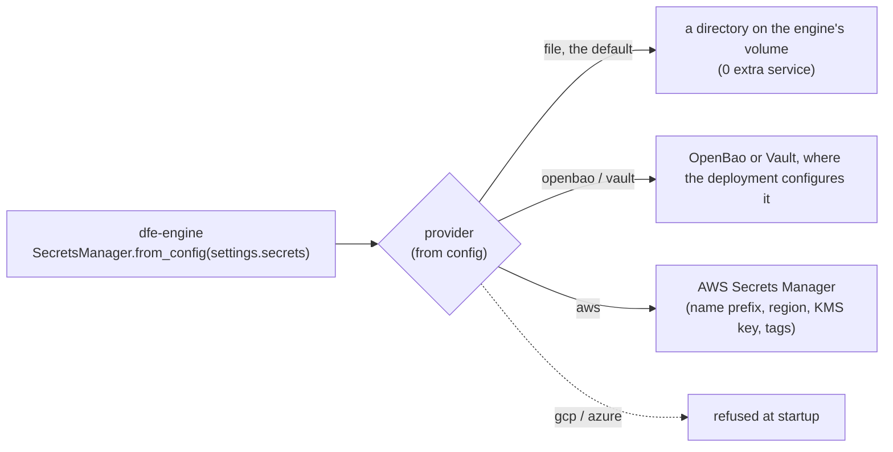
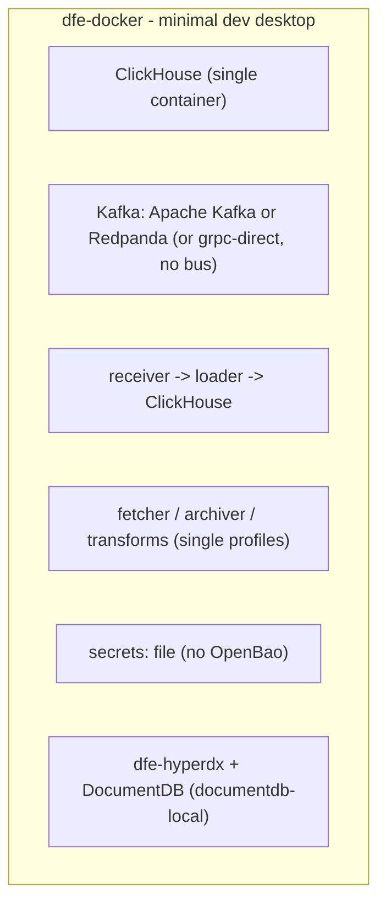

<!--
  Project:   dfe-engine
  File:      docs/deployment/backing-services.md
  Purpose:   DFE backing services - every backend swaps by config
  License:   BUSL-1.1
  Copyright: (c) 2026 HYPERI PTY LIMITED
-->

# DFE Backing Services - swap every backend by config

DFE is a generic product that ships into clusters we never touch. So every backing
service it stands on - the secrets store, the streaming bus, the object store, the
load balancer, the IdP - has to be swappable without rewriting the product. This
document is the itemised list of those backing services, the standard interface and setting each
one swaps through, and which concrete backend fills it per target.

("Backing services" is the Twelve-Factor term: attached resources treated as
swappable, bound by config, never hardcoded.)

## The one rule

**Every backing service has its own interface and setting, so each swaps without touching the others
or the engine.** There is no monolithic "on-prem build" vs "cloud build" - there is
a per-service choice, and any mix is valid ("hybrid" is not a special case, it is
just picking cells from different columns).

Two ownership lanes, applied to every backing service:

- **dfe-infra** deploys or wires the concrete backend, and injects the config that
  selects it.
- **dfe-engine** codes only to a standard interface plus config, never to a
  named product. It carries no per-cloud branches: any `if aws: ... elif gcp: ...`
  belongs in dfe-infra config.

## Two axes (do not conflate them)

Size and platform are orthogonal. Size sets *composition*, and platform sets
*which product* fills each row of the matrix below.

- **Size** = the four dfe-infra profiles (`argocd/values/profile-slim|single|scale|mesh.yaml`)
  plus the non-k8s `dfe-docker`. It changes replica counts, single-node vs cluster,
  which optional apps run - not which product a row binds to.
- **Platform** = the swap dimension (`argocd/values/local|rancher|aws|gcp|azure.yaml`).
  dfe-infra carries OpenTofu environments for `local` and `aws`. GCP and Azure have
  values files but no environment yet.

## The matrix

Rows are backing services. "Coded to" is the interface the engine or infra uses, and
the platform columns are the concrete backend. A cell names a backend a dfe-infra value,
chart or engine setting selects. A cell marked *(by interface)* codes to the standard
interface, but no value selects it and it is untested.

| Backing service | Coded to | on-prem / Rancher | AWS | GCP | Azure | dfe-docker |
|---|---|---|---|---|---|---|
| Cluster / compute | k8s API | RKE2 / Rancher | EKS + Karpenter | GKE *(by interface)* | AKS *(by interface)* | single host |
| Secrets the engine mints | `scalo.secrets` provider | `file` (default), OpenBao / Vault | Secrets Manager | refused | refused | `file` |
| Data store (CH) | ClickHouse client + `effective_data_database` | DFE CH (single/cluster) | DFE CH, or ClickHouse Cloud as `external` | ClickHouse Cloud as `external` | ClickHouse Cloud as `external` | CH container |
| Streaming | `scalo.kafka` | Strimzi / Redpanda | Strimzi, or MSK (IAM) as `external` | Confluent *(by interface)* | Event Hubs Kafka API *(by interface)* | Apache Kafka or Redpanda (`KAFKA_BACKEND`), or grpc-direct |
| Object store | S3 API | MinIO | S3 (EKS Pod Identity) | GCS *(by interface)* | Blob *(by interface)* | MinIO / local FS |
| Auth / IdP | OIDC, the engine as relying party | any OIDC IdP (`generic`), or local | any OIDC IdP *(by interface)* | Google (`google`) | Entra ID (`entra_id`) | local-auth / oauth2-proxy |
| Ingress / LB | Gateway API / Service | MetalLB + Envoy Gateway | NLB (AWS Load Balancer Controller) + Envoy Gateway | GCLB *(by interface)* | Azure LB *(by interface)* | Envoy (`dfe-proxy`) |
| TLS / PCA | cert-manager Issuer | cert-manager | cert-manager | cert-manager | cert-manager | self-signed / mkcert |
| GitOps repo | git remote URL | external git, or in-cluster Forgejo | external git, or Forgejo | external git, or Forgejo | external git, or Forgejo | local git / bind-mount |
| Reconciler (CD) | Argo Application / AppSet | Argo CD | Argo CD | Argo CD | Argo CD | compose render (none) |
| Registry | OCI ref | any OCI registry, `ghcr.io/hyperi-io` by default | same | same | same | same |
| Block storage | StorageClass | local-path, or the cluster default | EBS `gp3` | PD *(by interface)* | Azure Disk *(by interface)* | docker volumes |
| DNS | external-dns / zone | CoreDNS / site DNS | Route 53 *(by interface)* | Cloud DNS *(by interface)* | Azure DNS *(by interface)* | /etc/hosts |
| Observability sink | OTel exporter -> dest | dfe-hyperdx + CH | dfe-hyperdx + CH | dfe-hyperdx + CH | dfe-hyperdx + CH | dfe-hyperdx + CH |

## Worked example - secrets (the pattern for all of them)

The engine builds one manager from config and never names a product. dfe-infra sets
the provider per target. This is the whole trick, applied to every row above.

The engine's JWT signing key, ClickHouse passwords and the OIDC client secrets an operator enters all go through `scalo.secrets`. With no `DFE_ENGINE_SECRETS_PROVIDER` they land in the `file` provider under `DFE_ENGINE_SECRETS_PATH` (default `./.secrets`), which is all dfe-docker needs.

`DFE_ENGINE_SECRETS_PROVIDER=openbao` (or `vault`) reads `DFE_ENGINE_SECRETS_ADDR` for the server, `DFE_ENGINE_SECRETS_MOUNT` for the kv mount (default `dfe`) and `DFE_ENGINE_SECRETS_ROLE` for the AppRole role id.

`DFE_ENGINE_SECRETS_PROVIDER=aws` keeps them in AWS Secrets Manager as `<DFE_ENGINE_SECRETS_NAME_PREFIX>/<path>` in `DFE_ENGINE_SECRETS_REGION`, and the engine refuses to start without the region. Each is encrypted with `DFE_ENGINE_SECRETS_KMS_KEY_ID` (the AWS managed key when unset, with a startup warning), tagged with the `DFE_ENGINE_SECRETS_TAGS` JSON object, and deleted with no recovery window unless `DFE_ENGINE_SECRETS_RECOVERY_WINDOW_DAYS` sets 7-30. AWS finishes a forced delete in the background, so re-creating the same name retries for up to 30 seconds. Inside a window the name stays taken: re-creating that OIDC provider answers 409 with the remedy, and a reconcile re-creating that group fails naming the setting.

`gcp` and `azure` are refused: their secret names allow no `/`, and every engine path has one.

dfe-receiver reads its ingest bearer tokens from the same backend, so the backend has to be one the receiver reaches too. On `openbao` and `aws` it reads them where the engine wrote them, given a policy or role granting `ingest/bearer-tokens/*` and nothing else. The `file` directory sits on the engine's own volume, so the deployment mounts `<DFE_ENGINE_SECRETS_PATH>/ingest/bearer-tokens` read-only into the receiver at `/var/run/secrets/dfe/ingest-bearer-tokens`, as a directory so a rewrite reaches it, never the whole secrets root. On Kubernetes no receiver pod can mount the engine's volume. There `DFE_ENGINE_INGEST_BEARER_SECRET` names a Secret the engine also writes each listener's lines into, one key per listener, through scalo's `kubernetes` provider with `get` and `update` on that one Secret, and the receiver mounts the Secret read-only at the same path.

## The dfe-docker special case - keep it small

dfe-docker is the single-host Compose deployment. It must stay as small as possible: it
is never production, so every backing service takes its lightest backend - no OpenBao,
no ESO, no Argo. Every dfe-docker profile runs dfe-hyperdx.

Levers that keep it small: grpc-direct to skip the bus entirely, single-node
ClickHouse, the `file` secrets provider, one Envoy front proxy (`dfe-proxy`) instead
of a gateway, self-signed TLS. Adding a heavier backend to dfe-docker is a smell -
push weight to the k8s profiles, not the desktop.
