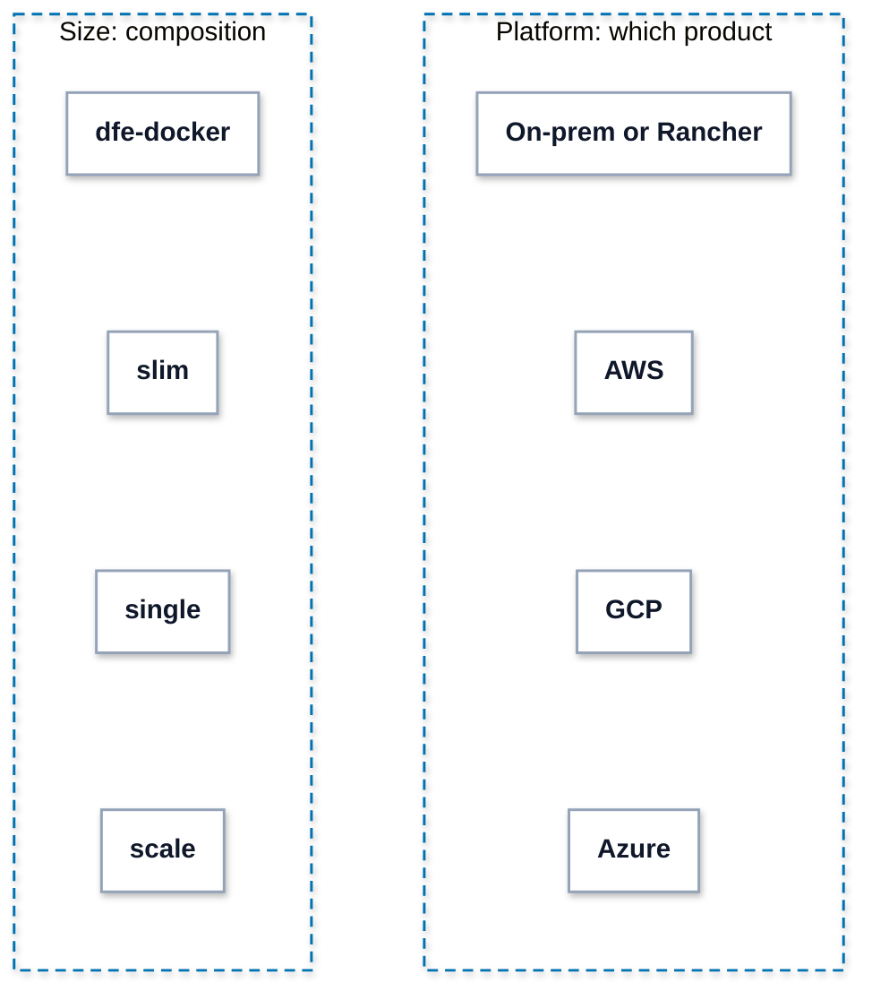
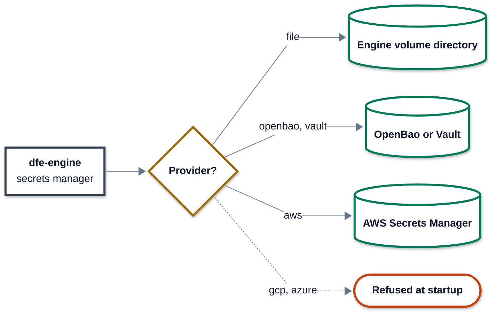
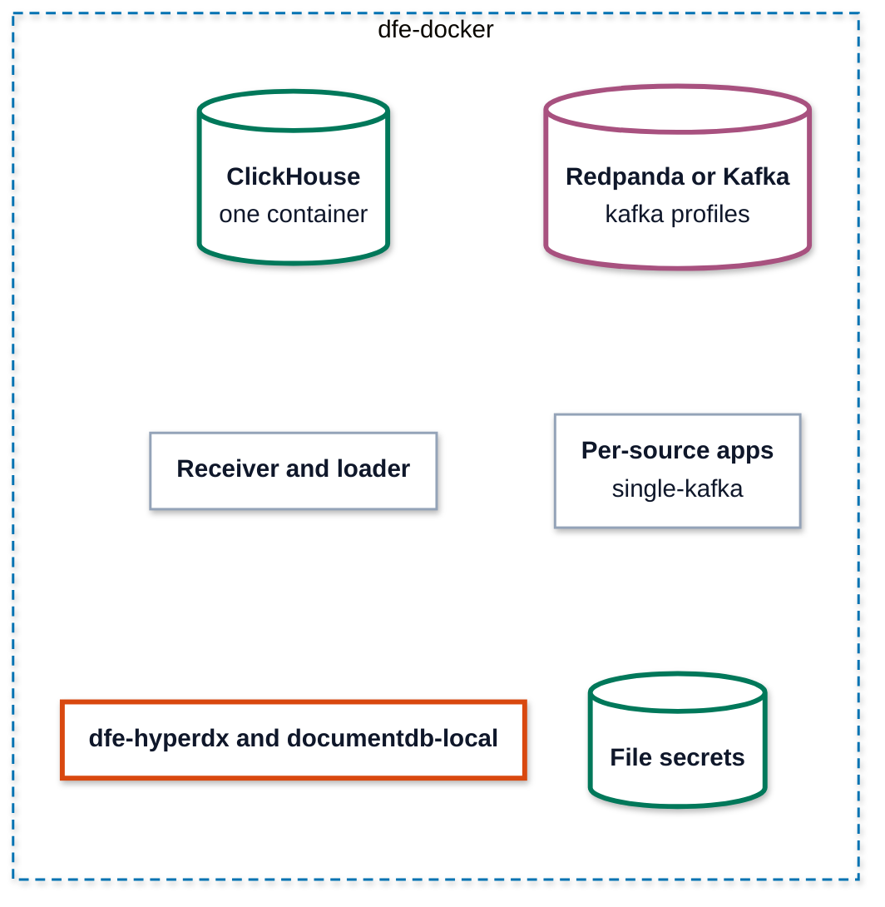

<!--
  Project:   dfe-engine
  File:      docs/deployment/backing-services.md
  Purpose:   DFE backing services - every backend swaps by config
  License:   BUSL-1.1
  Copyright: (c) 2026 HYPERI PTY LIMITED
-->

# DFE Backing Services - swap every backend by config

DFE is a generic product that ships into clusters we never touch. So every backing
service it stands on - the secrets store, the streaming bus, the object store, the
load balancer, the IdP - has to be swappable without rewriting the product. This
page lists those backing services, the interface and setting each one swaps
through, and which backend fills it per target.

("Backing services" is the Twelve-Factor term: attached resources treated as
swappable, bound by config, never hardcoded.)

## Each backing service swaps on one setting

Every backing service has an interface and a setting, so it swaps
without touching the others or the engine. There is no "on-prem build" or
"cloud build", just a choice per service, and any mix of cells from different
columns is valid.

dfe-infra deploys or wires the backend and injects the config that selects it.
dfe-engine codes to the standard interface and that config, never to a product
by name, and holds no per-cloud branches: an `if aws: ... elif gcp: ...`
belongs in dfe-infra config.

dfe-infra injects the config that picks a backend, and the engine codes to the interface.

```mermaid
---
config:
  theme: base
  look: neo
  fontFamily: Inter, -apple-system, Segoe UI, Roboto, Helvetica, Arial, sans-serif
  flowchart:
    curve: linear
    nodeSpacing: 40
    rankSpacing: 64
    padding: 18
    wrappingWidth: 280
    htmlLabels: true
  elk:
    preset: modelOrder
  themeVariables:
    fontSize: 15px
    lineColor: "#64748B"
    primaryTextColor: "#0F172A"
    nodeBorder: "#334155"
    clusterBorder: "#0072B2"
    edgeLabelBackground: "#FFFFFF"
  themeCSS: >-
    p{margin:0}
    .node[data-look] rect,.node[data-look] path,.node[data-look] polygon,.node[data-look] .outer-path{filter:drop-shadow(0 1px 2px rgba(15,23,42,.10)) drop-shadow(0 6px 14px rgba(15,23,42,.10))}
    .node rect{rx:10px;ry:10px}
    .cluster rect{rx:16px;ry:16px}
    .node .label div{min-width:150px}
    .node.decision .label div{min-width:0}
    .cluster[data-look] rect{filter:none}
    .nodeLabel{line-height:1.35}
    .nodeLabel b{font-weight:600;font-size:15px;letter-spacing:-0.01em}
    .nodeLabel span{font-size:12.5px;font-weight:400;color:#334155}
    .cluster-label span.nodeLabel{display:inline-block;background:#FFFFFF;color:#0B2A3F;border:1.5px solid #0072B2;border-radius:999px;padding:2px 12px;font-size:11.5px;font-weight:700;letter-spacing:.09em;text-transform:uppercase}
    .flowchart-link{stroke-width:1.75px}
    .labelBkg{background:transparent!important}
    span.edgeLabel{display:inline-block;background:#FFFFFF!important;color:#1E293B;border:1px solid #94A3B8;border-radius:999px;padding:2px 10px;font-size:12px;font-weight:500}
    span.edgeLabel p{background:transparent!important}
    .label-icon{width:20px;height:20px;vertical-align:-4px;margin-right:6px}
    .icon-shape path[stroke-width="0"][fill="none"]{fill:#FFFFFF;stroke:#FFFFFF;stroke-width:12px;stroke-linejoin:round}
    .icon-shape p{background:transparent!important;color:#0F172A}
    .ingest .label-icon{color:#0E8A7D}
    .xform .label-icon{color:#7B4FB0}
    .load .label-icon{color:#0072B2}
    .bus .label-icon{color:#A8517F}
    .store .label-icon{color:#00785A}
    .ui .label-icon{color:#D9480F}
    .ext .label-icon{color:#64748B}
---
flowchart LR
  accTitle: L4 Detail -- Backing-service binding
  accDescr: dfe-infra injects the config that selects a provider. The engine codes to the standard interface and talks to whichever backend the config names.

  cfg["<b>dfe-infra</b><br/><span>config</span>"]
  eng["<b>dfe-engine</b><br/><span>interface</span>"]
  be[("<b>Concrete backend</b>")]

  cfg -->|selects| eng
  eng -->|talks to| be
  class be store
  class cfg,eng control
  classDef ext fill:#F4F6F8,stroke:#94A3B8,stroke-width:1.5px,stroke-dasharray:5 4,color:#0F172A
  classDef ingest fill:#FFFFFF,stroke:#0E8A7D,stroke-width:3px,color:#0F172A
  classDef xform fill:#FFFFFF,stroke:#7B4FB0,stroke-width:3px,color:#0F172A
  classDef load fill:#FFFFFF,stroke:#0072B2,stroke-width:3px,color:#0F172A
  classDef bus fill:#FFFFFF,stroke:#A8517F,stroke-width:3px,color:#0F172A
  classDef store fill:#FFFFFF,stroke:#00785A,stroke-width:3px,color:#0F172A
  classDef ui fill:#FFFFFF,stroke:#D9480F,stroke-width:3px,color:#0F172A
  classDef decision fill:#FFFFFF,stroke:#9A6700,stroke-width:3px,color:#0F172A
  classDef error fill:#FFFFFF,stroke:#C2410C,stroke-width:3px,color:#0F172A
  classDef control fill:#FFFFFF,stroke:#334155,stroke-width:3px,color:#0F172A
  classDef part fill:#FFFFFF,stroke:#94A3B8,stroke-width:1.5px,color:#0F172A
```

*Figure 1. L4 Detail -- Backing-service binding.* Up: [Deployment](README.md).

`scalo.secrets` `from_config` is the pattern: the engine reads the provider from config and never names it.

## The matrix

Size and platform are independent. Size sets the composition, and platform sets
which product fills each row of the matrix below.

A deployment picks a size, which sets the composition, and a platform, which sets the product behind each service.

*Figure 2. L4 Detail -- Size and platform axes.* Up: [Deployment](README.md).

Size is the three dfe-infra profiles (`argocd/values/profile-slim|single|scale.yaml`)
plus `dfe-docker`, which is not Kubernetes. It changes replica counts, single node
against cluster and which optional apps run, never which product a row binds to.
Platform is the swap (`argocd/values/local|rancher|aws|gcp|azure.yaml`).
dfe-infra has OpenTofu environments for `local` and `aws`, and GCP and Azure
have values files but no environment.

Rows are backing services. "Coded to" is the interface the engine or infra uses, and
the platform columns are the concrete backend. A cell names a backend a dfe-infra value,
chart or engine setting selects. A cell marked *(by interface)* codes to the standard
interface, but no value selects it and it is untested.

| Backing service | Coded to | on-prem / Rancher | AWS | GCP | Azure | dfe-docker |
|---|---|---|---|---|---|---|
| Cluster / compute | k8s API | RKE2 / Rancher | EKS + Karpenter | GKE *(by interface)* | AKS *(by interface)* | single host |
| Secrets the engine mints | `scalo.secrets` provider | `file` (default), OpenBao / Vault | Secrets Manager | refused | refused | `file` |
| Data store (CH) | ClickHouse client + `effective_data_database` | DFE CH (single/cluster) | DFE CH, or ClickHouse Cloud as `external` | ClickHouse Cloud as `external` | ClickHouse Cloud as `external` | CH container |
| Streaming | `scalo.kafka` | Strimzi / Redpanda, or a managed Kafka below | MSK provisioned (`msk`, SCRAM-SHA-512), Strimzi, or a managed Kafka below | Strimzi / Redpanda *(by interface)*, or a managed Kafka below | Strimzi / Redpanda *(by interface)*, or a managed Kafka below | Apache Kafka or Redpanda (`KAFKA_BACKEND`), or grpc-direct |
| Object store | S3 API | a supplied S3-compatible store, such as MinIO | S3 (EKS Pod Identity) | GCS *(by interface)* | Blob *(by interface)* | the archiver's local volume |
| Auth / IdP | OIDC, the engine as relying party | any OIDC IdP (`generic`), or local | any OIDC IdP *(by interface)* | Google (`google`) | Entra ID (`entra_id`) | local-auth / oauth2-proxy |
| Ingress / LB | Gateway API / Service | MetalLB + Envoy Gateway | NLB (AWS Load Balancer Controller) + Envoy Gateway | GCLB *(by interface)* | Azure LB *(by interface)* | Envoy (`dfe-proxy`) |
| TLS / PCA | cert-manager Issuer | cert-manager | cert-manager | cert-manager | cert-manager | opt-in, a local CA `make certs` mints |
| GitOps repo | git remote URL | external git, or in-cluster Forgejo | external git, or Forgejo | external git, or Forgejo | external git, or Forgejo | a local deploy repo, or a git server |
| Reconciler (CD) | Argo Application / AppSet | Argo CD | Argo CD | Argo CD | Argo CD | compose render (none) |
| Registry | OCI ref | any OCI registry, `ghcr.io/hyperi-io` by default | same | same | same | same |
| Block storage | StorageClass | local-path, or the cluster default | EBS `gp3` | PD *(by interface)* | Azure Disk *(by interface)* | docker volumes |
| DNS | external-dns / zone | CoreDNS / site DNS | Route 53 *(by interface)* | Cloud DNS *(by interface)* | Azure DNS *(by interface)* | /etc/hosts |
| Observability sink | OTel exporter -> dest | dfe-hyperdx + CH | dfe-hyperdx + CH | dfe-hyperdx + CH | dfe-hyperdx + CH | dfe-hyperdx + CH |

A managed Kafka runs on any platform with `kafka.mode=external`: Confluent Cloud (`confluent-cloud`) and Redpanda Cloud (`redpanda-cloud`), each a provider in scalo's `transport/kafka/providers.rs` with a page under dfe-infra's `docs/deployment/kafka/`. MSK Serverless needs IAM auth. scalo knows it as `msk_iam` and rejects it (scalo-rs `src/transport/kafka/config.rs`), so no DFE app connects to one.

## Worked example - secrets (the pattern for all of them)

The engine builds one manager from config and never names a product. dfe-infra sets
the provider per target, and every row above works the same way.

The engine builds one secrets manager from config, `file` by default, and refuses `gcp` and `azure` at startup.

*Figure 3. L4 Detail -- Secrets provider choice. The dotted arrow is the refusal.* Up: [Deployment](README.md).

The engine's JWT signing key, ClickHouse passwords and the OIDC client secrets an operator enters all go through `scalo.secrets`. With no `DFE_ENGINE_SECRETS_PROVIDER` they land in the `file` provider under `DFE_ENGINE_SECRETS_PATH` (default `./.secrets`), which is all dfe-docker needs.

`DFE_ENGINE_SECRETS_PROVIDER=openbao` (or `vault`) keeps them in OpenBao at `DFE_ENGINE_SECRETS_ADDR`, falling back to `VAULT_ADDR`, under the KV v2 mount `DFE_ENGINE_SECRETS_MOUNT` (default `dfe`). The engine logs in with AppRole when `DFE_ENGINE_SECRETS_ROLE` holds the role id, taking the secret id from `VAULT_SECRET_ID`, and with `VAULT_TOKEN` otherwise. `VAULT_ROLE_ID` alone does not select AppRole.

The engine's OpenBao policy needs create, read, update, delete and list on `<mount>/data/*` and `<mount>/metadata/*`. An OpenBao behind a private CA is trusted through `SSL_CERT_FILE`.

`DFE_ENGINE_SECRETS_PROVIDER=aws` keeps them in AWS Secrets Manager as `<DFE_ENGINE_SECRETS_NAME_PREFIX>/<path>` in `DFE_ENGINE_SECRETS_REGION`, and the engine stops at startup without the region. Each is encrypted with `DFE_ENGINE_SECRETS_KMS_KEY_ID` (the AWS managed key when unset, with a startup warning), tagged with the `DFE_ENGINE_SECRETS_TAGS` JSON object, and deleted with no recovery window unless `DFE_ENGINE_SECRETS_RECOVERY_WINDOW_DAYS` sets 7-30. AWS finishes a forced delete in the background, so re-creating the same name retries for up to 30 seconds. Inside a window the name stays taken: re-creating that OIDC provider answers 409 with the remedy, and a reconcile re-creating that group fails naming the setting.

More than one engine needs `openbao` or `aws`. Both store a secret only when the name is free (KV v2 `cas=0`, `CreateSecret`), so replicas minting the same secret keep one value.

`gcp` and `azure` are refused: their secret names allow no `/`, and every engine path has one.

dfe-receiver reads its ingest bearer tokens from the same backend, so the backend has to be one the receiver reaches as well. On `openbao` and `aws` it reads them where the engine wrote them, given a policy or role granting `ingest/bearer-tokens/*` and nothing else. The `file` directory sits on the engine's volume, so the deployment mounts `<DFE_ENGINE_SECRETS_PATH>/ingest/bearer-tokens` read-only into the receiver at `/var/run/secrets/dfe/ingest-bearer-tokens`, as a directory so a rewrite reaches it, never the whole secrets root. On Kubernetes no receiver pod can mount that volume. There `DFE_ENGINE_INGEST_BEARER_SECRET` names a Secret the engine writes each listener's lines into as well, one key per listener, through scalo's `kubernetes` provider with `get` and `update` on that one Secret, and the receiver mounts the Secret read-only at the same path.

Who runs each provider: the deployment dial picks a provider per service, injected as
`DFE_ENGINE_DEPLOYMENT_KAFKA_PROVIDER` and `DFE_ENGINE_DEPLOYMENT_CLICKHOUSE_PROVIDER`.
`src/dfe_engine/backing/providers.yaml` says what each provider key means, and
`DFE_ENGINE_PROVIDER_CATALOGUE_FILE` points the engine at another copy. A key the
file does not list reads as DFE-run unless the deploy repo declares
`<prefix>.mode: external`.

| Key under `services.<service>` | Meaning |
|---|---|
| `providers.<key>.managed_by` | `dfe` (DFE runs it), `provider` (a SaaS whose API DFE knows) or `external` (someone else, and DFE has no API to it) |
| `providers.<key>.set_in` | For `provider`: `deployment` (a dial sizes it, change it and redeploy) or `provider` (the provider's console or API) |
| `providers.<key>.read_only` | For `provider`: value paths a write is rejected on with 409 `managed_by_provider`, at the path, below it or above it |
| `external.read_only` | The same for an external service. It leaves out `mode`, because writing `mode` back hands the service to DFE again |

## The dfe-docker special case - kept small by design

dfe-docker is the single-host Compose deployment. It must stay as small as possible: it
is never production, so every backing service takes its lightest backend - no OpenBao,
no ESO, no Argo. Every dfe-docker profile runs dfe-hyperdx.

dfe-docker runs each service in one container on one host, with the file secrets provider.

*Figure 4. L4 Detail -- dfe-docker composition.* Up: [Deployment](README.md).

Levers that keep it small: grpc-direct to skip the bus entirely, single-node
ClickHouse, the `file` secrets provider, one Envoy front proxy (`dfe-proxy`) instead
of a gateway, and TLS when asked for. A heavier backend belongs on the k8s
profiles, not the desktop.
