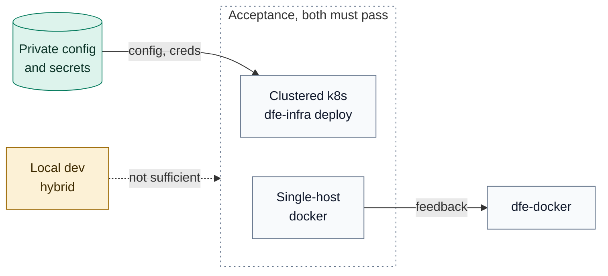

# E2E Acceptance - the two scenarios that sign off a change

A change is E2E-verified when it works at BOTH ends of the deployment range: a
full clustered Kubernetes deploy AND a single-host docker deploy. A local dev
hybrid, the engine run against capped local ClickHouse and Kafka, sits between
the two and proves neither, so it never counts as acceptance. It is for fast
unit and integration iteration: a green hybrid run shows the code path works,
not that the product deploys.

DFE is a product suite other organisations deploy. It has to hold up at the
full-cluster end (hosted and customer clusters) and at the single-host end
(dfe-docker).

Acceptance needs both the full Kubernetes deploy and the standalone docker run, and a local hybrid counts as neither.

*Figure 1. L4 Detail -- Acceptance scenarios. The dotted arrow marks a run that does not count.* Up: [Deployment](README.md).

## The two scenarios

Scenario 1, a full dfe-infra deploy to clustered k8s. What it proves: the product works the way it is operated, with Argo CD
reconciling the GitOps artifacts, backing services, ingress, RBAC and OIDC in
front, on a multi-node cluster.

Where: a multi-node cluster the deployment owns. That deployment's private
config repo holds the cluster topology, endpoints and node ownership.
Credentials come from its secrets backend, never from committed files. On a
shared cluster, deploy onto the nodes and namespace allocated to DFE and
nothing else.

Sign-off: the stack comes up healthy, the UI is reachable, a login works, and a
smoke path through the API and query surface returns. Finish with the deploy
access summary: URLs, how to log in, where to fetch credentials.

Scenario 2, standalone docker. What it proves: the product works on one host with no Kubernetes, the
dfe-docker setup. This is the smallest deployment a first-time adopter stands
up, and what it shows (compose wiring, env, image needs) feeds back into
[dfe-docker](https://github.com/hyperi-io/dfe-docker).

Where: a standalone docker compose bring-up of the engine and its backing
services, pinned by digest the way dfe-docker pins them.

Sign-off: the stack comes up from a clean state, health checks pass, and the
same smoke path through the API and query surface returns. Note anything that
had to differ from the k8s path, because that difference is the feedback for
dfe-docker.

The deployment overview, with its layers, tiers and Argo model, is
[README.md](README.md).
