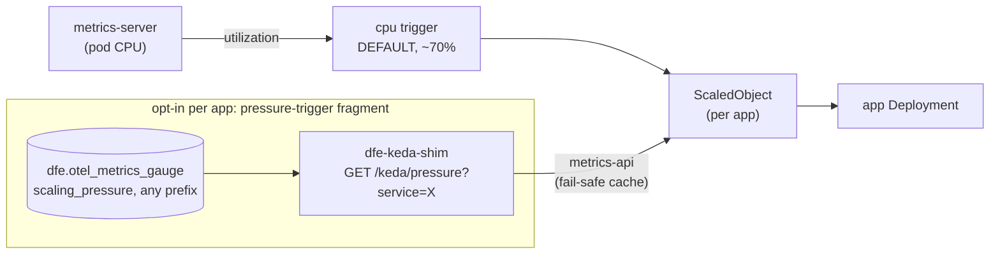

# KEDA scaling patterns

CPU is the fleet default, scalo ScalingPressure is opt-in per app via the
owned fail-safe `dfe-keda-shim`. On any shim or ClickHouse failure the
last-good value is returned, so scaling freezes at current replicas rather
than running up. There is no Kedify OTEL Scaler and no Prometheus fallback
in the stack.

## The two triggers

**Fleet default: CPU.** Every KEDA-scaled app uses KEDA's native `cpu`
scaler (~70% utilisation, metrics-server) as its DEFAULT trigger - zero
extra code, zero upstream risk.

**scalo ScalingPressure is OPT-IN per app**: an app's dfe-infra values carry
the `pressure-trigger` trigger fragment, and `keda.pressure.*` sets its target,
shim address and reported service. KEDA takes the higher of it and the CPU
trigger. It is read via the owned, fail-safe `dfe-keda-shim` (folded into the dfe-engine chart,
runs the engine container image as `dfe-keda-shim run`) rather than any
Prometheus/Kedify path. The signal is read from the OTel pipeline's
ClickHouse table (`otel_metrics_gauge`). Full fail-safe mechanics:
[hunt-runner-scaling](../data-plane/hunt-runner-scaling.md).

### Which gauge rows the shim reads

scalo registers the composite as a bare `scaling_pressure` gauge. An app emits it under that name, or as `<namespace>_scaling_pressure` when its deployment sets a metrics namespace. The shim reads every series of the gauge for one service and returns the hottest:

- **Name:** the bare `scaling_pressure`, plus any `<prefix>_scaling_pressure`. Nothing else matches, so a metric that merely ends in the words does not.
- **Service:** `ServiceName` is the app instance, matched exactly.
- **Series:** one metric name, one attribute set and one pod. A push over OTLP names the pod in the resource (`service.instance.id`), a Prometheus scrape names it in the data-point attributes, and rows that name no pod share one series.
- **Reduction:** each series is averaged over the 60s window, then the MAX across series is returned, so the hottest pod sets the value. Averaging the pods together would report a busy pod and an idle one as one lukewarm number.
- **No matching rows:** the query answers 0. That is a successful answer, so it replaces the cached value rather than holding it, and the CPU trigger sets the replica count. Only a failed query (ClickHouse unreachable, a timeout, a bad query) returns the last-good value, or the `cold_hold` of 0 when there is none yet.

The rule lives in `src/dfe_engine/scaling_pressure.py` and is substituted into both query catalogues (the shim's and the app-management reader's), so the autoscaler and the console match the same rows. The contract settled on dfe-infra#302 is that the reader matches any prefix, so no app is released to rename its gauge.

## Per-app defaults

| App | Default trigger | Opt-in trigger |
|-----|------------------|-----------------|
| dfe-receiver / dfe-loader / dfe-archiver | CPU ~70% | scalo ScalingPressure (shim) |
| dfe-transform-elastic/vector/vrl | CPU ~70% | scalo ScalingPressure (shim) |
| dfe-ui | CPU ~70% | - |
| dfe-engine | KEDA disabled by default (control-plane singleton) | CPU (opt-in) |
| dfe-fetcher | KEDA disabled by default | - |
| dfe-hunt-runner | no KEDA - one static pod | BETA: due-hunt backlog via the shim (`metrics-api`, `AverageValue`) - see [hunt-runner-scaling](../data-plane/hunt-runner-scaling.md) |

dfe-transform-splack and dfe-transform-wasm are coming: alpha, unpublished, and
commented out of dfe-infra's `versions.yaml` and KEDA default lists, so neither
has a default trigger to describe until it ships.

All ScaledObjects default `minReplicaCount: 1` - there is no scale-to-zero on
the fleet baseline today (`idleReplicaCount` support exists in `_keda.tpl` for
a later opt-in, e.g. the Kafka-pipeline apps once that is wired).

A per-app `keda.triggers` list is passed through verbatim and replaces the default triggers outright, CPU included. An explicit `kafka_trigger` in an engine deploy config compiles to that same override. The engine never sets one by default: consumer-group lag also rises when a downstream stage is broken, and more pods cannot help there.
