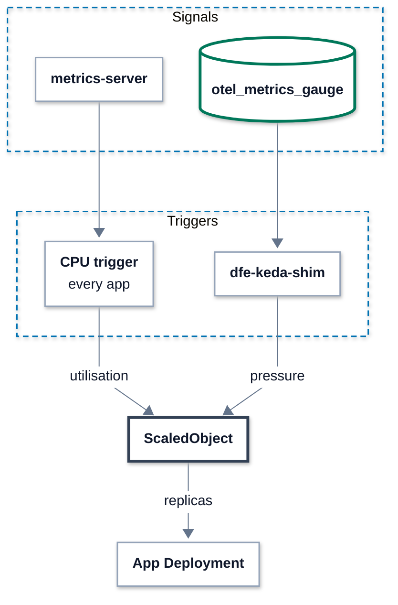

# KEDA scaling patterns

Every KEDA-scaled app scales on CPU. The ingest apps scale on scalo ScalingPressure as well, by default, read through the fail-safe `dfe-keda-shim`. When a query fails, the shim answers its last-good value, or `cold_hold` when it holds none, so a ClickHouse failure never reads as a spike. KEDA keeps acting on that value and on CPU, and an unreachable shim follows KEDA's own error handling. The deployed charts use no Kedify OTEL Scaler and no Prometheus trigger. The one Prometheus path is `POST /api/v1/pipeline/build`, which renders KEDA `prometheus` triggers against `PROMETHEUS_SERVER_ADDRESS`.

## What DFE scales

| Component | Scales out | Scales in |
|---|---|---|
| DFE apps | KEDA, on CPU and ScalingPressure | KEDA, at the scalo-service scale-down pace |
| Kafka brokers on Strimzi | KEDA, on consumer lag, up to `kafka.autoscaling.maxBrokers` | Off until `kafka.autoscaling.scaleIn.enabled` is set |
| Kafka brokers on Redpanda | By hand | By hand, one broker at a time |
| ClickHouse | Sized, not autoscaled | Sized, not autoscaled |
| Nodes | The platform's node autoscaler | The platform's node autoscaler |

The DFE apps scale out and in through the ScaledObject scalo-service renders for each one. KEDA's `cooldownPeriod` applies to the step to zero alone ([ScaledObject spec](https://keda.sh/docs/latest/reference/scaledobject-spec/)), and no DFE tier scales to zero. Between the floor and the ceiling, the HPA that KEDA creates decides.

scalo-service paces that HPA's scale-down. It waits out a 300 second stabilisation window, then removes at most 25 percent of the pods per 60 seconds (scalo-rs `charts/scalo-service/templates/_keda.tpl`). An app's values change it through `keda.scaleDown.stabilizationWindowSeconds`, `keda.scaleDown.percent` and `keda.scaleDown.periodSeconds`. A pod picked to go gets SIGTERM, then up to `terminationGracePeriodSeconds` (45 by default, scalo-rs `charts/scalo-service/templates/_grace.tpl`) to drain before SIGKILL.

On Strimzi, KEDA scales the broker KafkaNodePool on consumer lag in each landing source's transform group, from `kafka.replicas` up to `kafka.autoscaling.maxBrokers` (dfe-infra `helm/charts/kafka/templates/kafka-autoscaler.yaml`). It's on by default and renders once a landing source is declared. A change to the pool's replica count fires Strimzi's Cruise Control autoRebalance, which moves partitions onto an added broker and off a leaving one before Strimzi removes it (`kafka.yaml`, `kafka-rebalance-templates.yaml`).

Broker scale-in is a human decision. Brokers KEDA adds stay until someone sets `kafka.autoscaling.scaleIn.enabled`, which then applies an 1800 second stabilisation window (dfe-infra `helm/charts/kafka/values.yaml`). The [broker autoscaling guide](https://github.com/hyperi-io/dfe-infra/blob/main/docs/deployment/kafka/autoscaling.md) covers the triggers and what has to hold before a scale-in.

The broker autoscaler renders for `kafka.provider: strimzi` alone, so Redpanda brokers are sized by hand. Redpanda's guidance is to keep Kubernetes autoscalers off its brokers ([scaling Redpanda](https://docs.redpanda.com/streaming/current/manage/kubernetes/k-scale-redpanda/)) and to decommission one broker at a time ([decommissioning brokers](https://docs.redpanda.com/streaming/current/manage/kubernetes/k-decommission-brokers/)).

DFE sizes ClickHouse and doesn't autoscale it. The official operator has no autoscaler: scaling is an edit to `spec.replicas` or `spec.shards`, and an added shard takes later writes alone, because the operator moves no existing rows ([operator scaling](https://clickhouse.com/docs/products/kubernetes-operator/guides/scaling)).

Nodes are the platform's job. KEDA adds pods, and on AWS Karpenter adds the nodes they need. On-premises DFE ships no node autoscaler, so the node pool is sized for the peak (dfe-infra [autoscaling](https://github.com/hyperi-io/dfe-infra/blob/main/docs/autoscaling.md) and [node autoscaling](https://github.com/hyperi-io/dfe-infra/blob/main/docs/deployment/node-autoscaling.md)).

## The two triggers

**CPU, on every KEDA app.** KEDA's built-in `cpu` scaler (target 70% CPU, metrics-server).

**scalo ScalingPressure, on by default for the ingest apps**: an app's dfe-infra values hold
the `pressure-trigger` trigger fragment, and `keda.pressure.*` sets its target,
shim address and reported service. KEDA takes the higher of it and the CPU
trigger. It is read via the owned, fail-safe `dfe-keda-shim` (rendered by dfe-infra's
`dfe-extras` chart as a separate pod on the engine image, command `dfe-keda-shim`) rather than any
Prometheus/Kedify path. The signal is read from the OTel pipeline's
ClickHouse table (`otel_metrics_gauge`). Full fail-safe mechanics:
[hunt-runner-scaling](../data-plane/hunt-runner-scaling.md).

CPU and scaling pressure both reach KEDA, which takes the higher and sets the replica count.

*Figure 1. L4 Detail -- KEDA triggers.* Up: [Deployment](README.md).

scalo registers the composite as a bare `scaling_pressure` gauge. An app emits it under that name, or as `<namespace>_scaling_pressure` when its deployment sets a metrics namespace. The shim reads every series of the gauge for one service and returns the hottest:

| Part | Rule |
|---|---|
| Name | The bare `scaling_pressure`, plus any name ending in `_scaling_pressure`, whatever its prefix. A name that ends in `scaling_pressure` without the underscore separator does not match. |
| Service | `ServiceName` is the app instance, matched exactly. |
| Series | One metric name, one attribute set and one pod. A push over OTLP names the pod in the resource (`service.instance.id`), a Prometheus scrape names it in the data-point attributes, and rows that name no pod share one series. |
| Reduction | Each series is averaged over a 120s window, then the MAX across series is returned, so the hottest pod sets the value. The window is two of scalo's 60s export intervals, so every live pod has a reading in it. Averaging the pods together would report a busy pod and an idle one as one lukewarm number. |

With no matching rows the query answers 0. That is a successful answer, so it replaces the cached value rather than holding it, and the CPU trigger sets the replica count. A failed query (ClickHouse unreachable, a timeout, a bad query) alone returns the last-good value, or the `cold_hold` of 0 when there is none yet.

The charts' pressure trigger polls `GET /keda/pressure?service=<app>` (dfe-infra `argocd/values/apps/_fragments/pressure-trigger.yaml`), the alias for the `pressure` query of the generic `GET /q/{name}` route, and `/keda/hunt-backlog` is the alias for `backlog`. Its built-in queries are in `src/dfe_engine/keda_shim/queries.yaml`, and a YAML file at `DFE_ENGINE_KEDA_SHIM_QUERY_CONFIG` is deep-merged over them, so a changed query or a new signal is a config edit with no rebuild. A list in the override replaces the built-in list. Each query takes these keys:

| Key | Meaning |
|---|---|
| `database` | `otel`, `data` or a literal name. `otel` and `data` both resolve to the engine's data database, which replaces `__DB__` in the SQL |
| `sql` or `builtin` | The ClickHouse SQL, or a named query in code: `hunt_backlog` is `schedule.due_query` |
| `params`, `binds` | Request parameters and fixed values, bound as ClickHouse parameters and never interpolated |
| `result_field` | The column of row 0 that holds the value, 0 by default |
| `clamp_min`, `clamp_max` | The band the value is clamped into |
| `cold_hold` | The value on a failure with no cached last-good, 0 by default |
| `timeout_seconds` | ClickHouse `max_execution_time` |

The rule lives in `src/dfe_engine/scaling_pressure.py` and is substituted into both query catalogues (the shim's and the app-management reader's), so the autoscaler and the console match the same rows. The reader matches any prefix, so no app has to rename its gauge.

## Per-app defaults

Read from dfe-infra `argocd/values/apps/<app>/` and `apps.yaml` at the stack the build pins. The profile-slim tier clears the ScalingPressure trigger, so on slim every KEDA app scales on CPU alone.

The docs site fills the table below from the dfe-infra chart renders at the stack the build pins, so the published copy shows each app's replica bounds, CPU target and pressure trigger per profile.

<!-- dfe-keda-table -->
| App | KEDA | Triggers by default |
|-----|------|---------------------|
| dfe-receiver / dfe-loader | on | CPU ~70% and scalo ScalingPressure (shim, target 70) |
| dfe-archiver, dfe-transform-elastic / vrl / vector | on | CPU ~70%, plus ScalingPressure on the single, scale and mesh profiles |
| dfe-ui | on | CPU ~70% |
<!-- /dfe-keda-table -->

Apps that never autoscale:

| App | KEDA | Triggers by default |
|-----|------|---------------------|
| dfe-engine | off - control-plane singleton, always one pod | - |
| dfe-fetcher | off - one pod per fetcher config. The deployer turns KEDA on in that config's values, and solely for a source with a fetch that supports competing consumers | CPU ~70% once turned on |
| dfe-hunt-runner | off - one static pod | BETA, `huntRunner.autoscaling.enabled`: due-hunt backlog via the shim (`metrics-api`, `AverageValue`). Keep it off: the charts do not materialise the schedule it reads - see [hunt-runner-scaling](../data-plane/hunt-runner-scaling.md) |

Replica bounds come from dfe-infra `argocd/values/common.yaml` and the tier profile:

| Tier | minReplicaCount | maxReplicaCount | Pressure target |
|------|-----------------|-----------------|-----------------|
| common default | 1 | 5 | 70 |
| slim | 1 | 2 | 75 (unused, slim clears the trigger) |
| single | 1 | 3 | 70 |
| scale | 2 | 12 | 70 |
| mesh | 2 | 10 | 70 |

No tier scales to zero.

A per-app `keda.triggers` list is passed through verbatim and replaces the default triggers outright, CPU included. The engine never sets one by default: consumer-group lag rises when a downstream stage is broken as well, and more pods cannot help there.
