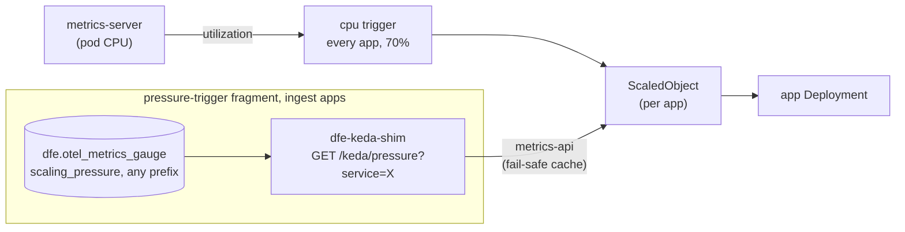

# KEDA scaling patterns

Every KEDA-scaled app scales on CPU. The ingest apps also scale on scalo ScalingPressure by default, read through the fail-safe `dfe-keda-shim`. On any shim or ClickHouse failure the last-good value is returned, so scaling freezes at current replicas rather than running up. The deployed charts use no Kedify OTEL Scaler and no Prometheus trigger. The one Prometheus path is `POST /api/v1/pipeline/build`, which renders KEDA `prometheus` triggers against `PROMETHEUS_SERVER_ADDRESS`.

## The two triggers

**CPU, on every KEDA app.** KEDA's native `cpu` scaler (70% utilisation, metrics-server).

**scalo ScalingPressure, on by default for the ingest apps**: an app's dfe-infra values carry
the `pressure-trigger` trigger fragment, and `keda.pressure.*` sets its target,
shim address and reported service. KEDA takes the higher of it and the CPU
trigger. It is read via the owned, fail-safe `dfe-keda-shim` (folded into the dfe-engine chart,
runs the engine container image as `dfe-keda-shim run`) rather than any
Prometheus/Kedify path. The signal is read from the OTel pipeline's
ClickHouse table (`otel_metrics_gauge`). Full fail-safe mechanics:
[hunt-runner-scaling](../data-plane/hunt-runner-scaling.md).

### Which gauge rows the shim reads

scalo registers the composite as a bare `scaling_pressure` gauge. An app emits it under that name, or as `<namespace>_scaling_pressure` when its deployment sets a metrics namespace. The shim reads every series of the gauge for one service and returns the hottest:

| Part | Rule |
|---|---|
| Name | The bare `scaling_pressure`, plus any name ending in `_scaling_pressure`, whatever its prefix. A name that ends in `scaling_pressure` without the underscore separator does not match. |
| Service | `ServiceName` is the app instance, matched exactly. |
| Series | One metric name, one attribute set and one pod. A push over OTLP names the pod in the resource (`service.instance.id`), a Prometheus scrape names it in the data-point attributes, and rows that name no pod share one series. |
| Reduction | Each series is averaged over a 120s window, then the MAX across series is returned, so the hottest pod sets the value. The window is two of scalo's 60s export intervals, so every live pod has a reading in it. Averaging the pods together would report a busy pod and an idle one as one lukewarm number. |

With no matching rows the query answers 0. That is a successful answer, so it replaces the cached value rather than holding it, and the CPU trigger sets the replica count. Only a failed query (ClickHouse unreachable, a timeout, a bad query) returns the last-good value, or the `cold_hold` of 0 when there is none yet.

The rule lives in `src/dfe_engine/scaling_pressure.py` and is substituted into both query catalogues (the shim's and the app-management reader's), so the autoscaler and the console match the same rows. The reader matches any prefix, so no app has to rename its gauge.

## Per-app defaults

Read from dfe-infra `argocd/values/apps/<app>/` and `apps.yaml` at 2.2.2. The profile-slim tier clears the ScalingPressure trigger, so on slim every KEDA app scales on CPU alone.

| App | KEDA | Triggers by default |
|-----|------|---------------------|
| dfe-receiver / dfe-loader | on | CPU ~70% and scalo ScalingPressure (shim, target 70) |
| dfe-archiver, dfe-transform-elastic / vrl | on | CPU ~70%, plus ScalingPressure on the single, scale and mesh profiles |
| dfe-transform-vector | on | CPU ~70% |
| dfe-ui | on | CPU ~70% |
| dfe-engine | off - control-plane singleton, always one pod | - |
| dfe-fetcher | off - one pod per fetcher config. The deployer turns KEDA on in that config's values, and only for a source whose fetch supports competing consumers | CPU ~70% once turned on |
| dfe-hunt-runner | off - one static pod | BETA, `huntRunner.autoscaling.enabled`: due-hunt backlog via the shim (`metrics-api`, `AverageValue`). Keep it off: the 2.2.2 charts do not materialise the schedule it reads - see [hunt-runner-scaling](../data-plane/hunt-runner-scaling.md) |

Replica bounds come from dfe-infra `argocd/values/common.yaml` and the tier profile:

| Tier | minReplicaCount | maxReplicaCount | Pressure target |
|------|-----------------|-----------------|-----------------|
| common default | 1 | 5 | 70 |
| slim | 1 | 2 | 75 (unused, slim clears the trigger) |
| single | 1 | 3 | 70 |
| scale | 2 | 12 | 70 |
| mesh | 2 | 10 | 70 |

No tier scales to zero. dfe-loader sets `cooldownPeriod: 120`.

A per-app `keda.triggers` list is passed through verbatim and replaces the default triggers outright, CPU included. The engine never sets one by default: consumer-group lag also rises when a downstream stage is broken, and more pods cannot help there.
