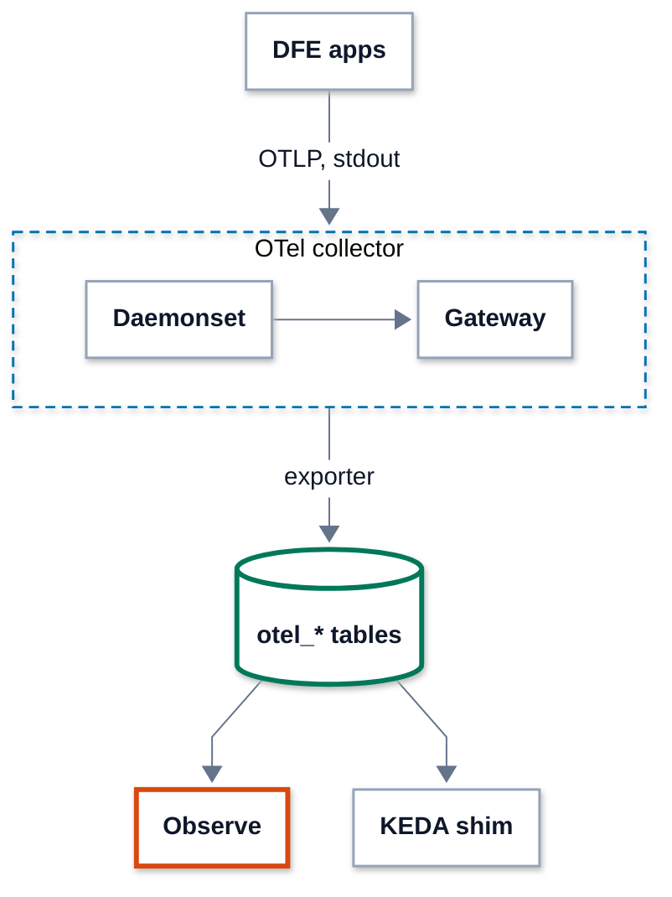

<!-- Project: dfe-engine (applies across dfe-infra, dfe-engine, dfe-ui, rust apps) -->
# DFE Observability Standard

One telemetry contract for the whole deployment: the dfe-infra platform services, dfe-engine, dfe-ui and the Rust apps (receiver, loader, fetcher, archiver, transforms). Every component reports to one OpenTelemetry Collector, the collector writes ClickHouse, and Observe reads those tables. Nothing pushes to Observe.

## Where telemetry lands

Every component's telemetry reaches the collector gateway, which writes the otel tables in the DFE database.

*Figure 1. L4 Detail -- Telemetry path.* Up: [Deployment](README.md).

The daemonset reads container stdout and forwards it to the gateway, which takes the OTLP push on 4317 and scrapes `/metrics`. Its ClickHouse exporter writes `otel_logs`, `otel_traces` and the `otel_metrics_*` tables into the DFE database. Observe, the engine's app-management queries and its KEDA shim read them there. The dfe-hyperdx image has no OTLP listener, so the collector's `otlp/hyperdx` exporter is off by default.

| Deployment | Collector | Database | Set by |
| --- | --- | --- | --- |
| Kubernetes (dfe-infra) | `otel-collector` gateway and daemonset, in the `otel` namespace | `dfe` | `clickhouse.database` in `argocd/values/common.yaml` |
| Docker (dfe-docker) | the bundled `otel-collector`, on a profile that declares `otel` or with `DFE_OTEL_ENABLED=true` | `dfe` | `DFE_OTEL_DATABASE` |

Both write `dfe.otel_*` by default, not dfe-hyperdx's `default` database. dfe-schemas declares the tables and dfe-engine applies them at its startup. The collector runs with `create_schema: false`, so it inserts and creates nothing.

On Kubernetes the gateway reads ClickHouse system tables as well, the Kubernetes API and the data operators' metrics endpoints. It re-exposes every metric on a Prometheus exporter for an external scraper.

## Choosing the destination

`telemetry.mode` in dfe-infra's `argocd/values/common.yaml` picks the OTLP endpoint every app exports to. `telemetry.otlpEndpointTemplate` in `argocd/values/apps/_common.yaml` resolves it into each app's `OTEL_EXPORTER_OTLP_ENDPOINT`. Three values set an endpoint and `prometheus` sets none. dfe-extras stops the render on any other value (dfe-infra `helm/charts/dfe-extras/templates/_guards.tpl`), so a misspelt mode never switches self-monitoring off unseen.

| `telemetry.mode` | Apps export to | Override |
| --- | --- | --- |
| `hyperdx` (default) | the stack's collector, `<project>-otel-collector-gateway.otel.svc.cluster.local:4317` | `telemetry.hyperdxEndpoint`, or `telemetry.collectorNamespace` for the namespace |
| `receiver` | `dfe-receiver.<release namespace>.svc.cluster.local:4317` | `telemetry.receiverEndpoint` |
| `external` | the deployer's OTLP backend | `telemetry.externalEndpoint`, empty by default |
| `prometheus` | nothing, apps are scraped instead | none |

An app with an empty endpoint exports nothing over OTLP. `external` with no `externalEndpoint` resolves to one and renders, so it exports nothing with no error.

An endpoint with no scheme gets `http://`, or `https://` when `otel.tls` is true. `otel.endpoint` overrides the resolved value for one deployment. It is exported as written, so it must include its scheme, and scalo-service sets `OTEL_EXPORTER_OTLP_PROTOCOL` beside it (default `grpc`). dfe-ui and dfe-hyperdx export over OTLP/HTTP, so they take the resolved endpoint on port 4318.

In `receiver` mode, apps export to dfe-receiver's OTLP listener. It binds 4317 and 4318 when the receiver's `config.otlp.enabled` is true, and with no `telemetry.receiverEndpoint` dfe-infra stops the render until it is. Turning it on serves OTLP on the receiver's load balancer as well. The receiver converts each record to JSON in the ClickHouse exporter's row format (its default `otlp.mode: hyperdx`) and sends it down the normal data path. It lands wherever the receiver's routing and the loader's table mapping send it. No shipped rule sends it to the `otel_*` tables.

The mode moves the apps' OTLP push and nothing else. The collector runs in every mode, so container logs, scraped `/metrics` and its other inputs keep landing in the `otel_*` tables.

On Docker, `DFE_OTEL_EXPORTER_ENDPOINT` plays the same part. A profile that declares `otel` points it at the bundled collector, an endpoint you name sends telemetry there instead, and empty exports nothing.

## Logs

Apps write structured JSON logs to stdout. The scalo logger is the reference for the output contract, masking of sensitive values included: scalo-py's `docs/core-pillars/logging.md` and scalo-rs's `docs/core-pillars/logging.md`. A component in another language matches that output, not that code.

Stdout is the log path, so an app needs no OTLP logging SDK to reach `otel_logs`. dfe-ui's server logger (dfe-ui `apps/dfe-core-ui/src/core/server/logger/`) writes scalo-py's record (`timestamp`, `level`, `target`, `message`, `fields`) with scalo's field-name masking. `LOG_LEVEL` sets the threshold (default INFO) and `LOG_FORMAT` is `json` or `text`. Unset, it picks JSON in production or with an OTLP endpoint set, and text on a dev terminal. NextAuth's logger and Next's `onRequestError` hook write through it, and request headers are never logged.

- On Kubernetes, the collector daemonset's `filelog` receiver reads `/var/log/pods` on each node and forwards to the gateway. A record with no `service.name` takes the container name, then the workload, then the pod.
- On Docker, the `fluentd` log driver sends each DFE container's stdout to the collector's `fluentforward` receiver on port 24224, and the container name becomes `service.name`. `DFE_CONTAINER_LOGS_ENABLED=false` puts every service back on `json-file`.

The infra provider's logs are a second feed into the same otel tables, off the DFE ingest path. The cluster annotation `dfe.hyperi.io/provider_logs_flavour` picks the receiver, run in a separate collector so a failed receiver restarts alone:

| Flavour | Receiver and source |
|---|---|
| `none` (default) | nothing renders |
| `aws` | `aws_cloudwatch`, polling the EKS audit and CloudTrail log groups |
| `azure` | `azure_event_hub`, fed by a diagnostic setting |
| `gcp` | `googlecloudpubsub`, fed by a log sink into a Pub/Sub subscription |
| `rancher` | `filelog` on the control-plane nodes, reading the kube-apiserver audit log |

## Metrics, traces and identity

Apps push metrics and traces over OTLP to the endpoint `telemetry.mode` resolves. In the Rust apps this comes from scalo-rs: its `metrics` feature includes `otel-metrics` and `otel-tracing`. dfe-ui registers OpenTelemetry through `@vercel/otel` once per server process when `OTEL_EXPORTER_OTLP_ENDPOINT` is set, with `OTEL_SERVICE_NAME` defaulting to `dfe-ui` (dfe-ui `apps/dfe-core-ui/src/instrumentation.ts`), and an empty endpoint registers nothing.

Every DFE app serves Prometheus `/metrics` as well, whatever its OTLP push is set to. scalo-service annotates each pod with `prometheus.io/scrape`, port and path unless `telemetry.prometheus.scrape` is false (scalo-rs `charts/scalo-service/templates/_telemetry.tpl`). On Kubernetes the gateway scrapes annotated pods labelled `app.kubernetes.io/part-of: dfe` when `clusterTelemetry.dfeServices.enabled` is on, the default.

KEDA scales on ScalingPressure, which the engine's KEDA shim reads from `otel_metrics_gauge` (`src/dfe_engine/keda_shim/queries.yaml`). The engine's metric names take the `dfe_` prefix from `metric_prefix` in `src/dfe_engine/deployment_contract.py`.

scalo-service sets `OTEL_SERVICE_NAME` on every app from `otel.serviceName`, else the release's full name. It becomes `ServiceName` in the tables. scalo-rs tags `deployment.environment.name` from the app's environment setting as well.

## The hunt runner pushes its metrics

The runner has no HTTP listener, so nothing scrapes it. It pushes on the OTLP endpoint the chart wires. The backlog gauge runs the SAME due-count SQL the KEDA shim scales on, so a dashboard and the autoscaler cannot disagree about the queue. Each fire logs one INFO line with the hunt, the rows it wrote and how long it took.

| Metric | Labels | Counts or records |
|---|---|---|
| `dfe_hunt_runs_total` | `hunt_id`, `outcome` | runs |
| `dfe_hunt_run_duration_seconds` | | run time |
| `dfe_hunt_rows_written_total` | | rows written |
| `dfe_hunt_overruns_total` | | runs that overran their interval |
| `dfe_hunt_claims_total` | `hunt_id`, `outcome` | fire claims |
| `dfe_hunt_backlog` | | due fires |
| `dfe_hunt_tick_duration_seconds` | | poll time |
| `dfe_hunt_clickhouse_unavailable_total` | `stage`, `reason` | ClickHouse outages |
| `dfe_hunt_fire_failures_total` | `hunt_id`, `reason` | failed fires |
| `dfe_hunt_fires_held_total` | `hunt_id` | fires held after a failure |
| `dfe_hunt_detections_capped_total` | `hunt_id`, `rule_id` | runs that hit the detection cap |
| `dfe_hunt_detections_dropped_total` | `hunt_id`, `rule_id` | matches the cap left unwritten |

A ClickHouse the runner cannot use never ends the process. At startup an outage (`reason=connection`), a refused login (`reason=authentication`, the runner's user not made yet) or a full server (`reason=capacity`) is retried on the `clickhouse.resilience` back-off, jittered and with no budget, and a tick that hits one is skipped until the next poll. Each adds 1 to `dfe_hunt_clickhouse_unavailable_total` with `stage` `connect` or `tick`, and the outage logs one WARN line when it starts.

## Failed fires and the detection cap

A fire that fails holds its watermark, so the same fire stays due. The runner retries `hunts.failure_backoff_initial_seconds` (default 30, env `DFE_ENGINE_HUNTS_FAILURE_BACKOFF_INITIAL_SECONDS`) after the first failure, doubling to `hunts.failure_backoff_max_seconds` (default 600, env `DFE_ENGINE_HUNTS_FAILURE_BACKOFF_MAX_SECONDS`), jittered. The failure's `reason` is the ClickHouse error category (`not_found` for a missing table) or the hunt's refusal (`empty_query`, which one refused rule gives as well, `no_customers`, `unknown_customers`). It logs one line when it starts, again when its cause changes and every `hunts.failure_reminder_seconds` (default 3600, env `DFE_ENGINE_HUNTS_FAILURE_REMINDER_SECONDS`) for as long as it lasts, then one INFO line when the hunt runs again. A missing table logs at WARN, since the hunt runs once the table exists, and any other cause at ERROR. An operator's run-now request goes through the wait once. It stays queued until a fire succeeds, and each failed attempt lists in the hunt's executions with its error.

`hunts.measure_fire_cost` (default off, env `DFE_ENGINE_HUNTS_MEASURE_FIRE_COST`) runs the detection guard's alert-volume preview after every fire and stores it on the fire's execution row. It costs one count per compiled rule inside the fire's lease, so a fire with it off records no estimate.

A rule compiled into a hunt writes at most `hunts.max_detections_per_run` detection rows per run (default 1000, env `DFE_ENGINE_HUNTS_MAX_DETECTIONS_PER_RUN`), cut to `hunts.max_detections_per_run_ceiling` (default 10000, env `DFE_ENGINE_HUNTS_MAX_DETECTIONS_PER_RUN_CEILING`). A rule that matches more writes the cap plus one summary row: nil `matched_uuid`, `_json` of `{"dfe_capped": true, "matched": N, "written": cap, "rule_id": ...}`, and an `_org_id` when every match shares one, else none. The run logs one WARN line with the counts.

The watermark advances and the run records as `completed`, so the same flood is not re-run whole next fire. The next fire's overlap re-reads the end of it, and writes up to the cap again from the matches the cap left out there. A hunt with a direct `query` rather than `rules` runs uncapped, and says so in an INFO line each time its specs load.

## Late rows: the safe horizon and the overlap

A row with its `_timestamp_load` inside a fire's window, but not yet on the replica the hunt reads, is otherwise never matched. Two layers stop that, both on by default.

The safe horizon is the newest `_timestamp_load` every replica holds, and a hunt never reads past it. The runner reads it before claiming a fire, as the server clock less the largest `absolute_delay` in `system.replicas` over the hunt's source and detection tables, less a 10 s commit allowance. When the horizon is short of the fire, the fire stays due and unclaimed. A hunt held for `hunts.safe_horizon_max_deferral_seconds` (default 300, cut to the hunt's interval, env `DFE_ENGINE_HUNTS_SAFE_HORIZON_MAX_DEFERRAL_SECONDS`), counted from the first poll it held across every fire since, runs anyway, logs one WARN line and records the horizon it ran short of, so the next fire re-reads from there. A read that fails holds the fire as unknown lag, timed on the runner's clock, and if the cap lets it run, the next fire re-reads its whole window. `hunts.safe_horizon` (env `DFE_ENGINE_HUNTS_SAFE_HORIZON`) turns the layer off.

Each rule re-reads `hunts.window_overlap_seconds` before its watermark (default 120, at least 10, env `DFE_ENGINE_HUNTS_WINDOW_OVERLAP_SECONDS`) and leaves out every source row it detected before, keyed on hunt, rule and the matched row's `_uuid`. A row that becomes readable within the overlap plus the deferral cap is never missed, and a later one is. The dedupe reads the answering replica's detections, so a duplicate detection and notification is possible when the cap lets a fire run as that replica's detection table lags, and at no other time. A direct `query` cannot skip what it saw, so it reads no overlap.

| Metric | Counts or records |
|---|---|
| `dfe_hunt_safe_horizon_deferrals_total` | polls that held a fire |
| `dfe_hunt_safe_horizon_deferrals_per_fire` | polls a fire waited before it ran |
| `dfe_hunt_safe_horizon_cap_reached_total` | fires the deferral cap let run short of the horizon |
| `dfe_hunt_safe_horizon_seconds_behind` | lag at each read |
| `dfe_hunt_safe_horizon_query_duration_seconds` | time of each read |
| `dfe_hunt_safe_horizon_unreadable_total` | reads that failed |
| `dfe_hunt_safe_horizon_cap_ran_with_target_lag_total` | capped fires run as the detection table lagged |
| `dfe_hunt_overlap_rows_reread_total` | source rows re-read in the overlap |
| `dfe_hunt_duplicates_skipped_total` | detections found in the read window |
| `dfe_hunt_detection_latency_seconds` | a matched row's `_timestamp_load` to its detection's insert |

## Acceptance tests

Both deployments ship a self-monitoring check beside the core data-path test.

- Kubernetes: dfe-infra's post-deploy smoke test (`bootstrap/smoke-test-integration.sh`, CORE 1) polls for up to 180s for an `otel_logs` row newer than 600s in the DFE database, by default. It proves the pipeline is streaming. It does not say which services report.
- Docker: dfe-docker's `make post` asserts `dfe.otel_*` rows newer than five minutes, and an `otel_logs` row from each of `dfe-engine`, `dfe-loader` and `dfe-receiver` written since that container started.

References:

- OpenTelemetry Collector: <https://opentelemetry.io/docs/collector/>
- dfe-infra: `argocd/values/common.yaml` (`telemetry`, `otel`, `clickhouse`), `argocd/values/apps/_common.yaml` (`telemetry.otlpEndpointTemplate`), `helm/charts/otel-collector/`
- dfe-docker: <https://github.com/hyperi-io/dfe-docker/blob/main/docs/observability.md>, <https://github.com/hyperi-io/dfe-docker/blob/main/config/otel-collector/config.yaml>
- scalo-rs: `charts/scalo-service/templates/_telemetry.tpl`, `docs/core-pillars/logging.md`
- scalo-py: `docs/core-pillars/logging.md`
