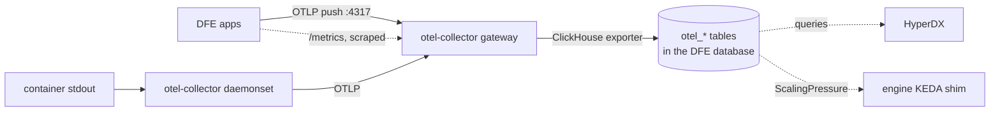

<!-- Project: dfe-engine (applies across dfe-infra, dfe-engine, dfe-ui, rust apps) -->
# DFE Observability Standard

One telemetry contract for the whole deployment: the dfe-infra platform services, dfe-engine, dfe-ui and the Rust apps (receiver, loader, fetcher, archiver, transforms). Every component reports to one OpenTelemetry Collector, the collector writes ClickHouse, and HyperDX reads those tables. Nothing pushes to HyperDX.

## Where telemetry lands

The collector's ClickHouse exporter writes `otel_logs`, `otel_traces` and the `otel_metrics_*` tables into the DFE database. HyperDX, the engine's app-management queries and its KEDA shim all read them there. The dfe-hyperdx image has no OTLP listener, so the collector's `otlp/hyperdx` exporter is off by default.

| Deployment | Collector | Database | Set by |
| --- | --- | --- | --- |
| Kubernetes (dfe-infra) | `otel-collector` gateway and daemonset, in the `otel` namespace | `dfe` | `clickhouse.database` in `argocd/values/common.yaml` |
| Docker (dfe-docker) | the bundled `otel-collector`, on a profile that declares `otel` or with `DFE_OTEL_ENABLED=true` | `dfe` | `DFE_OTEL_DATABASE` |

Both write `dfe.otel_*` by default, not HyperDX's `default` database. dfe-schemas declares the tables and dfe-engine applies them at its startup. The collector runs with `create_schema: false`, so it only inserts.

On Kubernetes the gateway also reads ClickHouse system tables, the Kubernetes API and the data operators' metrics endpoints. It re-exposes every metric on a Prometheus exporter for an external scraper.

## Choosing the destination

`telemetry.mode` in dfe-infra's `argocd/values/common.yaml` picks the OTLP endpoint every app exports to. `telemetry.otlpEndpointTemplate` in `argocd/values/apps/_common.yaml` resolves it into each app's `OTEL_EXPORTER_OTLP_ENDPOINT`. It recognises four values.

| `telemetry.mode` | Apps export to | Override |
| --- | --- | --- |
| `hyperdx` (default) | the stack's collector, `<project>-otel-collector-gateway.otel.svc.cluster.local:4317` | `telemetry.hyperdxEndpoint`, or `telemetry.collectorNamespace` for the namespace |
| `receiver` | `dfe-receiver.<release namespace>.svc.cluster.local:4317` | `telemetry.receiverEndpoint` |
| `external` | a deployer's own OTLP backend | `telemetry.externalEndpoint`, empty by default |
| `prometheus` | nothing, apps are scraped instead | none |

Any other value resolves to an empty endpoint, and an app with an empty endpoint exports nothing over OTLP. Nothing rejects an unknown mode, so a misspelt one fails silently. So does `external` with no `externalEndpoint`.

An endpoint with no scheme gets `http://`, or `https://` when `otel.tls` is true. `otel.endpoint` overrides the resolved value for one deployment. It is exported as written, so it must carry its scheme, and scalo-service sets `OTEL_EXPORTER_OTLP_PROTOCOL` beside it (default `grpc`). dfe-ui and HyperDX export over OTLP/HTTP, so they take the resolved endpoint on port 4318.

In `receiver` mode, apps export to dfe-receiver's OTLP listener. It binds 4317 and 4318 only while the receiver's `config.otlp.enabled` is true, and with no `telemetry.receiverEndpoint` dfe-infra refuses to render the receiver until it is. Turning it on also serves OTLP on the receiver's load balancer. The receiver converts each record to JSON in the ClickHouse exporter's row shape (its default `otlp.mode: hyperdx`) and sends it down the normal data path. It lands wherever the receiver's routing and the loader's table mapping send it. No shipped rule sends it to the `otel_*` tables.

The mode moves only the apps' OTLP push. The collector runs in every mode, so container logs, scraped `/metrics` and its other inputs keep landing in the `otel_*` tables.

On Docker, `DFE_OTEL_EXPORTER_ENDPOINT` plays the same part. A profile that declares `otel` points it at the bundled collector, an endpoint of your own sends telemetry there instead, and empty exports nothing.

## Logs

Apps write structured JSON logs to stdout. The scalo logger is the reference for the output contract, masking of sensitive values included: scalo-py's `docs/core-pillars/LOGGING.md` and scalo-rs's `docs/core-pillars/logging.md`. A component in another language matches that output, not that code.

Stdout is the log path, so an app needs no OTLP logging SDK to reach `otel_logs`.

- On Kubernetes, the collector daemonset's `filelog` receiver reads `/var/log/pods` on each node and forwards to the gateway. A record with no `service.name` takes the container name, then the workload, then the pod.
- On Docker, the `fluentd` log driver sends each DFE container's stdout to the collector's `fluentforward` receiver on port 24224, and the container name becomes `service.name`. `DFE_CONTAINER_LOGS_ENABLED=false` puts every service back on `json-file`.

## Metrics, traces and identity

Apps push metrics and traces over OTLP to the endpoint `telemetry.mode` resolves. In the Rust apps this comes from scalo-rs, whose `metrics` feature includes `otel-metrics` and `otel-tracing`.

Every DFE app also serves Prometheus `/metrics`, whatever its OTLP push is set to. scalo-service annotates each pod with `prometheus.io/scrape`, port and path unless `telemetry.prometheus.scrape` is false (scalo-rs `charts/scalo-service/templates/_telemetry.tpl`). On Kubernetes the gateway scrapes annotated pods labelled `app.kubernetes.io/part-of: dfe` while `clusterTelemetry.dfeServices.enabled` is on, which is the default.

KEDA scales on ScalingPressure, which the engine's KEDA shim reads from `otel_metrics_gauge` (`src/dfe_engine/keda_shim/queries.yaml`). The engine's metric names carry the `dfe_` prefix from `metric_prefix` in `src/dfe_engine/deployment_contract.py`.

scalo-service sets `OTEL_SERVICE_NAME` on every app from `otel.serviceName`, else the release's full name. It becomes `ServiceName` in the tables. scalo-rs also tags `deployment.environment.name` from the app's environment setting.

## The hunt runner pushes rather than being scraped

The runner has no HTTP listener, so nothing scrapes it. It pushes on the OTLP endpoint the chart already wires and reports `dfe_hunt_runs_total` (`hunt_id`, `outcome`), `dfe_hunt_run_duration_seconds`, `dfe_hunt_rows_written_total`, `dfe_hunt_overruns_total`, `dfe_hunt_claims_total` (`hunt_id`, `outcome`), `dfe_hunt_backlog`, `dfe_hunt_tick_duration_seconds`, `dfe_hunt_detections_capped_total` (`hunt_id`, `rule_id`), `dfe_hunt_detections_dropped_total` (`hunt_id`, `rule_id`), `dfe_hunt_clickhouse_unavailable_total` (`stage`, `reason`), `dfe_hunt_fire_failures_total` (`hunt_id`, `reason`) and `dfe_hunt_fires_held_total` (`hunt_id`). The backlog gauge runs the SAME due-count SQL the KEDA shim scales on, so a dashboard and the autoscaler cannot disagree about the queue. Each fire also logs one INFO line carrying the hunt, the rows it wrote and how long it took.

A ClickHouse the runner cannot use never ends the process. At startup an outage (`reason=connection`), a refused login (`reason=authentication`, the runner's user not made yet) or a full server (`reason=capacity`) is retried on the `clickhouse.resilience` back-off, jittered and with no budget, and a tick that hits either is skipped until the next poll. Each one adds 1 to `dfe_hunt_clickhouse_unavailable_total` with `stage` `connect` or `tick`, and the outage logs one WARN line when it starts.

A fire that fails holds its watermark, so the same fire stays due. The runner waits before trying it again: 30 s after the first failure, doubling to a cap of 10 minutes, jittered. Each failure adds 1 to `dfe_hunt_fire_failures_total` with the ClickHouse error category as `reason` (`not_found` for a missing table, `empty_query` for a hunt whose rules compiled to nothing), and each due fire skipped while waiting adds 1 to `dfe_hunt_fires_held_total`. The failure logs one line when it starts, again when its cause changes and hourly while it lasts, and one INFO line when the hunt runs again. A missing table logs at WARN, since the hunt runs once the table is created; any other cause logs at ERROR. An operator's run-now goes through the wait once.

A rule compiled into a hunt writes at most `hunts.max_detections_per_run` detection rows per run (default 1000, env `DFE_HUNTS_MAX_DETECTIONS_PER_RUN`), cut to `hunts.max_detections_per_run_ceiling` (default 10000, env `DFE_HUNTS_MAX_DETECTIONS_PER_RUN_CEILING`). A rule that matches more writes the cap plus one summary row: nil `matched_uuid`, `_json` of `{"dfe_capped": true, "matched": N, "written": cap, "rule_id": ...}`, and an `_org_id` only when every match shares one. The run logs one WARN line with the counts, adds 1 to `dfe_hunt_detections_capped_total` and adds the unwritten matches to `dfe_hunt_detections_dropped_total`.

The watermark still advances and the run still records as `completed`, so the same flood is not re-run next fire. A hunt that carries a direct `query` rather than `rules` runs uncapped, and says so in an INFO line each time its specs load.

## dfe-ui

dfe-ui registers OpenTelemetry through `@vercel/otel` once per server process when `OTEL_EXPORTER_OTLP_ENDPOINT` is set, with `OTEL_SERVICE_NAME` defaulting to `dfe-ui` (dfe-ui `apps/dfe-core-ui/src/instrumentation.ts`). An empty endpoint registers nothing, so `prometheus` mode starts no exporter. Its server output reaches `otel_logs` from stdout like any other pod.

It does not yet meet the log contract above. `packages/dev-logger` writes plain text, and only when `NODE_ENV=development`, so its lines are absent in production. Required: structured JSON to stdout in production, in the scalo log schema with masking and levels.

## Acceptance tests

Both deployments ship a self-monitoring check beside the core data-path test.

- Kubernetes: dfe-infra's post-deploy smoke test (`bootstrap/smoke-test-integration.sh`, CORE 1) polls for up to 180s for an `otel_logs` row newer than 600s in the DFE database, by default. It proves the pipeline is streaming. It does not say which services report.
- Docker: dfe-docker's `make post` asserts `dfe.otel_*` rows newer than five minutes, and an `otel_logs` row from each of `dfe-engine`, `dfe-loader` and `dfe-receiver` written since that container started.

Required, not yet built: the Kubernetes check asserting rows by `service.name`, dfe-engine and dfe-ui included, within the freshness window.

## References

- OpenTelemetry Collector: <https://opentelemetry.io/docs/collector/>
- dfe-infra: `argocd/values/common.yaml` (`telemetry`, `otel`, `clickhouse`), `argocd/values/apps/_common.yaml` (`telemetry.otlpEndpointTemplate`), `helm/charts/otel-collector/`
- dfe-docker: <https://github.com/hyperi-io/dfe-docker/blob/main/docs/observability.md>, <https://github.com/hyperi-io/dfe-docker/blob/main/config/otel-collector/config.yaml>
- scalo-rs: `charts/scalo-service/templates/_telemetry.tpl`, `docs/core-pillars/logging.md`
- scalo-py: `docs/core-pillars/LOGGING.md`
