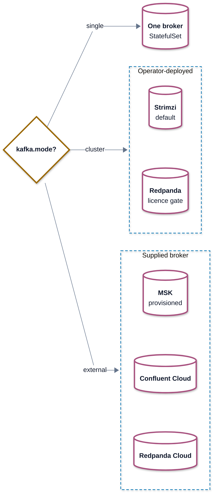

<!--
  Project:   dfe-engine
  File:      docs/deployment/transports.md
  Purpose:   Choosing a profile and a transport. The bus providers
  License:   BUSL-1.1
  Copyright: (c) 2026 HYPERI PTY LIMITED
-->

# Transports and profiles

DFE moves records between stages on one of two transports: a data bus, or direct gRPC. The profile picks which one, and every stage is bound to it at deploy - on the bus the loader consumes the topic, on direct it listens for a push, and no stage does both. So a deployment runs one transport, `GET /api/v1/system/deployment` reports that one, and a source naming the other is refused at save rather than accepted into a flow that lands nowhere. The flow itself is [../data-plane/source-flow.md](../data-plane/source-flow.md).

Pick the profile by what you need to survive.

| Need | Profile | Why |
|---|---|---|
| smallest footprint, a stage may drop records when another is down | slim | one pod per stage, direct gRPC, no broker |
| records survive a stage outage on one node | single | one broker holds them |
| records survive outages and the stack scales out | scale | broker cluster, replicated ClickHouse, KEDA |

slim runs on direct, where the receiver pushes records to the loader over gRPC, and to the archiver as well when a source is archived. A source that needs a fetcher or a transform is rejected at save there, so it needs single or scale.

## The bus is Kafka, the broker is a swap

`kafka.mode` picks one broker, an operator-run cluster or an external service, and the provider picks the product.

*Figure 1. L4 Detail -- Broker choice. The Supplied broker group is brokers the deployer supplies.* Up: [Deployment](README.md).

Values in the deploy repo select the broker. `kafka.provider` chooses which operator deploys it in-cluster: Strimzi by default, Redpanda behind a licence gate (`redpanda.acceptLicense`). `kafka.mode: external` with `kafka.external.bootstrap` points the stack at a broker you run, and `kafka.external.provider` names it: `msk`, `confluent-cloud` or `redpanda-cloud` (dfe-infra `helm/charts/kafka/values.yaml`). Deployed brokers and MSK use SCRAM-SHA-512, and Confluent Cloud takes its API key over SASL PLAIN. The apps reject a broker that takes IAM auth alone, such as MSK Serverless (`msk_iam`, scalo-rs `src/transport/kafka/config.rs`). Nothing in the engine changes for any of these. Sizing and the swap matrix: [backing-services.md](backing-services.md).

## Buffering without a bus

On the direct transport no stage stores records, and no fetcher runs, so the receiver is the one stage that holds them. What it holds depends on the receiver's acknowledgement mode.

With acknowledgements on, the default, the receiver builds no buffer or spool. It holds each request until the loader confirms delivery. Once that hold expires the sender gets a 503 and retries from its copy.

With acknowledgements off, the receiver's memory buffer and spool apply. A loader outage shorter than they hold is invisible to senders, and a longer one back-pressures them (503) until the loader returns. A record held there has had its 2xx, so it is lost if the pod dies. That is the trade for turning acknowledgements off.

The knobs are the receiver's (dfe-receiver `config.example.yaml`, `buffer:`), so a deployer sizes them in the overlay like any other dial.
