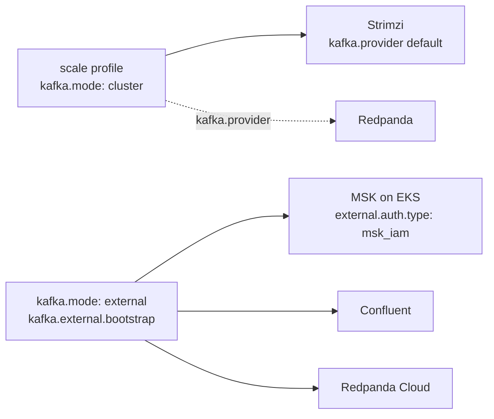
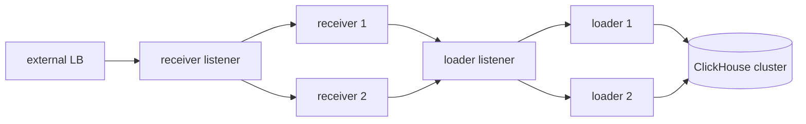

<!--
  Project:   dfe-engine
  File:      docs/deployment/transports.md
  Purpose:   Choosing a profile and a transport; the bus providers; the mesh balancer
  License:   BUSL-1.1
  Copyright: (c) 2026 HYPERI PTY LIMITED
-->

# Transports and profiles

DFE moves records between stages on one of two transports: a data bus, or direct gRPC. The profile picks which one, and every stage is bound to it at deploy - on the bus the loader consumes the topic, on direct it listens for a push, and no stage does both. So a deployment carries one transport, `GET /api/v1/system/deployment` reports that one, and a source naming the other is refused at save rather than accepted into a flow that lands nowhere. The flow itself is [../data-plane/source-flow.md](../data-plane/source-flow.md).

## Pick the profile by what you need to survive

| Need | Profile | Why |
|---|---|---|
| smallest footprint, a stage may drop records while another is down | slim | one pod per stage, direct gRPC, no broker |
| records survive a stage outage on one node | single | one broker holds them |
| records survive outages and the stack scales out | scale | broker cluster, replicated ClickHouse, KEDA |
| scale out without running a broker | mesh | receiver and loader pools behind per-pool listeners, no fetchers or transforms |

slim and mesh run on direct, which carries the receiver to loader path alone. A source that needs a fetcher or a transform is refused at save there, so it needs single or scale.

## The bus is Kafka, the broker is a swap

Two values in the deploy repo select the broker. `kafka.provider` chooses which operator deploys it in-cluster: Strimzi by default, Redpanda behind a licence gate. `kafka.mode: external` with `kafka.external.bootstrap` points the stack at a broker you already run: MSK on EKS, Confluent, Redpanda Cloud. Deployed brokers always use SCRAM-SHA-512, so the apps' client config is identical across them; an external broker that mandates IAM sets `external.auth.type: msk_iam`. Nothing in the engine changes for any of these. Sizing and the swap matrix: [backing-services.md](backing-services.md).

## The mesh tier balances between pools with a listener per pool

Every stage on `mesh` is a pool of replicas. A Kubernetes Service in front of a pool balances per connection, and gRPC holds long connections, so one sender would pin one pod. The profile places a listener in front of each pool; senders address the listener and every request is balanced. One chart helper renders the same listener for every pool as Gateway API resources (a Gateway listener plus a GRPCRoute), so the balancer is a GatewayClass value: Envoy Gateway by default, because the deployment already runs it for its external routes, or a cloud provider's Gateway API class where the swap is the class name alone.

All three transforms carry a Push listener, but no transform runs on direct, so none sits in this chain - see [../data-plane/source-flow.md](../data-plane/source-flow.md).

## Buffering without a bus

On the direct transport no stage stores records, and no fetcher runs, so the receiver is the only stage that holds them. What it holds depends on the receiver's acknowledgement mode, and dfe-infra's `apps/dfe-receiver/profile-mesh.yaml` sets the figures for both.

With acknowledgements on, the default, the receiver builds no buffer or spool. It holds each request until the loader confirms delivery. Once that hold expires the sender gets a 503 and retries from its own copy.

With acknowledgements off, the buffer and spool apply. mesh sets `buffer.memory_limit` to 3 GiB of the pod's 4Gi limit, so back-pressure starts at 2.4 GiB, and turns on `buffer.spillover` with 20 GiB of node-local spool per replica. A loader outage shorter than that is invisible to senders, and a longer one back-pressures them (503) until the loader returns. A record held there has already had its 2xx, so it is lost if the pod dies. That is the trade for turning acknowledgements off.

The knobs are the receiver's own (`config.example.yaml`, `buffer:`), so a deployer tunes them in the overlay like any other dial.
