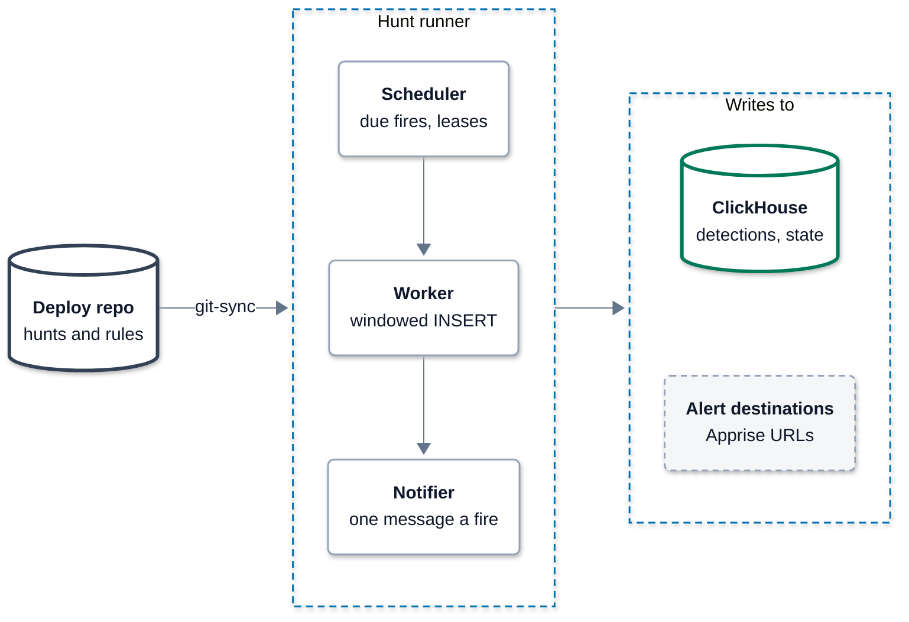

# Hunt runner

The hunt runner is the part of [dfe-engine](architecture.md) that runs each scheduled hunt inside ClickHouse and tells someone when it matched.

| | |
|---|---|
| Repo | [hyperi-io/dfe-engine](https://github.com/hyperi-io/dfe-engine) |
| Image and chart | `ghcr.io/hyperi-io/dfe-engine`, command `dfe-hunt-runner run`. dfe-infra chart `helm/charts/dfe-extras`, `templates/engine-hunt-runner.yaml` |
| Config reference | `DFE_ENGINE_HUNTS_` environment variables (`src/dfe_engine/settings.py`), and the chart's `huntRunner` values |
| Endpoints | None. The runner has no HTTP listener |
| Metrics | `dfe_hunt_*`, pushed over OTLP ([observability standard](deployment/observability-standard.md#the-hunt-runner-pushes-its-metrics)) |

A hunt needs only the deploy repo and ClickHouse to fire.

*Figure 1. L3 Components -- Hunt runner. The dashed grey box is outside DFE.* Up: [L2 Services -- dfe-engine](architecture.md). Down: none.

## How it works

1. The runner loads each hunt file from the synced `config/hunts/` directory, and the file's name is the hunt's id. A hunt that names rules gets one `INSERT ... SELECT` per rule, compiled at load, so a hunt made in dfe-ui runs with no hand-written SQL.
2. Every poll (15 seconds, `huntRunner.poll`) the scheduler finds the fires that are due. A hunt fires once per interval at a stable offset inside the first 80% of it (`hunts.phase_spread_fraction`), so hunts do not all start at once.
3. A due fire waits until every ClickHouse replica holds its window, then the scheduler claims a lease on it in ClickHouse. At most 8 fires run at once across all runner pods (`huntRunner.cap`), so ClickHouse is never flooded.
4. The worker runs the fire's statements over its window, writing matches to the hunt's target table, `detection` by default. It advances the watermark only after they commit.
5. The notifier sends one message per fire whose `alerts` trigger holds. A failed send is logged and the fire stands, because its rows are already written.

## Interfaces

- In: hunt and rule YAML from the deploy repo's `config/hunts/` and `config/rules/`, through a git-sync sidecar.
- In: alert destination URLs, read from the engine's secrets backend on every fire.
- ClickHouse: the source tables it reads, the detection table it writes, and the coordination tables `hunt_lease`, `hunt_watermark`, `hunt_state`, `hunt_run`, `hunt_runner_heartbeat` and `hunt_schedule`.
- Out: Apprise messages to Slack, email, PagerDuty, Teams and the other services Apprise covers.

## Scaling and failure

- One steady pod covers most deployments, since the query load runs in ClickHouse. A second pod competes for the same leases and nothing runs twice.
- A pod that dies mid-fire loses its lease after 300 seconds, and another pod re-runs the window from the last committed watermark. Nothing is lost and nothing is skipped.
- A ClickHouse that is down or full never ends the process. Each tick that hits it is skipped until the next poll.
- A failed fire keeps its watermark, so it stays due. It is retried after 30 seconds, doubling to 600.
- A rule writes at most 1,000 matches a fire (`hunts.max_detections_per_run`), then one summary row with the true count.
- With the API server down, a running pod keeps firing hunts. A pod that is starting waits for it.

## Key metrics

| Metric | Healthy |
|---|---|
| `dfe_hunt_runs_total{outcome}` | Rising, mostly `success` |
| `dfe_hunt_backlog` | Near 0 between fires |
| `dfe_hunt_fire_failures_total{reason}` | Flat |
| `dfe_hunt_clickhouse_unavailable_total` | Flat |
| `dfe_hunt_detections_capped_total` | Flat. A rise means a rule matches more than its cap |

## Related

- [Hunt-runner scaling](data-plane/hunt-runner-scaling.md): the leases, the schedule table and KEDA.
- [Hunt schedule smoothing](data-plane/hunt-schedule-smoothing.md).
- [How a hunt match reaches a person](data-plane/hunt-match-delivery.md).
- [Source detections](data-plane/source-detections.md) and [Sigma](data-plane/sigma.md).
